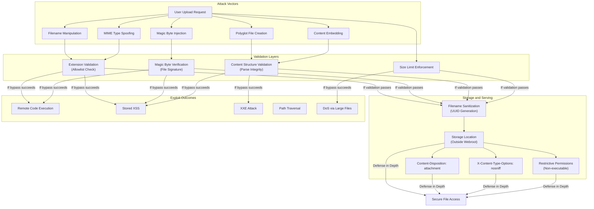
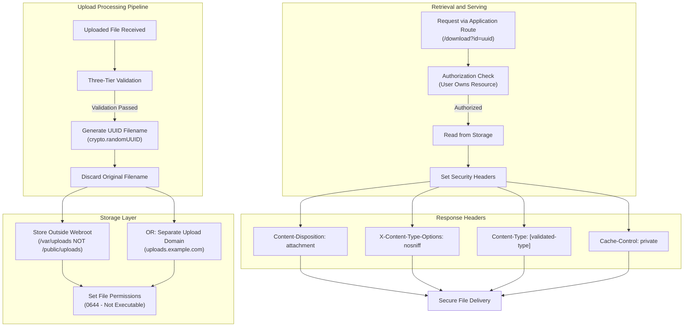
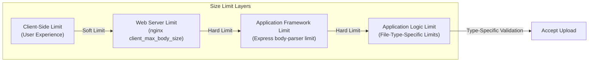
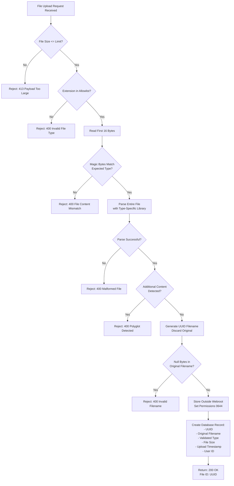

<!-- source: DeepWiki mcp.deepwiki.com · repo BehiSecc/VibeSec-Skill · page 7.5 Insecure File Upload Prevention · fetched 2026-10-26 -->

# Insecure File Upload Prevention

<details>
<summary>Relevant source files</summary>

The following files were used as context for generating this wiki page:

- [SKILL.md](SKILL.md)

</details>


## Purpose and Scope

This page documents secure file upload implementation patterns that prevent exploitation through malicious file uploads. File upload functionality represents a critical attack vector where user-controlled files can introduce server-side code execution, cross-site scripting, XXE attacks, path traversal, and content-type confusion attacks.

This page covers server-side file validation, magic byte verification, bypass technique prevention, and secure storage patterns. For client-side XSS prevention through SVG uploads, see [Cross-Site Scripting (XSS) Prevention](#6.1). For XXE vulnerabilities in document uploads (DOCX, XLSX), see [XML External Entity (XXE) Prevention](#7.3). For path traversal in file extraction, see [Path Traversal Prevention](#7.4).

**Sources:** [SKILL.md:394-454]()

---

## File Upload Attack Surface

The following diagram illustrates the multi-layered attack surface presented by file upload functionality:



**Sources:** [SKILL.md:394-454]()

---

## Three-Tier Validation Architecture

File upload validation must implement three independent validation layers. Relying on a single check creates bypass opportunities.

### Tier 1: File Type Validation

Extension validation provides the first security boundary but must not be the only defense.

**Implementation Requirements:**
- Check file extension against an allowlist (never use blocklist)
- Validate the complete extension, not just the final suffix
- Reject files with multiple extensions or suspicious patterns

**Bypass Prevention:**
- `shell.php.jpg` → Validate full extension chain
- `shell.jpg.php` → Only allow single extension
- `shell.php%00.jpg` → Sanitize filename for null bytes before validation

### Tier 2: Magic Byte Verification

Magic bytes (file signatures) provide cryptographic proof of file type and cannot be spoofed by simply renaming files.

**Magic Bytes Reference Table:**

| File Type | Magic Bytes (Hexadecimal) | Offset |
|-----------|---------------------------|--------|
| JPEG | `FF D8 FF` | 0 |
| PNG | `89 50 4E 47 0D 0A 1A 0A` | 0 |
| GIF87a | `47 49 46 38 37 61` | 0 |
| GIF89a | `47 49 46 38 39 61` | 0 |
| PDF | `25 50 44 46` | 0 |
| ZIP | `50 4B 03 04` | 0 |
| DOCX/XLSX/PPTX | `50 4B 03 04` | 0 (ZIP-based) |

**Implementation Pattern:**

```
Read first N bytes of uploaded file
Compare against expected magic bytes for declared file type
If mismatch: reject upload
If match: proceed to content validation
```

**Bypass Techniques to Block:**
- Prepending valid magic bytes to malicious payload → Validate entire file structure, not just header
- MIME type manipulation in Content-Type header → Always validate magic bytes, never trust HTTP headers

### Tier 3: Content Structure Validation

Content validation verifies the entire file conforms to the expected format specification.

**Image File Validation:**
```
Pass file to image processing library (PIL, ImageMagick, Sharp, etc.)
Attempt to decode/parse the entire image
If parsing fails: reject (indicates malformed or malicious file)
If parsing succeeds: file structure is valid
```

**Document File Validation:**
```
For Office documents (DOCX, XLSX, PPTX):
  - Parse as ZIP archive
  - Scan for embedded macros
  - Check for external entity references (XXE)
  - Validate XML structure of component files
```

**Polyglot File Detection:**

Polyglot files are valid in multiple formats simultaneously (e.g., a file that is both a valid JPEG and valid JavaScript). Content validation must parse the file in the expected format and reject if it contains unexpected structures.

**Sources:** [SKILL.md:398-415](), [SKILL.md:433-443]()

---

## Common Bypass Techniques and Mitigations

The following table catalogs known file upload bypass techniques and their corresponding prevention mechanisms:

| Attack Vector | Technique Example | Attack Mechanism | Prevention Strategy |
|---------------|-------------------|------------------|---------------------|
| **Extension Bypass** | `shell.php.jpg` | Server processes `.php` despite `.jpg` suffix | Validate complete extension; allowlist only; reject multi-extension files |
| **Null Byte Injection** | `shell.php%00.jpg` | Null byte truncates filename parsing | Sanitize filename; explicitly check for `%00` and null bytes; reject if present |
| **Double Extension** | `shell.jpg.php` | Web server processes final extension | Only allow single extension; validate no internal dots except before extension |
| **MIME Type Spoofing** | `Content-Type: image/jpeg` with PHP payload | Server trusts HTTP header | Validate magic bytes; ignore Content-Type header for validation decisions |
| **Magic Byte Injection** | Prepend `FF D8 FF` to PHP shell | File passes header check but contains executable code | Validate entire file structure via parsing library; not just header bytes |
| **Polyglot Files** | File valid as both JPEG and JS | Browser interprets as script despite image MIME type | Parse file as declared type; reject if parsing fails; set `X-Content-Type-Options: nosniff` |
| **SVG with JavaScript** | `<svg onload="alert(1)">` | SVG executed as HTML with embedded JS | Sanitize SVG XML; or disallow SVG entirely; serve with `Content-Disposition: attachment` |
| **XXE via Document Upload** | Malicious DOCX with external entity | Office document triggers XML parser XXE | Disable external entities in XML parser; see [XXE Prevention](#7.3) |
| **ZIP Slip** | Archive contains `../../../etc/passwd` | Path traversal during extraction | Validate extracted paths; canonicalize and check against base directory |
| **ImageMagick Exploits** | Specially crafted image triggers RCE | Image processing library vulnerability | Keep ImageMagick updated; use `policy.xml` to disable dangerous coders |
| **Filename Command Injection** | `; rm -rf /` in filename | Filename used in shell command without sanitization | Generate random UUID filenames; discard original filename entirely |
| **Content-Type Confusion** | Browser MIME sniffs uploaded file | Browser ignores declared MIME type | Set `X-Content-Type-Options: nosniff`; serve from separate domain |

**Sources:** [SKILL.md:417-432]()

---

## Secure Upload Handling Implementation

After validation, file handling must implement defense-in-depth to prevent exploitation even if validation is bypassed.

### File Storage Architecture



### Storage Location Strategies

**Option 1: Outside Webroot (Preferred)**
```
Application root: /var/www/app
Public directory: /var/www/app/public
Upload directory: /var/uploads  (NOT under /var/www/app/public)
```

Files in `/var/uploads` cannot be accessed directly via HTTP. Application serves files through authenticated endpoints with authorization checks.

**Option 2: Separate Upload Domain**
```
Main application: https://app.example.com
Upload domain: https://uploads.example.com
```

Separate domain isolates uploaded content from application cookies and origin context, preventing cookie theft via XSS in uploaded files.

### Filename Sanitization

**Original filename handling:**
```
User uploads: "../../etc/passwd.jpg"
Server generates: "a3f5e9c7-4d2b-4f1a-9e8c-3b5a7d9f2c1e.jpg"
Store mapping: uuid → original filename (for display purposes only)
```

**Implementation:**
- Use `crypto.randomUUID()` or equivalent cryptographic random generator
- Preserve file extension from validated type (not from original filename)
- Store original filename in database for display purposes
- Never use original filename in file system operations

### Response Header Configuration

**Content-Disposition Header:**
```
Content-Disposition: attachment; filename="document.pdf"
```

Forces browser to download file rather than display inline, preventing execution context.

**X-Content-Type-Options Header:**
```
X-Content-Type-Options: nosniff
```

Prevents browser MIME type sniffing, ensuring browser respects declared Content-Type.

**Content-Type Header:**
```
Content-Type: image/jpeg
```

Must match the validated file type from magic byte verification, not the user-declared type.

**Sources:** [SKILL.md:444-454]()

---

## File Size Limit Enforcement

File size limits prevent denial-of-service attacks through resource exhaustion.

### Multi-Layer Size Validation



**Implementation Guidelines:**

| Layer | Configuration Example | Purpose |
|-------|----------------------|---------|
| Client-Side | `<input accept="image/*" max="5MB">` | Improve UX; not security boundary |
| Nginx | `client_max_body_size 10M;` | Prevent extremely large requests from reaching application |
| Express | `app.use(bodyParser({ limit: '10mb' }))` | Framework-level hard limit |
| Application | `if (file.size > 5MB) reject()` | File-type-specific limits (images smaller than videos) |

**File-Type-Specific Limits:**
- Profile images: 2-5 MB
- Document uploads: 10-20 MB
- Video uploads: 100-500 MB
- Archive files: 50-100 MB

**Sources:** [SKILL.md:411-414]()

---

## Validation Workflow Implementation

The following diagram maps validation requirements to specific code-level operations:



**Code-Level Validation Sequence:**

```
1. Receive upload at POST /api/upload endpoint
2. Check Content-Length header <= max_size
3. Extract filename from multipart form data
4. Validate filename extension against ALLOWED_EXTENSIONS array
5. Read first 16 bytes into buffer
6. Compare buffer against MAGIC_BYTES_MAP[extension]
7. If image: call image_library.decode(file_buffer)
8. If document: call document_parser.validate(file_buffer)
9. Generate uuid = crypto.randomUUID()
10. filename_final = uuid + "." + validated_extension
11. Check os.path.contains_null_bytes(original_filename)
12. Write to UPLOAD_DIR/filename_final with mode=0o644
13. INSERT INTO uploads (id, original_name, type, size, user_id) VALUES (...)
14. Return JSON response with file ID
```

**Sources:** [SKILL.md:398-415]()

---

## Edge Cases and Advanced Attacks

### ImageMagick Exploit Prevention

ImageMagick has a history of RCE vulnerabilities through specially crafted image files. When using ImageMagick or similar image processing libraries:

**Mitigation:**
- Keep ImageMagick updated to latest version
- Implement `policy.xml` to disable dangerous coders:
  ```xml
  <policy domain="coder" rights="none" pattern="EPHEMERAL" />
  <policy domain="coder" rights="none" pattern="URL" />
  <policy domain="coder" rights="none" pattern="HTTPS" />
  <policy domain="coder" rights="none" pattern="MVG" />
  <policy domain="coder" rights="none" pattern="MSL" />
  ```
- Consider alternative libraries (Sharp, Pillow) with better security track records

### SVG File Handling

SVG files are XML-based and can contain JavaScript, making them high-risk for stored XSS.

**Option 1: Disallow SVG Entirely** (Recommended)
```
ALLOWED_EXTENSIONS = ['.jpg', '.jpeg', '.png', '.gif', '.webp']
# Note: .svg intentionally excluded
```

**Option 2: Sanitize SVG**
```
1. Parse SVG as XML
2. Strip all <script> tags
3. Remove event handler attributes (onload, onclick, etc.)
4. Remove <foreignObject> elements
5. Allowlist safe SVG elements and attributes
6. Serve with Content-Disposition: attachment
```

### ZIP Archive Handling

ZIP files present multiple attack vectors:

**ZIP Slip Prevention:**
```python
import zipfile
import os

def safe_extract(zip_path, extract_to):
    base = os.path.abspath(extract_to)
    with zipfile.ZipFile(zip_path) as zf:
        for member in zf.namelist():
            member_path = os.path.abspath(os.path.join(extract_to, member))
            if not member_path.startswith(base):
                raise Exception("ZIP Slip attack detected")
            zf.extract(member, extract_to)
```

**ZIP Bomb Detection:**
```
Check uncompressed_size before extraction
If uncompressed_size / compressed_size > 100: reject
If uncompressed_size > 1GB: reject
```

**Sources:** [SKILL.md:427-432]()

---

## Complete Implementation Checklist

Use this checklist to verify file upload implementation security:

### Validation Layer
- [ ] File extension validated against allowlist (not blocklist)
- [ ] Full extension validated (reject `file.php.jpg`)
- [ ] Single extension enforced (reject multiple dots before extension)
- [ ] Null bytes checked and rejected in filename
- [ ] Magic bytes read and verified against expected type
- [ ] Entire file parsed with type-specific library
- [ ] File size validated (per-type limits enforced)
- [ ] Content-Length header checked before processing

### Storage Layer
- [ ] Original filename discarded
- [ ] UUID-based filename generated with cryptographic randomness
- [ ] Files stored outside webroot OR on separate domain
- [ ] File permissions set to non-executable (0644)
- [ ] Web server configured to prevent direct file execution
- [ ] Database record created with UUID → original filename mapping

### Retrieval Layer
- [ ] Files served through authenticated endpoint (not static paths)
- [ ] Authorization check verifies user owns/can access file
- [ ] `Content-Disposition: attachment` header set
- [ ] `X-Content-Type-Options: nosniff` header set
- [ ] `Content-Type` header matches validated type
- [ ] `Cache-Control` header set appropriately

### Special File Types
- [ ] SVG uploads disallowed OR sanitized with XML parser
- [ ] Office documents scanned for macros and external entities
- [ ] ZIP archives validated for ZIP slip and ZIP bombs
- [ ] PDF files validated for embedded JavaScript
- [ ] ImageMagick policy.xml configured if using ImageMagick

### Configuration
- [ ] Web server `client_max_body_size` / equivalent configured
- [ ] Application framework body parser limit configured
- [ ] Upload directory has restricted file system permissions
- [ ] Separate upload domain configured with CDN (optional but recommended)

**Sources:** [SKILL.md:394-454]()

---

## Related Security Considerations

File uploads intersect with multiple other security domains:

- **Access Control:** Verify user authorization before allowing file access. See [Access Control & Authorization](#5)
- **XSS via Uploads:** SVG and HTML file uploads can execute scripts. See [Cross-Site Scripting (XSS) Prevention](#6.1)
- **XXE via Documents:** DOCX, XLSX, SVG contain XML that can trigger XXE. See [XML External Entity (XXE) Prevention](#7.3)
- **Path Traversal:** File extraction and storage must canonicalize paths. See [Path Traversal Prevention](#7.4)
- **SSRF via URLs:** If accepting URLs for file import, validate destination. See [Server-Side Request Forgery (SSRF) Prevention](#7.1)

**Sources:** [SKILL.md:394-454]()

---

