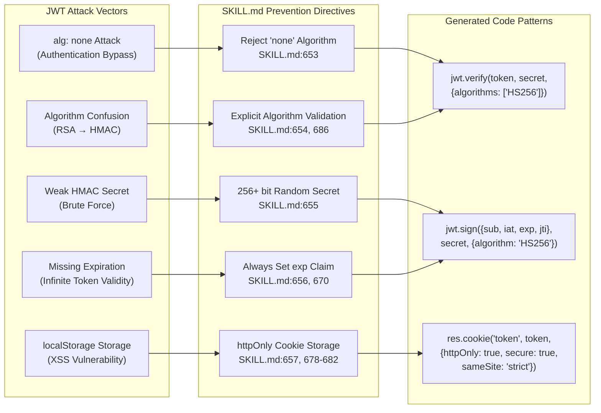

<!-- source: DeepWiki mcp.deepwiki.com · repo BehiSecc/VibeSec-Skill · page 8 Authentication & Session Security · fetched 2026-10-26 -->

# Authentication & Session Security

<details>
<summary>Relevant source files</summary>

The following files were used as context for generating this wiki page:

- [SKILL.md](SKILL.md)

</details>


## Purpose and Scope

This page provides an overview of authentication and session security guidance provided by VibeSec-Skill. It covers the two primary authentication mechanisms addressed by the skill:

- **Password Security**: Requirements for password policies and secure storage mechanisms
- **JWT Security**: Secure implementation of JSON Web Tokens for stateless authentication

For implementation details on password hashing algorithms and storage, see [Password Security](#8.1). For comprehensive JWT implementation patterns and vulnerability prevention, see [JWT Security](#8.2).

This page does not cover access control and authorization checks, which are addressed in [Access Control & Authorization](#5). It also does not cover CSRF protection for session-based authentication, which is covered in [CSRF Protection](#6.2).

**Sources:** [SKILL.md:305-318](), [SKILL.md:645-702]()

---

## Overview

VibeSec-Skill provides security directives for authentication mechanisms to prevent common vulnerabilities that lead to account compromise, session hijacking, and authentication bypass. The skill addresses two distinct authentication patterns commonly generated by AI coding assistants:

| Authentication Pattern | Primary Vulnerabilities Addressed | SKILL.md Coverage |
|------------------------|-----------------------------------|-------------------|
| Password-based | Weak hashing algorithms, insufficient password complexity, plaintext storage | Lines 305-318 |
| Token-based (JWT) | Algorithm confusion, missing expiration, insecure storage, weak secrets | Lines 645-702 |

The skill instructs AI models to implement defense-in-depth authentication security by combining multiple controls:
- Strong cryptographic storage for credentials
- Short-lived tokens with explicit expiration
- Secure transport and storage mechanisms (httpOnly cookies, SameSite attributes)
- Algorithm validation and secret management

**Sources:** [SKILL.md:305-318](), [SKILL.md:645-702]()

---

## Authentication Security Architecture

The following diagram illustrates how VibeSec-Skill guides AI platforms to generate authentication code with layered security controls:

```mermaid
graph TB
    subgraph "User Authentication Flow"
        User["User Credentials<br/>(username + password)"]
        LoginEndpoint["Login Endpoint"]
        PasswordVerify["Password Verification"]
        TokenGen["Token Generation"]
        SessionStore["Session/Token Storage"]
    end
    
    subgraph "VibeSec-Skill Directives"
        PWRequirements["Password Requirements<br/>SKILL.md:307-312"]
        PWStorage["Secure Storage<br/>SKILL.md:314-318<br/>(Argon2id/bcrypt/scrypt)"]
        JWTSign["jwt.sign()<br/>SKILL.md:663-674<br/>(algorithm, exp, jti)"]
        JWTCookie["Cookie Settings<br/>SKILL.md:676-682<br/>(httpOnly, secure, sameSite)"]
        JWTVerify["jwt.verify()<br/>SKILL.md:686-691<br/>(algorithms allowlist)"]
    end
    
    subgraph "Security Controls Applied"
        HashCheck["Hash Comparison<br/>(Argon2id.verify/bcrypt.compare)"]
        TokenClaims["Token Claims<br/>(sub, iat, exp, jti)"]
        CookieAttribs["Cookie Attributes<br/>(httpOnly: true<br/>secure: true<br/>sameSite: 'strict')"]
        AlgoValidation["Algorithm Validation<br/>(algorithms: ['HS256'])"]
    end
    
    User --> LoginEndpoint
    LoginEndpoint --> PasswordVerify
    
    PWRequirements -.->|"Enforced during<br/>registration"| User
    PWStorage -.->|"Guides storage<br/>implementation"| PasswordVerify
    
    PasswordVerify --> HashCheck
    HashCheck -->|"Valid"| TokenGen
    
    JWTSign -.->|"Guides token<br/>creation"| TokenGen
    TokenGen --> TokenClaims
    TokenClaims --> SessionStore
    
    JWTCookie -.->|"Guides cookie<br/>settings"| SessionStore
    SessionStore --> CookieAttribs
    
    CookieAttribs -->|"Sent to client"| AuthToken["Authentication Token<br/>(in httpOnly cookie)"]
    
    AuthToken -->|"Subsequent requests"| ProtectedEndpoint["Protected Endpoint"]
    ProtectedEndpoint --> TokenValidation["Token Validation"]
    
    JWTVerify -.->|"Guides verification<br/>logic"| TokenValidation
    TokenValidation --> AlgoValidation
    AlgoValidation -->|"Valid"| AccessGranted["Access Granted"]
```



**Sources:** [SKILL.md:305-318](), [SKILL.md:663-691]()

---

## Password Security

### Core Requirements

VibeSec-Skill directs AI models to implement password policies that balance security with usability:

| Requirement | Specification | Rationale |
|-------------|---------------|-----------|
| Minimum length | 8 characters (12+ recommended) | Prevents brute force attacks |
| Maximum length | None (or very high, e.g., 128 chars) | Allows passphrase use |
| Character requirements | Allow all characters including special chars | User choice over forced complexity |
| Character type enforcement | Not required | Avoids predictable patterns |

**Sources:** [SKILL.md:307-312]()

### Storage Mechanisms

The skill explicitly prohibits weak hashing algorithms and mandates secure alternatives:

**Prohibited Algorithms:**
- `MD5` - cryptographically broken
- `SHA1` - vulnerable to collision attacks  
- `SHA256` (plain) - too fast, vulnerable to brute force
- Plaintext storage

**Required Algorithms:**
- `Argon2id` (preferred)
- `bcrypt`
- `scrypt`

These algorithms are specifically designed for password hashing with built-in salting and computational cost factors that resist brute force attacks.

For detailed implementation patterns and language-specific examples, see [Password Security](#8.1).

**Sources:** [SKILL.md:314-318]()

---

## JWT Security

### Vulnerability Coverage

VibeSec-Skill addresses five critical JWT vulnerability classes:



**Sources:** [SKILL.md:645-702]()

### Token Implementation Pattern

VibeSec-Skill provides a three-phase JWT implementation pattern that AI models follow when generating authentication code:

**Phase 1: Token Signing** ([SKILL.md:663-674]())
```
jwt.sign({
  sub: userId,                    // Subject claim
  iat: Math.floor(Date.now() / 1000),  // Issued at
  exp: Math.floor(Date.now() / 1000) + (15 * 60),  // 15 min expiration
  jti: crypto.randomUUID()        // Unique token ID
}, process.env.JWT_SECRET, { 
  algorithm: 'HS256' 
})
```

**Phase 2: Token Storage** ([SKILL.md:676-682]())
```
res.cookie('token', token, {
  httpOnly: true,   // Prevents XSS access
  secure: true,     // HTTPS only
  sameSite: 'strict'  // CSRF protection
})
```

**Phase 3: Token Verification** ([SKILL.md:686-691]())
```
jwt.verify(token, secret, { algorithms: ['HS256'] }, callback)
```

The critical security control is the `algorithms` allowlist in verification, which prevents algorithm confusion attacks where attackers change the token header to use a different algorithm.

For comprehensive JWT vulnerability details, secure implementation examples, and verification checklists, see [JWT Security](#8.2).

**Sources:** [SKILL.md:663-691]()

---

## Session Security Controls

The following table maps session security requirements to specific VibeSec-Skill directives and generated code patterns:

| Security Control | SKILL.md Directive | Generated Code Pattern | Protection Against |
|------------------|-------------------|----------------------|-------------------|
| httpOnly cookie flag | Line 679 | `httpOnly: true` | XSS-based session theft |
| Secure cookie flag | Line 680 | `secure: true` | Man-in-the-middle attacks |
| SameSite attribute | Line 681 | `sameSite: 'strict'` | CSRF attacks |
| Short token lifetime | Line 670 | `exp: iat + (15 * 60)` | Token replay attacks |
| Unique token ID | Line 671 | `jti: crypto.randomUUID()` | Token revocation support |
| Secret from environment | Line 665 | `process.env.JWT_SECRET` | Secret exposure in code |
| Algorithm allowlist | Line 686 | `algorithms: ['HS256']` | Algorithm confusion |

**Sources:** [SKILL.md:663-691]()

---

## Integration with Access Control

Authentication security in VibeSec-Skill integrates with authorization checks to create a complete access control system:

```mermaid
sequenceDiagram
    participant Client
    participant AuthEndpoint["Authentication Endpoint"]
    participant JWTVerify["jwt.verify()<br/>(SKILL.md:686-691)"]
    participant ResourceEndpoint["Protected Resource Endpoint"]
    participant AuthZCheck["Authorization Check<br/>(SKILL.md:29-74)"]
    participant Resource["Resource Data"]
    
    Client->>AuthEndpoint: "POST /login<br/>{username, password}"
    
    Note over AuthEndpoint: Password verification<br/>(Argon2id/bcrypt)<br/>SKILL.md:314-318
    
    AuthEndpoint->>Client: "Set-Cookie: token=...<br/>(httpOnly, secure, sameSite)"
    
    Note over Client: Cookie stored<br/>automatically by browser
    
    Client->>ResourceEndpoint: "GET /api/resource/uuid<br/>Cookie: token=..."
    
    ResourceEndpoint->>JWTVerify: "Verify token"
    
    Note over JWTVerify: Algorithm validation<br/>algorithms: ['HS256']<br/>Expiration check
    
    JWTVerify-->>ResourceEndpoint: "decoded.sub = userId"
    
    ResourceEndpoint->>AuthZCheck: "Check resource ownership<br/>(resourceId, userId)"
    
    Note over AuthZCheck: Verify resource.ownerId<br/>== currentUser.id<br/>SKILL.md:63-74
    
    AuthZCheck-->>ResourceEndpoint: "Authorized"
    
    ResourceEndpoint->>Resource: "Fetch resource"
    Resource-->>ResourceEndpoint: "Resource data"
    ResourceEndpoint-->>Client: "200 OK + data"
```

**Key Integration Points:**

1. **Authentication → Authorization**: After `jwt.verify()` extracts `userId` from token claims (line 686-691), the application passes it to ownership verification checks (line 63-74)

2. **Session Revocation**: The `jti` claim (line 671) enables token revocation when users are removed from organizations (line 39-41)

3. **Defense in Depth**: Authentication validates the user identity, but authorization checks prevent horizontal/vertical access violations (line 53-56)

For detailed authorization patterns including IDOR prevention and privilege escalation checks, see [Access Control & Authorization](#5).

**Sources:** [SKILL.md:39-41](), [SKILL.md:63-74](), [SKILL.md:671](), [SKILL.md:686-691]()

---

## Security Checklist Integration

VibeSec-Skill provides verification checklists that AI models include as comments when generating authentication code:

### Password Security Checklist
From [SKILL.md:307-318]():
- [ ] Minimum 8 characters enforced (12+ recommended)
- [ ] No maximum length restriction (or very high limit)
- [ ] All character types allowed
- [ ] Password stored using Argon2id, bcrypt, or scrypt
- [ ] Never MD5, SHA1, or plain SHA256

### JWT Security Checklist  
From [SKILL.md:695-702]():
- [ ] Algorithm explicitly specified on verification (never trust token header)
- [ ] `alg: none` rejected
- [ ] Secret is 256+ bits of random data (not a password or phrase)
- [ ] `exp` claim always set and validated
- [ ] Tokens stored in httpOnly cookies (not localStorage/sessionStorage)
- [ ] Refresh token rotation implemented (old refresh token invalidated on use)

These checklists appear as inline comments in generated code, serving as both implementation guidance and security documentation.

**Sources:** [SKILL.md:307-318](), [SKILL.md:695-702]()

---

