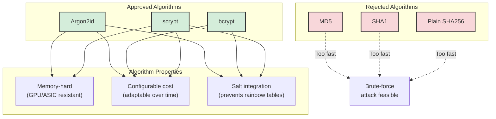
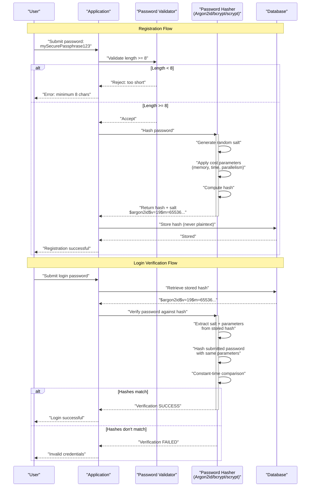
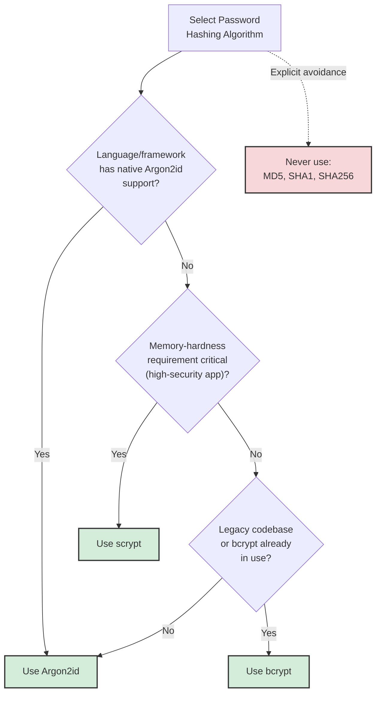

<!-- source: DeepWiki mcp.deepwiki.com · repo BehiSecc/VibeSec-Skill · page 8.1 Password Security · fetched 2026-10-26 -->

# Password Security

<details>
<summary>Relevant source files</summary>

The following files were used as context for generating this wiki page:

- [SKILL.md](SKILL.md)

</details>


This document covers password security requirements and storage mechanisms as defined in the VibeSec-Skill security guidance. It addresses the minimum security standards for password handling, including password strength requirements and cryptographic storage algorithms that AI-generated code should implement.

For JWT-based authentication security, see [JWT Security](#8.2). For general authentication patterns and access control, see [Authentication & Session Security](#8) and [Access Control & Authorization](#5).

**Sources:** [SKILL.md:305-318]()

---

## Overview

Password security in VibeSec-Skill operates on two distinct principles:

1. **User-Friendly Requirements**: Avoid restrictive password policies that force users into predictable patterns
2. **Strong Cryptographic Storage**: Use modern, computationally expensive hashing algorithms designed specifically for password storage

This dual approach recognizes that password complexity rules often lead to weaker passwords (e.g., `Password1!`), while proper cryptographic storage protects even weaker passwords from brute-force attacks.

**Sources:** [SKILL.md:305-318]()

---

## Password Requirements

### Recommended Policy

The VibeSec-Skill guidance defines password requirements that balance security with usability:

| Requirement | Specification | Rationale |
|------------|---------------|-----------|
| Minimum Length | 8 characters (12+ recommended) | Provides baseline entropy without excessive friction |
| Maximum Length | None (or very high, e.g., 128 chars) | Allows passphrases and password manager-generated passwords |
| Character Types | All characters allowed (including special chars) | Enables diverse password strategies |
| Composition Rules | No mandatory character type requirements | Avoids forcing predictable patterns like `Password1!` |

### Anti-Pattern: Restrictive Complexity Rules

Traditional complexity requirements (e.g., "must contain uppercase, lowercase, number, and symbol") are explicitly discouraged because they:

- Force users into predictable patterns (`Aa1!` suffix patterns)
- Reduce effective password space by eliminating simple but long passphrases
- Create friction that leads to password reuse across services

**Sources:** [SKILL.md:307-312]()

---

## Password Storage Algorithms

### Secure Hashing Functions

VibeSec-Skill mandates the use of password-specific hashing algorithms that incorporate key-stretching and resistance to hardware acceleration attacks:



**Diagram: Approved vs. Rejected Password Hashing Algorithms**

**Sources:** [SKILL.md:314-318]()

#### Argon2id (Recommended)

Argon2id is the preferred algorithm as it combines resistance to both side-channel timing attacks (Argon2i) and GPU/ASIC cracking (Argon2d). It is memory-hard, making parallelized cracking economically infeasible.

**Key Properties:**
- Winner of the Password Hashing Competition (2015)
- Memory-hard (configurable memory cost)
- Time-hard (configurable time cost)
- Parallelism parameter for multi-core resistance

#### bcrypt

bcrypt is a widely-supported alternative with decades of proven security. It uses the Blowfish cipher and incorporates a cost factor that can be increased over time as hardware improves.

**Key Properties:**
- Battle-tested since 1999
- Adaptive cost factor (work factor rounds)
- Built-in salt generation
- Wide language/framework support

#### scrypt

scrypt is a memory-hard key derivation function designed to make hardware brute-force attacks expensive by requiring significant memory allocation.

**Key Properties:**
- Memory-hard (configurable N parameter)
- CPU-hard (configurable r parameter)
- Parallelization control (p parameter)
- Originally designed for Tarsnap backup service

**Sources:** [SKILL.md:314-318]()

---

## Forbidden Algorithms

The following algorithms **must never be used** for password storage, as explicitly stated in SKILL.md:

### MD5
- Cryptographically broken since 2004
- Designed for speed, not password storage
- Collision vulnerabilities render it unsuitable even with salts

### SHA1
- Deprecated by NIST in 2011
- SHAttered attack (2017) demonstrated practical collision attacks
- Too fast for password hashing (billions of hashes per second on GPU)

### Plain SHA256
- While not cryptographically broken, SHA256 is designed for data integrity, not password storage
- Too fast: Modern GPUs can compute billions of SHA256 hashes per second
- No built-in salt or iteration mechanism
- Lacks memory-hardness properties needed to resist dedicated hardware

**Sources:** [SKILL.md:317-318]()

---

## Password Security Architecture

### Storage and Verification Flow



**Diagram: Password Registration and Verification Sequence**

**Sources:** [SKILL.md:305-318]()

---

## Implementation Requirements

### Password Validation

When AI-generated code implements password validation, it should:

1. **Enforce Minimum Length**: Check `password.length >= 8` (or preferably `>= 12`)
2. **No Maximum Restrictions**: Avoid arbitrary caps like 32 or 64 characters
3. **Allow All Characters**: Accept unicode, special characters, spaces, emojis
4. **No Composition Enforcement**: Do not require specific character types

**Example Validation Logic:**
```
function isValidPassword(password):
    if password.length < 8:
        return false, "Password must be at least 8 characters"
    
    if password.length > 128:
        return false, "Password exceeds maximum length"
    
    return true, null
```

**Sources:** [SKILL.md:307-312]()

### Password Storage

When AI-generated code implements password storage, it must:

1. **Select Approved Algorithm**: Use Argon2id, bcrypt, or scrypt
2. **Never Store Plaintext**: Always hash before database insertion
3. **Use Framework Functions**: Leverage built-in hashing functions where available
4. **Configure Adequate Cost**: Use recommended cost parameters for the chosen algorithm

**Example Storage Pattern:**
```
// Pseudocode for secure password storage
function registerUser(username, password):
    # Validate password meets requirements
    if not isValidPassword(password):
        return error
    
    # Hash using approved algorithm
    hashedPassword = argon2id.hash(password, {
        memoryCost: 65536,  # 64 MB
        timeCost: 3,         # 3 iterations
        parallelism: 4       # 4 threads
    })
    
    # Store hash, never plaintext
    database.insert({
        username: username,
        passwordHash: hashedPassword
    })
```

**Sources:** [SKILL.md:314-318]()

---

## Algorithm Selection Decision Tree



**Diagram: Password Hashing Algorithm Selection**

**Sources:** [SKILL.md:314-318]()

---

## Security Rationale

### Why Memory-Hard Functions?

Traditional cryptographic hash functions (SHA family, MD5) were designed for speed and low resource consumption. This makes them optimal for data integrity checking but catastrophic for password storage:

| Attack Method | SHA256 Performance | Argon2id Performance | Protection Factor |
|--------------|-------------------|---------------------|-------------------|
| GPU (RTX 4090) | ~60 billion hashes/sec | ~10,000 hashes/sec | 6,000,000x slower |
| ASIC Mining Rig | ~400 billion hashes/sec | Not economical | Hardware-resistant |
| Distributed Botnet | Linearly scales | Memory costs prevent scaling | Anti-parallelization |

Memory-hard functions like Argon2id force each hash computation to allocate substantial RAM (typically 64MB+), making mass parallelization on GPUs or custom hardware economically infeasible.

### Salt Integration

All approved algorithms (Argon2id, bcrypt, scrypt) automatically generate and integrate unique salts for each password. This prevents:

- **Rainbow Table Attacks**: Pre-computed hash tables become useless
- **Duplicate Password Detection**: Two users with identical passwords store different hashes
- **Batch Cracking**: Each password must be attacked individually

**Sources:** [SKILL.md:314-318]()

---

## Common Implementation Pitfalls

### Anti-Pattern 1: Custom Password Complexity Rules

```
# INCORRECT - Forces predictable patterns
function validatePassword(password):
    hasUppercase = /[A-Z]/.test(password)
    hasLowercase = /[a-z]/.test(password)
    hasNumber = /[0-9]/.test(password)
    hasSpecial = /[!@#$%^&*]/.test(password)
    
    return hasUppercase AND hasLowercase AND hasNumber AND hasSpecial
```

**Problem**: Users will choose `Password1!` patterns, reducing effective entropy.

**Correct Approach**: Enforce only minimum length, allowing diverse strategies like passphrases.

### Anti-Pattern 2: Using SHA256 with Salt

```
# INCORRECT - SHA256 is too fast
hashedPassword = sha256(password + salt)
```

**Problem**: Even with salt, GPU-based attacks can test billions of candidates per second.

**Correct Approach**: Use purpose-built password hashing functions.

### Anti-Pattern 3: Fixed Maximum Length

```
# INCORRECT - Blocks passphrases and password managers
if password.length > 32:
    return "Password too long"
```

**Problem**: Prevents secure long passphrases and auto-generated passwords.

**Correct Approach**: Set high limits (128+ characters) or remove maximum entirely.

**Sources:** [SKILL.md:305-318]()

---

## Integration with VibeSec-Skill Workflow

When developers prompt AI platforms with VibeSec-Skill installed:

1. **Prompt Recognition**: Keywords like "user registration", "password storage", or "authentication" trigger password security guidance
2. **Requirement Injection**: AI applies the 8-character minimum, no-composition-rule policy from [SKILL.md:307-312]()
3. **Algorithm Selection**: AI selects Argon2id/bcrypt/scrypt based on language/framework context
4. **Anti-Pattern Avoidance**: AI explicitly avoids MD5, SHA1, SHA256 per [SKILL.md:317-318]()
5. **Code Generation**: Output includes properly configured hashing with comments explaining security rationale

This automated guidance eliminates the most common password storage vulnerabilities (weak hashing, plaintext storage, overly restrictive policies) at code generation time.

**Sources:** [SKILL.md:1-557]()

---

## Verification Checklist

For AI-generated password handling code, verify:

- [ ] Minimum length requirement enforced (8+ characters)
- [ ] No arbitrary maximum length restriction (or set to 128+)
- [ ] All characters allowed (no character type composition rules)
- [ ] Password hashed using Argon2id, bcrypt, or scrypt
- [ ] MD5, SHA1, and plain SHA256 are NOT used
- [ ] Plaintext passwords never stored in database
- [ ] Salt generation is automatic (built into hashing function)
- [ ] Cost parameters configured appropriately for chosen algorithm
- [ ] Password comparison uses constant-time algorithm (prevents timing attacks)

**Sources:** [SKILL.md:305-318]()

---

