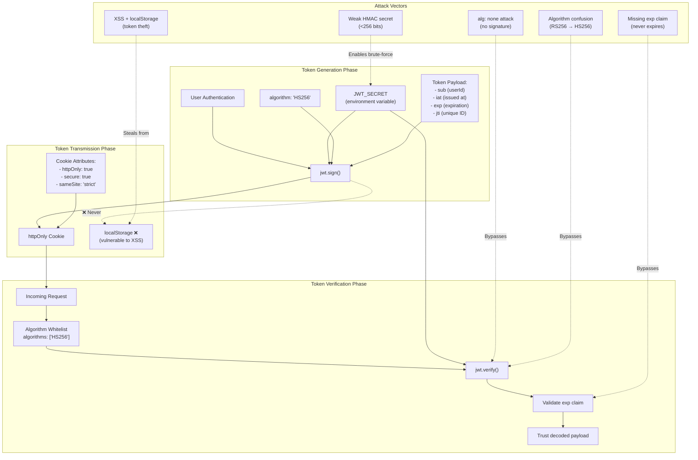
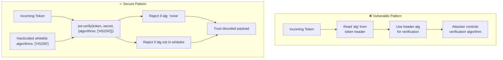
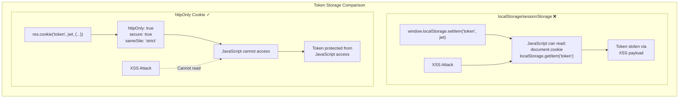
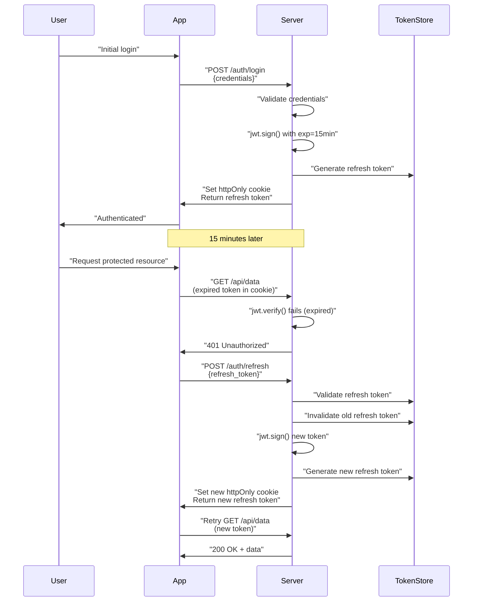
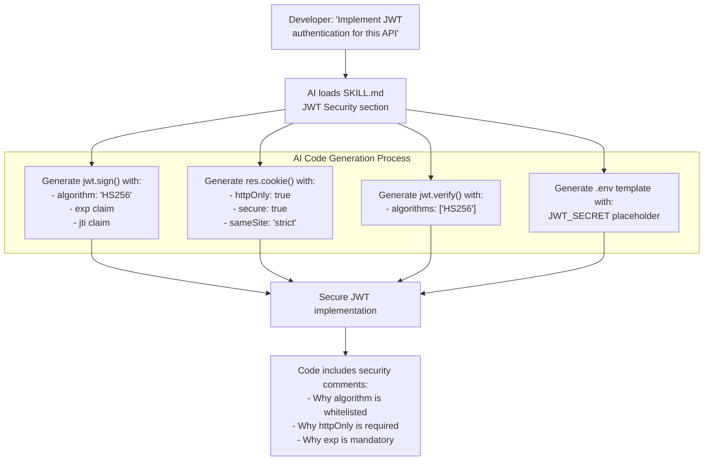

<!-- source: DeepWiki mcp.deepwiki.com · repo BehiSecc/VibeSec-Skill · page 8.2 JWT Security · fetched 2026-10-26 -->

# JWT Security

<details>
<summary>Relevant source files</summary>

The following files were used as context for generating this wiki page:

- [SKILL.md](SKILL.md)

</details>


## Purpose and Scope

This document covers JWT (JSON Web Token) security requirements and secure implementation patterns as defined in VibeSec-Skill. It addresses common JWT vulnerabilities including algorithm confusion attacks, token forgery, and insecure storage practices that can lead to authentication bypass.

For general password-based authentication security, see [Password Security](#8.1). For broader API authentication patterns, see [API Security](#9).

**Sources:** [SKILL.md:645-702]()

---

## JWT Token Lifecycle and Attack Surface



This diagram illustrates the complete JWT lifecycle from generation through verification, showing the three critical phases where security controls must be enforced. The token generation phase establishes the cryptographic foundation through proper algorithm selection and strong secrets. The transmission phase determines attack surface through storage mechanism choice. The verification phase prevents token forgery through strict algorithm validation. Attack vectors target weaknesses in each phase: `alg: none` attacks exploit missing signature verification, algorithm confusion attacks exploit type confusion between symmetric and asymmetric algorithms, weak secrets enable brute-force attacks, missing expiration enables indefinite token validity, and localStorage storage enables XSS-based token theft.

**Sources:** [SKILL.md:662-692]()

---

## JWT Vulnerability Matrix

| Vulnerability | Attack Mechanism | Prevention Requirement |
|--------------|------------------|------------------------|
| `alg: none` attack | Token header sets `"alg": "none"`, removing signature requirement entirely | Always verify algorithm server-side; explicitly reject `none` algorithm |
| Algorithm confusion | Token changes algorithm from `RS256` (asymmetric) to `HS256` (symmetric), allowing attacker to sign with public key | Explicitly specify expected algorithm in `jwt.verify()`; never derive algorithm from token header |
| Weak HMAC secrets | Short or predictable secrets enable brute-force attacks to forge tokens | Use 256+ bit cryptographically random secrets; never use passwords or phrases |
| Missing expiration | Tokens without `exp` claim remain valid indefinitely, even after logout or compromise | Always set `exp` claim during token generation; validate expiration on every verification |
| Token in localStorage | XSS attacks can read localStorage, stealing tokens for session hijacking | Store tokens in `httpOnly`, `Secure`, `sameSite=Strict` cookies only |

**Sources:** [SKILL.md:649-658]()

---

## Algorithm Validation Architecture

The most critical JWT security requirement is algorithm validation. The verification process must whitelist allowed algorithms explicitly rather than trusting the algorithm specified in the token header.



The vulnerable pattern reads the algorithm from the token header and uses it for verification, giving attackers control over the verification process. The secure pattern enforces a server-side algorithm whitelist passed to `jwt.verify()`, rejecting any token that doesn't match the expected algorithm regardless of what the token header claims.

**Sources:** [SKILL.md:653-654](), [SKILL.md:686-691]()

---

## Secure Token Generation Pattern

Token generation establishes the security foundation through proper claim selection, algorithm specification, and secret management.

### Token Signing Process

[SKILL.md:663-674]() demonstrates the secure signing pattern:

```
jwt.sign({
  sub: userId,
  iat: Math.floor(Date.now() / 1000),
  exp: Math.floor(Date.now() / 1000) + (15 * 60),
  jti: crypto.randomUUID()
}, secret, { 
  algorithm: 'HS256' 
})
```

### Required Token Claims

| Claim | Purpose | Security Requirement |
|-------|---------|---------------------|
| `sub` | Subject identifier (user ID) | Non-guessable identifier; prefer UUIDs over sequential integers |
| `iat` | Issued at timestamp | Enables token age validation; prevents pre-dating attacks |
| `exp` | Expiration timestamp | **Mandatory**; tokens without expiration remain valid indefinitely |
| `jti` | JWT ID (unique identifier) | Enables token revocation/blacklisting; must be cryptographically random |

### Secret Management

The JWT secret ([SKILL.md:665]()) must be:
- Stored in environment variables (`process.env.JWT_SECRET`)
- Never hardcoded in source code
- 256+ bits of cryptographic randomness
- Not derived from passwords or phrases

Short-lived tokens (15 minutes in the example) reduce the impact of token theft. The `jti` claim provides a revocation mechanism for cases where tokens must be invalidated before expiration.

**Sources:** [SKILL.md:663-674](), [SKILL.md:655-656](), [SKILL.md:669-671]()

---

## Token Storage and Transmission Security

Token storage mechanism directly determines XSS attack surface. VibeSec-Skill requires cookie-based storage with specific security attributes.



### Cookie Attribute Requirements

[SKILL.md:678-682]() specifies three mandatory cookie attributes:

| Attribute | Value | Protection Provided |
|-----------|-------|---------------------|
| `httpOnly` | `true` | Prevents JavaScript access via `document.cookie`; mitigates XSS token theft |
| `secure` | `true` | Ensures transmission only over HTTPS; prevents network sniffing |
| `sameSite` | `'strict'` | Prevents cross-site request inclusion; mitigates CSRF attacks |

The combination of `httpOnly` and XSS protection creates defense in depth: even if XSS vulnerabilities exist, tokens remain inaccessible to attacker-controlled JavaScript. The `sameSite` attribute provides CSRF protection independent of CSRF tokens.

**Sources:** [SKILL.md:657](), [SKILL.md:678-682](), [SKILL.md:700]()

---

## Token Verification and Algorithm Whitelisting

The verification phase must prevent token forgery through strict algorithm validation and secret verification.

### Verification Process Requirements

[SKILL.md:685-691]() demonstrates the secure verification pattern:

```
jwt.verify(token, secret, { algorithms: ['HS256'] }, (err, decoded) => {
  if (err) {
    // Handle invalid token
  }
  // Trust the payload
})
```

### Critical Verification Controls

1. **Algorithm Whitelist**: The `algorithms` parameter ([SKILL.md:686]()) must be explicitly provided. Never call `jwt.verify(token, secret)` without this parameter, as it allows the token header to specify the algorithm.

2. **Rejection of `alg: none`**: [SKILL.md:653]() requires explicit rejection of unsigned tokens. When `algorithms: ['HS256']` is specified, tokens with `"alg": "none"` are automatically rejected.

3. **Secret Validation**: The same secret used in `jwt.sign()` must be used in `jwt.verify()`. Secret rotation requires invalidating all existing tokens.

4. **Expiration Validation**: The verification library automatically validates the `exp` claim ([SKILL.md:656]()). Tokens past expiration are rejected with an error.

### Error Handling

Verification failures must be handled securely:
- Invalid signature: reject with generic "unauthorized" error
- Expired token: reject with generic "unauthorized" error  
- Missing claims: reject with generic "unauthorized" error
- Never expose specific failure reasons to prevent information leakage

**Sources:** [SKILL.md:685-691](), [SKILL.md:653-654](), [SKILL.md:696-697]()

---

## Token Lifecycle Management

JWT security requires proper lifecycle management including expiration and refresh token patterns.



### Expiration Strategy

[SKILL.md:670]() specifies short-lived access tokens (15 minutes). This limits the window of opportunity for stolen tokens while balancing user experience.

### Refresh Token Pattern

[SKILL.md:701]() requires refresh token rotation:
- Refresh tokens enable obtaining new access tokens without re-authentication
- Old refresh token is invalidated when used to prevent replay attacks
- Refresh tokens stored server-side (database) for revocation capability
- Refresh token reuse indicates potential compromise; invalidate all user sessions

### Revocation Requirements

[SKILL.md:671]() demonstrates using `jti` claim for revocation. Server maintains a blacklist or uses stateful tokens:
- Store `jti` values in database with expiration
- On logout: add current token's `jti` to blacklist
- On verification: check if `jti` is blacklisted
- Blacklist entries expire after token's `exp` time

**Sources:** [SKILL.md:669-671](), [SKILL.md:701]()

---

## JWT Implementation Checklist

[SKILL.md:694-701]() provides a comprehensive checklist for secure JWT implementation:

- [ ] **Algorithm explicitly specified on verification**: Never trust the algorithm from the token header; always pass `algorithms` parameter to `jwt.verify()`
- [ ] **`alg: none` rejected**: Ensure unsigned tokens are rejected by specifying allowed algorithms whitelist
- [ ] **Secret is 256+ bits of random data**: Generate secrets using cryptographic random number generators; never use passwords, phrases, or predictable values
- [ ] **`exp` claim always set and validated**: Every token must have an expiration; verification libraries automatically validate expiration
- [ ] **Tokens stored in httpOnly cookies**: Never store tokens in localStorage or sessionStorage; use cookies with `httpOnly`, `secure`, and `sameSite` attributes
- [ ] **Refresh token rotation implemented**: When a refresh token is used to obtain a new access token, the old refresh token must be invalidated

### Verification Pattern

The checklist items map to specific code requirements:

| Checklist Item | Code Pattern | Location |
|----------------|--------------|----------|
| Algorithm specification | `jwt.verify(token, secret, { algorithms: ['HS256'] })` | [SKILL.md:686]() |
| Secret generation | `const secret = process.env.JWT_SECRET` (256+ bit random) | [SKILL.md:665]() |
| Expiration setting | `exp: Math.floor(Date.now() / 1000) + (15 * 60)` | [SKILL.md:670]() |
| Cookie storage | `res.cookie('token', token, { httpOnly: true, secure: true, sameSite: 'strict' })` | [SKILL.md:678-682]() |

**Sources:** [SKILL.md:694-701]()

---

## Integration with VibeSec-Skill Platform

JWT security guidance is consumed by AI platforms during code generation. When developers request authentication implementation, AI models apply these security requirements automatically.



The AI platforms integrate JWT security requirements from [SKILL.md:645-702]() into code generation, ensuring that developers receive secure implementations by default rather than having to apply security fixes post-generation. This shifts JWT security left in the development lifecycle.

**Sources:** [SKILL.md:645-702](), [README.md:76-83]()

---

