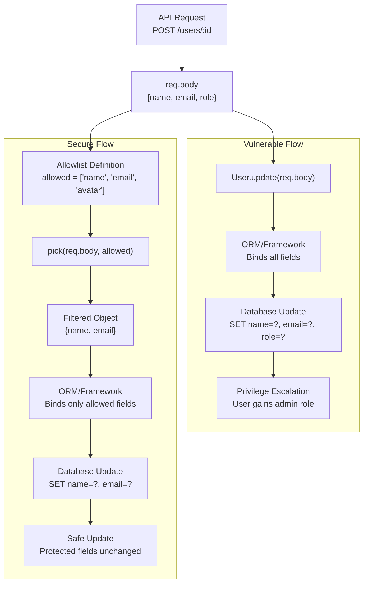
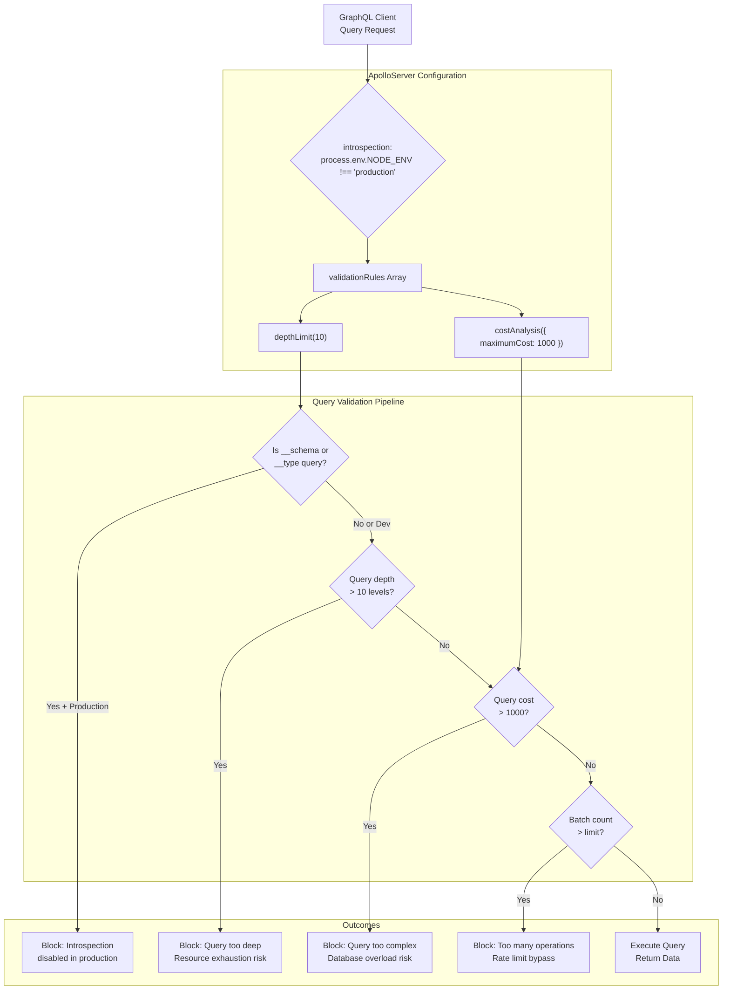

<!-- source: DeepWiki mcp.deepwiki.com · repo BehiSecc/VibeSec-Skill · page 9 API Security · fetched 2026-10-26 -->

# API Security

<details>
<summary>Relevant source files</summary>

The following files were used as context for generating this wiki page:

- [SKILL.md](SKILL.md)

</details>


## Purpose and Scope

This document covers API-specific security vulnerabilities and their prevention mechanisms in the VibeSec-Skill framework. The focus is on two primary attack vectors that affect modern web APIs: mass assignment vulnerabilities and GraphQL-specific security issues.

For general access control and authorization issues (including IDOR and privilege escalation), see [Access Control & Authorization](#5). For authentication mechanisms including JWT security, see [Authentication & Session Security](#8).

**Sources:** [SKILL.md:705-741]()

---

## Mass Assignment Vulnerabilities

Mass assignment occurs when API endpoints accept unfiltered request bodies and directly map them to database models or object properties, allowing attackers to modify fields that should be restricted.

### Attack Vector

In mass assignment attacks, an attacker includes additional fields in API request payloads to escalate privileges or modify protected attributes. The vulnerability exists when server-side code automatically binds all request body fields to model properties without filtering.

### Vulnerable Pattern

The following pattern demonstrates a critical mass assignment vulnerability:

```javascript
// VULNERABLE — user can set { role: "admin" } in request body
User.update(req.body)
```

In this pattern, the `User.update()` method accepts the entire `req.body` object without validation. An attacker can submit a request containing:

```json
{
  "name": "John Doe",
  "email": "john@example.com",
  "role": "admin",
  "isVerified": true,
  "accountBalance": 1000000
}
```

The ORM or framework will attempt to update all fields present in the request, including `role`, `isVerified`, and `accountBalance`, which should be restricted.

**Sources:** [SKILL.md:707-713]()

### Secure Implementation Pattern

The secure approach uses explicit field whitelisting:

```javascript
// SECURE — whitelist allowed fields
const allowed = ['name', 'email', 'avatar']
const updates = pick(req.body, allowed)
User.update(updates)
```

This pattern explicitly defines which fields can be modified via the API endpoint. Any additional fields in the request are ignored, preventing unauthorized attribute modification.

**Sources:** [SKILL.md:715-718]()

### Framework-Agnostic Prevention

Mass assignment prevention applies across all ORM and framework implementations. The core principle remains consistent: **always explicitly define which fields a request can modify**.



**Diagram: Mass Assignment Attack vs. Secure Implementation Flow**

This diagram illustrates how unfiltered `req.body` binding allows privilege escalation, while the `pick()` function with an allowlist filters the request to only permitted fields before ORM binding.

**Sources:** [SKILL.md:707-721]()

### Common Protected Fields

The following fields are frequently targeted in mass assignment attacks and should never be exposed in update endpoints:

| Field Category | Examples | Risk |
|----------------|----------|------|
| Privilege fields | `role`, `isAdmin`, `permissions`, `accessLevel` | Privilege escalation |
| Verification status | `isVerified`, `emailVerified`, `phoneVerified` | Bypass verification workflows |
| Financial fields | `balance`, `credits`, `accountBalance` | Unauthorized value manipulation |
| Timestamps | `createdAt`, `lastLogin`, `verifiedAt` | Audit trail manipulation |
| System metadata | `id`, `uuid`, `organizationId`, `ownerId` | Resource ownership bypass |

**Sources:** [SKILL.md:707-721]()

---

## GraphQL Security

GraphQL APIs introduce unique attack vectors due to their flexible query structure and introspection capabilities. The VibeSec-Skill framework addresses four primary GraphQL-specific vulnerabilities.

### Vulnerability Overview

| Vulnerability | Attack Method | Impact |
|---------------|---------------|--------|
| Introspection in production | Query `__schema` and `__type` to map entire API | Full API schema disclosure |
| Query depth attack | Deeply nested queries: `user { posts { author { posts { author... } } } }` | Resource exhaustion, DoS |
| Query complexity attack | Many expensive fields in single query | Database overload, performance degradation |
| Batching attack | Multiple operations in single request | Rate limit bypass, resource exhaustion |

**Sources:** [SKILL.md:723-730]()

### Introspection Control

GraphQL introspection allows clients to query the schema structure itself. While useful for development tools, introspection should be disabled in production to prevent attackers from mapping the entire API surface.

**Prevention:**
```javascript
introspection: process.env.NODE_ENV !== 'production'
```

This configuration enables introspection during development (`NODE_ENV` not set to `'production'`) but disables it in production environments.

**Sources:** [SKILL.md:727]()

### Query Depth Limiting

Query depth attacks exploit GraphQL's ability to nest queries arbitrarily deep, causing exponential database query growth.

**Attack Example:**
```graphql
query {
  user {
    posts {
      author {
        posts {
          author {
            posts {
              # 50+ levels deep...
            }
          }
        }
      }
    }
  }
}
```

**Prevention:**
```javascript
validationRules: [
  depthLimit(10)
]
```

The `depthLimit()` validation rule enforces a maximum query nesting level of 10, rejecting deeper queries before execution.

**Sources:** [SKILL.md:728-737]()

### Query Complexity Analysis

Query complexity attacks submit queries with many expensive field resolutions in a single request, overwhelming database connections and compute resources.

**Prevention:**
```javascript
validationRules: [
  costAnalysis({ maximumCost: 1000 })
]
```

The `costAnalysis()` rule calculates the computational cost of a query based on field resolvers and enforces a maximum total cost of 1000 (arbitrary units based on implementation).

**Sources:** [SKILL.md:729-738]()

### Batching Attack Prevention

GraphQL batching allows multiple operations in a single HTTP request. Without limits, attackers can bypass rate limiting by submitting hundreds of queries in one request.

**Prevention:**
Limit the number of operations allowed per request. This is typically implemented at the GraphQL server configuration level.

**Sources:** [SKILL.md:730]()

### Secure GraphQL Server Configuration

The complete secure `ApolloServer` configuration implementing all protections:

```javascript
const server = new ApolloServer({
  introspection: process.env.NODE_ENV !== 'production',
  validationRules: [
    depthLimit(10),
    costAnalysis({ maximumCost: 1000 })
  ]
})
```

This configuration appears in [SKILL.md:733-741]() and demonstrates the recommended baseline security posture for GraphQL APIs.

**Sources:** [SKILL.md:733-741]()



**Diagram: GraphQL Security Validation Pipeline with ApolloServer Configuration**

This diagram maps the `ApolloServer` configuration settings to their validation pipeline execution. Each `validationRules` array element corresponds to a specific check in the pipeline that rejects malicious queries before they reach the database layer.

**Sources:** [SKILL.md:723-741]()

---

## API Security Request Flow

The following diagram illustrates how both mass assignment and GraphQL security controls integrate into the API request lifecycle:

```mermaid
sequenceDiagram
    participant Client
    participant APIEndpoint["API Endpoint<br/>(REST or GraphQL)"]
    participant MassAssignFilter["Mass Assignment Filter<br/>pick(req.body, allowlist)"]
    participant GraphQLValidator["GraphQL Validator<br/>depthLimit, costAnalysis"]
    participant BusinessLogic["Business Logic Layer"]
    participant ORM["ORM/Database Layer<br/>User.update()"]
    participant Database
    
    Client->>APIEndpoint: "POST /api/users/:id<br/>{name, email, role}"
    
    alt REST Endpoint
        APIEndpoint->>MassAssignFilter: "req.body validation"
        MassAssignFilter->>MassAssignFilter: "Filter against allowlist<br/>allowed = ['name', 'email']"
        
        alt Disallowed fields present
            MassAssignFilter-->>Client: "Fields filtered silently<br/>or 400 Bad Request"
        else Only allowed fields
            MassAssignFilter->>BusinessLogic: "Filtered request object<br/>{name, email}"
        end
    end
    
    alt GraphQL Endpoint
        APIEndpoint->>GraphQLValidator: "Parse and validate query"
        GraphQLValidator->>GraphQLValidator: "Check introspection<br/>if production"
        GraphQLValidator->>GraphQLValidator: "Calculate query depth"
        GraphQLValidator->>GraphQLValidator: "Calculate query cost"
        
        alt Validation fails
            GraphQLValidator-->>Client: "400: Query depth/cost exceeded"
        else Validation passes
            GraphQLValidator->>BusinessLogic: "Validated query"
        end
    end
    
    BusinessLogic->>ORM: "Database operation<br/>with validated data"
    ORM->>Database: "SQL with parameterized values"
    Database-->>ORM: "Result set"
    ORM-->>BusinessLogic: "Model objects"
    BusinessLogic-->>APIEndpoint: "Response data"
    APIEndpoint-->>Client: "200 OK with sanitized data"
```

**Diagram: API Security Request Flow for REST and GraphQL**

This sequence diagram shows the divergent security validation paths for REST endpoints (mass assignment filtering via `pick()`) and GraphQL endpoints (`depthLimit` and `costAnalysis` validation) before reaching the shared business logic and ORM layers.

**Sources:** [SKILL.md:705-741]()

---

## Implementation Checklist

### Mass Assignment Protection

- [ ] Identify all API endpoints that accept request bodies
- [ ] Define explicit allowlists for updatable fields per endpoint
- [ ] Implement field filtering before ORM/model binding
- [ ] Never directly pass `req.body` to update methods
- [ ] Review ORM configuration for automatic binding behavior
- [ ] Test with additional fields in requests to verify filtering
- [ ] Document which fields are updatable in API documentation

### GraphQL Security

- [ ] Set `introspection: process.env.NODE_ENV !== 'production'`
- [ ] Implement `depthLimit()` validation rule (recommended: 10 levels)
- [ ] Implement `costAnalysis()` with appropriate `maximumCost`
- [ ] Configure operation batch limits
- [ ] Test with deep nested queries to verify depth limiting
- [ ] Test with complex queries to verify cost analysis
- [ ] Monitor query complexity metrics in production
- [ ] Document query depth and cost limits for API consumers

**Sources:** [SKILL.md:705-741]()

---

## Related Security Concerns

API security intersects with multiple other security domains covered in VibeSec-Skill:

| Related Area | Intersection with API Security | Reference |
|--------------|-------------------------------|-----------|
| Access Control | APIs must verify resource ownership and permissions | [Access Control & Authorization](#5) |
| CSRF Protection | State-changing API endpoints require CSRF tokens | [CSRF Protection](#6.2) |
| JWT Security | Token validation and storage for API authentication | [JWT Security](#8.2) |
| Input Validation | All API inputs must be validated server-side | [Core Security Principles](#4) |
| SQL Injection | ORM usage in APIs must use parameterized queries | [SQL Injection Prevention](#7.2) |

**Sources:** [SKILL.md:705-741]()

---

