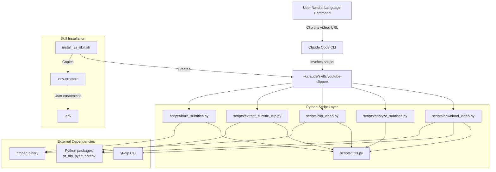
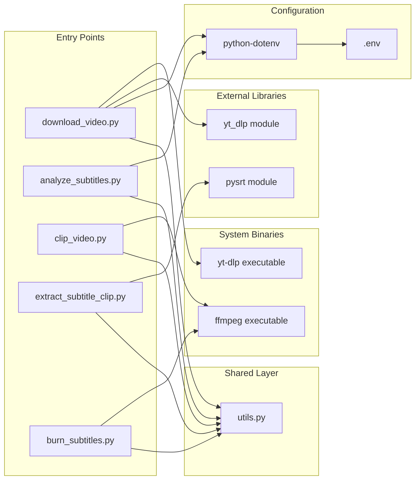
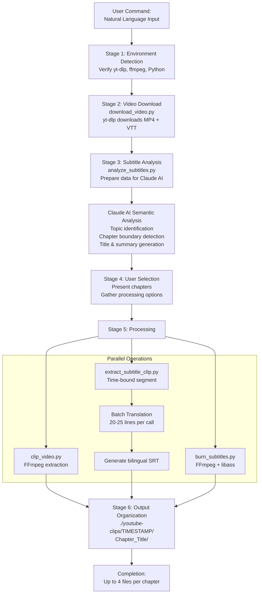

<!-- source: DeepWiki mcp.deepwiki.com · repo op7418/Youtube-clipper-skill · page 1 Overview · fetched 2026-10-26 -->

# Overview

<details>
<summary>Relevant source files</summary>

The following files were used as context for generating this wiki page:

- [.github/REPOSITORY_SETTINGS.md](.github/REPOSITORY_SETTINGS.md)
- [README.md](README.md)
- [README.zh-CN.md](README.zh-CN.md)

</details>


## Purpose and Scope

The YouTube Clipper Skill is an AI-powered video processing system designed for the Claude Code environment. The system downloads YouTube videos, performs semantic content analysis using Claude AI, extracts video segments based on meaningful chapter boundaries, translates subtitles into bilingual formats, and optionally burns subtitles into video files. The skill operates as a natural language interface, accepting user commands through Claude Code and orchestrating a multi-stage processing pipeline.

This document provides an architectural overview of the system, its execution environment, core components, and processing workflow. For detailed feature descriptions, see [Key Features](#1.1). For system dependencies and installation requirements, see [System Requirements](#1.2). For operational usage patterns, see [Getting Started](#2). For in-depth technical implementation details, see [Architecture](#3) and [Core Scripts](#4).

**Sources:** [README.md:1-13](), [.github/REPOSITORY_SETTINGS.md:1-14]()

## Claude Code Skill Architecture

The YouTube Clipper Skill operates within the Claude Code execution environment, installed at `~/.claude/skills/youtube-clipper/`. The skill exposes functionality through natural language commands, with Claude Code interpreting user intent and invoking the appropriate Python scripts.

### Skill Deployment Model



The `install_as_skill.sh` script performs initial setup, creating the skill directory structure, installing Python dependencies (`yt-dlp`, `pysrt`, `python-dotenv`), verifying external tools (`yt-dlp`, `ffmpeg`), and generating the `.env` configuration file from `.env.example`.

**Sources:** [README.md:24-47](), [README.zh-CN.md:24-47]()

## Core Script Components

The skill's functionality is implemented across five primary Python scripts, each handling a specific processing stage. All scripts share common functionality through `utils.py`.

### Script Dependency Matrix



| Script | Primary Responsibility | Key Dependencies |
|--------|----------------------|------------------|
| `download_video.py` | Video acquisition, subtitle download | `yt_dlp`, `yt-dlp` binary, `utils.py` |
| `analyze_subtitles.py` | Subtitle parsing, data preparation for AI | `utils.py`, `.env` |
| `clip_video.py` | Video segment extraction | `ffmpeg`, `utils.py` |
| `extract_subtitle_clip.py` | Subtitle segment extraction, timestamp adjustment | `pysrt`, `utils.py` |
| `burn_subtitles.py` | Subtitle rendering into video | `ffmpeg` with libass, `utils.py` |
| `utils.py` | Time conversion, file operations, validation | Standard library only |

**Sources:** [README.md:50-66](), Diagram 3 from high-level systems

## Processing Pipeline

The skill executes a six-stage pipeline when processing a YouTube video:

### End-to-End Workflow



**Stage 1 (Environment Detection):** Validates presence of `python`, `yt-dlp`, and `ffmpeg` binaries. Checks for `libass` support in FFmpeg by testing filter availability.

**Stage 2 (Video Download):** Invokes `download_video.py`, which uses `yt_dlp` Python library to download video in MP4 format (max 1080p) and English subtitles in VTT format.

**Stage 3 (Subtitle Analysis):** Executes `analyze_subtitles.py` to parse VTT subtitles and format data for Claude AI analysis. Estimates target chapter count based on video duration and configured `TARGET_CHAPTER_DURATION`.

**Stage 4 (User Selection):** Claude AI analyzes subtitle content to generate semantic chapters (2-5 minutes each). User selects chapters for processing and specifies options (subtitle translation, burning, summary generation).

**Stage 5 (Processing):** 
- `clip_video.py` extracts video segments using FFmpeg with `-c copy` for lossless extraction
- `extract_subtitle_clip.py` extracts time-bound subtitle segments and adjusts timestamps
- Batch translation groups 20-25 subtitle lines per API call
- Bilingual SRT generation combines English and translated text
- `burn_subtitles.py` applies subtitles using FFmpeg `subtitles` filter

**Stage 6 (Output Organization):** Creates timestamped session directory (`YYYYMMDD_HHMMSS`) containing chapter subdirectories, each with up to four files: `*_clip.mp4`, `*_with_subtitles.mp4`, `*_bilingual.srt`, `*_summary.md`.

**Sources:** [README.md:103-111](), [README.zh-CN.md:103-111](), Diagram 2 from high-level systems

## Configuration System

The skill uses environment variables loaded from `.env` for runtime configuration. All scripts import `python-dotenv` and call `load_dotenv()` to access configuration.

### Configuration Categories

| Category | Key Variables | Affected Components |
|----------|--------------|---------------------|
| **Paths** | `FFMPEG_PATH`, `OUTPUT_DIR`, `TEMP_DIR` | All scripts |
| **Video** | `MAX_VIDEO_HEIGHT`, `YT_DLP_PROXY`, `YT_DLP_RATE_LIMIT` | `download_video.py` |
| **Subtitles** | `SUBTITLE_FONT_SIZE`, `SUBTITLE_MARGIN_V`, `TARGET_LANGUAGE` | `burn_subtitles.py`, translation logic |
| **Processing** | `TRANSLATION_BATCH_SIZE`, `TARGET_CHAPTER_DURATION`, `KEEP_TEMP_FILES` | `analyze_subtitles.py`, translation, cleanup |
| **Logging** | `LOG_LEVEL` | All scripts |

The `.env.example` template provides default values. The `install_as_skill.sh` script copies this to `.env` during installation. Scripts implement fallback defaults when variables are undefined.

**Sources:** [README.md:127-154](), [README.zh-CN.md:127-154](), Diagram 5 from high-level systems

## Output Structure

The skill generates a three-level directory hierarchy for organized output:

```
./youtube-clips/
└── YYYYMMDD_HHMMSS/          # Timestamped session
    ├── Chapter_1_Title/
    │   ├── Chapter_1_Title_clip.mp4              # Original segment (no subtitles)
    │   ├── Chapter_1_Title_with_subtitles.mp4    # Burned subtitles
    │   ├── Chapter_1_Title_bilingual.srt         # English + target language
    │   └── Chapter_1_Title_summary.md            # Social media content
    └── Chapter_2_Title/
        ├── Chapter_2_Title_clip.mp4
        ├── Chapter_2_Title_with_subtitles.mp4
        ├── Chapter_2_Title_bilingual.srt
        └── Chapter_2_Title_summary.md
```

The `utils.py` module provides `sanitize_filename()` to clean chapter titles for use as directory names, removing special characters (`/`, `\`, `:`, `*`, `?`, `"`, `<`, `>`, `|`), replacing spaces with underscores, and limiting length to 100 characters.

**Sources:** [README.md:112-123](), [README.zh-CN.md:112-123](), Diagram 6 from high-level systems

## External Tool Integration

The skill integrates two external command-line tools as critical dependencies:

### yt-dlp Integration

`download_video.py` uses both the `yt_dlp` Python library and the `yt-dlp` command-line executable. The script constructs a format string for video quality selection (e.g., `"bestvideo[height<=1080]+bestaudio/best[height<=1080]"`), downloads subtitles with `writeautomaticsub=True`, and handles proxy configuration via `YT_DLP_PROXY`.

**Sources:** [README.md:50-66]()

### FFmpeg with libass Integration

`clip_video.py` invokes `ffmpeg` with stream copying (`-c copy`) for lossless video extraction. `burn_subtitles.py` requires `ffmpeg` compiled with `libass` support for the `subtitles` filter. The script detects FFmpeg variant (standard vs. `ffmpeg-full` on macOS) and verifies filter availability using `ffmpeg -filters`. Due to path handling issues with spaces, the script implements a temporary directory workaround, copying subtitle files to a temp location before processing.

**Sources:** [README.md:67-84](), [README.zh-CN.md:67-84]()

## AI-Powered Intelligence

The skill differentiates itself through two AI-powered capabilities:

### Semantic Chapter Analysis

Claude AI analyzes subtitle content to identify topic boundaries, generating chapters with:
- **Titles:** 10-20 characters, descriptive of content
- **Summaries:** 50-100 characters, core message
- **Keywords:** 3-5 terms for searchability
- **Time boundaries:** Natural transition points, not arbitrary time intervals

This contrasts with mechanical splitting (e.g., fixed 5-minute segments) by understanding semantic content flow.

**Sources:** [README.md:14-20, 193-209](), Diagram 4 from high-level systems

### Batch Translation Optimization

Instead of translating subtitles individually, the skill groups 20-25 subtitle lines into a single API call. This batch strategy achieves 95% reduction in API calls compared to one-by-one translation, reduces processing time by 10x, and maintains translation consistency through context preservation across batches.

**Sources:** [README.md:211-217](), [README.zh-CN.md:211-217](), Diagram 4 from high-level systems

## Technology Stack Summary

| Layer | Technologies | Purpose |
|-------|--------------|---------|
| **Runtime** | Python 3.8+ | Script execution |
| **Hosting** | Claude Code | Natural language interface, AI analysis |
| **Download** | yt-dlp (CLI + library) | YouTube video/subtitle acquisition |
| **Video Processing** | FFmpeg with libass | Clipping, subtitle burning |
| **Subtitle Parsing** | pysrt | SRT format manipulation |
| **Configuration** | python-dotenv | Environment variable management |
| **AI Services** | Claude AI API | Semantic analysis, translation |

**Sources:** [README.md:50-66](), [README.zh-CN.md:50-66]()

---

