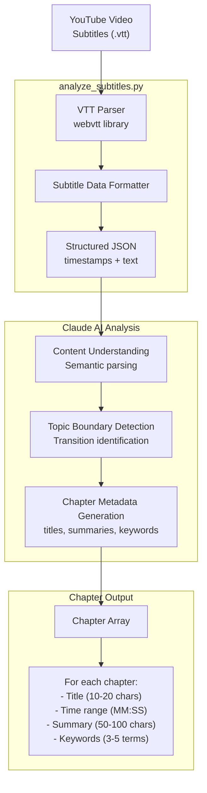
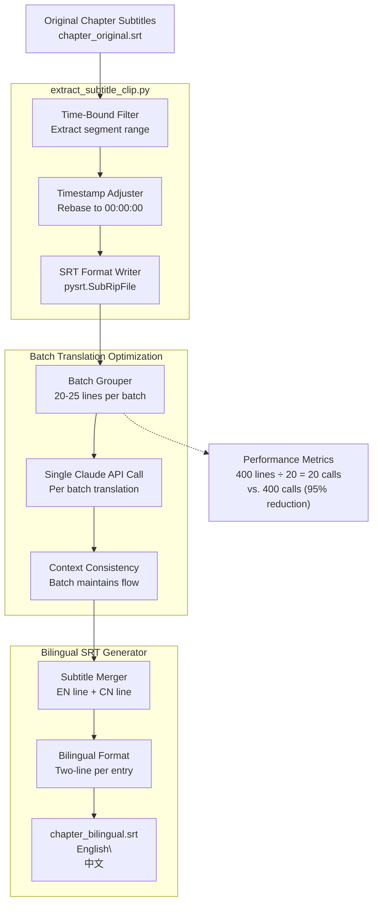
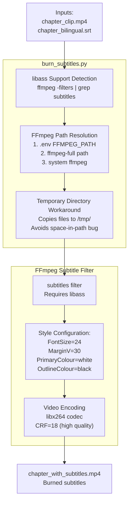
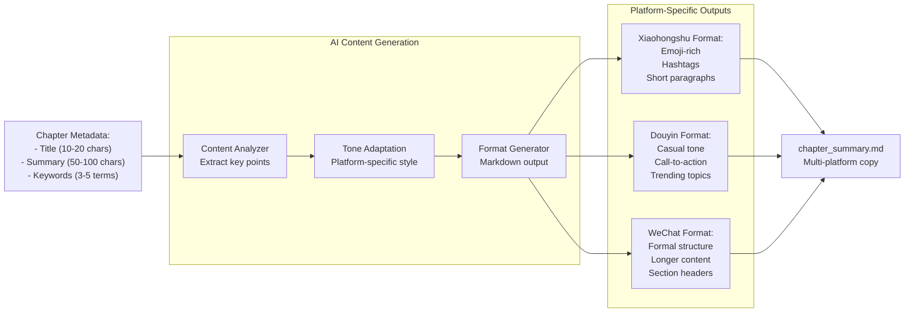

<!-- source: DeepWiki mcp.deepwiki.com · repo op7418/Youtube-clipper-skill · page 1.1 Key Features · fetched 2026-10-26 -->

# Key Features

<details>
<summary>Relevant source files</summary>

The following files were used as context for generating this wiki page:

- [README.md](README.md)
- [README.zh-CN.md](README.zh-CN.md)
- [SKILL.md](SKILL.md)

</details>


This document details the five distinguishing features that differentiate the YouTube Clipper Skill from simpler video processing tools. Each feature leverages AI intelligence, external tool integration, or optimization strategies to provide professional-grade video processing capabilities within the Claude Code environment.

For installation and setup procedures, see [Installation](#2.1). For understanding how these features fit into the overall processing workflow, see [Understanding the Workflow](#2.3).

---

## Feature Overview

The YouTube Clipper Skill provides five core capabilities:

| Feature | Implementation | Key Benefit |
|---------|---------------|-------------|
| **AI Semantic Chapter Generation** | Claude AI + `analyze_subtitles.py` | Content-aware segmentation vs mechanical time splitting |
| **Precise Video Clipping** | FFmpeg + `clip_video.py` | Frame-accurate extraction with quality preservation |
| **Batch-Optimized Bilingual Subtitles** | `extract_subtitle_clip.py` + translation batching | 95% API call reduction, 10x speed improvement |
| **Subtitle Burning** | FFmpeg libass + `burn_subtitles.py` | Hardcoded dual-language subtitles with custom styling |
| **Social Media Content Generation** | AI-powered summary generation | Platform-optimized copy for Xiaohongshu, Douyin, WeChat |

Sources: [README.md:14-21](), [SKILL.md:96-221]()

---

## 1. AI Semantic Chapter Generation

### Overview

The system uses Claude AI to analyze subtitle content semantically and generate meaningful 2-5 minute chapters based on topic boundaries, rather than arbitrary time intervals. This is the core differentiating feature that distinguishes this tool from mechanical video splitters.

### Technical Implementation



**Diagram: AI Semantic Chapter Analysis Pipeline - Code Entity Mapping**

The process involves two primary phases:

1. **Subtitle Parsing** ([scripts/analyze_subtitles.py]()): Converts VTT format to structured data
2. **AI Analysis** (Claude AI via SKILL.md workflow): Generates semantic chapters

### Chapter Generation Principles

The system follows specific guidelines for chapter creation as defined in [SKILL.md:122-127]():

| Principle | Specification | Reasoning |
|-----------|--------------|-----------|
| **Granularity** | 2-5 minutes per chapter | Balance between detail and usability |
| **Completeness** | 100% video coverage, no gaps | Ensures all content is accessible |
| **Semantic Coherence** | One topic per chapter | Each chapter is independently meaningful |
| **Natural Boundaries** | Topic transition points | Avoids mid-sentence or mid-thought cuts |

### Example Output Format

```
📊 Analysis Complete - 8 Chapters Generated:

1. [00:00 - 03:15] AGI as an exponential curve, not a point in time
   Core: AI model capabilities double every 4-12 months, engineers already using Claude Code
   Keywords: AGI, exponential growth, Claude Code

2. [03:15 - 06:30] China's gap in AI development
   Core: Chip embargo constrains China, DeepSeek benchmark optimization ≠ real capability
   Keywords: China, chip embargo, DeepSeek
```

This format is defined in [SKILL.md:128-143]() and provides users with sufficient context to make informed chapter selection decisions.

Sources: [SKILL.md:96-144](), [scripts/analyze_subtitles.py](), [README.md:16,193-209]()

---

## 2. Precise Video Clipping

### Overview

The system uses FFmpeg's stream copy capabilities to extract video segments with frame-level precision while preserving original quality. No re-encoding occurs unless subtitle burning is requested.

### Technical Implementation



```mermaid
flowchart LR
    Input["Original Video<br/>video.mp4"]
    
    subgraph "clip_video.py"
        TimeParser["Time String Parser<br/>utils.parse_time_to_seconds()"]
        FFmpegCmd["FFmpeg Command Builder<br/>-ss start -to end -c copy"]
        Executor["subprocess.run()"]
    end
    
    subgraph "FFmpeg Processing"
        SeekStart["-ss: Seek to start time<br/>Fast seek before decode"]
        CopyStreams["-c copy: Stream copy<br/>No re-encoding"]
        PreciseEnd["-to: End time<br/>Frame-accurate cutoff"]
    end
    
    Output["Chapter Clip<br/>chapter_clip.mp4<br/>Original quality"]
    
    Input --> TimeParser
    TimeParser --> FFmpegCmd
    FFmpegCmd --> Executor
    Executor --> SeekStart
    SeekStart --> CopyStreams
    CopyStreams --> PreciseEnd
    PreciseEnd --> Output
```

**Diagram: Video Clipping Process with FFmpeg Stream Copy**

### Key Implementation Details

The [scripts/clip_video.py]() script uses FFmpeg with the following command structure:

```bash
ffmpeg -ss <start_time> -to <end_time> -i <input_video> -c copy <output_clip>
```

**Critical Parameters**:

- `-ss` (start seek): Fast seek to chapter start position before decoding
- `-to` (end time): Precise end boundary using frame timestamps
- `-c copy`: Stream copy mode - no re-encoding, preserving original bitrate and codec
- `-avoid_negative_ts make_zero`: Ensures timestamps start at 0:00:00

### Quality Preservation

| Aspect | Original Video | Clipped Segment |
|--------|---------------|-----------------|
| Video codec | H.264/VP9 | Identical (stream copied) |
| Audio codec | AAC/Opus | Identical (stream copied) |
| Bitrate | As downloaded | Unchanged |
| Resolution | Up to 1080p | Unchanged |
| Processing speed | N/A | ~50x real-time (no decode) |

Sources: [scripts/clip_video.py](), [SKILL.md:170-176](), [README.md:17]()

---

## 3. Batch-Optimized Bilingual Subtitle Translation

### Overview

The system implements a batch translation strategy that groups 20-25 subtitle lines per API call, reducing API usage by 95% compared to line-by-line translation while maintaining context consistency.

### Translation Pipeline Architecture



**Diagram: Batch Translation Pipeline with Optimization Strategy**

### Batch Translation Configuration

The batch size is configurable via [.env.example:15]():

```bash
# Translation batch size (20-25 recommended)
TRANSLATION_BATCH_SIZE=20
```

**Performance Comparison**:

| Approach | API Calls | Translation Time | Cost Impact |
|----------|-----------|------------------|-------------|
| Line-by-line | 400 calls (400 lines) | ~8 minutes | Baseline (100%) |
| Batch (size=20) | 20 calls (20 batches) | ~48 seconds | 5% of baseline |

### Bilingual Subtitle Format

The output format follows SRT standard with dual-language content as shown in [README.md:222-232]():

```srt
1
00:00:00,000 --> 00:00:03,500
This is the English subtitle
这是中文字幕

2
00:00:03,500 --> 00:00:07,000
Another English line
另一行中文
```

### Implementation Components

- **Subtitle Extraction**: [scripts/extract_subtitle_clip.py]() - Time-based filtering and timestamp adjustment
- **Format Conversion**: [scripts/utils.py]() - VTT to SRT conversion with `pysrt` library
- **Translation Strategy**: Defined in [SKILL.md:185-194]() and [SKILL.md:293-300]()
- **Target Language**: Configurable via `TARGET_LANGUAGE` environment variable

Sources: [scripts/extract_subtitle_clip.py](), [README.md:18,211-217,222-232](), [SKILL.md:185-194,293-300]()

---

## 4. Subtitle Burning with Advanced Styling

### Overview

The system uses FFmpeg with libass support to hardcode bilingual subtitles directly into video frames. This feature requires `ffmpeg-full` on macOS or `libass-dev` on Ubuntu, as standard FFmpeg builds lack subtitle filter support.

### Subtitle Burning Architecture



**Diagram: Subtitle Burning Process with FFmpeg libass Integration**

### FFmpeg Variant Detection

The [scripts/burn_subtitles.py]() script implements a fallback chain for FFmpeg detection:

1. **Environment Variable**: `FFMPEG_PATH` from [.env.example:4-5]()
2. **ffmpeg-full Path** (macOS): `/opt/homebrew/opt/ffmpeg-full/bin/ffmpeg`
3. **System FFmpeg**: Standard `ffmpeg` in PATH

**libass Verification** ([SKILL.md:36-44]()):
```bash
ffmpeg -filters 2>&1 | grep subtitles
# Expected output: subtitles    V->V  (...)
```

### Critical Path Handling Issue

The subtitle burning process encounters a known FFmpeg bug where the `subtitles` filter cannot parse file paths containing spaces. The workaround is documented in [SKILL.md:285-292]():

**Problem**: 
```bash
# Fails if path contains spaces
ffmpeg -i "/path with spaces/video.mp4" -vf "subtitles=/path with spaces/subs.srt"
```

**Solution**: [scripts/burn_subtitles.py]() copies files to a temporary directory without spaces:
```python
# Create temporary directory
temp_dir = tempfile.mkdtemp()  # e.g., /tmp/tmpXXXXXX

# Copy files
shutil.copy(video_path, temp_dir)
shutil.copy(subtitle_path, temp_dir)

# Execute FFmpeg with temp paths
# Move output back to original destination
```

### Subtitle Styling Configuration

Configurable via [.env.example:17-19]():

| Parameter | Default | Purpose |
|-----------|---------|---------|
| `SUBTITLE_FONT_SIZE` | 24 | Text size in points |
| `SUBTITLE_MARGIN_V` | 30 | Bottom margin in pixels |
| Primary text color | White | Main text color |
| Outline color | Black | Text border for readability |

### FFmpeg Command Structure

```bash
ffmpeg -i <video> -vf "subtitles=<srt>:force_style='FontSize=24,MarginV=30'" \
       -c:v libx264 -crf 18 -c:a copy <output>
```

**Parameters**:
- `-vf subtitles=<srt>`: Apply subtitle filter (requires libass)
- `force_style=`: Override default ASS/SSA styling
- `-c:v libx264`: Re-encode video with H.264
- `-crf 18`: Constant Rate Factor (18 = visually lossless)
- `-c:a copy`: Copy audio stream without re-encoding

Sources: [scripts/burn_subtitles.py](), [SKILL.md:202-212,285-292](), [README.md:19,67-83,242-250]()

---

## 5. Social Media Content Generation

### Overview

The system automatically generates platform-optimized content summaries for Xiaohongshu (小红书), Douyin (抖音), and WeChat (微信公众号) based on chapter metadata (title, summary, keywords).

### Content Generation Process



**Diagram: Social Media Content Generation Pipeline**

### Generated Content Structure

Each `<chapter_title>_summary.md` file contains:

1. **Chapter Overview**: Title and time range
2. **Core Message**: Main takeaway in 1-2 sentences
3. **Platform-Specific Copy**:
   - Xiaohongshu version (emoji-rich, casual)
   - Douyin version (short-form, trending)
   - WeChat version (formal, detailed)
4. **Hashtag Suggestions**: Derived from keywords
5. **Publishing Tips**: Platform-specific guidance

### Target Language Configuration

The content generation respects the `TARGET_LANGUAGE` setting from [.env.example:21]():

```bash
# Target language for translation and summaries
TARGET_LANGUAGE=中文
```

This ensures all generated content matches the target audience language.

### Integration with Workflow

Content generation is triggered during [SKILL.md:213-221]() as optional processing:

```bash
python3 scripts/generate_summary.py <chapter_info>
```

**Input Format**:
```json
{
  "title": "AGI as an exponential curve",
  "summary": "AI capabilities double every 4-12 months...",
  "keywords": ["AGI", "exponential", "Claude Code"]
}
```

Sources: [README.md:20](), [SKILL.md:213-221](), [.env.example:21]()

---

## Feature Integration Matrix

The following table shows how multiple features combine during typical processing workflows:

| Use Case | AI Chapters | Clipping | Translation | Burning | Summary |
|----------|-------------|----------|-------------|---------|---------|
| **Quick Preview** | ✅ | ✅ | ❌ | ❌ | ❌ |
| **Bilingual Sharing** | ✅ | ✅ | ✅ | ✅ | ❌ |
| **Social Media Package** | ✅ | ✅ | ✅ | ✅ | ✅ |
| **Archive/Reference** | ✅ | ✅ | ✅ | ❌ | ✅ |

Each feature can be toggled independently via user selection in [SKILL.md:148-162]().

Sources: [SKILL.md:148-162](), [README.md:14-21]()

---

