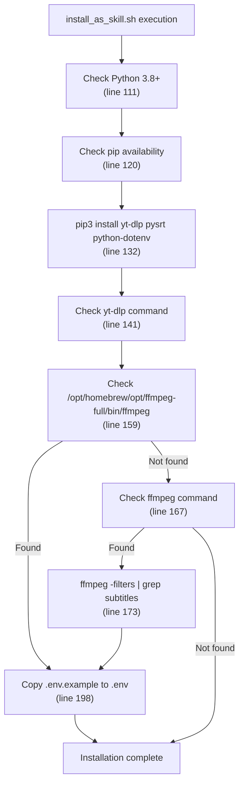
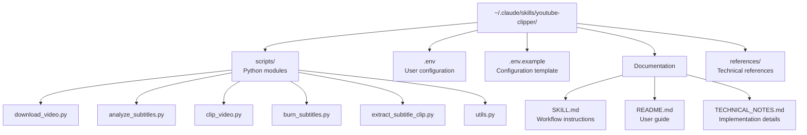
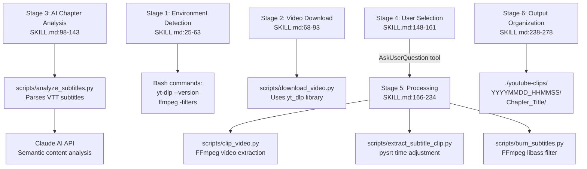
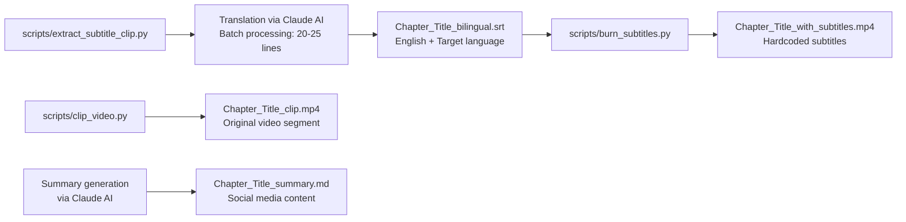

<!-- source: DeepWiki mcp.deepwiki.com · repo op7418/Youtube-clipper-skill · page 2 Getting Started · fetched 2026-10-26 -->

# Getting Started

<details>
<summary>Relevant source files</summary>

The following files were used as context for generating this wiki page:

- [README.md](README.md)
- [SKILL.md](SKILL.md)
- [install_as_skill.sh](install_as_skill.sh)

</details>


This page provides a quick start guide for installing and using the YouTube Clipper Skill for the first time. It covers the essential steps to get the skill operational within the Claude Code environment, perform a first video clipping operation, and understand the basic workflow.

For detailed installation procedures, see [Installation](#2.1). For comprehensive usage patterns, see [Basic Usage](#2.2). For in-depth workflow mechanics, see [Understanding the Workflow](#2.3).

## Prerequisites Overview

Before installing the YouTube Clipper Skill, verify that your system meets the required dependencies. The skill requires both system-level tools and Python packages.

### Required System Dependencies

| Dependency | Minimum Version | Purpose | Verification Command |
|------------|----------------|---------|---------------------|
| Python | 3.8+ | Script execution runtime | `python3 --version` |
| yt-dlp | Latest stable | YouTube video/subtitle download | `yt-dlp --version` |
| FFmpeg with libass | Latest stable | Video processing and subtitle burning | `ffmpeg -filters 2>&1 \| grep subtitles` |

### Critical Dependency: libass Support

The standard `ffmpeg` package on macOS (via Homebrew) does **not** include libass support, which is required for subtitle burning functionality. Users must install `ffmpeg-full` instead:

```bash
brew uninstall ffmpeg
brew install ffmpeg-full
```

The installation script [install_as_skill.sh:153-191]() performs automatic detection of FFmpeg variants and verifies libass support.

**Diagram: Dependency Detection Flow**



Sources: [install_as_skill.sh:109-191]()

## Installation Quick Start

The YouTube Clipper Skill provides two installation methods. The recommended approach uses `npx skills` for automatic installation.

### Method 1: npx skills (Recommended)

```bash
npx skills add https://github.com/op7418/Youtube-clipper-skill
```

This command automatically:
1. Clones the repository
2. Copies files to `~/.claude/skills/youtube-clipper/`
3. Executes [install_as_skill.sh]()
4. Installs Python dependencies
5. Creates configuration files

### Method 2: Manual Installation

```bash
git clone https://github.com/op7418/Youtube-clipper-skill.git
cd Youtube-clipper-skill
bash install_as_skill.sh
```

The [install_as_skill.sh:56-241]() script performs the following operations:

1. **Directory Setup** [install_as_skill.sh:60-79](): Creates `~/.claude/skills/youtube-clipper/` directory structure
2. **File Copy** [install_as_skill.sh:82-107](): Copies all source files, excluding `.git/`, `venv/`, `__pycache__/`, and `youtube-clips/`
3. **Python Package Installation** [install_as_skill.sh:127-137](): Installs `yt-dlp`, `pysrt`, `python-dotenv` via pip
4. **Dependency Verification** [install_as_skill.sh:139-191](): Checks yt-dlp and FFmpeg availability
5. **Configuration Generation** [install_as_skill.sh:194-208](): Creates `.env` from `.env.example`

For detailed installation procedures including troubleshooting, see [Installation](#2.1).

Sources: [README.md:24-47](), [install_as_skill.sh:1-241]()

## Directory Structure After Installation

The installation process creates the following directory structure at `~/.claude/skills/youtube-clipper/`:



The `.env` file contains runtime configuration variables that control video quality, subtitle settings, and processing parameters. See [Configuration](#6) for complete variable reference.

Sources: [install_as_skill.sh:82-107](), [README.md:129-153]()

## First Run Example

After installation, invoke the skill through Claude Code using natural language commands. The skill responds to commands in both English and Chinese.

### Basic Invocation

```
Clip this YouTube video: https://youtube.com/watch?v=VIDEO_ID
```

or in Chinese:

```
剪辑这个 YouTube 视频：https://youtube.com/watch?v=VIDEO_ID
```

**Diagram: Natural Language to Code Entity Mapping**

```mermaid
flowchart LR
    UserCmd["User natural language:<br/>'Clip this YouTube video: URL'"]
    
    SkillEntry["SKILL.md workflow<br/>Claude Code parser"]
    
    Phase1["Phase 1: Environment Detection<br/>Verify dependencies"]
    Phase2["Phase 2: download_video.py<br/>Download video + subtitles"]
    Phase3["Phase 3: analyze_subtitles.py<br/>AI semantic analysis"]
    Phase4["Phase 4: User selection<br/>AskUserQuestion tool"]
    Phase5["Phase 5: Processing<br/>clip_video.py, burn_subtitles.py"]
    Phase6["Phase 6: Output<br/>./youtube-clips/TIMESTAMP/"]
    
    UserCmd --> SkillEntry
    SkillEntry --> Phase1
    Phase1 --> Phase2
    Phase2 --> Phase3
    Phase3 --> Phase4
    Phase4 --> Phase5
    Phase5 --> Phase6
```



The skill follows the workflow defined in [SKILL.md:21-278](), which specifies six distinct processing phases. Each phase invokes specific Python scripts from the `scripts/` directory.

For complete usage patterns and command variations, see [Basic Usage](#2.2).

Sources: [README.md:87-111](), [SKILL.md:21-49]()

## Six-Stage Processing Workflow Overview

The YouTube Clipper Skill executes a six-stage sequential workflow. Each stage is clearly defined in [SKILL.md]() and corresponds to specific Python scripts.

**Diagram: Workflow Stage to Script Mapping**



### Stage Summary

1. **Environment Detection** [SKILL.md:25-63](): Verifies yt-dlp, FFmpeg with libass, and Python dependencies
2. **Video Download** [SKILL.md:68-93](): Invokes [scripts/download_video.py]() to download video (max 1080p) and English subtitles (VTT format)
3. **AI Chapter Analysis** [SKILL.md:98-143](): Uses [scripts/analyze_subtitles.py]() to parse subtitles, then applies Claude AI to generate semantic chapters (2-5 minutes each)
4. **User Selection** [SKILL.md:148-161](): Prompts user to select chapters and processing options (subtitles, burning, summary)
5. **Processing** [SKILL.md:166-234](): Executes [scripts/clip_video.py](), [scripts/extract_subtitle_clip.py](), [scripts/burn_subtitles.py]() for each selected chapter
6. **Output Organization** [SKILL.md:238-278](): Creates timestamped directory structure in `./youtube-clips/`

For detailed workflow mechanics, see [Understanding the Workflow](#2.3).

Sources: [SKILL.md:21-278](), [README.md:103-111]()

## Output Files Generated

For each processed chapter, the skill generates up to four file types in the output directory structure.

**Diagram: Output File Generation Pipeline**



### Output Directory Structure

```
./youtube-clips/20260122_143022/
└── Chapter_Title/
    ├── Chapter_Title_clip.mp4              # Original clip (no subtitles)
    ├── Chapter_Title_with_subtitles.mp4    # Burned subtitles version
    ├── Chapter_Title_bilingual.srt         # Bilingual subtitle file
    └── Chapter_Title_summary.md            # Social media summary
```

The directory naming follows the pattern defined in [SKILL.md:242-261]():
- Timestamp format: `YYYYMMDD_HHMMSS`
- Chapter titles sanitized: special characters removed, spaces replaced with underscores
- Maximum filename length: 100 characters

Sources: [README.md:113-123](), [SKILL.md:242-261](), [SKILL.md:340-350]()

## Verification Steps

After installation, verify that the skill is properly configured by checking the following:

### 1. Verify Installation Directory

```bash
ls -la ~/.claude/skills/youtube-clipper/
```

Expected output should include:
- `scripts/` directory with Python modules
- `.env` configuration file
- `SKILL.md`, `README.md`, `TECHNICAL_NOTES.md`

### 2. Verify Python Dependencies

```bash
cd ~/.claude/skills/youtube-clipper
python3 -c "import yt_dlp; print('✅ yt-dlp available')"
python3 -c "import pysrt; print('✅ pysrt available')"
python3 -c "import dotenv; print('✅ python-dotenv available')"
```

### 3. Verify FFmpeg libass Support

```bash
ffmpeg -filters 2>&1 | grep subtitles
```

Expected output: `subtitles    V->V  (...)`

If this test fails, the subtitle burning functionality will not work. Install `ffmpeg-full` as described in [System Requirements](#1.2).

### 4. Test Script Execution

```bash
cd ~/.claude/skills/youtube-clipper
python3 scripts/download_video.py --help
```

This should display usage information without errors.

Sources: [install_as_skill.sh:139-191](), [SKILL.md:25-63]()

## Configuration File Location

The skill configuration is stored in `~/.claude/skills/youtube-clipper/.env`. This file is created by copying [.env.example]() during installation [install_as_skill.sh:196-208]().

Key configuration variables include:

```bash
FFMPEG_PATH=                    # Auto-detected if empty
OUTPUT_DIR=./youtube-clips      # Relative to working directory
MAX_VIDEO_HEIGHT=1080           # 720, 1080, 1440, or 2160
TRANSLATION_BATCH_SIZE=20       # Optimize API calls
TARGET_LANGUAGE=中文            # Translation target
TARGET_CHAPTER_DURATION=180     # Seconds (2-5 min recommended)
```

For complete configuration reference, see [Configuration](#6) and [Environment Variables Reference](#6.1).

Sources: [README.md:129-153](), [install_as_skill.sh:194-208]()

## Next Steps

After successful installation and verification:

1. **Run First Clipping Operation**: See [Basic Usage](#2.2) for command examples
2. **Understand Workflow Stages**: See [Understanding the Workflow](#2.3) for detailed stage explanations
3. **Configure Advanced Settings**: See [Configuration](#6) for customization options
4. **Explore AI Features**: See [AI Semantic Analysis](#7.2) and [Batch Translation Optimization](#7.1)
5. **Troubleshoot Issues**: See [Troubleshooting](#8) for common problems and solutions

The skill is now ready to use. Invoke it through Claude Code with a YouTube URL to begin processing.

Sources: [README.md:87-189](), [SKILL.md:364-373]()

---

