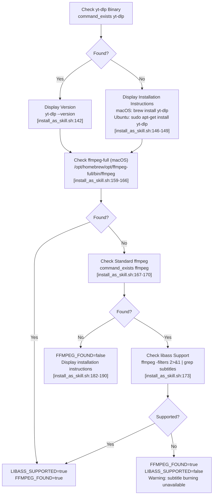
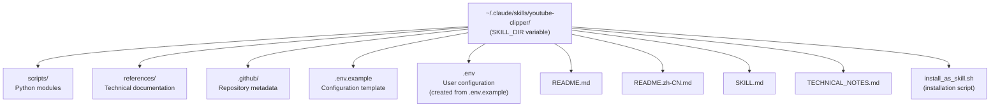
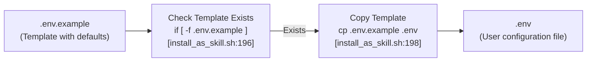

<!-- source: DeepWiki mcp.deepwiki.com · repo op7418/Youtube-clipper-skill · page 2.1 Installation · fetched 2026-10-26 -->

# Installation

<details>
<summary>Relevant source files</summary>

The following files were used as context for generating this wiki page:

- [README.md](README.md)
- [README.zh-CN.md](README.zh-CN.md)
- [install_as_skill.sh](install_as_skill.sh)

</details>


This document details the installation process for the YouTube Clipper Skill, including both automated installation methods, dependency setup, directory structure creation, and verification procedures. For system requirements and prerequisite software versions, see [System Requirements](#1.2). For troubleshooting installation problems, see [Installation Issues](#8.1).

## Installation Methods

The YouTube Clipper Skill provides two installation methods: automated installation via `npx skills` and manual installation via the `install_as_skill.sh` script. Both methods install the skill to `~/.claude/skills/youtube-clipper/` and set up all required dependencies.

### Method 1: npx skills (Recommended)

```bash
npx skills add https://github.com/op7418/Youtube-clipper-skill
```

This command automatically clones the repository and executes the installation script, placing the skill in the Claude Code skills directory at `~/.claude/skills/youtube-clipper/`.

**Sources:** [README.md:26-32]()

### Method 2: Manual Installation

```bash
git clone https://github.com/op7418/Youtube-clipper-skill.git
cd Youtube-clipper-skill
bash install_as_skill.sh
```

The manual method provides more visibility into the installation process and is useful for debugging or custom installations.

**Sources:** [README.md:34-46]()

## Installation Process Flow

The installation process consists of multiple phases executed by the `install_as_skill.sh` script. The following diagram maps each installation phase to specific functions and code sections in the installation script:

```mermaid
flowchart TB
    Start["Installation Start<br/>(bash install_as_skill.sh)"]
    
    DetermineDir["Phase 1: Determine Target Directory<br/>SKILL_DIR=$HOME/.claude/skills/youtube-clipper<br/>[install_as_skill.sh:60]"]
    
    CheckExisting["Phase 2: Check Existing Installation<br/>if [ -d $SKILL_DIR ]<br/>[install_as_skill.sh:64-74]"]
    
    Decision{Directory<br/>Exists?}
    
    Prompt["Prompt User: Overwrite?<br/>read -p 'y/N'<br/>[install_as_skill.sh:66-71]"]
    
    Remove["Remove Old Installation<br/>rm -rf $SKILL_DIR<br/>[install_as_skill.sh:73]"]
    
    CreateDir["Phase 3: Create Skill Directory<br/>mkdir -p $SKILL_DIR<br/>[install_as_skill.sh:78]"]
    
    CopyFiles["Phase 4: Copy Project Files<br/>cp -r $SCRIPT_DIR/* $SKILL_DIR/<br/>[install_as_skill.sh:82-106]"]
    
    Cleanup["Cleanup: Remove Unwanted Files<br/>.git, venv, __pycache__, youtube-clips<br/>[install_as_skill.sh:91-105]"]
    
    CheckPython["Phase 5: Check Python 3<br/>command_exists python3<br/>[install_as_skill.sh:110-117]"]
    
    CheckPip["Phase 6: Check pip<br/>command_exists pip3/pip<br/>[install_as_skill.sh:120-124]"]
    
    InstallPython["Phase 7: Install Python Dependencies<br/>pip3 install yt-dlp pysrt python-dotenv<br/>[install_as_skill.sh:127-137]"]
    
    CheckYtDlp["Phase 8: Verify yt-dlp CLI<br/>command_exists yt-dlp<br/>[install_as_skill.sh:140-150]"]
    
    CheckFFmpeg["Phase 9: Verify FFmpeg + libass<br/>ffmpeg -filters 2>&1 | grep subtitles<br/>[install_as_skill.sh:153-191]"]
    
    CreateEnv["Phase 10: Create .env File<br/>cp .env.example .env<br/>[install_as_skill.sh:194-208]"]
    
    Complete["Installation Complete<br/>print_header 'Installation Complete!'<br/>[install_as_skill.sh:211-234]"]
    
    Start --> DetermineDir
    DetermineDir --> CheckExisting
    CheckExisting --> Decision
    Decision -->|Yes| Prompt
    Decision -->|No| CreateDir
    Prompt -->|Yes| Remove
    Prompt -->|No| Complete
    Remove --> CreateDir
    CreateDir --> CopyFiles
    CopyFiles --> Cleanup
    Cleanup --> CheckPython
    CheckPython --> CheckPip
    CheckPip --> InstallPython
    InstallPython --> CheckYtDlp
    CheckYtDlp --> CheckFFmpeg
    CheckFFmpeg --> CreateEnv
    CreateEnv --> Complete
```



**Sources:** [install_as_skill.sh:1-242]()

## Dependency Installation Details

The installation script manages three categories of dependencies: Python runtime, Python packages, and system binaries.

### Python Packages

The following Python packages are installed via `pip3` or `pip`:

| Package | Purpose | Installation Line |
|---------|---------|-------------------|
| `yt-dlp` | YouTube video downloading (Python library) | [install_as_skill.sh:132-135]() |
| `pysrt` | SRT subtitle file parsing | [install_as_skill.sh:132-135]() |
| `python-dotenv` | Environment variable loading from `.env` | [install_as_skill.sh:132-135]() |

The installation uses the `-q` flag for quiet installation and attempts `pip3` first, falling back to `pip` if unavailable.

**Sources:** [install_as_skill.sh:127-137](), [README.md:62-65]()

### System Binary Detection

The script verifies but does not install system binaries. Detection logic:



**Sources:** [install_as_skill.sh:140-191]()

### FFmpeg libass Detection Logic

The script prioritizes `ffmpeg-full` on macOS because it includes libass support by default. Detection order:

1. Check `/opt/homebrew/opt/ffmpeg-full/bin/ffmpeg` (Apple Silicon)
2. Check `/usr/local/opt/ffmpeg-full/bin/ffmpeg` (Intel Mac)
3. Check standard `ffmpeg` in PATH and verify libass support via filter listing

The libass verification command:
```bash
ffmpeg -filters 2>&1 | grep subtitles
```

If this command finds the `subtitles` filter, libass support is confirmed. Without libass, the `burn_subtitles.py` script cannot function.

**Sources:** [install_as_skill.sh:153-191](), [README.md:67-83]()

## Directory Structure Created

The installation creates the following directory structure at `~/.claude/skills/youtube-clipper/`:



**Excluded from installation** (removed by cleanup phase):
- `.git/` directory ([install_as_skill.sh:91-93]())
- `venv/` directory ([install_as_skill.sh:94-96]())
- `__pycache__/` directories ([install_as_skill.sh:97-99]())
- `youtube-clips/` directory ([install_as_skill.sh:100-102]())
- Existing `.env` file (to prevent overwriting user configuration) ([install_as_skill.sh:103-105]())

**Sources:** [install_as_skill.sh:82-106]()

## Environment Configuration File Creation

The installation script creates a `.env` file from the `.env.example` template:



The `.env` file location: `~/.claude/skills/youtube-clipper/.env`

Users can customize this file to override default settings. For detailed configuration options, see [Configuration](#6).

**Sources:** [install_as_skill.sh:194-208]()

## Installation Output and Verification

The installation script uses color-coded output functions to indicate status:

| Function | Purpose | Used For |
|----------|---------|----------|
| `print_info()` | Blue info messages | Progress updates ([install_as_skill.sh:26-28]()) |
| `print_success()` | Green success messages | Completion confirmations ([install_as_skill.sh:30-32]()) |
| `print_warning()` | Yellow warnings | Non-critical issues ([install_as_skill.sh:34-36]()) |
| `print_error()` | Red error messages | Critical failures ([install_as_skill.sh:38-40]()) |
| `print_header()` | Section headers | Phase separators ([install_as_skill.sh:42-48]()) |

### Successful Installation Output

A successful installation displays:

1. Installation location: `~/.claude/skills/youtube-clipper/`
2. Python version detected
3. Installed Python packages: `yt-dlp`, `pysrt`, `python-dotenv`
4. yt-dlp version (if installed)
5. FFmpeg version and libass support status
6. `.env` file creation confirmation
7. Usage instructions and documentation links

### Verification Steps

After installation, verify the following:

**Check Skill Directory:**
```bash
ls -la ~/.claude/skills/youtube-clipper/
```

Expected files: `scripts/`, `.env`, `README.md`, `SKILL.md`, etc.

**Verify Python Dependencies:**
```bash
python3 -c "import yt_dlp, pysrt, dotenv; print('All packages installed')"
```

**Verify yt-dlp CLI:**
```bash
yt-dlp --version
```

**Verify FFmpeg with libass:**
```bash
ffmpeg -filters 2>&1 | grep subtitles
```

Expected output: `subtitles    V->V  (...)`

**Sources:** [install_as_skill.sh:211-234]()

## Error Handling

The installation script includes error handling via the `trap` command:

```bash
trap 'print_error "安装过程中发生错误"; exit 1' ERR
```

This ensures that any command failure (with `set -e` enabled at [install_as_skill.sh:16]()) triggers an error message and clean exit.

The `set -e` flag causes the script to exit immediately if any command returns a non-zero status, preventing partial installations.

**Sources:** [install_as_skill.sh:16](), [install_as_skill.sh:238]()

## Post-Installation Next Steps

After successful installation:

1. **Review Configuration**: Edit `~/.claude/skills/youtube-clipper/.env` to customize settings (see [Configuration](#6))
2. **Verify System Dependencies**: Ensure yt-dlp and FFmpeg are properly installed if warnings were displayed
3. **Test the Skill**: Follow the usage instructions in [Basic Usage](#2.2)
4. **Review Documentation**: Read `SKILL.md` for detailed workflow information

If installation issues occur, consult [Installation Issues](#8.1) for troubleshooting guidance.

**Sources:** [README.md:87-110](), [install_as_skill.sh:224-233]()

---

