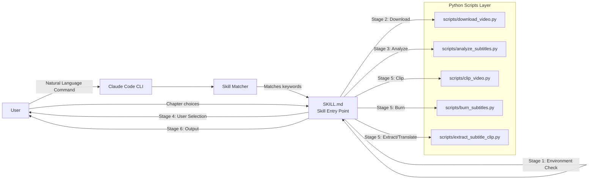
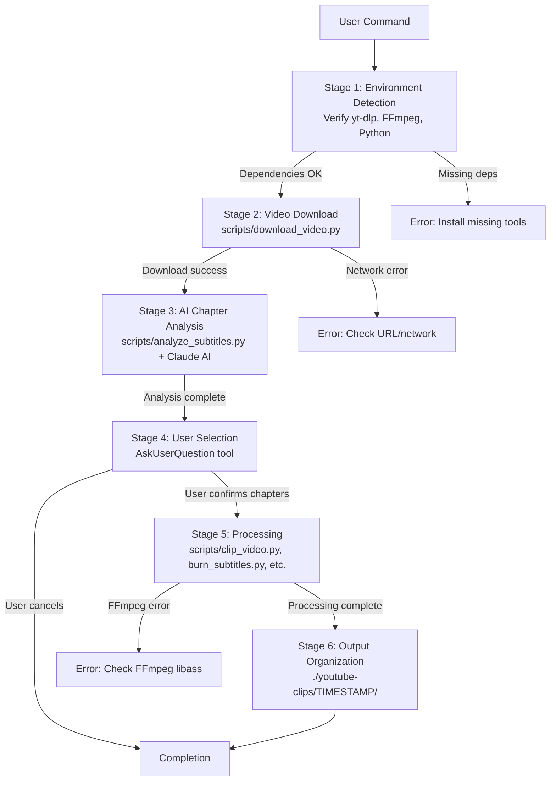
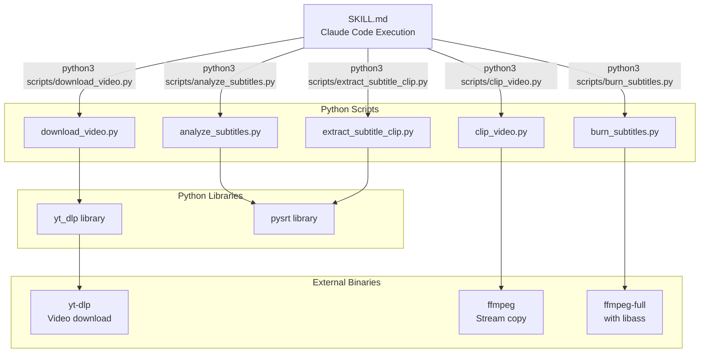

<!-- source: DeepWiki mcp.deepwiki.com · repo op7418/Youtube-clipper-skill · page 2.2 Basic Usage · fetched 2026-10-26 -->

# Basic Usage

<details>
<summary>Relevant source files</summary>

The following files were used as context for generating this wiki page:

- [README.md](README.md)
- [README.zh-CN.md](README.zh-CN.md)
- [SKILL.md](SKILL.md)

</details>


This page explains how to invoke the YouTube Clipper Skill through Claude Code using natural language commands and describes what to expect during execution. For detailed information about the six-stage processing pipeline, see [Understanding the Workflow](#2.3). For installation instructions, see [Installation](#2.1).

## Purpose and Scope

This document covers the basic interaction patterns for using the YouTube Clipper Skill: invoking the skill with natural language commands, responding to interactive prompts, and understanding the output files. It does not cover internal architecture details (see [Architecture](#3)), individual script implementations (see [Core Scripts](#4)), or advanced configuration options (see [Configuration](#6)).

---

## Skill Invocation

The YouTube Clipper Skill is invoked through Claude Code using natural language commands. The skill is registered with the Claude Code platform via the skill definition file at [SKILL.md:1-15]().

### Natural Language Commands

Users can invoke the skill with various natural language patterns:

**English commands:**
```
Clip this YouTube video: https://youtube.com/watch?v=VIDEO_ID
```

**Chinese commands:**
```
剪辑这个 YouTube 视频：https://youtube.com/watch?v=VIDEO_ID
```

**Variations:**
```
Extract clips from this video: <URL>
Download and clip this YouTube video: <URL>
Create short clips from this lecture: <URL>
```

The skill recognizes keywords like "clip", "剪辑", "YouTube", and "video" to trigger activation. The skill definition at [SKILL.md:3-6]() specifies the description and keywords used for skill matching.

### Command Flow Diagram



**Sources:** [SKILL.md:1-15](), [README.md:87-111]()

---

## Six-Stage Execution Flow

When invoked, the skill executes a six-stage workflow. Users interact at specific decision points while Claude Code handles the technical execution.

### Stage Overview Diagram



**Sources:** [SKILL.md:21-279](), [README.md:104-111]()

---

## Interactive Prompts

The skill requires user input at two key points during execution.

### Chapter Selection Prompt

After AI analysis (Stage 3), Claude Code presents generated chapters and asks the user to select which ones to clip.

**Example interaction:**
```
📊 分析完成，生成 8 个章节：

1. [00:00 - 03:15] AGI 不是时间点，是指数曲线
   核心: AI 模型能力每 4-12 月翻倍，工程师已用 Claude 写代码
   关键词: AGI、指数增长、Claude Code

2. [03:15 - 06:30] 中国在 AI 上的差距
   核心: 芯片禁运卡住中国，DeepSeek benchmark 优化不代表实力
   关键词: 中国、芯片禁运、DeepSeek

[... more chapters ...]

Which chapters would you like to clip? (e.g., 1,3,5 or all)
```

The chapter analysis logic is implemented in [SKILL.md:96-144](), which uses Claude AI to perform semantic analysis rather than mechanical time-based splitting.

### Processing Options Prompt

After chapter selection, the skill asks about optional processing steps:

**Example interaction:**
```
Processing options:
- Generate bilingual subtitles? (English + Chinese) [Y/n]
- Burn subtitles into video? (hardcoded) [Y/n]
- Generate social media summary? [Y/n]
```

These options control which processing scripts are invoked:
- Bilingual subtitles: [scripts/extract_subtitle_clip.py]() + translation
- Subtitle burning: [scripts/burn_subtitles.py]()
- Summary generation: `scripts/generate_summary.py` (if implemented)

**Sources:** [SKILL.md:148-162](), [SKILL.md:164-221]()

---

## Progress Monitoring

During Stage 5 (Processing), the skill displays real-time progress for each chapter being processed.

### Progress Display Format

```
🎬 开始处理章节 1/3: AGI 不是时间点，是指数曲线

1/6 剪辑视频片段... ✅
2/6 提取字幕片段... ✅
3/6 翻译字幕为中文... [=====>    ] 50% (26/52)
4/6 生成双语字幕文件... ✅
5/6 烧录字幕到视频... ✅
6/6 生成总结文案... ✅

✨ 章节 1 处理完成
```

### Processing Steps Mapping

| Progress Step | Script Invoked | Purpose |
|--------------|----------------|---------|
| 1/6 剪辑视频片段 | [scripts/clip_video.py]() | Extract video segment with FFmpeg |
| 2/6 提取字幕片段 | [scripts/extract_subtitle_clip.py]() | Extract and adjust subtitle timestamps |
| 3/6 翻译字幕 | Translation logic in skill | Batch translate subtitles (20-25 lines per API call) |
| 4/6 生成双语字幕 | Subtitle merging logic | Combine English and Chinese into single SRT |
| 5/6 烧录字幕 | [scripts/burn_subtitles.py]() | Hardcode subtitles using FFmpeg with libass |
| 6/6 生成总结 | Summary generation logic | Create social media content |

**Sources:** [SKILL.md:164-235](), [README.md:104-111]()

---

## Output Structure

All processed files are organized in a timestamped directory structure under `./youtube-clips/` in the current working directory.

### Directory Layout

```
./youtube-clips/
└── YYYYMMDD_HHMMSS/                    # Timestamp of processing session
    ├── Chapter_Title_1/                 # Sanitized chapter title
    │   ├── Chapter_Title_1_clip.mp4              # Original clip (no subtitles)
    │   ├── Chapter_Title_1_with_subtitles.mp4    # Video with burned subtitles
    │   ├── Chapter_Title_1_bilingual.srt         # Bilingual subtitle file
    │   └── Chapter_Title_1_summary.md            # Social media content
    ├── Chapter_Title_2/
    │   └── [same file structure]
    └── Chapter_Title_3/
        └── [same file structure]
```

### Output File Types

| File Type | Naming Convention | Description | Always Generated? |
|-----------|------------------|-------------|-------------------|
| Clipped Video | `*_clip.mp4` | Original video segment without subtitles | ✅ Yes |
| Burned Subtitles | `*_with_subtitles.mp4` | Video with hardcoded bilingual subtitles | ⚠️ Optional |
| Bilingual SRT | `*_bilingual.srt` | Subtitle file with English + target language | ⚠️ Optional |
| Summary | `*_summary.md` | Social media content and chapter summary | ⚠️ Optional |

### File Naming Sanitization

The skill automatically sanitizes chapter titles for use as filenames by:
- Removing special characters: `/`, `\`, `:`, `*`, `?`, `"`, `<`, `>`, `|`
- Replacing spaces with underscores
- Limiting length to 100 characters

This logic is referenced in [SKILL.md:340-350]() and [README.md:270-277]().

**Sources:** [SKILL.md:238-275](), [README.md:112-123]()

---

## File Path and Execution Context

### Skill Installation Location

The skill is installed at `~/.claude/skills/youtube-clipper/` with the following structure:

```
~/.claude/skills/youtube-clipper/
├── SKILL.md                  # Skill definition and workflow
├── .env                      # Configuration file
├── .env.example             # Configuration template
└── scripts/                 # Python processing scripts
    ├── download_video.py
    ├── analyze_subtitles.py
    ├── clip_video.py
    ├── burn_subtitles.py
    ├── extract_subtitle_clip.py
    └── utils.py
```

### Script Execution Pattern

All Python scripts are executed from the skill directory context:

```bash
cd ~/.claude/skills/youtube-clipper
python3 scripts/<script_name>.py <arguments>
```

This execution pattern is consistent throughout the skill workflow as seen in [SKILL.md:74-77]() for video download and similar patterns for other scripts.

**Sources:** [SKILL.md:74-77](), [SKILL.md:100-102](), [README.md:32-46]()

---

## Example Session

### Complete Usage Example

**User command:**
```
Clip this YouTube video: https://youtube.com/watch?v=Ckt1cj0xjRM
```

**Stage 1 output:**
```
✓ Checking dependencies...
  ✓ yt-dlp: 2024.12.6
  ✓ FFmpeg: 6.1.1 (with libass support)
  ✓ Python packages: yt_dlp, pysrt, python-dotenv
```

**Stage 2 output:**
```
📥 Downloading video...
  Title: "AGI and the Future of AI Development"
  Duration: 42:30
  Resolution: 1920x1080
  
✓ Downloaded: Ckt1cj0xjRM.mp4 (156 MB)
✓ Subtitles: Ckt1cj0xjRM.en.vtt (52 KB)
```

**Stage 3 output:**
```
📊 AI 章节分析完成，生成 12 个章节：

1. [00:00 - 03:15] AGI definition and exponential growth
2. [03:15 - 06:30] China's AI development gap
3. [06:30 - 09:45] Impact of chip bans
[... 9 more chapters ...]

✓ All content covered, no gaps
```

**Stage 4 prompts:**
```
Which chapters would you like to clip? > 1,2,3

Processing options:
- Generate bilingual subtitles? (English + 中文) [Y/n] > Y
- Burn subtitles into video? [Y/n] > Y
- Generate social media summary? [Y/n] > Y
```

**Stage 5 progress:**
```
🎬 Processing chapter 1/3: AGI_definition_and_exponential_growth

1/6 Clipping video segment... ✅
2/6 Extracting subtitle segment... ✅
3/6 Translating subtitles... [=========>] 100% (52/52)
4/6 Creating bilingual subtitle file... ✅
5/6 Burning subtitles to video... ✅
6/6 Generating summary... ✅

✨ Chapter 1 complete (18.4 MB)

[Progress for chapters 2 and 3...]
```

**Stage 6 output:**
```
✨ Processing complete!

📁 Output directory: ./youtube-clips/20260122_143022/

Files generated:
  📂 AGI_definition_and_exponential_growth/
     🎬 AGI_definition_and_exponential_growth_clip.mp4 (14.2 MB)
     🎬 AGI_definition_and_exponential_growth_with_subtitles.mp4 (18.4 MB)
     📄 AGI_definition_and_exponential_growth_bilingual.srt (2.3 KB)
     📝 AGI_definition_and_exponential_growth_summary.md (1.8 KB)
  
  [... chapters 2 and 3 ...]

Preview command:
  open ./youtube-clips/20260122_143022/
```

**Sources:** [README.md:157-189](), [SKILL.md:21-279]()

---

## Command-Line Tool Mapping

The skill invokes several external tools through Python scripts. Understanding this mapping helps when troubleshooting.

### Tool Invocation Chain



### Environment Detection Commands

During Stage 1, the skill executes these verification commands:

| Check | Command | Expected Output |
|-------|---------|----------------|
| yt-dlp version | `yt-dlp --version` | Version number (e.g., 2024.12.6) |
| FFmpeg version | `ffmpeg -version` | Version and configuration |
| FFmpeg libass | `ffmpeg -filters 2>&1 \| grep subtitles` | `subtitles V->V` filter listed |
| Python yt_dlp | `python3 -c "import yt_dlp"` | No error |
| Python pysrt | `python3 -c "import pysrt"` | No error |

These checks are specified in [SKILL.md:25-50]().

**Sources:** [SKILL.md:25-63](), [README.md:50-66]()

---

## Configuration Impact on Usage

While basic usage works with default settings, users can customize behavior through the `.env` file at `~/.claude/skills/youtube-clipper/.env`.

### Key Settings for Basic Usage

| Setting | Default | Impact on Usage |
|---------|---------|-----------------|
| `OUTPUT_DIR` | `./youtube-clips` | Changes where output files are saved |
| `MAX_VIDEO_HEIGHT` | `1080` | Limits video download resolution |
| `TARGET_LANGUAGE` | `中文` | Changes translation target language |
| `TRANSLATION_BATCH_SIZE` | `20` | Affects translation speed and API usage |
| `TARGET_CHAPTER_DURATION` | `180` | Guides AI chapter length (seconds) |

For complete configuration details, see [Configuration](#6).

**Sources:** [README.md:127-153](), [.env.example]()

---

## Error Scenarios and User Response

### Common Error Messages

**Missing dependencies:**
```
❌ Error: yt-dlp not found
Please install: brew install yt-dlp
```

**FFmpeg without libass:**
```
❌ Error: FFmpeg does not support subtitle burning
Your FFmpeg installation is missing libass support.

macOS: brew install ffmpeg-full
Ubuntu: sudo apt install ffmpeg libass-dev
```

**Network error during download:**
```
❌ Error: Failed to download video
Check your internet connection and YouTube URL
```

**Invalid URL:**
```
❌ Error: Invalid YouTube URL
Expected format: https://youtube.com/watch?v=VIDEO_ID
```

### User Actions for Errors

The skill provides actionable error messages with installation commands. Users typically need to:

1. **For dependency errors:** Run the suggested installation command, then retry
2. **For network errors:** Check connection, proxy settings in `.env`, then retry
3. **For URL errors:** Verify the YouTube URL format and retry

Error handling logic is described in [SKILL.md:321-337]().

**Sources:** [SKILL.md:321-337](), [README.md:236-278]()

---

## Next Steps

After completing a basic usage session, users may want to:

- **Understand the detailed workflow:** See [Understanding the Workflow](#2.3) for in-depth explanation of each stage
- **Customize configuration:** See [Configuration](#6) for all available settings
- **Learn about AI features:** See [AI Semantic Analysis](#7.2) and [Batch Translation Optimization](#7.1)
- **Troubleshoot issues:** See [Troubleshooting](#8) for common problems and solutions
- **Understand output formats:** See [Bilingual Subtitle Format](#7.3)

**Sources:** [README.md:1-320](), [SKILL.md:1-374]()

---

