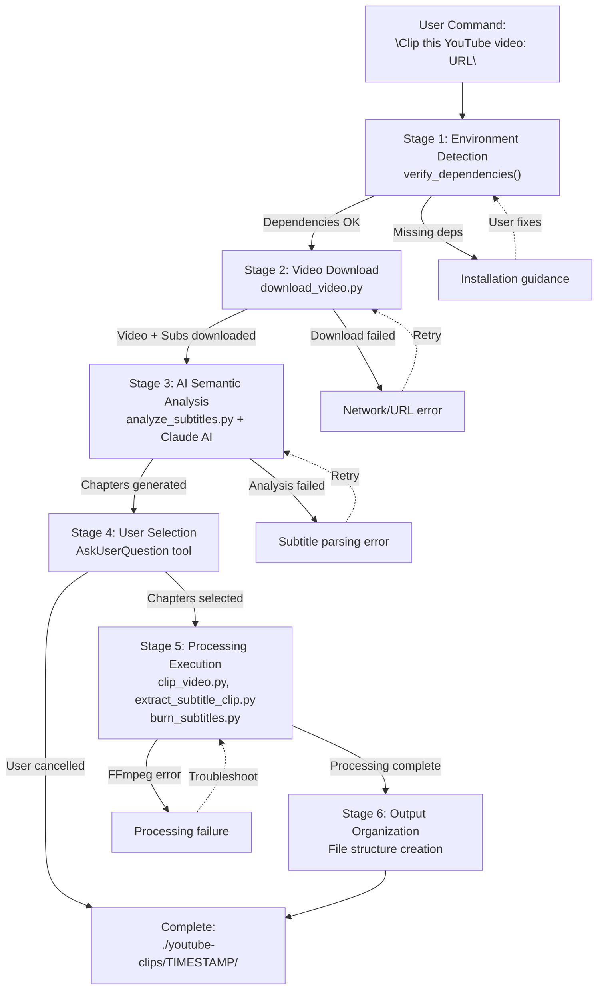
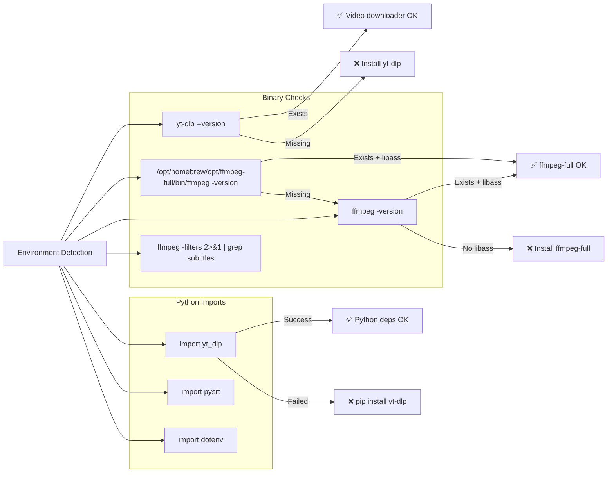
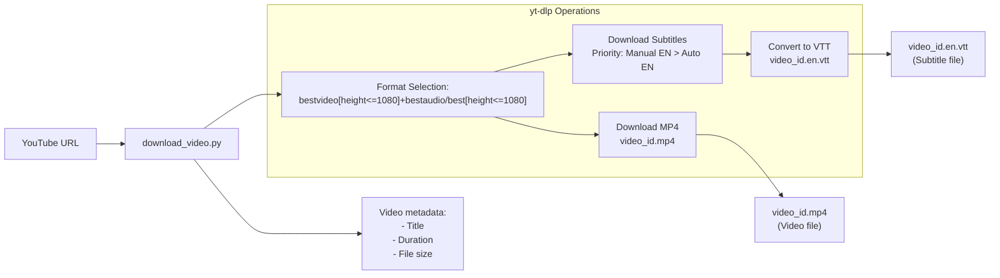
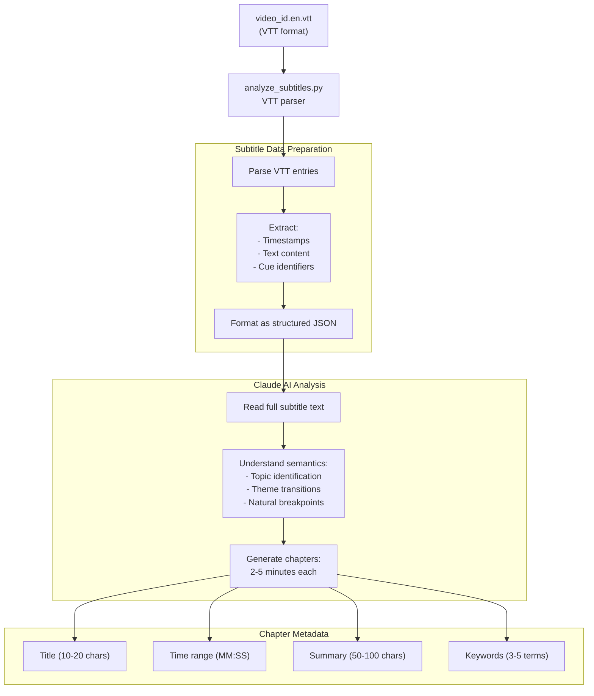
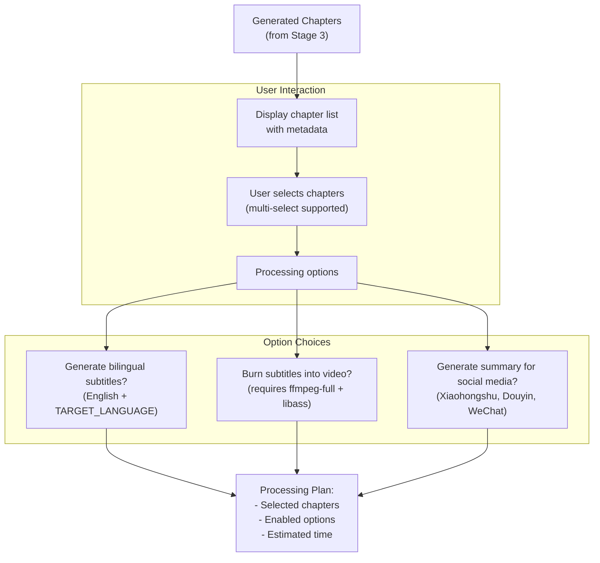
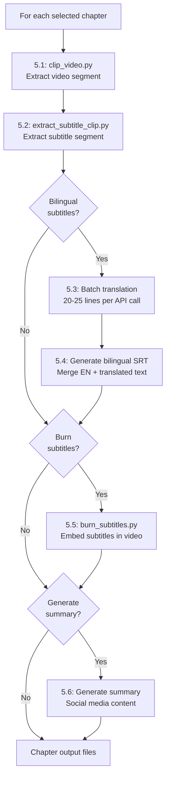
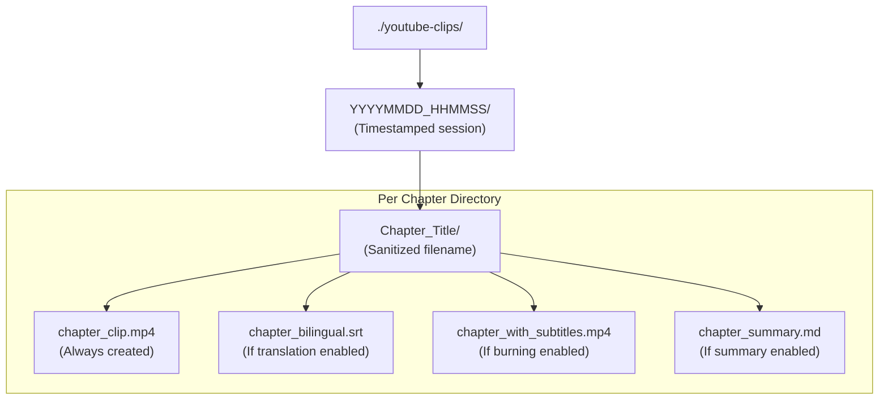
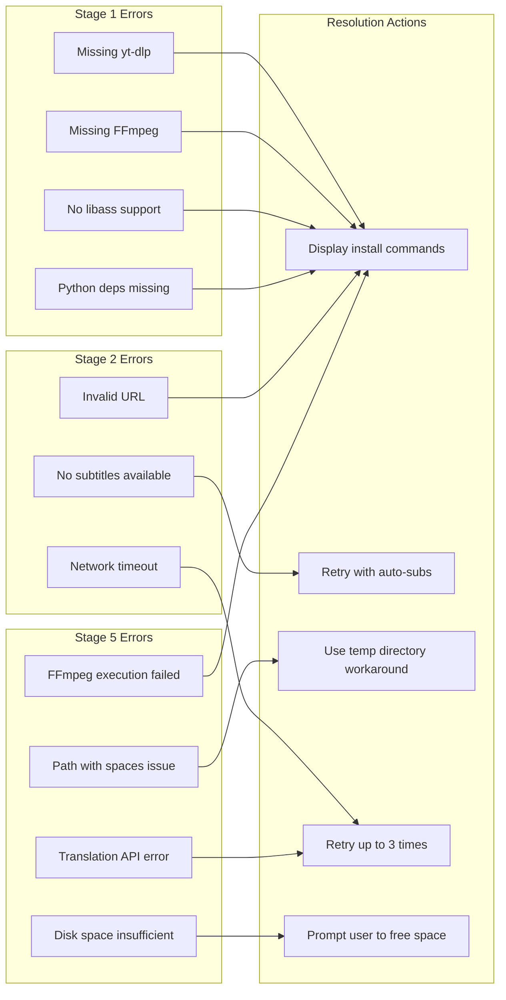

<!-- source: DeepWiki mcp.deepwiki.com · repo op7418/Youtube-clipper-skill · page 2.3 Understanding the Workflow · fetched 2026-10-26 -->

# Understanding the Workflow

<details>
<summary>Relevant source files</summary>

The following files were used as context for generating this wiki page:

- [README.md](README.md)
- [README.zh-CN.md](README.zh-CN.md)
- [SKILL.md](SKILL.md)

</details>


This document walks through the six-stage processing pipeline that executes when you ask Claude Code to clip a YouTube video. Each stage is explained with its purpose, key operations, involved scripts, and expected outputs. This provides a practical understanding of what happens behind the scenes when the skill runs.

For detailed technical implementation of each script, see [Core Scripts](#4). For AI integration specifics, see [AI Integration](#3.3). For configuration of workflow behavior, see [Configuration](#6).

---

## Workflow Overview

The YouTube Clipper Skill executes as a sequential six-stage pipeline. Each stage depends on the successful completion of the previous stage, with user interaction at strategic decision points.



**Sources:** [SKILL.md:22-275](), [README.md:103-110]()

---

## Stage 1: Environment Detection

**Purpose:** Verify all required dependencies are available before attempting any processing.

The skill checks three categories of dependencies:

### System Binaries



### Key Detection Commands

| Component | Detection Command | Expected Output |
|-----------|------------------|-----------------|
| yt-dlp | `yt-dlp --version` | Version string |
| FFmpeg (preferred) | `/opt/homebrew/opt/ffmpeg-full/bin/ffmpeg -version` | FFmpeg version with libass |
| FFmpeg (fallback) | `ffmpeg -version` | FFmpeg version |
| libass support | `ffmpeg -filters 2>&1 \| grep subtitles` | `subtitles V->V` filter listing |
| yt_dlp module | `python3 -c "import yt_dlp"` | No output (success) |
| pysrt module | `python3 -c "import pysrt"` | No output (success) |

### Critical Requirement: libass

The standard Homebrew `ffmpeg` package does **not** include libass support, which is required for [burn_subtitles.py]() to function. The skill specifically checks for `ffmpeg-full` at [/opt/homebrew/opt/ffmpeg-full/bin/ffmpeg]() on macOS systems.

**Sources:** [SKILL.md:25-63](), [README.md:67-83](), [README.md:239-250]()

---

## Stage 2: Video Download

**Purpose:** Acquire the video file and English subtitles from YouTube.

This stage is handled by [scripts/download_video.py](), which wraps the `yt-dlp` library with specific configuration for quality and subtitle handling.



### Download Configuration

The script applies these constraints:

- **Video quality:** Maximum 1080p (configurable via `MAX_VIDEO_HEIGHT`)
- **Format:** MP4 container with H.264 video and AAC audio
- **Subtitle language:** English (manual subtitles preferred, auto-generated as fallback)
- **Subtitle format:** VTT (WebVTT) with timestamps
- **Filename:** Uses video ID to avoid special character issues (e.g., `dQw4w9WgXcQ.mp4`)

### Output Files

| File | Pattern | Purpose |
|------|---------|---------|
| Video | `{video_id}.mp4` | Source video for clipping |
| Subtitles | `{video_id}.en.vtt` | English subtitles for analysis |

**Sources:** [SKILL.md:67-93](), [README.md:57](), [.env.example:15-22]()

---

## Stage 3: AI Semantic Analysis

**Purpose:** Generate meaningful chapters based on content understanding, not mechanical time splitting.

This is the **core differentiator** of the skill. It involves two components:

1. [scripts/analyze_subtitles.py]() - Parses VTT format and prepares subtitle data
2. Claude AI - Performs semantic analysis to identify topic boundaries



### Chapter Generation Principles

The AI analysis follows these guidelines defined in [SKILL.md:122-127]():

| Principle | Specification |
|-----------|---------------|
| **Granularity** | 2-5 minutes per chapter (target: 180-300 seconds) |
| **Completeness** | All video content covered, no gaps |
| **Meaningfulness** | Each chapter represents a coherent topic |
| **Natural boundaries** | Split at semantic transitions, not arbitrary timestamps |

### Chapter Structure

Each generated chapter contains:

```
Chapter N:
├── Title: "AGI as exponential curve"
├── Time Range: "00:00 - 03:15"
├── Core Summary: "AI models double in capability every 4-12 months..."
└── Keywords: ["AGI", "exponential growth", "Claude Code"]
```

### Example Output

From [README.md:167-172]():

```
1. [00:00 - 03:15] AGI as an exponential curve, not a point in time
2. [03:15 - 06:30] China's gap in AI development
3. [06:30 - 09:45] The impact of chip bans
```

**Sources:** [SKILL.md:96-144](), [README.md:16](), [README.md:193-209]()

---

## Stage 4: User Selection

**Purpose:** Allow user to choose which chapters to process and what processing options to apply.

This stage uses Claude Code's `AskUserQuestion` tool to interact with the user. No Python scripts are directly involved; this is pure orchestration by Claude Code.



### Selection Format

Users can select chapters by:
- Single number: `1`
- Multiple numbers: `1,3,5`
- Range: `1-3`
- Combination: `1,3-5,7`

### Processing Options

| Option | Script Involved | Dependencies |
|--------|----------------|--------------|
| Bilingual subtitles | [extract_subtitle_clip.py]() + translation | Claude AI API |
| Burn subtitles | [burn_subtitles.py]() | FFmpeg with libass |
| Generate summary | Claude AI | None (built-in) |

**Sources:** [SKILL.md:146-161](), [README.md:109]()

---

## Stage 5: Processing Execution

**Purpose:** Execute selected processing tasks for each chosen chapter.

This stage orchestrates multiple Python scripts in a coordinated sequence. Each chapter undergoes up to six sub-stages depending on user-selected options.



### Sub-Stage 5.1: Video Clipping

**Script:** [scripts/clip_video.py]()

Extracts precise video segment using FFmpeg stream copying:

```bash
python3 scripts/clip_video.py <video_path> <start_time> <end_time> <output_path>
```

- **Method:** FFmpeg `-ss` (seek start) and `-to` (seek end) with `-c copy`
- **Quality:** Lossless (no re-encoding)
- **Precision:** Frame-accurate timing
- **Output:** `{chapter_title}_clip.mp4`

### Sub-Stage 5.2: Subtitle Extraction

**Script:** [scripts/extract_subtitle_clip.py]()

Filters subtitles by time range and adjusts timestamps:

- Extract entries within `[start_time, end_time]`
- Adjust timestamps: `new_timestamp = original_timestamp - start_time`
- Convert VTT to SRT format
- Output: `{chapter_title}_original.srt`

### Sub-Stage 5.3: Batch Translation

**Optimization:** Translates 20-25 subtitle lines per API call instead of one-by-one.

Translation strategy from [SKILL.md:188-193]():
- Maintain technical term accuracy
- Use conversational language for short-form video
- Keep translations concise and fluid
- Batch size configurable via `TRANSLATION_BATCH_SIZE` in [.env.example:37]()

**API Call Reduction:** 95% fewer calls compared to line-by-line translation

### Sub-Stage 5.4: Bilingual Subtitle Generation

Merges original and translated subtitles into dual-language SRT format:

```srt
1
00:00:00,000 --> 00:00:03,500
This is the English subtitle
这是中文字幕

2
00:00:03,500 --> 00:00:07,000
Another English line
另一行中文
```

Output: `{chapter_title}_bilingual.srt`

### Sub-Stage 5.5: Subtitle Burning

**Script:** [scripts/burn_subtitles.py]()

Hardcodes subtitles into video using FFmpeg's `subtitles` filter:

```bash
python3 scripts/burn_subtitles.py <video_path> <subtitle_path> <output_path>
```

**Critical Implementation Detail:** The script uses a temporary directory workaround to handle paths with spaces, as FFmpeg's subtitles filter cannot properly parse escaped spaces. See [SKILL.md:287-291]() for details.

Subtitle styling from [.env.example:24-32]():
- Font size: 24
- Bottom margin: 30
- Color: White text with black outline

Output: `{chapter_title}_with_subtitles.mp4`

### Sub-Stage 5.6: Summary Generation

Uses Claude AI to generate social media content:
- Platform-specific formatting (Xiaohongshu, Douyin, WeChat)
- Based on chapter title, summary, and keywords
- Includes: headline, key points, hashtags

Output: `{chapter_title}_summary.md`

**Sources:** [SKILL.md:164-235](), [README.md:16-20](), [README.md:212-217]()

---

## Stage 6: Output Organization

**Purpose:** Create organized directory structure and present results to user.



### Directory Structure

The output follows a three-level hierarchy:

```
./youtube-clips/                          # Base output directory
└── 20260122_143022/                      # Session timestamp
    ├── AGI_as_exponential_curve/         # Chapter 1
    │   ├── AGI_as_exponential_curve_clip.mp4
    │   ├── AGI_as_exponential_curve_bilingual.srt
    │   ├── AGI_as_exponential_curve_with_subtitles.mp4
    │   └── AGI_as_exponential_curve_summary.md
    └── China_gap_in_AI/                  # Chapter 2
        ├── China_gap_in_AI_clip.mp4
        └── ...
```

### Filename Sanitization

Chapter titles are sanitized to create valid filenames (from [SKILL.md:347-350]()):

- Remove special characters: `/ \ : * ? " < > |`
- Replace spaces with underscores
- Limit length to 100 characters

### Output Presentation

The skill displays to the user:

1. **Output directory path** - Full path to session directory
2. **File listing** - All generated files with sizes
3. **Quick preview command** - OS-specific command to open files
4. **Continuation prompt** - Option to process more chapters

Example output from [SKILL.md:262-274]():

```
✨ Processing complete!

📁 Output directory: ./youtube-clips/20260121_143022/

Files:
  🎬 AGI_exponential_curve_with_subtitles.mp4 (14 MB)
  📄 AGI_exponential_curve_bilingual.srt (2.3 KB)
  📝 AGI_exponential_curve_summary.md (3.2 KB)

Quick preview:
open ./youtube-clips/20260121_143022/AGI_exponential_curve_with_subtitles.mp4
```

**Sources:** [SKILL.md:238-278](), [README.md:112-123]()

---

## Error Handling Flow

Each stage has specific error handling and recovery mechanisms:



### Common Error Scenarios

| Error Type | Detection | Resolution |
|------------|-----------|------------|
| Missing dependencies | Command not found / Import error | Display platform-specific install commands |
| No libass support | grep returns empty | Guide to install ffmpeg-full |
| Network issues | yt-dlp timeout | Automatic retry, suggest proxy configuration |
| Translation failures | API error | Retry up to 3 times, reduce batch size |
| Path issues | FFmpeg subtitles filter error | Temporary directory workaround (automatic) |

**Sources:** [SKILL.md:322-337](), [README.md:236-278]()

---

## Workflow Execution Context

The entire workflow executes within the Claude Code environment with the skill installed at `~/.claude/skills/youtube-clipper/`. All scripts are invoked with:

```bash
cd ~/.claude/skills/youtube-clipper
python3 scripts/<script_name>.py <arguments>
```

### Key Environment Variables

These variables from [.env.example]() affect workflow behavior:

| Variable | Impact on Workflow | Default |
|----------|-------------------|---------|
| `FFMPEG_PATH` | FFmpeg binary location for stages 5.1, 5.5 | Auto-detected |
| `OUTPUT_DIR` | Base directory for stage 6 output | `./youtube-clips` |
| `MAX_VIDEO_HEIGHT` | Video quality in stage 2 | 1080 |
| `TARGET_CHAPTER_DURATION` | AI chapter target in stage 3 | 180 seconds |
| `TRANSLATION_BATCH_SIZE` | Batch size in stage 5.3 | 20-25 |
| `TARGET_LANGUAGE` | Translation language in stage 5.3 | 中文 |

**Sources:** [.env.example](), [README.md:129-152]()

---

