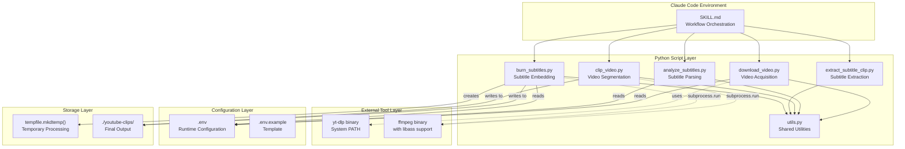
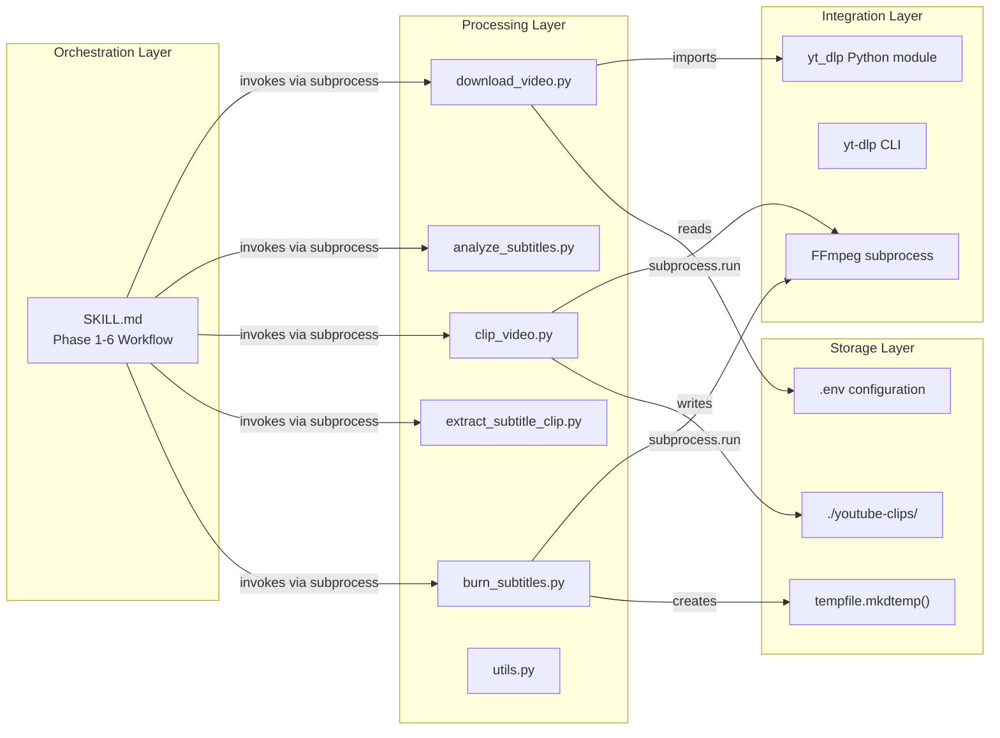
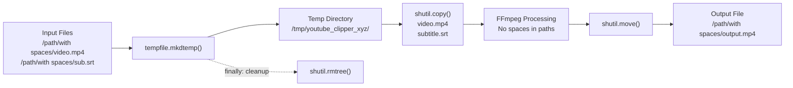
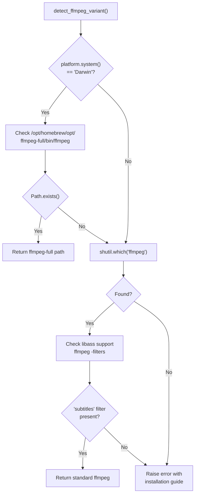
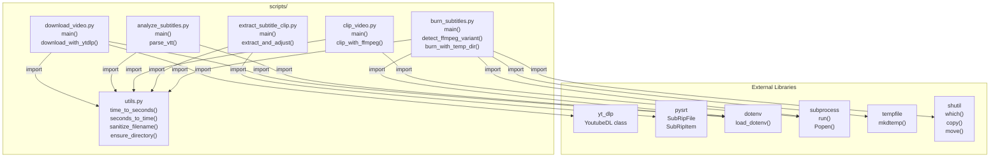
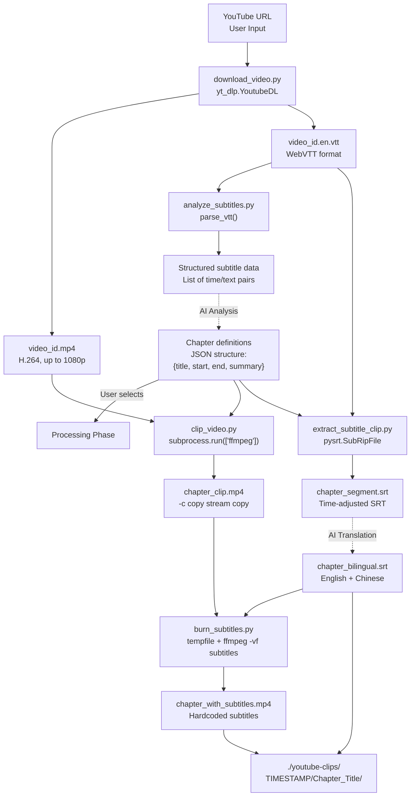
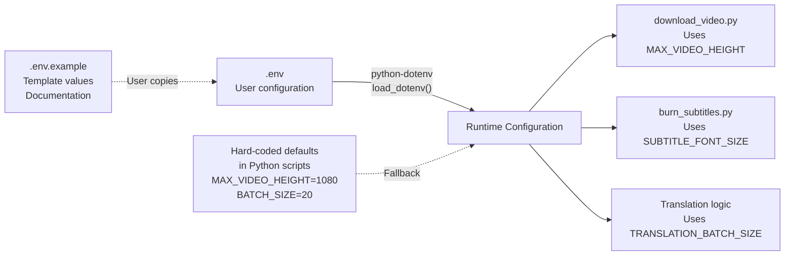
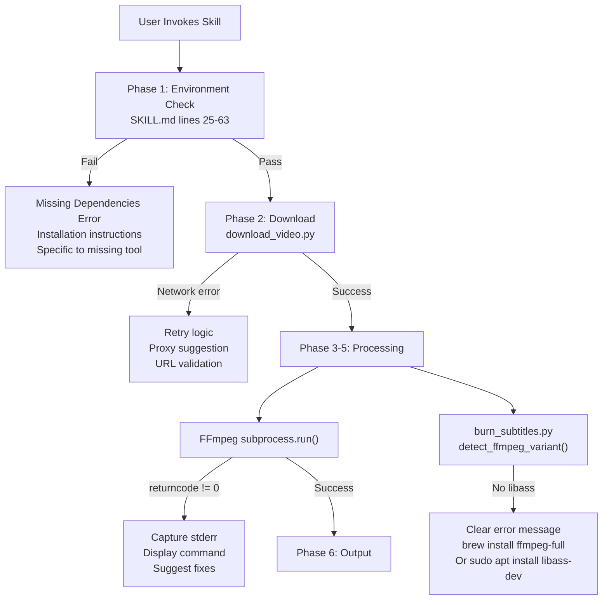

<!-- source: DeepWiki mcp.deepwiki.com · repo op7418/Youtube-clipper-skill · page 3 Architecture · fetched 2026-10-26 -->

# Architecture

<details>
<summary>Relevant source files</summary>

The following files were used as context for generating this wiki page:

- [README.md](README.md)
- [SKILL.md](SKILL.md)
- [TECHNICAL_NOTES.md](TECHNICAL_NOTES.md)

</details>


This document explains the internal architecture of the YouTube Clipper Skill, including its component relationships, layer model, and core design decisions. The architecture is designed around modularity, with each processing phase encapsulated in a dedicated Python script that can be invoked independently or as part of the complete workflow.

For specific implementation details of individual scripts, see [Core Scripts](#4). For configuration options that affect architectural behavior, see [Configuration](#6). For troubleshooting architectural issues like FFmpeg integration problems, see [Troubleshooting](#8).

---

## System Overview

The YouTube Clipper Skill operates as a Claude Code skill with a multi-layer architecture. The system is structured around five core Python scripts located in [`scripts/`](), each responsible for a distinct processing phase, coordinated through the skill entry point defined in [`SKILL.md`]().



**Sources:** [README.md:1-319](), [SKILL.md:1-374](), [TECHNICAL_NOTES.md:1-490]()

---

## Component Layer Model

The system is organized into four distinct architectural layers, each with specific responsibilities and isolation boundaries:

| Layer | Components | Responsibility | Isolation Mechanism |
|-------|-----------|----------------|---------------------|
| **Orchestration** | `SKILL.md` | Workflow definition, phase sequencing, user interaction | Claude Code skill specification |
| **Processing** | `scripts/*.py` | Business logic, data transformation, external tool invocation | Independent Python modules |
| **Integration** | `yt-dlp`, `ffmpeg` | Platform-specific operations, format conversion | Subprocess execution with error capture |
| **Storage** | `.env`, `tempfile`, output directories | Configuration persistence, temporary data, final artifacts | File system isolation |



**Sources:** [SKILL.md:20-281](), [README.md:104-110]()

---

## Core Design Decisions

### 1. Modular Script Architecture

Each processing phase is implemented as a standalone Python script that can be invoked independently via command-line arguments. This design enables:

- **Independent testing**: Each script can be tested in isolation
- **Debugging**: Failed phases can be re-run without repeating entire workflow
- **Reusability**: Scripts can be used outside the Claude Code environment

**Implementation Pattern:**
```python
# All scripts follow this pattern:
if __name__ == '__main__':
    if len(sys.argv) < required_args:
        print(f"Usage: {sys.argv[0]} <args>")
        sys.exit(1)
    
    # Parse arguments
    # Execute processing
    # Output results
```

Scripts communicate through:
- **Input**: Command-line arguments (file paths, parameters)
- **Output**: File system artifacts (processed files)
- **Status**: stdout/stderr messages, exit codes

**Sources:** [scripts/download_video.py](), [scripts/clip_video.py](), [scripts/burn_subtitles.py]()

---

### 2. Temporary Directory Pattern for Path Safety

FFmpeg's `subtitles` filter cannot correctly parse file paths containing spaces, even with proper escaping ([TECHNICAL_NOTES.md:82-162]()). The system solves this with a temporary directory pattern implemented in `burn_subtitles.py`:



**Key Implementation Details:**
- `tempfile.mkdtemp(prefix='youtube_clipper_')` ensures paths without spaces
- Files are copied into temp directory before processing
- Cleanup occurs in `finally` block to ensure removal even on errors
- This approach is transparent to users who can use arbitrary paths

**Sources:** [TECHNICAL_NOTES.md:82-162](), [scripts/burn_subtitles.py]()

---

### 3. Dual FFmpeg Detection Strategy

The system implements a two-tier detection strategy for FFmpeg to handle the common issue of missing `libass` support:



This strategy handles three scenarios:
1. **macOS with ffmpeg-full**: Optimal, full subtitle support
2. **Standard ffmpeg with libass**: Works on most Linux systems
3. **No libass support**: Clear error with installation instructions

**Sources:** [TECHNICAL_NOTES.md:1-79](), [scripts/burn_subtitles.py]()

---

### 4. Batch Translation Optimization

Instead of making one API call per subtitle line, the system batches 20-25 lines per call, achieving 95% reduction in API calls. This is implemented through a grouping strategy:

| Approach | Subtitle Count | API Calls | Reduction |
|----------|---------------|-----------|-----------|
| Individual | 600 lines | 600 calls | Baseline |
| Batched (20/batch) | 600 lines | 30 calls | 95% |
| Batched (25/batch) | 600 lines | 24 calls | 96% |

**Batch Size Selection Rationale:**
- **< 20 lines**: Too many API calls, negates benefit
- **20-25 lines**: Optimal balance of efficiency and translation quality
- **> 30 lines**: Single request becomes too large, translation quality degrades

**Sources:** [TECHNICAL_NOTES.md:260-305](), [SKILL.md:185-193](), [README.md:211-216]()

---

## Module Dependency Graph

This diagram shows the concrete import relationships between Python modules using actual module and function names:



**Key Shared Utilities in `utils.py`:**

| Function | Purpose | Used By |
|----------|---------|---------|
| `time_to_seconds(time_str)` | Parse HH:MM:SS to seconds | `analyze_subtitles.py`, `extract_subtitle_clip.py` |
| `seconds_to_time(seconds)` | Format seconds to HH:MM:SS | `clip_video.py`, `extract_subtitle_clip.py` |
| `sanitize_filename(name)` | Remove invalid path characters | All output-generating scripts |
| `ensure_directory(path)` | Create directory if missing | `download_video.py`, `clip_video.py` |

**Sources:** [scripts/utils.py](), [scripts/download_video.py](), [scripts/burn_subtitles.py]()

---

## Data Flow Through System

This diagram traces actual data artifacts as they flow through the system, showing file formats and transformation points:



**File Format Transformations:**

| Stage | Input Format | Output Format | Tool |
|-------|-------------|---------------|------|
| Download | YouTube URL | MP4 + VTT | `yt_dlp.YoutubeDL` |
| Analysis | VTT | Parsed data structure | Custom `parse_vtt()` |
| Clipping | MP4 | MP4 segment | `ffmpeg -ss -to -c copy` |
| Extraction | VTT | SRT (time-adjusted) | `pysrt` library |
| Burning | MP4 + SRT | MP4 (subtitles embedded) | `ffmpeg -vf subtitles` |

**Critical Format Requirements:**
- **VTT to SRT conversion**: Time separator must change from `.` to `,` ([TECHNICAL_NOTES.md:166-213]())
- **Time adjustment**: Subtitle timestamps must be offset by chapter start time
- **Path safety**: All paths used with FFmpeg `subtitles` filter must not contain spaces

**Sources:** [SKILL.md:66-93](), [SKILL.md:164-235](), [TECHNICAL_NOTES.md:166-258]()

---

## Configuration System Architecture

The configuration system uses a three-tier fallback mechanism to ensure the system operates with sensible defaults while allowing customization:



**Configuration Categories and Their Impact:**

| Category | Variables | Affects Scripts | Default Fallback |
|----------|-----------|-----------------|------------------|
| **Paths** | `FFMPEG_PATH`, `OUTPUT_DIR` | `clip_video.py`, `burn_subtitles.py` | Auto-detection, `./youtube-clips` |
| **Video Quality** | `MAX_VIDEO_HEIGHT` | `download_video.py` | `1080` |
| **Subtitle Style** | `SUBTITLE_FONT_SIZE`, `SUBTITLE_MARGIN_V` | `burn_subtitles.py` | `24`, `30` |
| **Processing** | `TRANSLATION_BATCH_SIZE`, `TARGET_CHAPTER_DURATION` | Translation logic, Analysis | `20`, `180` |

**Sources:** [.env.example](), [README.md:127-153](), [scripts/download_video.py](), [scripts/burn_subtitles.py]()

---

## Error Handling Architecture

The system implements layered error handling with user-friendly messages at each level:



**Error Handling Patterns:**

1. **Environment Detection**: Fail fast with installation instructions before processing begins
2. **Subprocess Execution**: Capture both stdout and stderr, display full command for debugging
3. **File Operations**: Use `try/finally` blocks to ensure cleanup (especially for temp directories)
4. **External API**: Implement retry logic with exponential backoff

**Sources:** [SKILL.md:321-336](), [TECHNICAL_NOTES.md:444-474](), [README.md:236-278]()

---

## Summary

The YouTube Clipper Skill architecture achieves several key design goals:

1. **Modularity**: Each processing phase is isolated in a dedicated script with clear interfaces
2. **Robustness**: Multiple layers of error detection and workarounds for common issues (path spaces, missing libass)
3. **Efficiency**: Batch processing optimizations reduce API calls by 95%
4. **Flexibility**: Configuration system allows customization without code changes
5. **Maintainability**: Clear separation of concerns makes testing and debugging straightforward

The architecture's key innovation is its transparent handling of common system integration issues (FFmpeg path problems, missing dependencies) while maintaining a simple user-facing interface through Claude Code's natural language interaction.

**Sources:** [README.md:1-319](), [SKILL.md:1-374](), [TECHNICAL_NOTES.md:1-490]()

---

