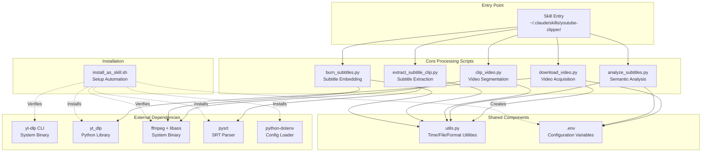
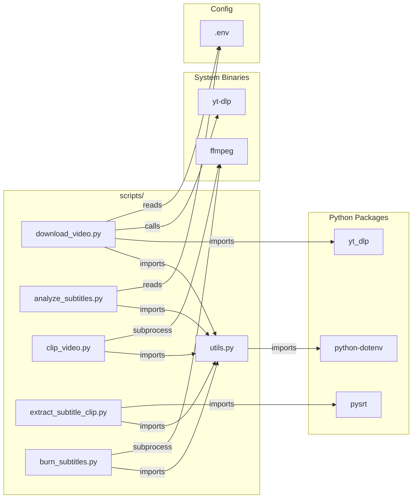

<!-- source: DeepWiki mcp.deepwiki.com · repo op7418/Youtube-clipper-skill · page 3.1 System Components · fetched 2026-10-26 -->

# System Components

<details>
<summary>Relevant source files</summary>

The following files were used as context for generating this wiki page:

- [README.md](README.md)
- [TECHNICAL_NOTES.md](TECHNICAL_NOTES.md)
- [scripts/__init__.py](scripts/__init__.py)

</details>


This document provides a comprehensive reference for all major components in the YouTube Clipper Skill codebase. It describes the purpose, location, and interactions of Python scripts, external tools, utilities, and configuration systems.

For information about how these components work together in the processing pipeline, see [Processing Pipeline](#3.2). For details on Claude AI integration specifically, see [AI Integration](#3.3).

## Component Categories

The YouTube Clipper Skill is organized into five primary component categories:

| Category | Purpose | Location |
|----------|---------|----------|
| **Core Scripts** | Python modules that execute specific processing stages | `scripts/*.py` |
| **External Tools** | Command-line utilities for video/subtitle processing | System PATH (yt-dlp, FFmpeg) |
| **Shared Utilities** | Common functions used across all scripts | `scripts/utils.py` |
| **Configuration** | Environment variables and settings | `.env`, `.env.example` |
| **Installation** | Setup automation and dependency verification | `install_as_skill.sh` |

Sources: [README.md:1-320](), Diagram 1 and Diagram 3 from high-level architecture

---

## Component Hierarchy



Sources: [README.md:42-66](), [TECHNICAL_NOTES.md:1-490](), Diagram 3 from high-level architecture

---

## Core Processing Scripts

The system implements five specialized Python scripts in the `scripts/` directory, each responsible for a discrete processing stage.

### download_video.py

**Purpose**: Downloads YouTube videos and subtitles using yt-dlp.

**Key Responsibilities**:
- Configures yt-dlp with quality limits (default 1080p max)
- Downloads video in mp4 format with best audio
- Extracts English subtitles (VTT format)
- Supports proxy configuration and rate limiting
- Provides download progress monitoring

**External Dependencies**:
- `yt_dlp` Python library
- `yt-dlp` CLI tool (fallback)

**Configuration Variables**:
- `MAX_VIDEO_HEIGHT` - Video quality limit (720/1080/1440/2160)
- `YT_DLP_PROXY` - Proxy server URL
- `YT_DLP_RATE_LIMIT` - Download speed limit

Sources: [README.md:54-66](), [TECHNICAL_NOTES.md:306-354]()

---

### analyze_subtitles.py

**Purpose**: Prepares subtitle data for AI semantic analysis.

**Key Responsibilities**:
- Parses VTT subtitle files
- Formats subtitle data for Claude AI analysis
- Provides chapter duration guidelines
- Structures data for semantic understanding

**Data Flow**:
1. Reads VTT file from download stage
2. Extracts text content and timestamps
3. Formats for AI consumption
4. Returns structured subtitle data

**Configuration Variables**:
- `TARGET_CHAPTER_DURATION` - Suggested chapter length (180-300 seconds)

Sources: [README.md:105-110](), Diagram 2 from high-level architecture

---

### clip_video.py

**Purpose**: Extracts precise video segments using FFmpeg.

**Key Responsibilities**:
- Performs frame-accurate video clipping
- Uses FFmpeg stream copying (no re-encoding)
- Supports multiple chapter extraction
- Preserves original video quality

**FFmpeg Strategy**:
```bash
ffmpeg -ss START_TIME -i INPUT -t DURATION -c copy OUTPUT
```

The `-c copy` flag ensures stream copying without quality loss.

**Input Parameters**:
- Video file path
- Start timestamp (seconds)
- End timestamp (seconds)
- Output file path

Sources: [README.md:109](), [TECHNICAL_NOTES.md:83-163]()

---

### extract_subtitle_clip.py

**Purpose**: Extracts and time-adjusts subtitle segments for clipped videos.

**Key Responsibilities**:
- Filters subtitles within time range
- Adjusts timestamps relative to clip start (offset = 0)
- Converts VTT to SRT format
- Handles boundary cases (partial overlaps)

**Time Adjustment Logic**:
```python
adjusted_time = original_time - clip_start_time
adjusted_time = max(0.0, adjusted_time)  # Ensure non-negative
```

**Dependencies**:
- `pysrt` library for SRT parsing and manipulation

Sources: [TECHNICAL_NOTES.md:215-258](), [TECHNICAL_NOTES.md:166-213]()

---

### burn_subtitles.py

**Purpose**: Embeds subtitles directly into video files using FFmpeg with libass.

**Key Responsibilities**:
- Detects FFmpeg variant (standard vs ffmpeg-full)
- Verifies libass support for `subtitles` filter
- Applies subtitle styling (font size, margins)
- Handles file paths with spaces using temporary directories

**Critical Implementation Details**:

The script uses a temporary directory workaround to handle paths with spaces, as FFmpeg's `subtitles` filter cannot parse them correctly:

```python
# Creates temp directory without spaces
temp_dir = tempfile.mkdtemp(prefix='youtube_clipper_')
# Copies files to temp location
# Processes with FFmpeg
# Moves output back to target location
```

**FFmpeg Detection Logic**:
1. Checks for `ffmpeg-full` on macOS (`/opt/homebrew/opt/ffmpeg-full/bin/ffmpeg`)
2. Falls back to standard `ffmpeg` if libass supported
3. Provides installation guidance if libass missing

**Configuration Variables**:
- `FFMPEG_PATH` - Override FFmpeg binary path
- `SUBTITLE_FONT_SIZE` - Font size (default: 24 for 1080p)
- `SUBTITLE_MARGIN_V` - Bottom margin in pixels (default: 30)

Sources: [README.md:67-84](), [TECHNICAL_NOTES.md:1-82](), [TECHNICAL_NOTES.md:83-163]()

---

## Component Dependency Matrix



Sources: [scripts/__init__.py:1-8](), Diagram 3 from high-level architecture

---

## Shared Utilities Module

### utils.py

**Purpose**: Provides common functions used across all processing scripts.

**Function Categories**:

| Category | Functions | Purpose |
|----------|-----------|---------|
| **Time Conversion** | Time string parsing/formatting | Convert between HH:MM:SS and seconds |
| **File Management** | Path validation, sanitization | Handle filenames with special characters |
| **Format Utilities** | VTT/SRT conversions | Subtitle format transformations |
| **Validation** | Existence checks, format verification | Ensure inputs are valid |

**Common Operations**:
- Sanitizing filenames by removing special characters `/ \ : * ? " < > |`
- Converting timestamp strings to float seconds
- Creating output directory structures
- Validating video/subtitle file formats

**Design Pattern**: All scripts import utilities to avoid code duplication and ensure consistent behavior across the system.

Sources: Diagram 1 and Diagram 3 from high-level architecture, [README.md:274-277]()

---

## External Tools Integration

### yt-dlp

**Type**: External command-line tool + Python library

**Integration Points**:
1. **CLI Tool** - System binary for direct video downloads
2. **Python Library** (`yt_dlp`) - Programmatic control with custom options

**Usage in download_video.py**:
```python
ydl_opts = {
    'format': 'bestvideo[height<=1080][ext=mp4]+bestaudio[ext=m4a]/best',
    'writesubtitles': True,
    'writeautomaticsub': True,
    'subtitleslangs': ['en'],
    'subtitlesformat': 'vtt',
    'outtmpl': '%(title)s [%(id)s].%(ext)s'
}
```

**Format Selection Logic**:
- Prioritizes mp4 video up to 1080p
- Merges with best m4a audio
- Falls back to best available format
- Downloads English subtitles (manual or automatic)

Sources: [README.md:54-58](), [TECHNICAL_NOTES.md:306-354]()

---

### FFmpeg with libass

**Type**: External command-line tool

**Critical Requirements**:
- FFmpeg must be compiled with `libass` support
- libass enables the `subtitles` filter for burning subtitles
- Standard Homebrew FFmpeg on macOS lacks libass

**Integration Points**:

| Script | FFmpeg Operation | Required Features |
|--------|------------------|-------------------|
| `clip_video.py` | Stream copy extraction | Basic FFmpeg |
| `burn_subtitles.py` | Subtitle rendering | libass support |

**Detection Strategy** (in burn_subtitles.py):
1. Check for macOS-specific `ffmpeg-full` at `/opt/homebrew/opt/ffmpeg-full/bin/ffmpeg`
2. Verify libass support by checking available filters
3. Exit with installation instructions if unsupported

**Filter Syntax**:
```bash
ffmpeg -i video.mp4 -vf "subtitles=subtitle.srt:force_style='FontSize=24,MarginV=30'" output.mp4
```

Sources: [README.md:67-84](), [TECHNICAL_NOTES.md:1-82]()

---

## Configuration System

### .env File Structure

The configuration system uses environment variables loaded from `.env` at the skill root directory.

**Configuration Categories**:

```mermaid
graph TB
    ENV[".env file"]
    
    subgraph "Path Configuration"
        P1["FFMPEG_PATH"]
        P2["OUTPUT_DIR"]
        P3["TEMP_DIR"]
    end
    
    subgraph "Video Settings"
        V1["MAX_VIDEO_HEIGHT"]
        V2["YT_DLP_PROXY"]
        V3["YT_DLP_RATE_LIMIT"]
    end
    
    subgraph "Subtitle Settings"
        S1["SUBTITLE_FONT_SIZE"]
        S2["SUBTITLE_MARGIN_V"]
        S3["TARGET_LANGUAGE"]
    end
    
    subgraph "Processing Settings"
        PR1["TRANSLATION_BATCH_SIZE"]
        PR2["TARGET_CHAPTER_DURATION"]
        PR3["KEEP_TEMP_FILES"]
    end
    
    ENV --> P1
    ENV --> P2
    ENV --> P3
    ENV --> V1
    ENV --> V2
    ENV --> V3
    ENV --> S1
    ENV --> S2
    ENV --> S3
    ENV --> PR1
    ENV --> PR2
    ENV --> PR3
    
    P1 -.-> BS["burn_subtitles.py<br/>clip_video.py"]
    P2 -.-> All["All scripts"]
    V1 -.-> DV["download_video.py"]
    V2 -.-> DV
    S1 -.-> BS
    S2 -.-> BS
    S3 -.-> Trans["Translation Pipeline"]
    PR1 -.-> Trans
    PR2 -.-> AS["analyze_subtitles.py"]
```



Sources: [README.md:128-154](), Diagram 5 from high-level architecture

---

### .env.example Template

**Purpose**: Provides template and default values for user configuration.

**Creation**: Generated by `install_as_skill.sh` during installation.

**Key Variables**:

| Variable | Default | Used By |
|----------|---------|---------|
| `FFMPEG_PATH` | (auto-detect) | `burn_subtitles.py`, `clip_video.py` |
| `OUTPUT_DIR` | `./youtube-clips` | All scripts |
| `MAX_VIDEO_HEIGHT` | `1080` | `download_video.py` |
| `TRANSLATION_BATCH_SIZE` | `20` | Translation pipeline |
| `TARGET_CHAPTER_DURATION` | `180` | `analyze_subtitles.py` |
| `SUBTITLE_FONT_SIZE` | `24` | `burn_subtitles.py` |
| `SUBTITLE_MARGIN_V` | `30` | `burn_subtitles.py` |
| `TARGET_LANGUAGE` | `中文` | Translation pipeline |

**Loading Mechanism**: Scripts use `python-dotenv` to load variables at runtime.

Sources: [README.md:128-154]()

---

## Installation and Setup

### install_as_skill.sh

**Purpose**: Automates installation and dependency verification.

**Installation Steps**:
1. Creates target directory: `~/.claude/skills/youtube-clipper/`
2. Copies all source files
3. Installs Python dependencies via pip
4. Verifies system dependencies (Python, yt-dlp, FFmpeg)
5. Creates `.env` from `.env.example`
6. Provides status report and troubleshooting guidance

**Dependency Checks**:
- **Python 3.8+**: Verifies version compatibility
- **yt-dlp**: Checks PATH for binary
- **FFmpeg**: Checks PATH and optionally verifies libass support
- **Python Packages**: Installs `yt-dlp`, `pysrt`, `python-dotenv`

**Installation Methods**:
1. **npx skills** (recommended): `npx skills add https://github.com/op7418/Youtube-clipper-skill`
2. **Manual**: Clone repository and run `bash install_as_skill.sh`

Sources: [README.md:24-47](), [README.md:42-46]()

---

## Component Interaction Summary

The following table summarizes how components interact during typical operations:

| Operation | Components Involved | Data Flow |
|-----------|---------------------|-----------|
| **Video Download** | `download_video.py` → `yt-dlp` → `utils.py` | URL → Video file + VTT subtitles |
| **Chapter Analysis** | `analyze_subtitles.py` → Claude AI → `utils.py` | VTT → Semantic chapters JSON |
| **Video Clipping** | `clip_video.py` → FFmpeg → `utils.py` | Video + timestamps → Clipped video |
| **Subtitle Extraction** | `extract_subtitle_clip.py` → `pysrt` → `utils.py` | VTT + timestamps → Time-adjusted SRT |
| **Subtitle Burning** | `burn_subtitles.py` → FFmpeg + libass → `utils.py` | Video + SRT → Video with burned subs |
| **Configuration** | All scripts → `.env` → `python-dotenv` | Environment variables → Runtime settings |

Sources: Diagram 1 and Diagram 2 from high-level architecture

---

## File Structure Overview

```
~/.claude/skills/youtube-clipper/
├── scripts/
│   ├── __init__.py                  # Package initialization
│   ├── download_video.py            # yt-dlp integration
│   ├── analyze_subtitles.py         # Subtitle preparation
│   ├── clip_video.py                # FFmpeg video clipping
│   ├── extract_subtitle_clip.py     # Subtitle time adjustment
│   ├── burn_subtitles.py            # FFmpeg subtitle burning
│   └── utils.py                     # Shared utilities
├── .env                              # User configuration (created by install)
├── .env.example                      # Configuration template
├── install_as_skill.sh               # Installation script
├── README.md                         # User documentation
├── TECHNICAL_NOTES.md                # Implementation details
└── references/                       # Technical guides
```

Sources: [README.md:1-320](), Diagram 6 from high-level architecture

---

