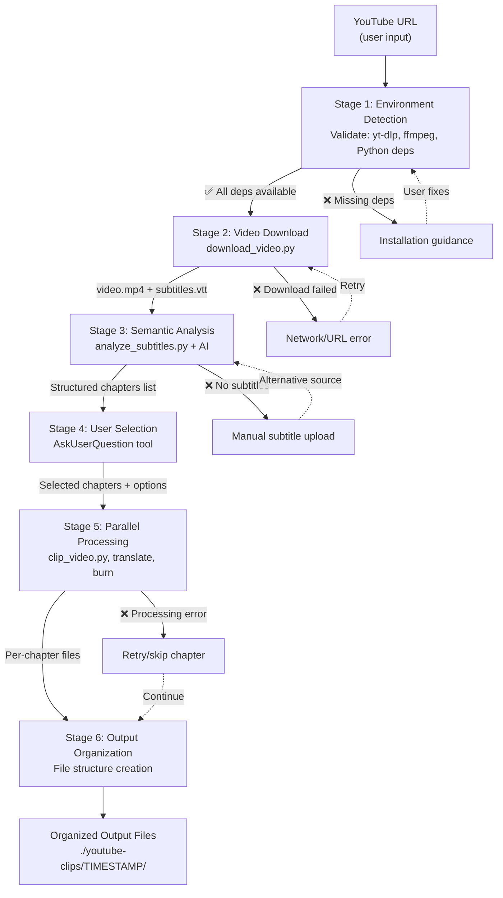
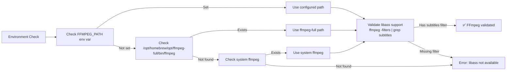
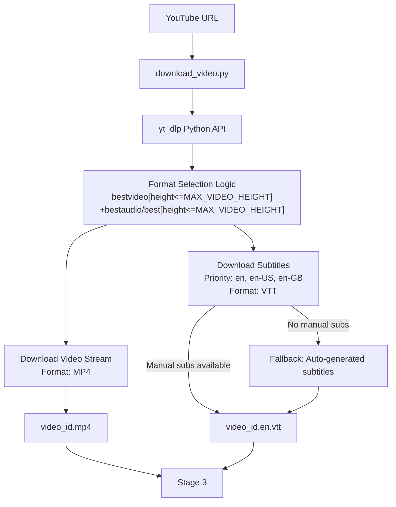
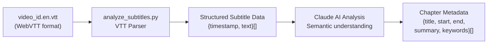
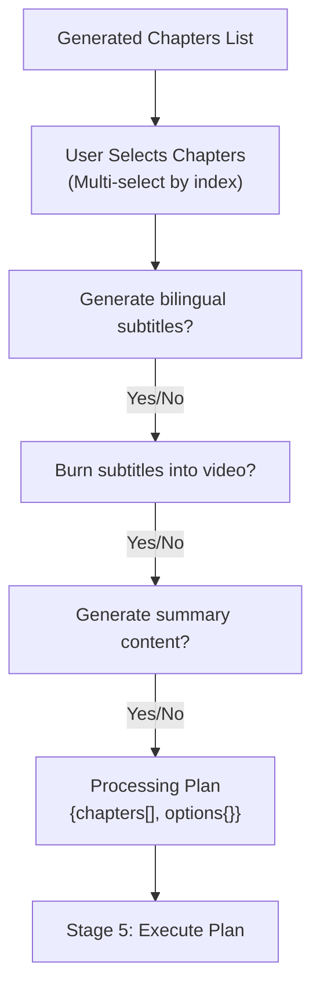
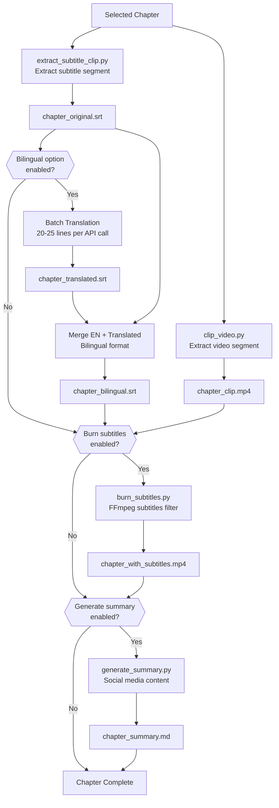
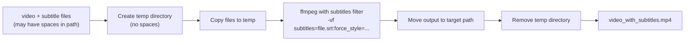
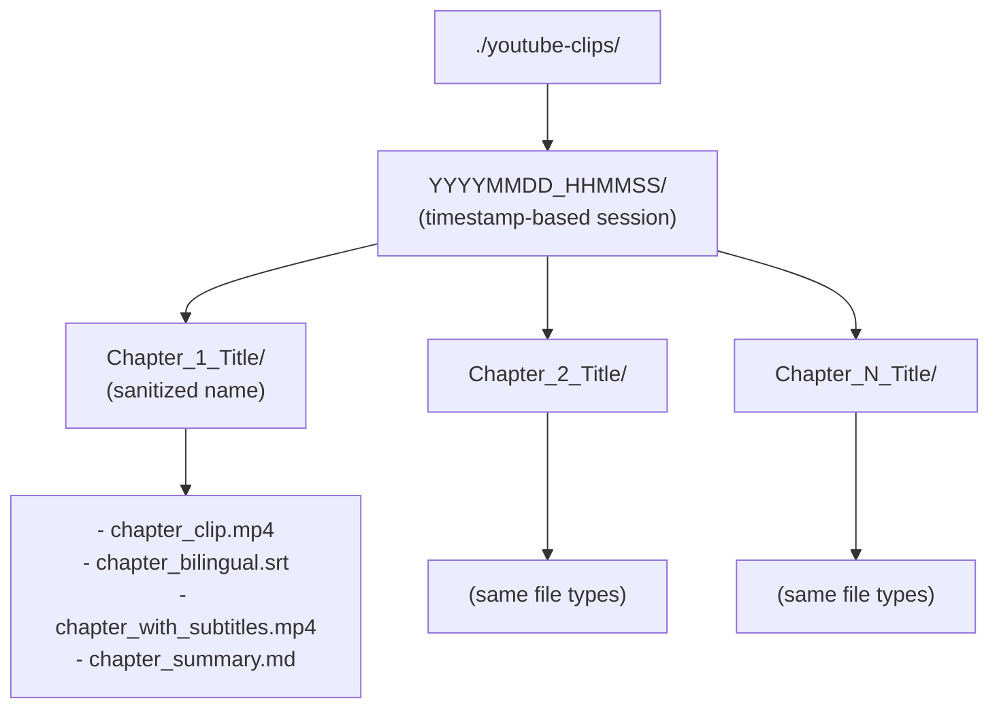
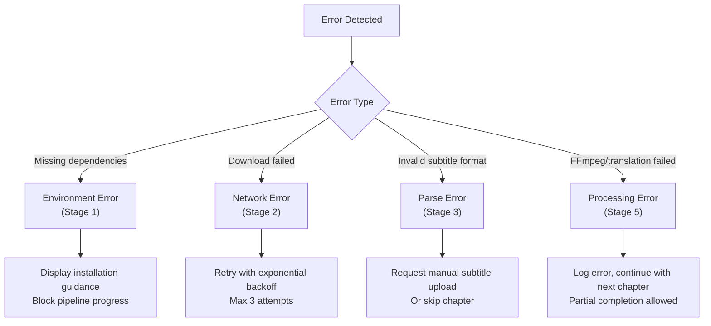
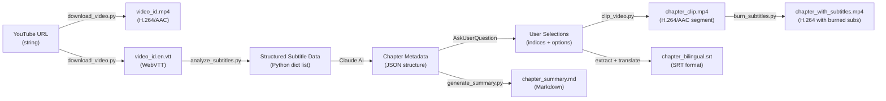

<!-- source: DeepWiki mcp.deepwiki.com · repo op7418/Youtube-clipper-skill · page 3.2 Processing Pipeline · fetched 2026-10-26 -->

# Processing Pipeline

<details>
<summary>Relevant source files</summary>

The following files were used as context for generating this wiki page:

- [README.md](README.md)
- [README.zh-CN.md](README.zh-CN.md)
- [SKILL.md](SKILL.md)

</details>


This page documents the end-to-end data processing pipeline of the YouTube Clipper Skill, detailing how data flows from a YouTube URL input through multiple processing stages to produce clipped videos with bilingual subtitles. The pipeline consists of six sequential stages with conditional processing paths based on user selections.

For information about individual script implementations, see [Core Scripts](#4). For details on AI semantic analysis mechanisms, see [AI Integration](#3.3). For output file organization, see [File Organization](#3.4).

## Pipeline Overview

The YouTube Clipper Skill implements a linear six-stage pipeline with optional processing branches. Each stage transforms data from one format to another, with validation and error handling at stage boundaries.



**Sources:** [SKILL.md:22-52](), [README.md:103-110]()

## Stage 1: Environment Detection

The first stage validates all required system dependencies before proceeding. This is a gating stage that prevents execution with incomplete environments.

### Validation Checklist

| Dependency | Validation Command | Expected Output | Fallback Action |
|------------|-------------------|-----------------|-----------------|
| `yt-dlp` CLI | `yt-dlp --version` | Version string | Install via pip/brew |
| `ffmpeg` binary | `ffmpeg -version` | Version with configuration | Install via package manager |
| `libass` support | `ffmpeg -filters 2>&1 \| grep subtitles` | Filter list containing "subtitles" | Install ffmpeg-full (macOS) |
| Python `yt_dlp` | `python3 -c "import yt_dlp"` | No error | `pip install yt-dlp` |
| Python `pysrt` | `python3 -c "import pysrt"` | No error | `pip install pysrt` |

### FFmpeg Path Resolution Strategy



**Sources:** [SKILL.md:25-63](), [README.md:67-83]()

## Stage 2: Video Download

This stage downloads the YouTube video and subtitle files using `yt-dlp`. The download process prioritizes quality while respecting configuration limits.

### Download Process Flow



### Data Specifications

**Input:**
- YouTube URL (format: `https://youtube.com/watch?v=VIDEO_ID`)
- Configuration from `.env`: `MAX_VIDEO_HEIGHT`, `YT_DLP_PROXY`, `YT_DLP_RATE_LIMIT`

**Output:**
- Video file: `<video_id>.mp4` (H.264 codec, AAC audio)
- Subtitle file: `<video_id>.en.vtt` (WebVTT format)
- Metadata: Video title, duration, file size

**Script Invocation:**
```bash
cd ~/.claude/skills/youtube-clipper
python3 scripts/download_video.py <youtube_url>
```

**Sources:** [SKILL.md:68-93](), [README.md:106]()

## Stage 3: Semantic Analysis

This stage transforms raw subtitle data into structured semantic chapters through VTT parsing and AI-powered content analysis.

### Data Transformation Pipeline



### Analysis Process

The semantic analysis follows this sequence:

1. **VTT Parsing** - `analyze_subtitles.py` extracts subtitle entries
2. **Data Preparation** - Formats subtitle data with timestamps for AI consumption
3. **AI Analysis** - Claude processes content to identify:
   - Topic boundaries and transitions
   - Natural breakpoints between subjects
   - Semantic coherence within segments
4. **Chapter Generation** - Produces structured chapter metadata

### Chapter Structure

Each generated chapter contains:

```python
{
    "title": str,           # 10-20 characters, topic summary
    "start_time": str,      # Format: "MM:SS" or "HH:MM:SS"
    "end_time": str,        # Format: "MM:SS" or "HH:MM:SS"
    "summary": str,         # 50-100 characters, core content
    "keywords": List[str]   # 3-5 key concepts
}
```

**Target Duration:** 180-300 seconds per chapter (configurable via `TARGET_CHAPTER_DURATION`)

**Script Invocation:**
```bash
python3 scripts/analyze_subtitles.py <subtitle_path>
```

**Sources:** [SKILL.md:96-144](), [README.md:16](), [README.md:194-209]()

## Stage 4: User Selection

This stage presents generated chapters to the user and collects processing options through the `AskUserQuestion` tool. User choices determine which conditional processing branches execute in Stage 5.

### Selection Interface

The system presents:
- Enumerated chapter list with titles, time ranges, and summaries
- Multi-selection prompt for chapter indices
- Boolean prompts for processing options

### Decision Matrix



**Output Structure:**
```python
{
    "selected_chapters": List[int],  # Chapter indices
    "options": {
        "bilingual_subtitles": bool,
        "burn_subtitles": bool,
        "generate_summary": bool
    }
}
```

**Sources:** [SKILL.md:146-161]()

## Stage 5: Parallel Processing

Stage 5 executes multiple processing operations per selected chapter. Operations may execute in parallel or sequentially depending on dependencies.

### Processing Dependency Graph



### Core Processing Operations

#### 5.1: Video Clipping

**Script:** `clip_video.py`

**Input:**
- Source video path: `<video_id>.mp4`
- Time range: `start_time`, `end_time` (seconds)
- Output path specification

**Process:**
```bash
python3 scripts/clip_video.py <video_path> <start_time> <end_time> <output_path>
```

**Output:** Clipped video segment with original quality (stream copy, no re-encoding)

#### 5.2: Subtitle Extraction

**Script:** `extract_subtitle_clip.py`

**Process:**
1. Parse complete SRT/VTT subtitle file using `pysrt`
2. Filter entries where `start_time` falls within chapter range
3. Adjust timestamps by subtracting chapter start time
4. Convert to SRT format
5. Write time-adjusted subtitle segment

**Output:** `<chapter>_original.srt` with timestamps starting at 00:00:00

#### 5.3: Batch Translation

**Optimization Strategy:**
- Group 20-25 subtitle entries per API call
- Single translation request per batch
- Maintains context consistency across batches

**API Call Reduction:**
- Traditional: N API calls for N subtitle lines
- Optimized: N/20 API calls (95% reduction)

**Translation Parameters:**
- Target language: From `TARGET_LANGUAGE` config
- Style: Conversational, concise
- Technical term handling: Preserve accuracy

#### 5.4: Bilingual Subtitle Generation

**Format Specification:**
```srt
1
00:00:00,000 --> 00:00:03,500
English text line
中文翻译文本

2
00:00:03,500 --> 00:00:07,000
Next English line
下一行中文
```

Each entry contains original English on first line, translation on second line.

#### 5.5: Subtitle Burning

**Script:** `burn_subtitles.py`

**Critical Implementation Detail:** Uses temporary directory workaround for path handling

**Process Flow:**


**FFmpeg Command Structure:**
```bash
ffmpeg -i video.mp4 -vf "subtitles=subtitle.srt:force_style='FontSize=24,MarginV=30'" -c:a copy output.mp4
```

**Style Parameters:**
- `FontSize`: 24 (configurable via `SUBTITLE_FONT_SIZE`)
- `MarginV`: 30 (configurable via `SUBTITLE_MARGIN_V`)
- Color: White text with black outline (default)

#### 5.6: Summary Generation

**Script:** `generate_summary.py`

**Input:** Chapter metadata (title, summary, keywords)

**Output:** Markdown file with platform-specific social media content

**Platforms Targeted:**
- Xiaohongshu (小红书)
- Douyin (抖音)
- WeChat (微信公众号)

**Sources:** [SKILL.md:164-234](), [README.md:109](), [README.md:213-216]()

## Stage 6: Output Organization

The final stage organizes processed files into a structured directory hierarchy.

### Directory Structure Creation



### File Naming Convention

All output files follow the pattern: `<sanitized_chapter_title>_<type>.<ext>`

**Sanitization Rules:**
- Remove characters: `/ \ : * ? " < > |`
- Replace spaces with underscores
- Truncate to 100 characters maximum
- Preserve Unicode characters for non-English titles

**File Types Per Chapter:**

| File Type | Suffix | Always Present | Condition |
|-----------|--------|----------------|-----------|
| Clipped video | `_clip.mp4` | Yes | Always generated |
| Bilingual subtitles | `_bilingual.srt` | No | If bilingual option enabled |
| Video with subtitles | `_with_subtitles.mp4` | No | If burn option enabled |
| Summary content | `_summary.md` | No | If summary option enabled |

**Sources:** [SKILL.md:236-279](), [README.md:115-123]()

## Error Handling and Recovery

The pipeline implements error handling at stage boundaries with recovery mechanisms.

### Error Categories and Responses



### Retry Mechanisms

**Network Operations (Stage 2):**
- Initial timeout: 30 seconds
- Retry count: 3
- Backoff: Exponential (1s, 2s, 4s)

**Translation API (Stage 5.3):**
- Retry count: 3
- Batch size reduction on failure
- Continue with untranslated on exhaustion

**FFmpeg Operations (Stage 5):**
- No automatic retry
- Log full error output
- Skip to next chapter on failure

**Sources:** [SKILL.md:322-337]()

## Performance Characteristics

### Pipeline Execution Times

Approximate durations for a 30-minute source video:

| Stage | Duration | Scaling Factor |
|-------|----------|----------------|
| Environment Detection | 2-5 seconds | Constant |
| Video Download | 1-10 minutes | Video length × quality |
| Semantic Analysis | 10-30 seconds | Subtitle count |
| User Selection | Variable | User interaction |
| Processing (per chapter) | 1-3 minutes | Chapter length × options |
| Output Organization | <5 seconds | File count |

### Batch Translation Performance

**Traditional approach:** 400 subtitle lines → 400 API calls → ~20 minutes

**Optimized approach:** 400 subtitle lines → 20 API calls → ~2 minutes

**Improvement:** 90% time reduction, 95% API call reduction

**Sources:** [README.md:213-216](), [SKILL.md:293-300]()

## Data Flow Summary

### Complete Pipeline Data Transformation



**Sources:** [SKILL.md:22-279](), README diagrams

---

