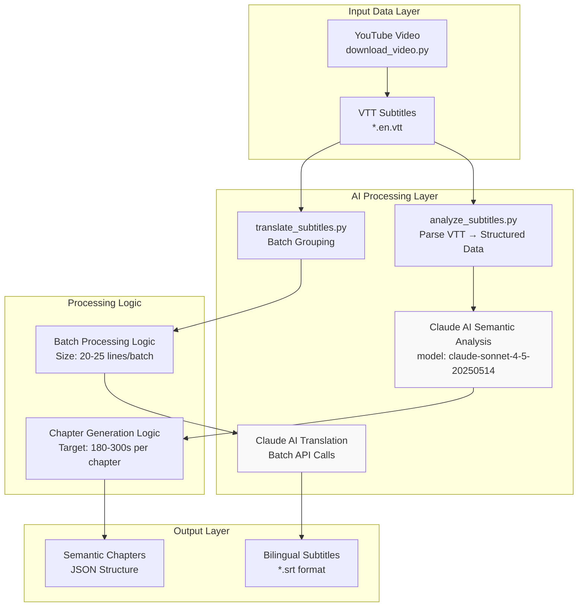
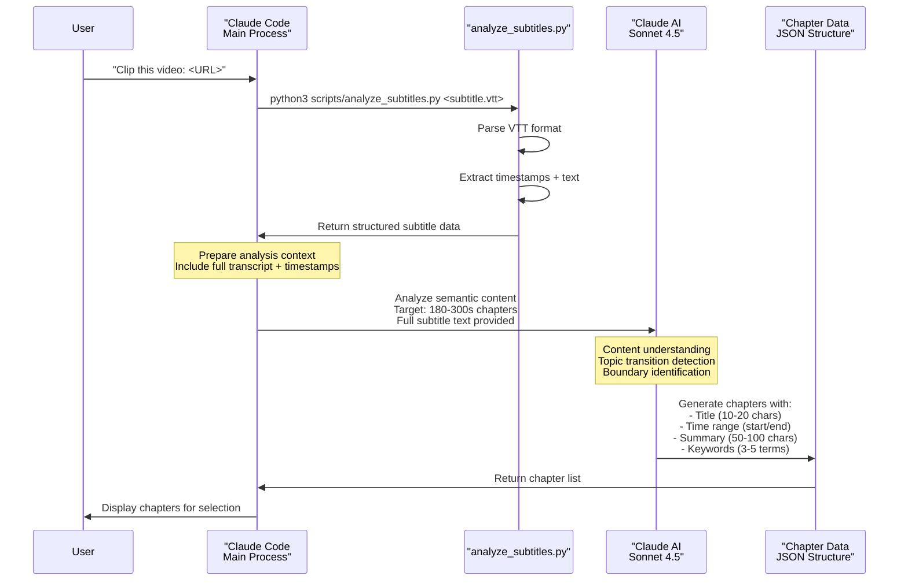
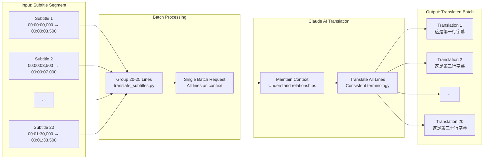
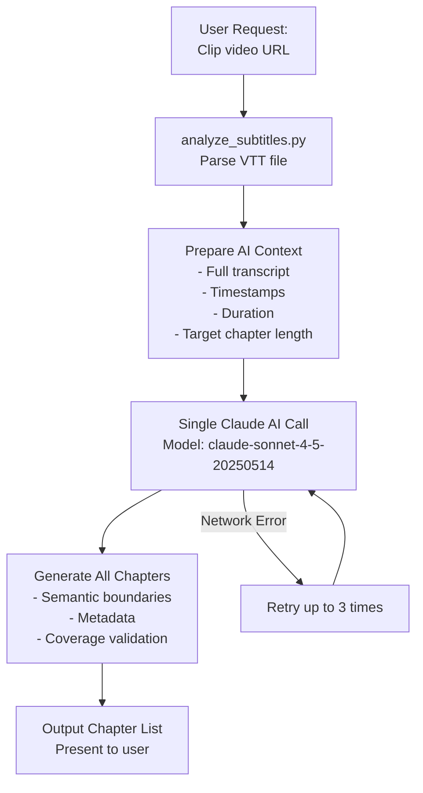
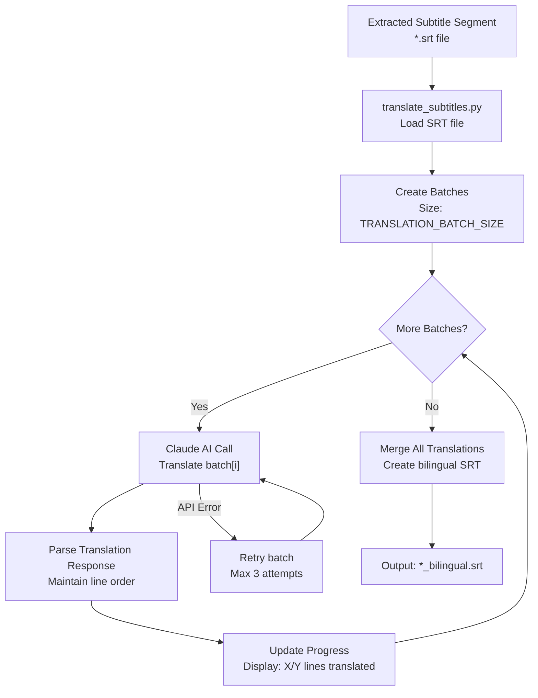

<!-- source: DeepWiki mcp.deepwiki.com · repo op7418/Youtube-clipper-skill · page 3.3 AI Integration · fetched 2026-10-26 -->

# AI Integration

<details>
<summary>Relevant source files</summary>

The following files were used as context for generating this wiki page:

- [README.md](README.md)
- [README.zh-CN.md](README.zh-CN.md)
- [SKILL.md](SKILL.md)

</details>


This document explains how Claude AI is integrated into the YouTube Clipper Skill system to provide intelligent video processing capabilities. The AI integration occurs at two critical points in the processing pipeline: semantic chapter analysis and batch subtitle translation.

For detailed information about the batch translation optimization strategy, see [Batch Translation Optimization](#7.1). For specifics on the semantic analysis algorithm, see [AI Semantic Analysis](#7.2). For implementation details of the subtitle analysis script, see [analyze_subtitles.py](#4.2).

---

## Overview

The YouTube Clipper Skill uses Claude AI as its intelligence layer for two core differentiating features:

| Feature | Purpose | Optimization | API Reduction |
|---------|---------|--------------|---------------|
| **Semantic Chapter Analysis** | Generate meaningful 2-5 minute chapters based on content understanding | Single AI call per video | N/A |
| **Batch Translation** | Translate subtitle segments to target language | Group 20-25 lines per API call | 95% reduction |

Both AI integration points are designed to minimize API calls while maximizing output quality through context preservation and intelligent batching.

Sources: [README.md:14-20](), [SKILL.md:96-144](), [SKILL.md:185-194]()

---

## AI Integration Architecture

### System-Level AI Integration Points



**AI Integration Points in Codebase**

This diagram maps the natural language workflow to specific code entities. The `analyze_subtitles.py` script parses VTT format subtitles and prepares structured data for Claude AI analysis. The Claude AI model specified in [SKILL.md:14]() is `claude-sonnet-4-5-20250514`, which performs both semantic analysis and translation tasks. The `translate_subtitles.py` script implements the batching logic that groups subtitle lines before sending them to the AI.

Sources: [SKILL.md:96-110](), [SKILL.md:185-194](), [README.md:140-150]()

---

## Semantic Chapter Analysis

### Purpose and Methodology

The semantic chapter analysis is the system's core differentiating feature. Unlike mechanical time-based video splitting (e.g., every 30 minutes), this system uses Claude AI to understand video content and identify natural topic boundaries.

**Analysis Objectives:**
- Parse complete subtitle transcripts with timestamps
- Identify semantic topic transitions and natural breakpoints
- Generate chapters with duration between 2-5 minutes (configurable via `TARGET_CHAPTER_DURATION`)
- Ensure complete video coverage with no gaps or overlaps
- Create meaningful metadata for each chapter

Sources: [README.md:194-209](), [SKILL.md:96-127]()

### Implementation Flow



**Key Implementation Details:**

The `analyze_subtitles.py` script handles VTT parsing and data preparation. It outputs structured subtitle data including:
- Full subtitle text with timestamps
- Total video duration
- Subtitle entry count

Claude Code then performs the AI analysis by reading the complete subtitle content and applying semantic understanding. The analysis is not performed within the Python script itself but rather in the Claude Code execution environment, allowing Claude AI to read and understand the full context.

Sources: [SKILL.md:100-110](), [SKILL.md:111-127]()

### Chapter Generation Principles

The semantic analysis follows specific principles defined in [SKILL.md:122-127]():

| Principle | Target | Purpose |
|-----------|--------|---------|
| **Granularity** | 2-5 minutes per chapter | Avoid too-short clips or 30+ minute segments |
| **Completeness** | 100% video coverage | No gaps, no overlaps |
| **Semantic Meaning** | One topic per chapter | Each chapter is a coherent unit |
| **Natural Boundaries** | Topic transition points | Not mechanical time-based splitting |

**Chapter Metadata Structure:**

Each generated chapter contains:
- **Title**: Concise topic summary (10-20 characters)
- **Time Range**: `MM:SS` or `HH:MM:SS` format start and end times
- **Core Summary**: 1-2 sentence description (50-100 characters)
- **Keywords**: 3-5 core concepts for that segment

Example output format from [SKILL.md:128-143]():

```
1. [00:00 - 03:15] AGI as an exponential curve, not a point in time
   Core: AI model capabilities double every 4-12 months
   Keywords: AGI, exponential growth, Claude Code

2. [03:15 - 06:30] China's gap in AI development
   Core: Chip bans impact Chinese AI capabilities
   Keywords: China, chip ban, DeepSeek
```

Sources: [SKILL.md:122-143](), [README.md:203-209]()

---

## Batch Translation System

### The Optimization Problem

Traditional subtitle translation approaches translate each subtitle line individually, resulting in:
- High API call volume (one call per subtitle line)
- Slow processing (network latency per call)
- Potential context loss between lines
- Expensive API usage

For a typical video with 400+ subtitle entries, individual translation would require 400+ API calls.

Sources: [README.md:211-216](), [SKILL.md:291-299]()

### Batching Strategy

The system implements an intelligent batching strategy defined in [SKILL.md:185-194]():

**Batch Parameters:**
- **Batch Size**: 20-25 subtitle lines per API call (configurable via `TRANSLATION_BATCH_SIZE` in `.env`)
- **API Call Reduction**: 95% reduction (e.g., 400 lines → 20 API calls)
- **Context Preservation**: All lines in a batch are translated together, maintaining semantic consistency



**Translation Strategy Details:**

The `translate_subtitles.py` script implements the batching logic:
1. Groups subtitle lines into batches of 20-25 entries
2. Sends entire batch to Claude AI in a single API call
3. Receives all translations in a single response
4. Maintains line ordering and timestamp associations

Translation quality guidelines from [SKILL.md:189-193]():
- Preserve technical terminology accuracy
- Use conversational tone (suitable for short-form video)
- Produce concise and fluent output
- Maintain consistency within each batch

Sources: [SKILL.md:185-194](), [README.md:144](), [SKILL.md:291-299]()

### Context Preservation and Consistency

Batching provides semantic advantages beyond API efficiency:

| Aspect | Individual Translation | Batch Translation |
|--------|----------------------|-------------------|
| **Context Awareness** | No context between lines | Full batch context available |
| **Terminology Consistency** | May vary between calls | Consistent within batch |
| **Semantic Flow** | Disconnected | Natural conversation flow |
| **API Calls (400 lines)** | 400 calls | 20 calls (95% reduction) |
| **Processing Time** | ~400 × latency | ~20 × latency (10x faster) |

The Claude AI model can understand the relationships between subtitle lines within a batch, producing more natural and contextually appropriate translations.

Sources: [README.md:211-216](), [SKILL.md:291-299]()

---

## Configuration and Customization

AI integration behavior can be customized through environment variables in the `.env` file:

**Semantic Analysis Configuration:**
```bash
# Target chapter duration in seconds (default: 180-300s range)
TARGET_CHAPTER_DURATION=180
```

**Translation Configuration:**
```bash
# Batch size for subtitle translation (default: 20)
TRANSLATION_BATCH_SIZE=20

# Target language for translation (default: 中文)
TARGET_LANGUAGE=中文
```

These parameters are read by the processing scripts to adjust AI call patterns and output characteristics.

Sources: [README.md:144-150](), [SKILL.md:14]()

---

## API Call Flow and Error Handling

### Semantic Analysis API Flow



**Error Handling:**
- Network failures: Automatic retry up to 3 times
- Invalid response: Log error and prompt user for manual intervention
- Timeout: Extend timeout for long videos (handled by Claude Code environment)

Sources: [SKILL.md:96-144](), [SKILL.md:329-336]()

### Batch Translation API Flow



**Progress Display:**

The system provides real-time progress updates during translation, as shown in [SKILL.md:223-234]():

```
3/6 Translating subtitles... [=====>    ] 50% (26/52)
```

This shows the number of lines translated out of the total, giving users visibility into the batch processing progress.

Sources: [SKILL.md:185-194](), [SKILL.md:223-234](), [SKILL.md:329-336]()

---

## Integration with Claude Code Platform

The AI integration is designed specifically for the Claude Code environment, specified in [SKILL.md:14]():

```yaml
model: claude-sonnet-4-5-20250514
```

This model specification ensures:
- Consistent AI capabilities across all installations
- Access to advanced semantic understanding features
- Optimal performance for subtitle analysis and translation tasks

The skill uses Claude Code's native AI capabilities, meaning:
- No separate API key configuration required
- Direct access to Claude AI within the execution environment
- Seamless integration with Claude Code's tool system (`AskUserQuestion`, `Read`, `Write`, `Bash`)

Sources: [SKILL.md:1-15](), [README.md:3-4]()

---

## Performance Characteristics

### Semantic Analysis Performance

| Metric | Typical Value | Notes |
|--------|---------------|-------|
| **Videos per Analysis** | 1 | Single AI call per video |
| **Analysis Time** | 5-15 seconds | Depends on video length |
| **Chapters Generated** | Video duration ÷ 3 minutes | Target: 2-5 min per chapter |
| **Coverage** | 100% | No gaps in video timeline |

### Batch Translation Performance

| Metric | Without Batching | With Batching (20-line) | Improvement |
|--------|------------------|------------------------|-------------|
| **API Calls (400 lines)** | 400 | 20 | 95% reduction |
| **Estimated Time** | ~400 × 1.5s = 10 min | ~20 × 1.5s = 30s | 20x faster |
| **Context Quality** | Independent lines | Contextual batches | Higher quality |
| **API Cost** | Baseline | 5% of baseline | 95% cost reduction |

These performance improvements make the system practical for processing long-form content while maintaining high translation quality through context preservation.

Sources: [README.md:211-216](), [SKILL.md:291-299]()

---

