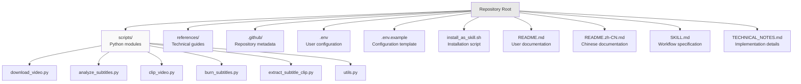
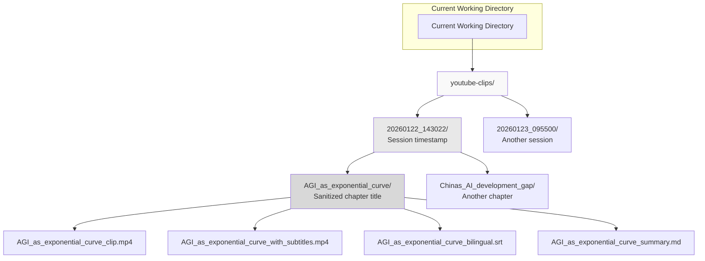
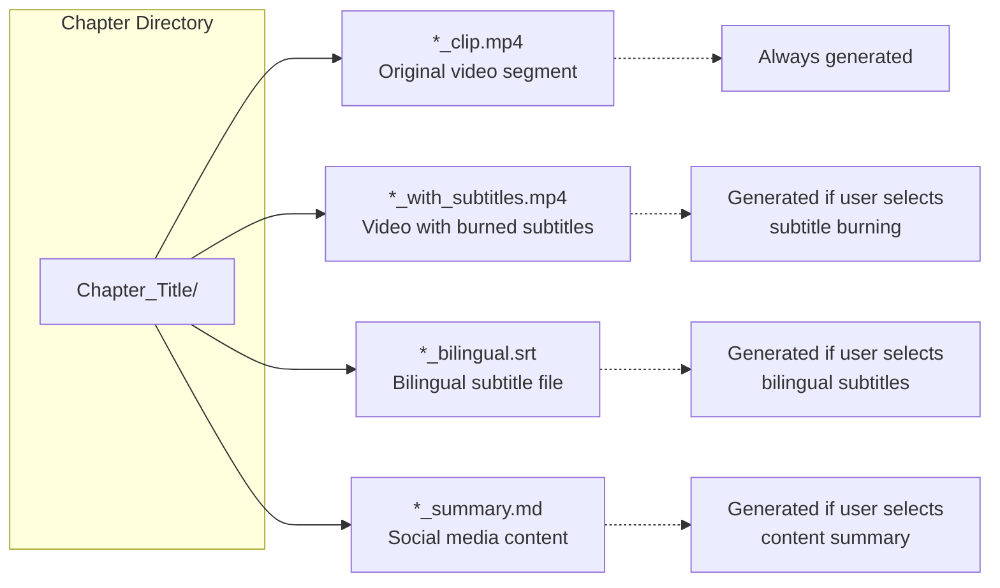
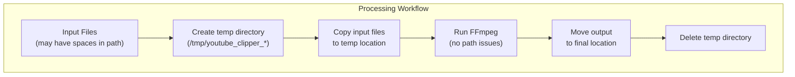

<!-- source: DeepWiki mcp.deepwiki.com · repo op7418/Youtube-clipper-skill · page 3.4 File Organization · fetched 2026-10-26 -->

# File Organization

<details>
<summary>Relevant source files</summary>

The following files were used as context for generating this wiki page:

- [README.md](README.md)
- [README.zh-CN.md](README.zh-CN.md)
- [SKILL.md](SKILL.md)

</details>


This document describes the file organization structure of the YouTube Clipper Skill, including both the repository source structure and the runtime output directory structure. For information about the processing scripts themselves, see [Core Scripts](#4). For configuration file details, see [Configuration](#6).

## Purpose and Scope

This page documents:
- Repository source code organization
- Output directory hierarchy and structure
- File naming conventions for generated content
- Types of files produced per chapter
- Temporary file management strategies

## Repository Structure

The YouTube Clipper Skill repository follows a clean separation of concerns with source code, documentation, configuration, and installation automation in distinct locations.



**Sources:** [README.md:1-320](), [SKILL.md:1-374]()

### Key Directories and Files

| Path | Type | Purpose |
|------|------|---------|
| `scripts/` | Directory | Contains all Python processing scripts |
| `references/` | Directory | Technical reference documentation for FFmpeg, yt-dlp |
| `.github/` | Directory | GitHub repository metadata and configuration |
| `.env` | File | User-specific configuration (created during installation) |
| `.env.example` | File | Configuration template with default values |
| `install_as_skill.sh` | File | Automated installation script for Claude Code |
| `README.md` | File | Primary user documentation in English |
| `README.zh-CN.md` | File | User documentation in Chinese |
| `SKILL.md` | File | Detailed workflow specification for Claude Code |
| `TECHNICAL_NOTES.md` | File | Implementation notes and design decisions |

**Sources:** [README.md:24-47](), [SKILL.md:19-65]()

## Installation Location

When installed as a Claude Code skill, the repository is copied to the user's home directory:

```
~/.claude/skills/youtube-clipper/
├── scripts/
│   ├── download_video.py
│   ├── analyze_subtitles.py
│   ├── clip_video.py
│   ├── burn_subtitles.py
│   ├── extract_subtitle_clip.py
│   └── utils.py
├── .env
├── .env.example
└── SKILL.md
```

The installation script [install_as_skill.sh:1-100]() handles copying files to this location and installing Python dependencies.

**Sources:** [README.md:32-46](), [SKILL.md:19-20]()

## Output Directory Structure

The YouTube Clipper Skill generates organized output in a three-level hierarchy: root directory → timestamped session → chapter directories.



**Sources:** [README.md:112-123](), [SKILL.md:242-262]()

### Directory Hierarchy Levels

#### Level 1: Output Root Directory

The root output directory is configurable via the `OUTPUT_DIR` environment variable, defaulting to `./youtube-clips/` in the current working directory.

**Path:** `./youtube-clips/`

This directory contains all video processing sessions and is created automatically if it doesn't exist.

**Sources:** [README.md:138](), [SKILL.md:244]()

#### Level 2: Session Timestamp Directory

Each video processing session creates a timestamped subdirectory using the format `YYYYMMDD_HHMMSS`:

- **Format:** `20260122_143022` (Year-Month-Day_Hour-Minute-Second)
- **Purpose:** Prevents file conflicts across multiple sessions
- **Example:** `20260122_143022/` for a session started on January 22, 2026 at 14:30:22

This timestamp-based naming ensures that:
- Multiple processing sessions never conflict
- Output files are chronologically organized
- Session provenance is clear from the directory name

**Sources:** [README.md:117](), [SKILL.md:244]()

#### Level 3: Chapter Directory

Each selected chapter creates a subdirectory named after the sanitized chapter title:

**Path:** `./youtube-clips/20260122_143022/Chapter_Title/`

Chapter directory names undergo sanitization to ensure filesystem compatibility:
- Special characters removed: `/ \ : * ? " < > |`
- Spaces replaced with underscores
- Length limited to 100 characters

**Sources:** [README.md:118](), [SKILL.md:342-350]()

## File Types Generated

Each chapter directory can contain up to four distinct file types, depending on user-selected processing options:



**Sources:** [README.md:114-123](), [SKILL.md:248-255]()

### File Type Reference

| File Type | Naming Pattern | Always Generated | Purpose | Script |
|-----------|----------------|------------------|---------|--------|
| Video Clip | `{title}_clip.mp4` | ✅ Yes | Original extracted video segment without subtitles | [scripts/clip_video.py]() |
| Burned Subtitles | `{title}_with_subtitles.mp4` | ❌ Optional | Video with hardcoded bilingual subtitles | [scripts/burn_subtitles.py]() |
| Bilingual SRT | `{title}_bilingual.srt` | ❌ Optional | Subtitle file with English and target language | [scripts/extract_subtitle_clip.py]() |
| Summary | `{title}_summary.md` | ❌ Optional | Social media content and chapter summary | Generated by Claude AI |

**Sources:** [README.md:114-123](), [SKILL.md:170-220]()

### File Content Details

#### Video Clip File (`*_clip.mp4`)

- **Format:** MP4 container with H.264 video codec
- **Quality:** Preserved from source (up to 1080p)
- **Audio:** Original audio track maintained
- **Generation:** FFmpeg stream copy for lossless extraction
- **Script:** [scripts/clip_video.py:1-100]()

The video clip is always generated and represents the precise time-bounded segment extracted from the source video.

**Sources:** [SKILL.md:170-176]()

#### Burned Subtitles File (`*_with_subtitles.mp4`)

- **Format:** MP4 with hardcoded subtitle overlay
- **Subtitle Style:** White text with black outline, customizable font size and margins
- **Encoding:** Re-encoded to embed subtitles (not stream copy)
- **Requirements:** FFmpeg with libass support
- **Script:** [scripts/burn_subtitles.py:1-200]()

This file is only generated if the user selects the subtitle burning option. It embeds the bilingual subtitles permanently into the video frames.

**Sources:** [README.md:69-83](), [SKILL.md:202-211]()

#### Bilingual SRT File (`*_bilingual.srt`)

- **Format:** SubRip (SRT) text format
- **Structure:** Each subtitle entry contains both English and target language
- **Encoding:** UTF-8
- **Line Order:** English text followed by translated text

Example format:
```srt
1
00:00:00,000 --> 00:00:03,500
This is the English subtitle
这是中文字幕

2
00:00:03,500 --> 00:00:07,000
Another English line
另一行中文
```

**Sources:** [README.md:218-232](), [SKILL.md:195-199]()

#### Summary File (`*_summary.md`)

- **Format:** Markdown
- **Contents:** Chapter title, core summary, keywords, social media copy
- **Platforms:** Optimized for Xiaohongshu, Douyin, WeChat
- **Generation:** Claude AI based on chapter metadata

This file provides ready-to-use content for social media sharing and video description.

**Sources:** [README.md:20](), [SKILL.md:213-220]()

## File Naming Convention

The YouTube Clipper Skill applies consistent naming rules to ensure filesystem compatibility and readability.

### Sanitization Rules

All generated filenames undergo the following transformations:

```mermaid
graph LR
    Original["Original Title:<br/>'China's AI: Gap?'"]
    Remove["Remove Special Chars:<br/>' * ? \" < > | / \\ :'"]
    Replace["Replace Spaces:<br/>' ' → '_'"]
    Limit["Limit Length:<br/>Max 100 characters"]
    Final["Final Name:<br/>'Chinas_AI_Gap'"]
    
    Original --> Remove
    Remove --> Replace
    Replace --> Limit
    Limit --> Final
```

**Sources:** [README.md:270-277](), [SKILL.md:342-350]()

### Character Handling

| Input | Action | Reason |
|-------|--------|--------|
| `/` `\` `:` `*` `?` `"` `<` `>` `|` | Removed | Filesystem reserved characters |
| Space ` ` | Replaced with `_` | Improves command-line usability |
| Length > 100 chars | Truncated | Prevents filesystem path length limits |
| Unicode characters | Preserved | Supports international titles |

### Naming Pattern Components

Each generated file follows this pattern:

```
{sanitized_chapter_title}_{file_type}.{extension}
```

Where:
- `{sanitized_chapter_title}`: Chapter title after sanitization rules
- `{file_type}`: One of `clip`, `with_subtitles`, `bilingual`, `summary`
- `{extension}`: File extension (`.mp4`, `.srt`, `.md`)

**Example transformations:**

| Original Chapter Title | Sanitized Filename Base |
|------------------------|-------------------------|
| `AGI as an exponential curve, not a point in time` | `AGI_as_an_exponential_curve_not_a_point_in_time` |
| `China's gap in AI development` | `Chinas_gap_in_AI_development` |
| `The impact of chip bans: consequences?` | `The_impact_of_chip_bans_consequences` |

**Sources:** [SKILL.md:342-350]()

## Temporary File Management

The YouTube Clipper Skill creates temporary files during processing to handle path compatibility issues and intermediate data.

### Temporary Directory Strategy



**Sources:** [SKILL.md:284-291]()

### Why Temporary Files Are Needed

**Problem:** FFmpeg's subtitle filter (`subtitles=`) cannot correctly parse file paths containing spaces, even with proper quoting or escaping.

**Solution:** [scripts/burn_subtitles.py:1-200]() implements a temporary directory workaround:

1. Create a temporary directory without spaces: `/tmp/youtube_clipper_{random}/`
2. Copy input video and subtitle files to temporary location
3. Execute FFmpeg using space-free paths
4. Move the output file back to the target location
5. Clean up temporary directory

This approach ensures reliable subtitle burning regardless of the user's directory structure.

**Sources:** [SKILL.md:284-291]()

### Temporary File Configuration

The `KEEP_TEMP_FILES` environment variable controls temporary file retention:

- `KEEP_TEMP_FILES=false` (default): Temporary files deleted after processing
- `KEEP_TEMP_FILES=true`: Temporary files preserved for debugging

When debugging subtitle burning issues, setting `KEEP_TEMP_FILES=true` allows inspection of the intermediate files and FFmpeg command arguments.

**Sources:** [README.md:129-154]()

## Complete Output Example

Here is a complete example of the output directory structure after processing a video with all options enabled:

```
./youtube-clips/
└── 20260122_143022/
    ├── AGI_as_exponential_curve/
    │   ├── AGI_as_exponential_curve_clip.mp4            (14 MB)
    │   ├── AGI_as_exponential_curve_with_subtitles.mp4  (15 MB)
    │   ├── AGI_as_exponential_curve_bilingual.srt       (2.3 KB)
    │   └── AGI_as_exponential_curve_summary.md          (1.2 KB)
    │
    ├── Chinas_gap_in_AI_development/
    │   ├── Chinas_gap_in_AI_development_clip.mp4            (12 MB)
    │   ├── Chinas_gap_in_AI_development_with_subtitles.mp4  (13 MB)
    │   ├── Chinas_gap_in_AI_development_bilingual.srt       (1.8 KB)
    │   └── Chinas_gap_in_AI_development_summary.md          (980 B)
    │
    └── The_impact_of_chip_bans/
        ├── The_impact_of_chip_bans_clip.mp4            (16 MB)
        ├── The_impact_of_chip_bans_with_subtitles.mp4  (17 MB)
        ├── The_impact_of_chip_bans_bilingual.srt       (2.1 KB)
        └── The_impact_of_chip_bans_summary.md          (1.1 KB)
```

**Sources:** [README.md:112-123](), [SKILL.md:242-274]()

## File Organization Benefits

This hierarchical organization provides several advantages:

1. **Session Isolation:** Timestamped directories prevent conflicts between multiple processing runs
2. **Provenance:** Clear timestamp indicates when content was generated
3. **Logical Grouping:** All files for a chapter are contained in one directory
4. **Flexible Options:** Users can choose which file types to generate per chapter
5. **Easy Cleanup:** Delete entire session directories to remove old content
6. **Command-Line Friendly:** Sanitized names work well with shell commands and scripts

The structure balances organizational clarity with practical filesystem constraints, ensuring reliable operation across different platforms and directory configurations.

**Sources:** [README.md:112-123](), [SKILL.md:242-262]()

---

