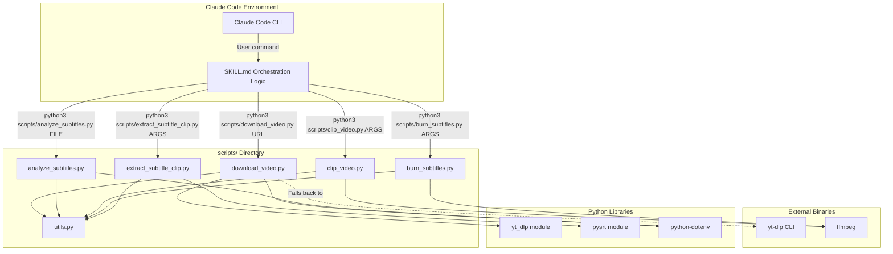
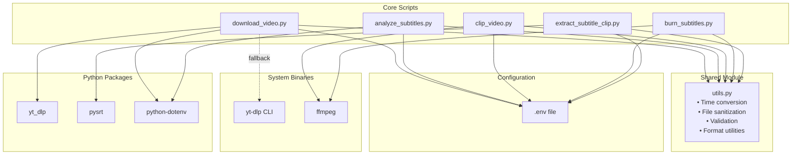
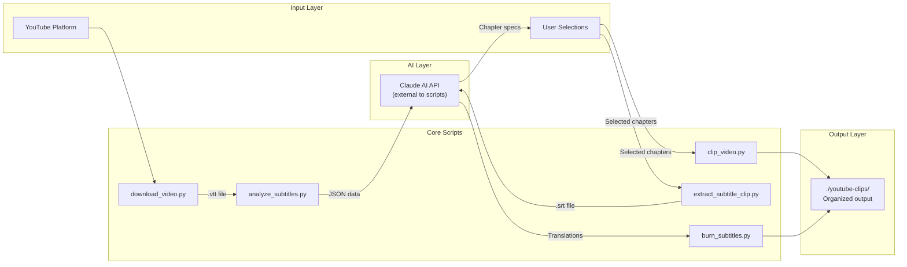

<!-- source: DeepWiki mcp.deepwiki.com · repo op7418/Youtube-clipper-skill · page 4 Core Scripts · fetched 2026-10-26 -->

# Core Scripts

<details>
<summary>Relevant source files</summary>

The following files were used as context for generating this wiki page:

- [README.md](README.md)
- [SKILL.md](SKILL.md)
- [scripts/__init__.py](scripts/__init__.py)

</details>


This document provides an overview of the Python scripts in the `scripts/` directory that implement the YouTube Clipper Skill's core processing capabilities. Each script is a standalone executable module responsible for a specific phase of the video processing pipeline. For detailed information about the overall system architecture, see [Architecture](#3). For specific implementation details of each script, see their respective subsections ([4.1](#4.1)-[4.6](#4.6)).

---

## Script Inventory

The YouTube Clipper Skill consists of five primary processing scripts and one shared utilities module located in the `scripts/` directory:

| Script | Primary Responsibility | Input | Output | External Tools |
|--------|----------------------|-------|--------|----------------|
| `download_video.py` | Video and subtitle acquisition from YouTube | YouTube URL | `.mp4` video, `.vtt` subtitle | yt-dlp (CLI & library) |
| `analyze_subtitles.py` | Subtitle parsing and data preparation for AI | `.vtt` subtitle file | Structured subtitle data (JSON) | None |
| `clip_video.py` | Time-based video segment extraction | `.mp4` + start/end times | `.mp4` clip | FFmpeg |
| `burn_subtitles.py` | Hardcode subtitles into video | `.mp4` + `.srt` subtitle | `.mp4` with burned subtitles | FFmpeg (libass) |
| `extract_subtitle_clip.py` | Extract and adjust subtitle segments | `.srt/.vtt` + time range | `.srt` segment | pysrt |
| `utils.py` | Shared utility functions | N/A | N/A | N/A |

All scripts are designed to be invoked from the command line and follow a consistent pattern of reading configuration from `.env` files and writing structured output to stdout/stderr.

**Sources:** [README.md:1-320](), [SKILL.md:1-374](), [scripts/__init__.py:1-8]()

---

## Script Invocation Model



**Description:** Scripts are invoked as separate Python processes by the SKILL.md orchestration logic running within Claude Code. Each script is a standalone executable module (`#!/usr/bin/env python3`) that can be run directly from the command line. The scripts share common functionality through `utils.py` and configuration through `.env` files loaded via `python-dotenv`.

**Sources:** [SKILL.md:21-279](), [README.md:42-46]()

---

## Processing Pipeline Data Flow

```mermaid
flowchart LR
    URL["YouTube URL"]
    
    subgraph "Phase 1: Download"
        DV["download_video.py"]
        VidFile["VIDEO_ID.mp4<br/>Max 1080p"]
        SubFile["VIDEO_ID.en.vtt<br/>English subtitles"]
    end
    
    subgraph "Phase 2: Analysis"
        AS["analyze_subtitles.py"]
        SubData["Structured subtitle data<br/>JSON to stdout"]
        AI["Claude AI Analysis<br/>(external to scripts)"]
        Chapters["Chapter definitions<br/>with timestamps"]
    end
    
    subgraph "Phase 3: Extraction"
        ESC["extract_subtitle_clip.py"]
        CV["clip_video.py"]
        ClipFile["CHAPTER_clip.mp4"]
        ClipSub["CHAPTER.srt<br/>Time-adjusted"]
    end
    
    subgraph "Phase 4: Enhancement"
        Trans["Translation<br/>(via Claude API)"]
        BiSub["CHAPTER_bilingual.srt<br/>EN + TARGET_LANGUAGE"]
        BS["burn_subtitles.py"]
        BurnedFile["CHAPTER_with_subtitles.mp4"]
    end
    
    URL --> DV
    DV --> VidFile
    DV --> SubFile
    
    SubFile --> AS
    AS --> SubData
    SubData --> AI
    AI --> Chapters
    
    VidFile --> CV
    Chapters --> CV
    Chapters --> ESC
    SubFile --> ESC
    
    CV --> ClipFile
    ESC --> ClipSub
    
    ClipSub --> Trans
    Trans --> BiSub
    
    ClipFile --> BS
    BiSub --> BS
    BS --> BurnedFile
```



**Description:** This diagram shows the actual data artifacts (file names and formats) produced and consumed by each script. The scripts operate in a sequential pipeline where output files from one script become input files for subsequent scripts. Video files maintain the `.mp4` container format throughout, while subtitle files transition from `.vtt` (download) to `.srt` (processing) format.

**Sources:** [SKILL.md:66-279](), [README.md:112-123]()

---

## Script Execution Characteristics

### Command-Line Interface

All scripts follow a consistent CLI pattern:

```bash
# Positional arguments pattern
python3 scripts/download_video.py <youtube_url>
python3 scripts/analyze_subtitles.py <subtitle_path>
python3 scripts/clip_video.py <video_path> <start_time> <end_time> <output_path>
python3 scripts/burn_subtitles.py <video_path> <subtitle_path> <output_path>
python3 scripts/extract_subtitle_clip.py <subtitle_path> <start_time> <end_time> <output_path>
```

Scripts accept arguments via `sys.argv` and are invoked from the `~/.claude/skills/youtube-clipper/` directory as specified in [SKILL.md:74-76]().

**Sources:** [SKILL.md:74-220]()

### Configuration Loading

All scripts load configuration from the `.env` file in the skill directory using the `python-dotenv` library. Configuration variables affect:

- File paths (`FFMPEG_PATH`, `OUTPUT_DIR`, `TEMP_DIR`)
- Processing parameters (`MAX_VIDEO_HEIGHT`, `TRANSLATION_BATCH_SIZE`)
- Subtitle styling (`SUBTITLE_FONT_SIZE`, `SUBTITLE_MARGIN_V`)
- Target language (`TARGET_LANGUAGE`)

The scripts implement a fallback pattern: `.env` values → hard-coded defaults. See [Configuration](#6) for full variable reference.

**Sources:** [README.md:129-154](), [SKILL.md:286-309]()

### Output and Logging

Scripts write structured output to stdout and stderr:

- **stdout**: Structured data (JSON, file paths) for consumption by Claude Code
- **stderr**: Progress information, warnings, and error messages
- **Exit codes**: 0 for success, non-zero for failures

This separation allows the orchestration logic in Claude Code to parse results while displaying human-readable progress to users.

**Sources:** [SKILL.md:80-89](), [README.md:105-110]()

---

## Dependency Relationships



**Description:** The `utils.py` module serves as the central shared dependency, providing common functionality used by all processing scripts. External dependencies are partitioned into Python packages (imported as modules) and system binaries (invoked via subprocess). The `.env` configuration file is read by all scripts through the `python-dotenv` library.

**Sources:** [README.md:50-66](), [SKILL.md:46-50]()

---

## Shared Utilities Module

The `utils.py` module provides cross-cutting functionality used by multiple scripts:

| Function Category | Purpose | Used By |
|-------------------|---------|---------|
| Time conversion | Parse and format timestamps (`MM:SS`, `HH:MM:SS` ↔ seconds) | All scripts with time parameters |
| File management | Path sanitization, directory creation, file validation | All scripts |
| Filename sanitization | Remove special characters (`/ \ : * ? " < > \|`), limit length | Scripts generating output files |
| Format utilities | VTT ↔ SRT conversion, encoding detection | `analyze_subtitles.py`, `extract_subtitle_clip.py` |
| Validation | Check file existence, verify tools availability | All scripts |

For detailed documentation of utility functions, see [Utilities Module](#4.6).

**Sources:** [README.md:271-277](), [SKILL.md:340-350]()

---

## Error Handling Patterns

Scripts implement consistent error handling across three categories:

### Environment Errors

Scripts verify prerequisites before execution:

```bash
# Example: FFmpeg libass detection
ffmpeg -filters 2>&1 | grep subtitles
```

If tools are missing, scripts exit with non-zero status and emit installation instructions to stderr.

**Sources:** [SKILL.md:26-63](), [README.md:50-84]()

### Processing Errors

- **Download failures**: Retry with exponential backoff, fallback to auto-generated subtitles
- **FFmpeg failures**: Display full error output, suggest common fixes (path spaces, libass)
- **Translation failures**: Retry up to 3 times, reduce batch size on persistent failures

**Sources:** [SKILL.md:322-337](), [README.md:236-278]()

### File Path Issues

Special handling for paths containing spaces or special characters:

- `burn_subtitles.py` implements temporary directory workaround for FFmpeg subtitle filter path parsing limitations
- All scripts sanitize output filenames by removing `/ \ : * ? " < > |` and replacing spaces with underscores

**Sources:** [SKILL.md:286-291](), [README.md:271-277]()

---

## Script Integration Points



**Description:** Scripts interface with three external systems: YouTube (via `download_video.py`), Claude AI API (for analysis and translation, invoked by SKILL.md logic), and the user (via Claude Code interface). The scripts themselves do not directly call the Claude API; instead, they prepare data structures that the SKILL.md orchestration logic passes to Claude and consume the results.

**Sources:** [SKILL.md:96-144](), [SKILL.md:183-194]()

---

## Script Execution Context

### Working Directory

All scripts are invoked from `~/.claude/skills/youtube-clipper/` as specified in [SKILL.md:75](). This ensures:

- Relative imports work correctly (`from utils import ...`)
- Configuration file (`.env`) is found at a predictable location
- Output paths are relative to the skill directory unless overridden by `OUTPUT_DIR`

**Sources:** [SKILL.md:74-77](), [README.md:32-46]()

### Environment Detection

Before processing begins, scripts verify the execution environment:

1. **Python version check**: Require Python 3.8+ for `yt_dlp` library compatibility
2. **Binary availability**: Test `yt-dlp --version` and `ffmpeg -version`
3. **Library imports**: Attempt to `import yt_dlp`, `import pysrt`
4. **FFmpeg capabilities**: Check for libass support via `ffmpeg -filters | grep subtitles`

Failures at this stage prevent processing from starting and emit actionable error messages.

**Sources:** [SKILL.md:25-63](), [README.md:50-84]()

---

## Performance Characteristics

| Script | Bottleneck | Typical Duration | Optimization Strategy |
|--------|------------|------------------|----------------------|
| `download_video.py` | Network I/O | 30s-5min (depends on video length) | Resume support, proxy configuration |
| `analyze_subtitles.py` | File parsing | <1s | Minimal; parsing is fast |
| `clip_video.py` | FFmpeg encoding | 5-30s per clip | Stream copy (no re-encoding) |
| `burn_subtitles.py` | FFmpeg rendering | 30s-2min per clip | Hardware acceleration (when available) |
| `extract_subtitle_clip.py` | File I/O | <1s | In-memory processing |

The `download_video.py` and `burn_subtitles.py` scripts are the primary bottlenecks. Download speed can be improved via proxy configuration (`YT_DLP_PROXY`). Subtitle burning performance depends on FFmpeg hardware acceleration support.

**Sources:** [SKILL.md:164-235](), [README.md:253-260]()

---

## File Format Conversions

Scripts perform several format conversions during processing:

| Conversion | Performed By | Reason |
|------------|--------------|--------|
| VTT → JSON | `analyze_subtitles.py` | Structure data for AI analysis |
| VTT → SRT | `extract_subtitle_clip.py` | SRT is simpler format for FFmpeg |
| Single-language SRT → Bilingual SRT | (External translation logic) | Combine English + target language |
| SRT → Hardcoded video | `burn_subtitles.py` | Embed subtitles permanently |

VTT (Web Video Text Tracks) is YouTube's native subtitle format, while SRT (SubRip) is more widely supported by video processing tools. All conversions preserve timestamp precision and handle encoding properly (UTF-8).

**Sources:** [SKILL.md:101-110](), [README.md:219-233]()

---

## Next Steps

For detailed information about each script's implementation:

- [download_video.py](#4.1) - yt-dlp integration and video acquisition
- [analyze_subtitles.py](#4.2) - VTT parsing and data preparation  
- [clip_video.py](#4.3) - FFmpeg video extraction
- [burn_subtitles.py](#4.4) - Subtitle rendering with libass
- [extract_subtitle_clip.py](#4.5) - Subtitle segment extraction
- [Utilities Module](#4.6) - Shared helper functions

For configuration options that affect script behavior, see [Configuration](#6).

**Sources:** [README.md:1-320](), [SKILL.md:1-374]()

---

