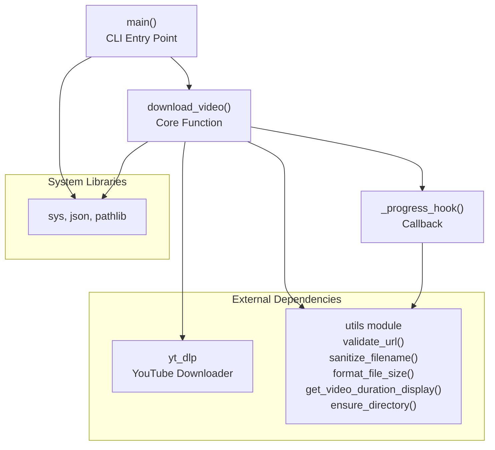
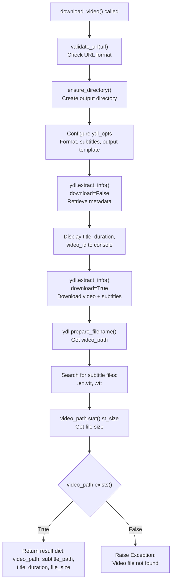
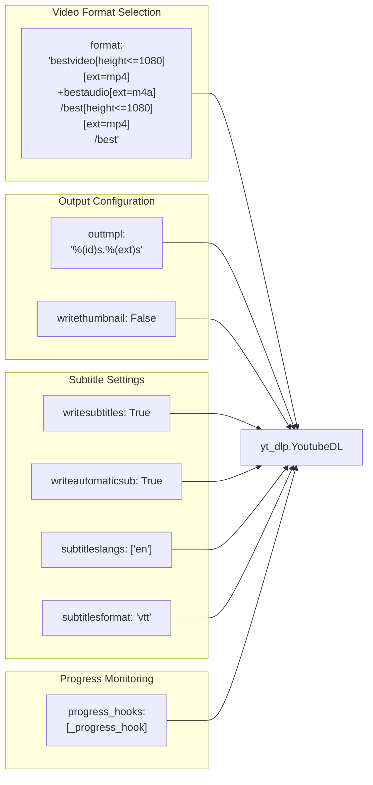
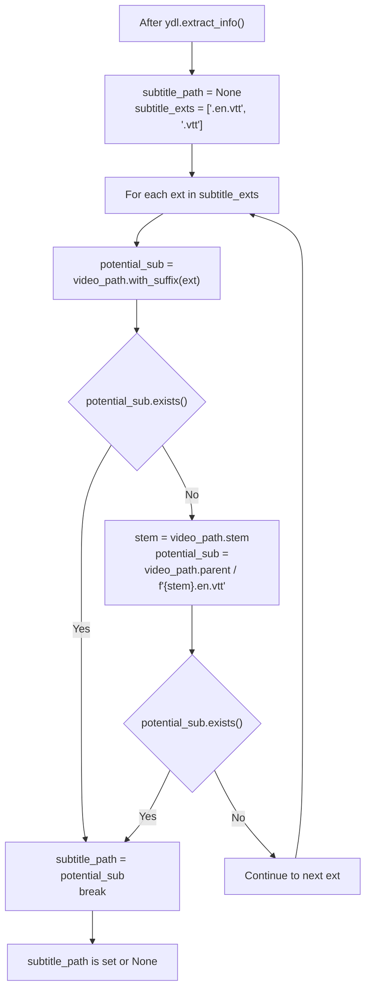
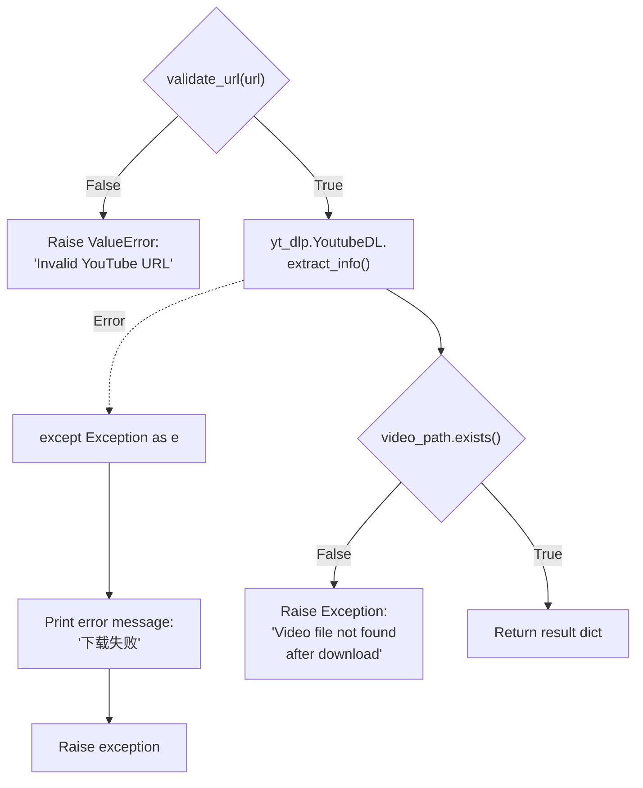
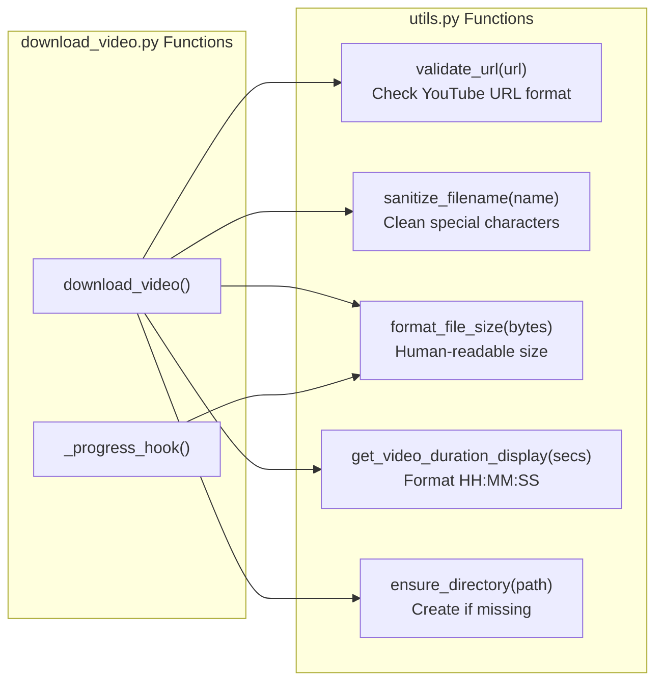

<!-- source: DeepWiki mcp.deepwiki.com · repo op7418/Youtube-clipper-skill · page 4.1 download_video.py · fetched 2026-10-26 -->

# download_video.py

<details>
<summary>Relevant source files</summary>

The following files were used as context for generating this wiki page:

- [TECHNICAL_NOTES.md](TECHNICAL_NOTES.md)
- [references/yt-dlp-guide.md](references/yt-dlp-guide.md)
- [scripts/download_video.py](scripts/download_video.py)

</details>


## Purpose and Scope

The `download_video.py` script is responsible for downloading YouTube videos and their English subtitles using the yt-dlp library. This script implements the **Phase 2: Video Download** stage of the processing pipeline, handling video format selection, quality limits (1080p maximum), subtitle extraction, and download progress monitoring.

For information about analyzing downloaded subtitles, see [analyze_subtitles.py](#4.2). For information about yt-dlp command-line usage and configuration details, see [yt-dlp Integration](#5.1).

**Sources:** [scripts/download_video.py:1-211]()

---

## Module Overview

### Entry Point and Dependencies

The script requires the `yt_dlp` Python package and imports utility functions from the shared `utils` module. If yt-dlp is not installed, the script exits with a clear error message directing the user to install it.



**Diagram: Module Dependency Structure for download_video.py**

**Sources:** [scripts/download_video.py:1-24]()

---

## Core Function: download_video()

### Function Signature and Parameters

```python
def download_video(url: str, output_dir: str = None) -> dict
```

The `download_video()` function is the primary interface for downloading videos. It accepts a YouTube URL and optional output directory, returning a dictionary with download results.

| Parameter | Type | Default | Description |
|-----------|------|---------|-------------|
| `url` | str | Required | YouTube video URL |
| `output_dir` | str | None | Output directory path (defaults to current directory) |

**Return Value Structure:**
```python
{
    'video_path': str,      # Absolute path to downloaded video
    'subtitle_path': str,   # Absolute path to subtitle file (or None)
    'title': str,           # Video title from metadata
    'duration': int,        # Video duration in seconds
    'file_size': int,       # Video file size in bytes
    'video_id': str         # YouTube video ID
}
```

**Sources:** [scripts/download_video.py:27-47]()

---

### Processing Flow



**Diagram: Execution Flow of download_video() Function**

**Sources:** [scripts/download_video.py:48-153]()

---

## yt-dlp Configuration

### ydl_opts Dictionary Structure

The `ydl_opts` dictionary configures yt-dlp behavior. This configuration is defined at [scripts/download_video.py:65-87]().



**Diagram: yt-dlp Configuration Options in ydl_opts**

**Sources:** [scripts/download_video.py:64-87]()

---

### Format Selection Logic

The `format` string implements a fallback chain to ensure successful downloads across different video types:

| Priority | Format String | Description |
|----------|---------------|-------------|
| 1 | `bestvideo[height<=1080][ext=mp4]+bestaudio[ext=m4a]` | Best video ≤1080p (mp4) + best audio (m4a), merged |
| 2 | `best[height<=1080][ext=mp4]` | Best combined stream ≤1080p (mp4) |
| 3 | `best` | Any best available format |

**Rationale for 1080p Limit:**
- File size management (4K videos can exceed 5-10GB)
- Processing performance (FFmpeg operations are faster on smaller files)
- Target platforms (short-form video platforms primarily use 1080p or lower)
- Storage efficiency

**Sources:** [scripts/download_video.py:66-67](), [TECHNICAL_NOTES.md:98-104](), [references/yt-dlp-guide.md:98-104]()

---

### Output Template and File Naming

The `outtmpl` value is set to `'%(id)s.%(ext)s'` at [scripts/download_video.py:70](), which results in files named by their YouTube video ID:

```
Video:    Ckt1cj0xjRM.mp4
Subtitle: Ckt1cj0xjRM.en.vtt
```

This naming strategy avoids issues with:
- Special characters in video titles
- Filesystem path length limits
- File name collisions
- Non-ASCII characters

The video ID ensures uniqueness and provides traceability to the source video.

**Sources:** [scripts/download_video.py:70](), [TECHNICAL_NOTES.md:340-353]()

---

## Subtitle Handling

### Subtitle Download Configuration

The script requests English subtitles in VTT format with automatic fallback:

```python
'writesubtitles': True,        # Request manual subtitles
'writeautomaticsub': True,     # Fallback to auto-generated
'subtitleslangs': ['en'],      # English only
'subtitlesformat': 'vtt',      # WebVTT format
```

**Priority Order:**
1. Manual/human-created English subtitles (if available)
2. Auto-generated English subtitles (YouTube's automatic captions)

**Sources:** [scripts/download_video.py:72-76]()

---

### Subtitle File Detection

After download, the script searches for subtitle files using multiple patterns at [scripts/download_video.py:112-124]():



**Diagram: Subtitle File Detection Logic**

**File Pattern Examples:**
- `Ckt1cj0xjRM.en.vtt` (language-specific)
- `Ckt1cj0xjRM.vtt` (generic)

**Sources:** [scripts/download_video.py:112-124]()

---

## Progress Monitoring

### _progress_hook() Callback

The `_progress_hook()` function at [scripts/download_video.py:156-182]() is registered in `ydl_opts['progress_hooks']` and receives download status updates from yt-dlp.

**Callback Status Types:**

| Status | Information Available | Display Behavior |
|--------|----------------------|------------------|
| `downloading` | `downloaded_bytes`, `total_bytes`, `speed` | Progress bar with percentage, data transferred, and speed |
| `downloading` (no total) | `downloaded_bytes`, `speed` | Simple progress counter with speed |
| `finished` | None | Print newline to complete progress display |

**Progress Bar Rendering:**

```python
bar_length = 30
filled = int(bar_length * percent / 100)
bar = '█' * filled + '░' * (bar_length - filled)
```

Example output:
```
   [████████████░░░░░░░░░░░░░░░░] 42.3% - 15.2 MB/36.0 MB - 2.1 MB/s
```

The progress display uses `\r` (carriage return) to overwrite the same line, creating an animated progress bar effect.

**Sources:** [scripts/download_video.py:156-182]()

---

## Error Handling

### Validation and Exceptions



**Diagram: Error Handling Flow in download_video()**

**Exception Types:**
- `ValueError`: Invalid URL format (raised by `validate_url()`)
- `Exception`: yt-dlp download failures (network errors, unavailable video, etc.)
- `Exception`: Missing video file after download (filesystem issue)

**Sources:** [scripts/download_video.py:49-50](), [scripts/download_video.py:130-132](), [scripts/download_video.py:151-153]()

---

## Command-Line Interface

### main() Function

The `main()` function at [scripts/download_video.py:184-210]() provides a command-line interface for standalone script execution.

**Usage Patterns:**

```bash
# Basic usage (downloads to current directory)
python download_video.py https://youtube.com/watch?v=Ckt1cj0xjRM

# Specify output directory
python download_video.py https://youtube.com/watch?v=Ckt1cj0xjRM ~/Downloads
```

**Argument Processing:**

| Argument | Position | Required | Description |
|----------|----------|----------|-------------|
| URL | `sys.argv[1]` | Yes | YouTube video URL |
| Output directory | `sys.argv[2]` | No | Target directory for downloaded files |

**Output Format:**

After successful download, the script prints a JSON summary:

```json
{
  "video_path": "/path/to/Ckt1cj0xjRM.mp4",
  "subtitle_path": "/path/to/Ckt1cj0xjRM.en.vtt",
  "title": "Anthropic's Amodei on AI",
  "duration": 1543,
  "file_size": 145728432,
  "video_id": "Ckt1cj0xjRM"
}
```

This JSON output enables integration with other scripts in the processing pipeline.

**Sources:** [scripts/download_video.py:184-210]()

---

## Integration with Utilities Module

### Utility Function Usage

The script leverages shared utilities from `utils.py` (see [Utilities Module](#4.6) for details):



**Diagram: Utility Function Dependencies in download_video.py**

**Function Call Locations:**
- `validate_url()`: [scripts/download_video.py:49]()
- `ensure_directory()`: [scripts/download_video.py:58]()
- `get_video_duration_display()`: [scripts/download_video.py:100]()
- `format_file_size()`: [scripts/download_video.py:134](), [scripts/download_video.py:162-163](), [scripts/download_video.py:165](), [scripts/download_video.py:177]()

**Sources:** [scripts/download_video.py:18-24]()

---

## Output Files and Structure

### Generated Files

For a given YouTube video with ID `Ckt1cj0xjRM`, the download operation produces:

| File | Pattern | Purpose |
|------|---------|---------|
| Video | `Ckt1cj0xjRM.mp4` | Downloaded video file (≤1080p) |
| Subtitle | `Ckt1cj0xjRM.en.vtt` | English subtitles in WebVTT format |

**File Location:**
Both files are placed in the directory specified by `output_dir` parameter, or the current working directory if not specified.

**Storage Characteristics:**
- Video files typically range from 50MB (short videos) to 500MB+ (longer 1080p content)
- VTT subtitle files are text-based, typically <1MB
- File naming by video ID prevents conflicts when downloading multiple videos

**Sources:** [scripts/download_video.py:70](), [scripts/download_video.py:108-124]()

---

## Console Output Format

### Download Progress Display

The script provides structured console output with clear visual indicators:

**Phase 1: Information Retrieval**
```
🎬 开始下载视频...
   URL: https://youtube.com/watch?v=Ckt1cj0xjRM
   输出目录: /Users/username/videos

📊 获取视频信息...
   标题: Anthropic's Amodei on AI
   时长: 25:43
   视频ID: Ckt1cj0xjRM
```

**Phase 2: Download Progress**
```
📥 开始下载...
   [██████████████████████░░░░░░░] 75.3% - 108.5 MB/144.2 MB - 3.2 MB/s
```

**Phase 3: Completion**
```
✅ 视频下载完成: Ckt1cj0xjRM.mp4
   大小: 144.2 MB
✅ 字幕下载完成: Ckt1cj0xjRM.en.vtt
```

**Emoji Legend:**
- 🎬 Download initialization
- 📊 Metadata extraction
- 📥 Active download
- ✅ Success
- ⚠️ Warning (e.g., missing subtitles)
- ❌ Error

**Sources:** [scripts/download_video.py:60-153]()

---

## Common Usage Patterns

### Standalone Script Execution

```bash
# Download to current directory
python scripts/download_video.py "https://youtube.com/watch?v=VIDEO_ID"

# Download to specific directory
python scripts/download_video.py "https://youtube.com/watch?v=VIDEO_ID" ./downloads
```

### Programmatic API Usage

```python
from scripts.download_video import download_video

result = download_video(
    url="https://youtube.com/watch?v=Ckt1cj0xjRM",
    output_dir="/path/to/output"
)

video_path = result['video_path']
subtitle_path = result['subtitle_path']
duration = result['duration']
```

### Integration with Pipeline

The script is typically invoked as the first stage of the processing pipeline:

1. **download_video.py** → Downloads video and subtitles
2. [analyze_subtitles.py](#4.2) → Analyzes subtitle content for chapters
3. [clip_video.py](#4.3) → Extracts chapter segments
4. [extract_subtitle_clip.py](#4.5) → Extracts subtitle segments
5. [burn_subtitles.py](#4.4) → Burns subtitles into video

**Sources:** [scripts/download_video.py:27-153]()

---

