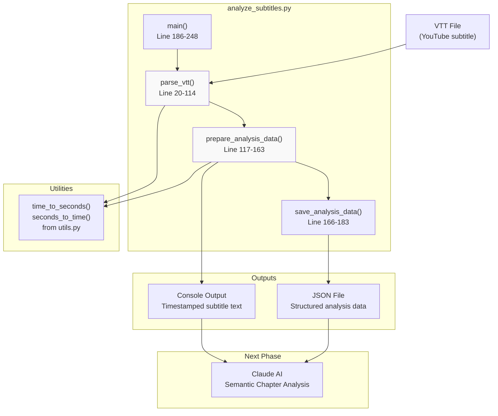
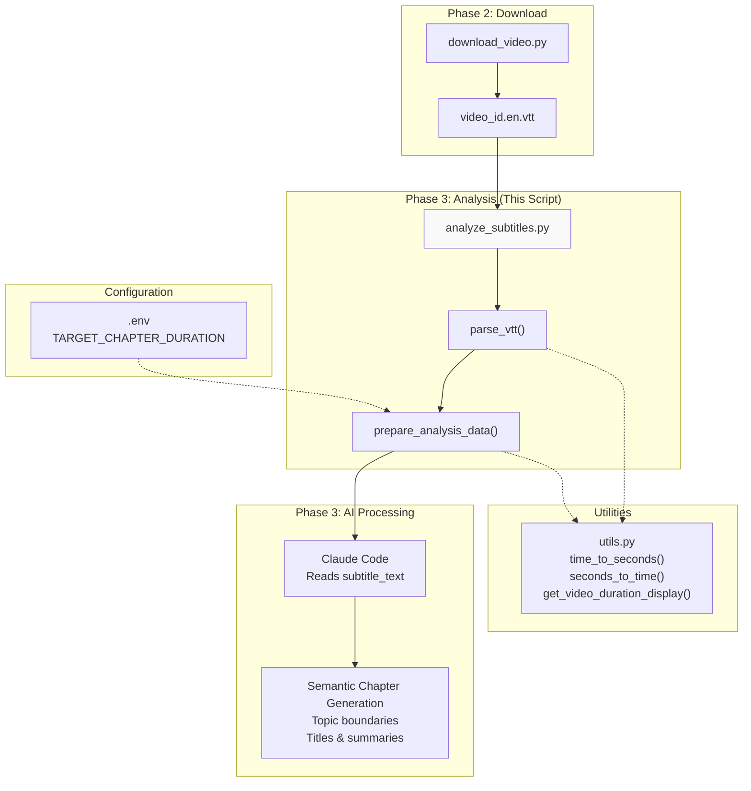
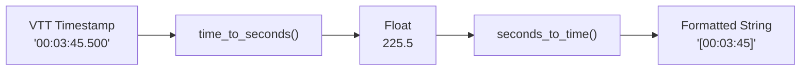
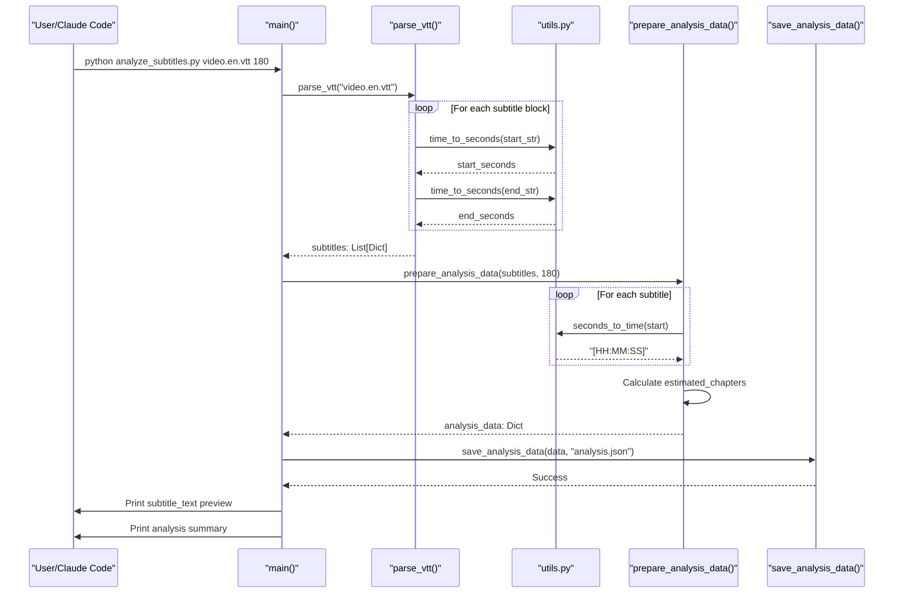

<!-- source: DeepWiki mcp.deepwiki.com · repo op7418/Youtube-clipper-skill · page 4.2 analyze_subtitles.py · fetched 2026-10-26 -->

# analyze_subtitles.py

<details>
<summary>Relevant source files</summary>

The following files were used as context for generating this wiki page:

- [README.md](README.md)
- [SKILL.md](SKILL.md)
- [scripts/analyze_subtitles.py](scripts/analyze_subtitles.py)

</details>


## Purpose and Scope

This document describes the `analyze_subtitles.py` script, which is responsible for parsing VTT subtitle files downloaded from YouTube and preparing structured data for AI semantic analysis. This script serves as the bridge between raw subtitle data and Claude AI's chapter generation capabilities.

For information about the video download process that produces the VTT files, see [download_video.py](#4.1). For details on how Claude AI uses the prepared data to generate chapters, see [AI Semantic Analysis](#7.2).

**Sources:** [scripts/analyze_subtitles.py:1-252]()

---

## Overview

The `analyze_subtitles.py` script performs two primary functions:

1. **VTT Parsing**: Reads WebVTT subtitle files and extracts timestamps and text into a structured format
2. **Data Preparation**: Formats the parsed subtitles into a text representation that Claude AI can analyze to identify semantic boundaries and generate meaningful chapters

The script does **not** perform the actual AI analysis; it only prepares the data. The actual chapter generation is performed by Claude Code reading the prepared subtitle text and applying semantic understanding.

**Sources:** [scripts/analyze_subtitles.py:1-5](), [SKILL.md:96-145]()

---

## Input/Output Specifications

### Input

| Parameter | Type | Description | Default |
|-----------|------|-------------|---------|
| `vtt_file` | File path | VTT subtitle file from YouTube download | Required |
| `target_duration` | Integer | Target chapter duration in seconds | 180 (3 min) |
| `output_json` | File path | Optional JSON output file for analysis data | None |

### Output

The script produces two types of output:

1. **Console Output**: Formatted subtitle text with timestamps for AI analysis
2. **JSON File** (optional): Structured analysis data including:
   - `subtitle_text`: Full timestamped subtitle content
   - `total_duration`: Video duration in seconds
   - `subtitle_count`: Number of subtitle entries
   - `target_chapter_duration`: Target chapter length
   - `estimated_chapters`: Calculated chapter estimate
   - `subtitles_raw`: Original parsed subtitle array

**Sources:** [scripts/analyze_subtitles.py:186-248]()

---

## Architecture and Data Flow



**Sources:** [scripts/analyze_subtitles.py:1-252](), [scripts/utils.py]()

---

## Core Functions

### parse_vtt()

Parses WebVTT subtitle files into structured Python dictionaries.

**Function Signature:**
```python
def parse_vtt(vtt_path: str) -> List[Dict]
```

**Processing Steps:**

1. **Header Removal**: Strips WEBVTT header and STYLE blocks using regex
2. **Block Splitting**: Separates subtitle entries by double newlines
3. **Timestamp Extraction**: Parses `HH:MM:SS.mmm --> HH:MM:SS.mmm` format
4. **Text Cleaning**: Removes HTML tags and special characters
5. **Time Conversion**: Converts timestamp strings to seconds using `time_to_seconds()`

**VTT Parsing Logic:**

```mermaid
flowchart LR
    VTTFile["VTT File Content"]
    RemoveHeader["Remove WEBVTT Header<br/>& STYLE blocks<br/>Line 50-51"]
    SplitBlocks["Split by double newline<br/>Line 54"]
    
    subgraph "For Each Block"
        FindTimestamp["Find timestamp line<br/>(contains '-->')<br/>Line 68-69"]
        ExtractText["Extract text lines<br/>(skip digits)<br/>Line 70-71"]
        ParseTime["Parse start/end times<br/>time_to_seconds()<br/>Line 85-86"]
        CleanText["Remove HTML tags<br/>& special chars<br/>Line 92-95"]
        AppendSub["Append to subtitles list<br/>Line 98-102"]
    end
    
    Result["List[Dict]<br/>{start, end, text}"]
    
    VTTFile --> RemoveHeader
    RemoveHeader --> SplitBlocks
    SplitBlocks --> FindTimestamp
    FindTimestamp --> ExtractText
    ExtractText --> ParseTime
    ParseTime --> CleanText
    CleanText --> AppendSub
    AppendSub --> Result
```



**Data Structure Output:**
```python
[
    {'start': 0.0, 'end': 3.5, 'text': 'Hello world'},
    {'start': 3.5, 'end': 7.2, 'text': 'This is a test'},
    ...
]
```

**Error Handling**: The function uses try-except blocks to skip malformed subtitle entries rather than failing the entire parse operation [scripts/analyze_subtitles.py:104-106]().

**Sources:** [scripts/analyze_subtitles.py:20-114]()

---

### prepare_analysis_data()

Formats parsed subtitles into a timestamped text representation for AI consumption.

**Function Signature:**
```python
def prepare_analysis_data(subtitles: List[Dict], target_chapter_duration: int = 180) -> Dict
```

**Key Operations:**

1. **Text Formatting**: Converts each subtitle to `[HH:MM:SS] text` format
2. **Duration Calculation**: Extracts total duration from last subtitle's end time
3. **Chapter Estimation**: Calculates `estimated_chapters = total_duration / target_duration`

**Chapter Estimation Algorithm:**

| Total Duration | Target Duration (180s) | Estimated Chapters |
|----------------|------------------------|-------------------|
| 900s (15 min) | 180s (3 min) | 5 chapters |
| 1800s (30 min) | 180s (3 min) | 10 chapters |
| 3600s (60 min) | 180s (3 min) | 20 chapters |

Formula: `max(1, int(total_duration / target_chapter_duration))`

**Output Format Example:**
```
[00:00:00] Welcome to this video
[00:00:03] Today we'll discuss AI development
[00:00:07] Let's start with the basics
...
```

**Sources:** [scripts/analyze_subtitles.py:117-163]()

---

### save_analysis_data()

Serializes analysis data to JSON format for persistence or further processing.

**Function Signature:**
```python
def save_analysis_data(data: Dict, output_path: str)
```

**Features:**
- Creates parent directories if they don't exist
- Saves with UTF-8 encoding and proper indentation
- Uses `ensure_ascii=False` to preserve Unicode characters (important for Chinese text)

**Sources:** [scripts/analyze_subtitles.py:166-183]()

---

## Data Structures

### Subtitle Entry Format

Each parsed subtitle is represented as:

```python
{
    'start': float,    # Start time in seconds (e.g., 0.0)
    'end': float,      # End time in seconds (e.g., 3.5)
    'text': str        # Cleaned subtitle text
}
```

### Analysis Data Format

The complete analysis data structure:

```python
{
    'subtitle_text': str,              # Full timestamped text for AI
    'total_duration': float,           # Total video duration (seconds)
    'subtitle_count': int,             # Number of subtitle entries
    'target_chapter_duration': int,    # Target chapter length (seconds)
    'estimated_chapters': int,         # Calculated chapter estimate
    'subtitles_raw': List[Dict]        # Original parsed subtitles
}
```

**Sources:** [scripts/analyze_subtitles.py:117-163]()

---

## Integration with System Components



**Sources:** [scripts/analyze_subtitles.py:1-252](), [SKILL.md:96-145](), [scripts/utils.py]()

---

## Command-Line Interface

### Usage Patterns

**Basic Usage:**
```bash
python3 scripts/analyze_subtitles.py video.en.vtt
```

**With Custom Chapter Duration:**
```bash
python3 scripts/analyze_subtitles.py video.en.vtt 240
```

**With JSON Output:**
```bash
python3 scripts/analyze_subtitles.py video.en.vtt 240 analysis.json
```

### Arguments

| Position | Argument | Type | Description | Default |
|----------|----------|------|-------------|---------|
| 1 | `vtt_file` | String | Path to VTT subtitle file | Required |
| 2 | `target_duration` | Integer | Target chapter duration (seconds) | 180 |
| 3 | `output_json` | String | Output JSON file path | None |

### Output Format

The script prints structured output to console:

1. **Parsing Progress**: File name and subtitle count
2. **Preview**: First 50 lines of timestamped text
3. **Summary Statistics**: JSON-formatted metadata

**Sources:** [scripts/analyze_subtitles.py:186-248]()

---

## Regular Expressions and Text Processing

The script uses several regex patterns for VTT parsing:

| Pattern | Purpose | Location |
|---------|---------|----------|
| `r'^WEBVTT.*?\n\n'` | Remove WEBVTT header | Line 50 |
| `r'STYLE.*?-->'` | Remove STYLE blocks | Line 51 |
| `r'align:.*\|position:.*'` | Strip position metadata | Line 79 |
| `r'<[^>]+>'` | Remove HTML tags | Line 92 |

### VTT Format Handling

VTT files may contain various metadata that must be stripped:

```
WEBVTT
Kind: captions
Language: en

STYLE
::cue {
  background-color: transparent;
}

00:00:00.000 --> 00:00:03.500 align:start position:0%
Welcome to this video
```

The parser removes all metadata and extracts only timestamps and text.

**Sources:** [scripts/analyze_subtitles.py:49-95]()

---

## Time Conversion and Utilities

The script relies heavily on utility functions from `utils.py`:

### Time Conversion Functions



**Function Usage:**

- `time_to_seconds(time_str)`: Converts VTT timestamps to float seconds [scripts/analyze_subtitles.py:85-86]()
- `seconds_to_time(seconds)`: Converts seconds back to formatted time strings [scripts/analyze_subtitles.py:143]()
- `get_video_duration_display(seconds)`: Formats duration for display [scripts/analyze_subtitles.py:112]()

**Sources:** [scripts/analyze_subtitles.py:13-17](), [scripts/utils.py]()

---

## Error Handling and Robustness

### File Validation

The script checks for file existence before parsing:

```python
if not vtt_path.exists():
    raise FileNotFoundError(f"Subtitle file not found: {vtt_path}")
```

**Source:** [scripts/analyze_subtitles.py:39-40]()

### Malformed Entry Handling

Rather than failing on invalid subtitle blocks, the parser skips them:

```python
except Exception as e:
    # Skip unparseable blocks
    continue
```

This ensures that a few malformed entries don't prevent the entire file from being processed.

**Source:** [scripts/analyze_subtitles.py:104-106]()

### Empty Subtitle Protection

The script validates that subtitles exist before proceeding:

```python
if not subtitles:
    raise ValueError("No subtitles to analyze")
```

**Source:** [scripts/analyze_subtitles.py:134-135]()

---

## Performance Characteristics

### Processing Metrics

For a typical YouTube video:

| Metric | Example Value |
|--------|--------------|
| Input file size | 50-200 KB |
| Subtitle entries | 300-1000 |
| Parsing time | < 1 second |
| Memory usage | Minimal (subtitles held in memory) |
| Output text size | Similar to input |

### Scalability

The script processes subtitles sequentially in a single pass. Memory usage scales linearly with subtitle count, but even hour-long videos produce manageable data sizes (typically < 5000 subtitle entries).

**Sources:** [scripts/analyze_subtitles.py:20-114]()

---

## Example Execution Flow



**Sources:** [scripts/analyze_subtitles.py:186-248]()

---

## Relationship to AI Chapter Generation

This script is part of **Phase 3: AI Semantic Analysis** in the overall workflow. The prepared subtitle text is consumed by Claude Code, which:

1. Reads the timestamped subtitle text
2. Identifies semantic topic boundaries
3. Generates chapter titles and summaries
4. Ensures 2-5 minute chapter granularity

The `estimated_chapters` calculation provides a guidance value to Claude AI about how many chapters are expected based on the target duration, but the AI is free to adjust this based on actual content semantics.

**Estimation Formula:**
```python
estimated_chapters = max(1, int(total_duration / target_chapter_duration))
```

For `TARGET_CHAPTER_DURATION=180` (3 minutes), a 30-minute video yields `estimated_chapters=10`.

**Sources:** [scripts/analyze_subtitles.py:149](), [SKILL.md:96-145](), [README.md:193-209]()

---

## Configuration Integration

The script accepts `target_chapter_duration` as a parameter, which can be configured via environment variables:

| Environment Variable | Default | Purpose |
|---------------------|---------|---------|
| `TARGET_CHAPTER_DURATION` | 180 | Target chapter length in seconds |

When invoked by Claude Code, the skill reads this value from `.env` and passes it to the script.

**Sources:** [scripts/analyze_subtitles.py:117](), [.env.example]()

---

