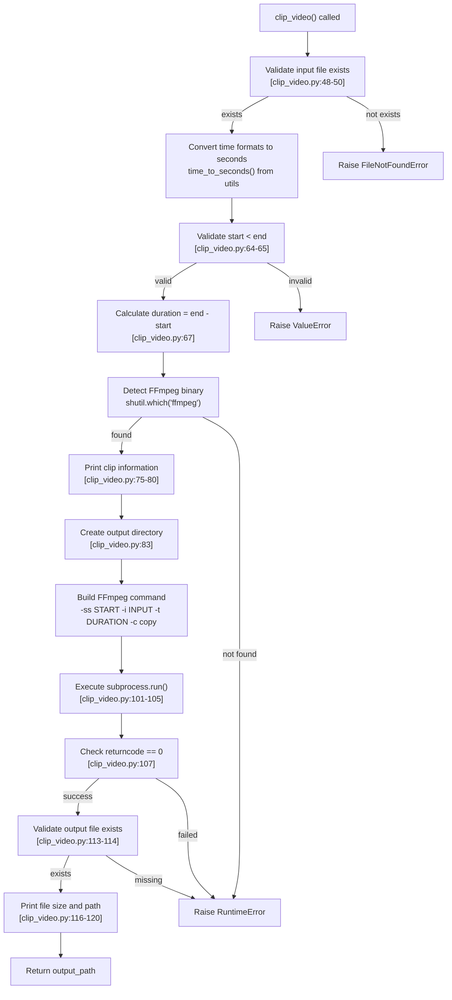
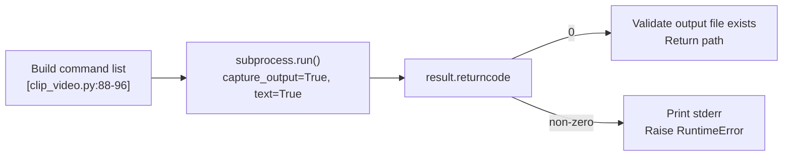
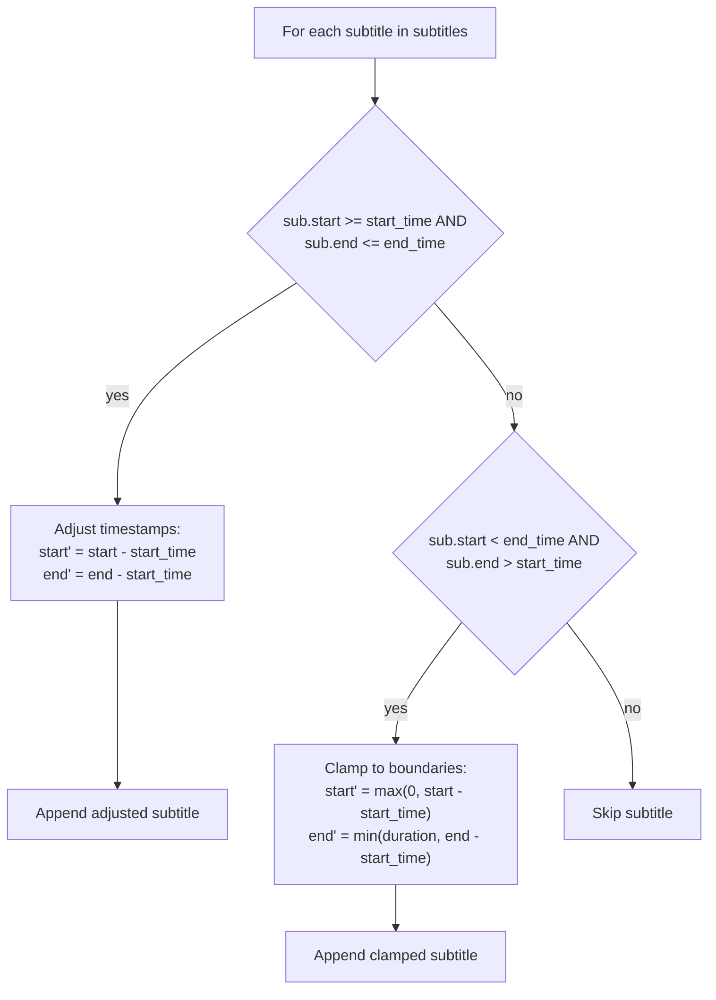
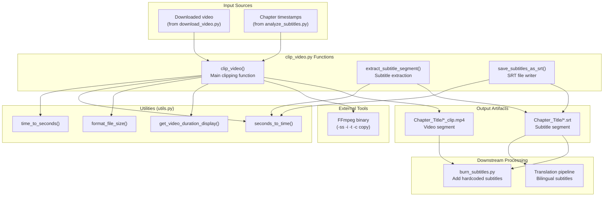

<!-- source: DeepWiki mcp.deepwiki.com · repo op7418/Youtube-clipper-skill · page 4.3 clip_video.py · fetched 2026-10-26 -->

# clip_video.py

<details>
<summary>Relevant source files</summary>

The following files were used as context for generating this wiki page:

- [TECHNICAL_NOTES.md](TECHNICAL_NOTES.md)
- [references/ffmpeg-guide.md](references/ffmpeg-guide.md)
- [scripts/clip_video.py](scripts/clip_video.py)

</details>


This document covers the `clip_video.py` script, which performs precise video segment extraction using FFmpeg. The script provides a Python wrapper around FFmpeg's clipping functionality with time format conversion, validation, and quality-preserving stream copying. For subtitle burning onto clipped videos, see [burn_subtitles.py](#4.4). For subtitle-only extraction with timestamp adjustment, see [extract_subtitle_clip.py](#4.5).

Sources: [scripts/clip_video.py:1-237]()

## Overview

The `clip_video.py` script implements time-based video segmentation by invoking FFmpeg with precise start/end timestamps. It uses stream copying (`-c copy`) rather than re-encoding to maintain original video quality and achieve fast processing speeds. The script also provides utility functions for extracting corresponding subtitle segments with timestamp adjustment.

**Key responsibilities:**
- Convert time formats (string to seconds, seconds to formatted strings)
- Validate input files and time ranges
- Execute FFmpeg with optimized clipping parameters
- Extract subtitle segments matching video time ranges
- Adjust subtitle timestamps relative to clip start time
- Generate SRT format subtitle files

Sources: [scripts/clip_video.py:1-10](), [scripts/clip_video.py:21-123]()

## Function: clip_video()

The primary entry point for video clipping operations. This function accepts flexible time inputs (either numeric seconds or time strings like "01:30:00") and produces a clipped video segment.

### Function Signature

```python
def clip_video(
    video_path: str,
    start_time: Union[str, float],
    end_time: Union[str, float],
    output_path: str,
    ffmpeg_path: str = None
) -> str
```

**Parameters:**

| Parameter | Type | Description |
|-----------|------|-------------|
| `video_path` | `str` | Path to input video file |
| `start_time` | `Union[str, float]` | Start timestamp (seconds or "HH:MM:SS" format) |
| `end_time` | `Union[str, float]` | End timestamp (seconds or "HH:MM:SS" format) |
| `output_path` | `str` | Destination path for clipped video |
| `ffmpeg_path` | `str` (optional) | Custom FFmpeg executable path; auto-detected if `None` |

**Returns:** `str` - Path to the created output file

**Raises:**
- `FileNotFoundError` - Input video file does not exist
- `ValueError` - Invalid time range (start >= end)
- `RuntimeError` - FFmpeg execution failure or missing FFmpeg binary

Sources: [scripts/clip_video.py:21-44]()

### Processing Flow



Sources: [scripts/clip_video.py:45-122]()

## FFmpeg Command Construction

The script constructs an FFmpeg command optimized for fast, lossless video clipping using stream copying.

### Command Structure

The FFmpeg command follows this pattern:

```
ffmpeg -ss <start_seconds> -i <input_video> -t <duration> -c copy -y <output_video>
```

**Command breakdown:**

| Flag | Value | Purpose |
|------|-------|---------|
| `-ss` | `start_seconds` | Seek to start position (input seeking for accuracy) |
| `-i` | `video_path` | Input file path |
| `-t` | `duration` | Duration to extract (calculated as `end - start`) |
| `-c` | `copy` | Copy streams without re-encoding (fast, lossless) |
| `-y` | - | Overwrite output file if exists |

Sources: [scripts/clip_video.py:85-96]()

### Stream Copying Strategy

The `-c copy` parameter instructs FFmpeg to copy video and audio streams directly without transcoding. This approach:

- **Preserves quality**: No generation loss from re-encoding
- **Maximizes speed**: No computational overhead from codec operations
- **Maintains format**: Original codec, bitrate, and container properties preserved
- **Limitations**: Cannot modify resolution, apply filters, or burn subtitles

For operations requiring re-encoding (e.g., subtitle burning), see [burn_subtitles.py](#4.4).

Sources: [scripts/clip_video.py:87-93](), [TECHNICAL_NOTES.md:33-48]()

### Execution and Error Handling



The script captures both stdout and stderr from FFmpeg for diagnostic purposes. On failure, the full error output is displayed to aid troubleshooting.

Sources: [scripts/clip_video.py:100-114]()

## Function: extract_subtitle_segment()

Extracts subtitle entries within a specified time range and optionally adjusts timestamps to be relative to the segment start time.

### Function Signature

```python
def extract_subtitle_segment(
    subtitles: list,
    start_time: float,
    end_time: float,
    adjust_timestamps: bool = True
) -> list
```

**Parameters:**

| Parameter | Type | Description |
|-----------|------|-------------|
| `subtitles` | `list` | List of subtitle dicts with keys: `start`, `end`, `text` |
| `start_time` | `float` | Segment start time in seconds |
| `end_time` | `float` | Segment end time in seconds |
| `adjust_timestamps` | `bool` | If `True`, subtract `start_time` from all timestamps |

**Returns:** `list` - Filtered subtitle entries

Sources: [scripts/clip_video.py:125-142]()

### Timestamp Adjustment Logic

When `adjust_timestamps=True`, the function transforms subtitle timestamps to be relative to the clip's start time:

```
Original subtitle: [120s - 125s] "Hello world"
Clip range: [100s - 200s]
Adjusted subtitle: [20s - 25s] "Hello world"
```

**Three cases handled:**

1. **Subtitle fully within range**: Include and adjust
2. **Subtitle fully outside range**: Exclude
3. **Subtitle partially overlapping**: Include with boundary clamping

Sources: [scripts/clip_video.py:143-171]()

### Overlap Handling Diagram



Sources: [scripts/clip_video.py:145-170]()

## Function: save_subtitles_as_srt()

Writes subtitle data to disk in SRT (SubRip) format with proper formatting and encoding.

### Function Signature

```python
def save_subtitles_as_srt(subtitles: list, output_path: str)
```

**Parameters:**
- `subtitles`: List of subtitle dictionaries with `start`, `end`, `text` keys
- `output_path`: Destination file path (directory created if needed)

### SRT Format Structure

The function generates SRT files following this structure:

```
1
00:00:00,000 --> 00:00:03,500
First subtitle text

2
00:00:03,500 --> 00:00:07,000
Second subtitle text
```

**Format requirements:**
- Sequential numbering starting from 1
- Timestamp format: `HH:MM:SS,mmm` (comma separator for milliseconds)
- Arrow separator: ` --> ` (space-arrow-space)
- Blank line between entries

Sources: [scripts/clip_video.py:174-201](), [TECHNICAL_NOTES.md:169-185]()

### Implementation Details

The function uses `seconds_to_time()` from `utils.py` with specific flags:

```python
start_time = seconds_to_time(sub['start'], include_hours=True, use_comma=True)
end_time = seconds_to_time(sub['end'], include_hours=True, use_comma=True)
```

**Key parameters:**
- `include_hours=True`: Always include hour field (required by SRT spec)
- `use_comma=True`: Use comma instead of period for milliseconds (SRT vs VTT format)

The file is written with UTF-8 encoding to support international characters in subtitle text.

Sources: [scripts/clip_video.py:185-201]()

## Command-Line Interface

When executed as a standalone script, `clip_video.py` provides a CLI for direct video clipping.

### Usage

```bash
python clip_video.py <video> <start_time> <end_time> <output>
```

**Arguments:**
- `video`: Input video file path
- `start_time`: Start time (numeric seconds or "HH:MM:SS" format)
- `end_time`: End time (numeric seconds or "HH:MM:SS" format)
- `output`: Output video file path

**Examples:**

```bash
# Using numeric seconds
python clip_video.py input.mp4 0 195 output.mp4

# Using time strings
python clip_video.py input.mp4 00:00:00 00:03:15 output.mp4
python clip_video.py input.mp4 01:30:00 01:33:15 output.mp4
```

Sources: [scripts/clip_video.py:204-217]()

### Error Handling

The CLI wrapper catches all exceptions and provides formatted error output:

```python
try:
    result_path = clip_video(video_path, start_time, end_time, output_path)
    print(f"\n✨ 完成！输出文件: {result_path}")
except Exception as e:
    print(f"\n❌ 错误: {str(e)}")
    import traceback
    traceback.print_exc()
    sys.exit(1)
```

Exit codes:
- `0`: Success
- `1`: Error (invalid arguments, FFmpeg failure, etc.)

Sources: [scripts/clip_video.py:224-232]()

## Integration with System Components

The `clip_video.py` script integrates with multiple system components in the processing pipeline.



Sources: [scripts/clip_video.py:1-237](), [TECHNICAL_NOTES.md:1-490]()

### Dependency Table

| Component | Type | Purpose | Import/Call |
|-----------|------|---------|-------------|
| `utils.time_to_seconds()` | Function | Convert "HH:MM:SS" to seconds | [clip_video.py:14]() |
| `utils.seconds_to_time()` | Function | Convert seconds to formatted string | [clip_video.py:15]() |
| `utils.format_file_size()` | Function | Human-readable file size | [clip_video.py:16]() |
| `utils.get_video_duration_display()` | Function | Format duration for display | [clip_video.py:17]() |
| `shutil.which()` | Function | Detect FFmpeg binary path | [clip_video.py:71]() |
| `subprocess.run()` | Function | Execute FFmpeg command | [clip_video.py:101]() |
| `pathlib.Path` | Class | Cross-platform path handling | [clip_video.py:10,45-46]() |

Sources: [scripts/clip_video.py:7-18](), [scripts/clip_video.py:70-105]()

## Performance Characteristics

The stream copying approach provides significant performance advantages:

**Typical performance (1080p video):**
- **With `-c copy` (stream copy)**: 1-3 seconds per clip (I/O bound)
- **With re-encoding**: 30-120 seconds per clip (CPU bound)

**Speed multiplier**: 10-40x faster than re-encoding

**Quality**: Bit-perfect copy of original streams (no generation loss)

**Limitations**: Cannot apply filters, burn subtitles, or change resolution. For subtitle burning, the clipped video must be passed to `burn_subtitles.py` which performs re-encoding with the `subtitles` filter.

Sources: [TECHNICAL_NOTES.md:33-57](), [references/ffmpeg-guide.md:33-48]()

---

