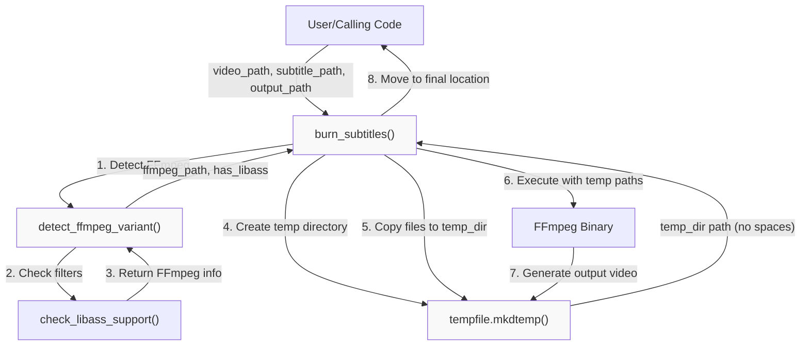
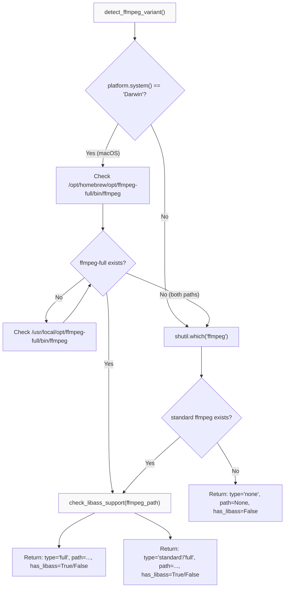
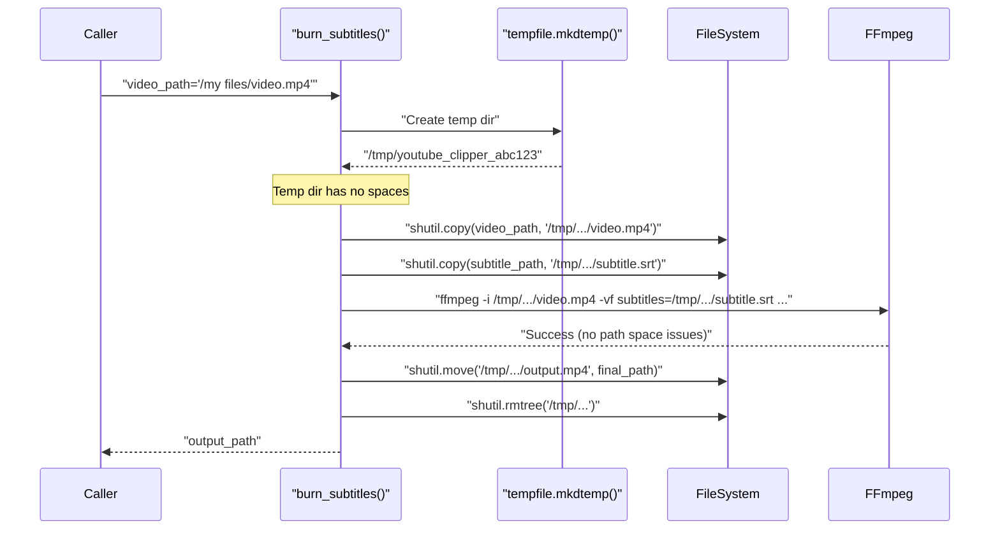

<!-- source: DeepWiki mcp.deepwiki.com · repo op7418/Youtube-clipper-skill · page 4.4 burn_subtitles.py · fetched 2026-10-26 -->

# burn_subtitles.py

<details>
<summary>Relevant source files</summary>

The following files were used as context for generating this wiki page:

- [TECHNICAL_NOTES.md](TECHNICAL_NOTES.md)
- [references/ffmpeg-guide.md](references/ffmpeg-guide.md)
- [scripts/burn_subtitles.py](scripts/burn_subtitles.py)

</details>


## Purpose and Scope

The `burn_subtitles.py` script hardcodes (burns) subtitles into video files using FFmpeg's `subtitles` filter. This creates a single video file with permanently embedded subtitles that cannot be disabled or removed. The script handles two critical technical challenges: detecting FFmpeg installations with libass support and working around FFmpeg's inability to process file paths containing spaces.

For video clipping without subtitle burning, see [clip_video.py](#4.3). For subtitle extraction and time adjustment, see [extract_subtitle_clip.py](#4.5). For general FFmpeg integration details, see [FFmpeg Integration](#5.2).

Sources: [scripts/burn_subtitles.py:1-16]()

## Core Responsibilities

The script performs four primary functions:

1. **FFmpeg Variant Detection** - Identifies available FFmpeg installations and verifies libass support
2. **libass Support Verification** - Ensures the `subtitles` filter is available for subtitle burning
3. **Path Space Workaround** - Uses temporary directories to bypass FFmpeg's path handling limitations
4. **Subtitle Rendering** - Applies customizable subtitle styles (font size, margin) during video encoding

Sources: [scripts/burn_subtitles.py:1-288](), [TECHNICAL_NOTES.md:1-489]()

## System Architecture

### Component Interaction Flow



Sources: [scripts/burn_subtitles.py:123-244]()

### FFmpeg Detection Strategy



Sources: [scripts/burn_subtitles.py:19-70]()

## Function Reference

### `detect_ffmpeg_variant()`

Detects available FFmpeg installations with a priority-based search strategy.

**Detection Priority:**
1. macOS `ffmpeg-full` on Apple Silicon: `/opt/homebrew/opt/ffmpeg-full/bin/ffmpeg`
2. macOS `ffmpeg-full` on Intel: `/usr/local/opt/ffmpeg-full/bin/ffmpeg`
3. Standard `ffmpeg` in system PATH

**Return Structure:**
```python
{
    'type': 'full' | 'standard' | 'none',
    'path': str,  # FFmpeg executable path or None
    'has_libass': bool  # Whether subtitles filter is available
}
```

| Field | Type | Description |
|-------|------|-------------|
| `type` | `str` | `'full'` if libass supported, `'standard'` if found but no libass, `'none'` if not found |
| `path` | `str` or `None` | Absolute path to FFmpeg binary |
| `has_libass` | `bool` | Result of `check_libass_support()` check |

Sources: [scripts/burn_subtitles.py:19-70]()

### `check_libass_support(ffmpeg_path)`

Verifies whether a specific FFmpeg installation supports the `subtitles` filter by checking available filters.

**Implementation:**
```python
# Executes: ffmpeg -filters
# Searches stdout for 'subtitles' keyword
```

**Parameters:**
- `ffmpeg_path` (str): Path to FFmpeg executable

**Returns:**
- `bool`: `True` if `subtitles` filter found in output, `False` otherwise

**Technical Details:**
- Runs `ffmpeg -filters` command
- Timeout set to 5 seconds to prevent hangs
- Case-insensitive search for `'subtitles'` in filter list
- Returns `False` on any exception (missing binary, timeout, etc.)

Sources: [scripts/burn_subtitles.py:73-96]()

### `install_ffmpeg_full_guide()`

Displays platform-specific installation instructions when libass support is missing.

**Output Content:**

| Platform | Instruction |
|----------|-------------|
| macOS (Darwin) | `brew install ffmpeg-full` |
| Other | Compile from source with `--enable-libass` |

**Displayed Information:**
- Installation commands
- Expected binary paths (Apple Silicon vs Intel)
- Verification command: `ffmpeg -filters 2>&1 | grep subtitles`

Sources: [scripts/burn_subtitles.py:99-121]()

### `burn_subtitles()`

Main function that orchestrates the subtitle burning process using FFmpeg.

**Function Signature:**
```python
def burn_subtitles(
    video_path: str,
    subtitle_path: str,
    output_path: str,
    ffmpeg_path: str = None,
    font_size: int = 24,
    margin_v: int = 30
) -> str
```

**Parameters:**

| Parameter | Type | Default | Description |
|-----------|------|---------|-------------|
| `video_path` | `str` | Required | Input video file path |
| `subtitle_path` | `str` | Required | SRT subtitle file path |
| `output_path` | `str` | Required | Output video file path |
| `ffmpeg_path` | `str` | `None` | FFmpeg binary path (auto-detected if None) |
| `font_size` | `int` | `24` | Subtitle font size in pixels |
| `margin_v` | `int` | `30` | Vertical margin from bottom in pixels |

**Returns:**
- `str`: Path to the output video file

**Raises:**
- `FileNotFoundError`: Input video or subtitle file not found
- `RuntimeError`: FFmpeg not found, no libass support, or execution failure

Sources: [scripts/burn_subtitles.py:123-244]()

## Temporary Directory Workaround

### The Path Space Problem

FFmpeg's `subtitles` filter cannot correctly parse file paths containing spaces, even when quoted or escaped. This is a known FFmpeg limitation.

**Failed Approaches:**
```bash
# All of these fail:
-vf "subtitles='/path/with spaces/sub.srt'"
-vf "subtitles=/path/with\ spaces/sub.srt"
-vf subtitles="'/path/with spaces/sub.srt'"
```

**Error Message:**
```
[Parsed_subtitles_0 @ 0x...] Unable to find '/path/with'
```

Note that the path is truncated at the first space character.

Sources: [TECHNICAL_NOTES.md:83-113]()

### Solution Implementation



Sources: [scripts/burn_subtitles.py:179-243](), [TECHNICAL_NOTES.md:114-163]()

### Temporary Directory Lifecycle

**Step-by-Step Process:**

1. **Creation** - `tempfile.mkdtemp(prefix='youtube_clipper_')` creates directory in `/tmp/` with guaranteed space-free path
2. **File Copy** - Original video and subtitle files copied to temporary directory with simple names (`video.mp4`, `subtitle.srt`)
3. **FFmpeg Execution** - All paths passed to FFmpeg are within the temporary directory
4. **Output Retrieval** - Generated video moved from temporary directory to final output location
5. **Cleanup** - Temporary directory deleted with `shutil.rmtree(temp_dir, ignore_errors=True)`

**Code Locations:**
- Temp directory creation: [scripts/burn_subtitles.py:180-181]()
- File copying: [scripts/burn_subtitles.py:184-191]()
- FFmpeg execution: [scripts/burn_subtitles.py:193-219]()
- Output move: [scripts/burn_subtitles.py:225-228]()
- Cleanup: [scripts/burn_subtitles.py:238-243]()

Sources: [scripts/burn_subtitles.py:179-244]()

## FFmpeg Command Construction

### Subtitle Filter Configuration

The script constructs an FFmpeg filter string with customizable style parameters:

```python
subtitle_filter = f"subtitles={temp_subtitle}:force_style='FontSize={font_size},MarginV={margin_v}'"
```

**Default Style Parameters:**

| Parameter | Default Value | Purpose |
|-----------|---------------|---------|
| `FontSize` | `24` | Font size in pixels (suitable for 1080p) |
| `MarginV` | `30` | Vertical margin from bottom edge in pixels |

**Recommended Values by Resolution:**

| Resolution | FontSize | MarginV |
|------------|----------|---------|
| 720p | 20 | 20 |
| 1080p | 24 | 30 |
| 4K (2160p) | 48 | 60 |

Sources: [scripts/burn_subtitles.py:193-196](), [TECHNICAL_NOTES.md:357-388]()

### Complete FFmpeg Command

```python
cmd = [
    ffmpeg_path,
    '-i', temp_video,                # Input video
    '-vf', subtitle_filter,          # Video filter: subtitles
    '-c:a', 'copy',                  # Audio codec: copy (no re-encoding)
    '-y',                            # Overwrite output file
    temp_output                      # Output path
]
```

**Command Breakdown:**

| Flag | Value | Purpose |
|------|-------|---------|
| `-i` | `temp_video` | Input video file |
| `-vf` | `subtitle_filter` | Apply subtitles filter to video stream |
| `-c:a` | `copy` | Copy audio stream without re-encoding (faster, lossless) |
| `-y` | (flag) | Automatically overwrite output file if exists |

**Performance Characteristics:**
- **Video**: Re-encoded (subtitle burning requires processing pixels)
- **Audio**: Copied directly (no quality loss, faster)
- **Speed**: Slower than clipping (see [clip_video.py](#4.3)) due to video re-encoding

Sources: [scripts/burn_subtitles.py:197-204](), [references/ffmpeg-guide.md:52-69]()

## Command-Line Interface

### Usage Pattern

```bash
python burn_subtitles.py <video> <subtitle> <output> [font_size] [margin_v]
```

**Arguments:**

| Position | Parameter | Required | Default | Description |
|----------|-----------|----------|---------|-------------|
| 1 | `video` | Yes | - | Input video file path |
| 2 | `subtitle` | Yes | - | SRT subtitle file path |
| 3 | `output` | Yes | - | Output video file path |
| 4 | `font_size` | No | `24` | Font size in pixels |
| 5 | `margin_v` | No | `30` | Vertical margin in pixels |

### Example Invocations

**Basic Usage:**
```bash
python burn_subtitles.py input.mp4 subtitle.srt output.mp4
```

**Custom Styling:**
```bash
python burn_subtitles.py input.mp4 subtitle.srt output.mp4 28 40
```

**With Spaces in Paths:**
```bash
python burn_subtitles.py "my video.mp4" "my subtitle.srt" "my output.mp4"
# Script handles spaces automatically via temporary directory workaround
```

Sources: [scripts/burn_subtitles.py:247-283]()

## Error Handling

### Common Failure Scenarios


Sources: [scripts/burn_subtitles.py:154-228]()

### Exception Types

| Exception | Trigger | User Action |
|-----------|---------|-------------|
| `FileNotFoundError` | Input video or subtitle file missing | Verify file paths exist |
| `RuntimeError` (FFmpeg not found) | No FFmpeg in PATH or standard locations | Install FFmpeg or ffmpeg-full |
| `RuntimeError` (no libass) | FFmpeg lacks `subtitles` filter | Install ffmpeg-full or recompile with libass |
| `RuntimeError` (execution failed) | FFmpeg returns non-zero exit code | Check FFmpeg stderr output for details |
| `RuntimeError` (no output) | Output file not created despite success code | Check disk space, permissions |

Sources: [scripts/burn_subtitles.py:154-224]()

## Integration with Processing Pipeline

### Position in Workflow

The `burn_subtitles.py` script is invoked during **Phase 4: Processing Options** after video clipping and subtitle extraction have completed. It is an optional step selected by the user.

**Typical Call Chain:**
1. `download_video.py` - Downloads video and subtitles
2. `analyze_subtitles.py` - Generates semantic chapters
3. `clip_video.py` - Extracts video segments
4. `extract_subtitle_clip.py` - Extracts and adjusts subtitle segments
5. **`burn_subtitles.py`** - Burns subtitles into video (optional)

Sources: [scripts/burn_subtitles.py:1-288]()

### Expected Input Files

| File Type | Source | Format Requirements |
|-----------|--------|---------------------|
| Video | Output from `clip_video.py` | MP4 container, H.264 video |
| Subtitle | Output from `extract_subtitle_clip.py` (translated) | SRT format with adjusted timestamps |

**Output Location:**
```
./youtube-clips/YYYYMMDD_HHMMSS/Chapter_Title/*_with_subtitles.mp4
```

Sources: [scripts/burn_subtitles.py:123-244]()

## Platform-Specific Considerations

### macOS FFmpeg Variants

**Apple Silicon (M1/M2/M3):**
- Standard path: `/opt/homebrew/bin/ffmpeg` (often lacks libass)
- Full path: `/opt/homebrew/opt/ffmpeg-full/bin/ffmpeg` (recommended)

**Intel Mac:**
- Standard path: `/usr/local/bin/ffmpeg` (often lacks libass)
- Full path: `/usr/local/opt/ffmpeg-full/bin/ffmpeg` (recommended)

**Detection Order:**
1. Check `/opt/homebrew/opt/ffmpeg-full/bin/ffmpeg` (Apple Silicon)
2. Check `/usr/local/opt/ffmpeg-full/bin/ffmpeg` (Intel)
3. Check `shutil.which('ffmpeg')` (system PATH)

Sources: [scripts/burn_subtitles.py:33-48](), [TECHNICAL_NOTES.md:5-80]()

### Linux Considerations

On Linux systems, FFmpeg is typically installed via package managers with libass support included:

```bash
# Ubuntu/Debian
sudo apt-get install ffmpeg libass-dev

# Verification
ffmpeg -filters 2>&1 | grep subtitles
```

The script checks standard `ffmpeg` in PATH and verifies libass support automatically.

Sources: [TECHNICAL_NOTES.md:46-57](), [references/ffmpeg-guide.md:16-29]()

## Dependencies

### Python Modules

| Module | Purpose | Import Location |
|--------|---------|-----------------|
| `sys` | Exit codes, command-line args | [scripts/burn_subtitles.py:7]() |
| `os` | Path operations | [scripts/burn_subtitles.py:8]() |
| `shutil` | File operations, FFmpeg detection | [scripts/burn_subtitles.py:9]() |
| `subprocess` | FFmpeg execution | [scripts/burn_subtitles.py:10]() |
| `tempfile` | Temporary directory creation | [scripts/burn_subtitles.py:11]() |
| `platform` | OS detection (macOS vs others) | [scripts/burn_subtitles.py:12]() |
| `pathlib.Path` | Cross-platform path handling | [scripts/burn_subtitles.py:13]() |
| `typing` | Type hints | [scripts/burn_subtitles.py:14]() |
| `utils.format_file_size` | File size formatting utility | [scripts/burn_subtitles.py:16]() |

### External Dependencies

| Tool | Required Version | Purpose |
|------|------------------|---------|
| FFmpeg | Any with libass | Subtitle burning via `subtitles` filter |
| libass | (via FFmpeg) | Subtitle rendering library |

Sources: [scripts/burn_subtitles.py:7-16]()

---

