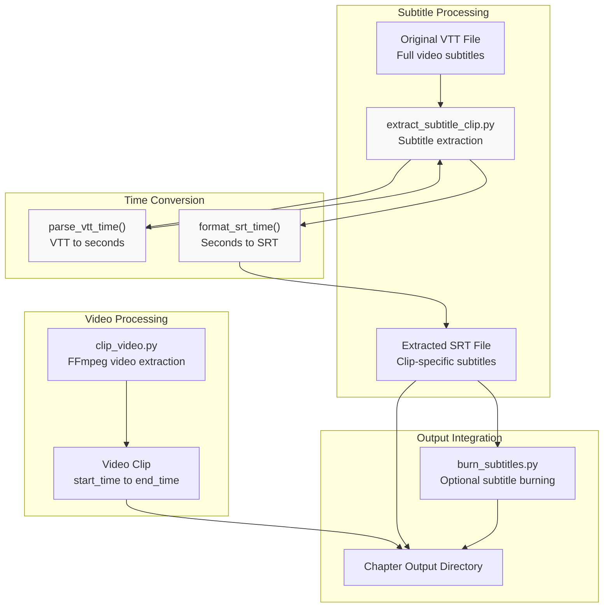
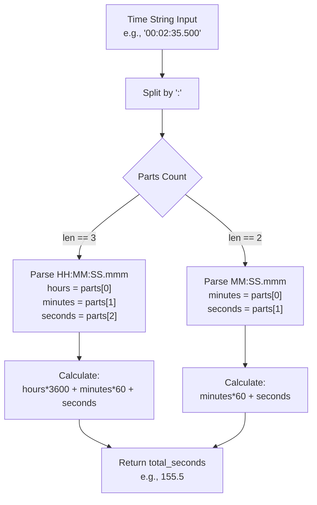
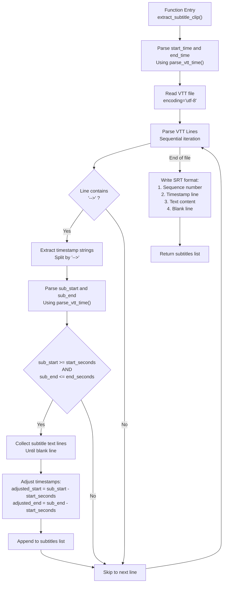
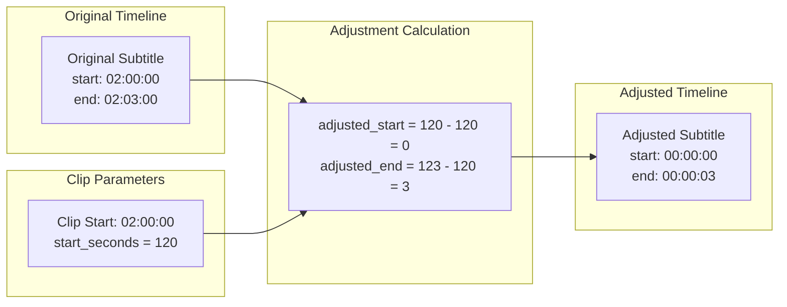
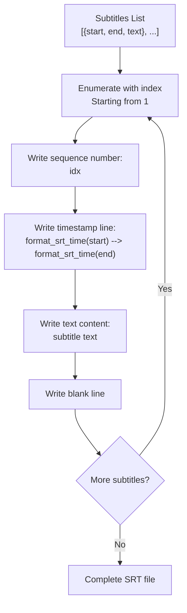
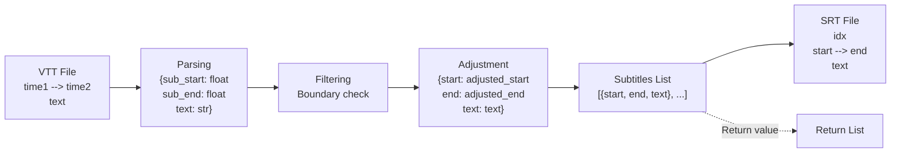
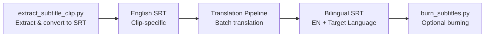

<!-- source: DeepWiki mcp.deepwiki.com · repo op7418/Youtube-clipper-skill · page 4.5 extract_subtitle_clip.py · fetched 2026-10-26 -->

# extract_subtitle_clip.py

<details>
<summary>Relevant source files</summary>

The following files were used as context for generating this wiki page:

- [TECHNICAL_NOTES.md](TECHNICAL_NOTES.md)
- [references/subtitle-formatting.md](references/subtitle-formatting.md)
- [scripts/extract_subtitle_clip.py](scripts/extract_subtitle_clip.py)

</details>


## Purpose and Scope

This document covers the `extract_subtitle_clip.py` script, which extracts time-bounded subtitle segments from VTT subtitle files and converts them to SRT format with adjusted timestamps. This script is a critical component in the video clipping workflow, ensuring that subtitle files match the temporal boundaries of their corresponding video clips.

For information about video clipping operations, see [clip_video.py](#4.3). For subtitle burning (hardcoding subtitles into video), see [burn_subtitles.py](#4.4). For general subtitle format conversion details, see [Subtitle Format Conversion](#7.4).

---

## System Role and Integration

The `extract_subtitle_clip.py` script operates as part of the subtitle processing pipeline, working in coordination with video clipping operations. When a video segment is extracted, this script ensures that the accompanying subtitle file contains only the relevant subtitle entries with timestamps adjusted to match the new zero-based timeline of the clip.

**Primary Responsibilities:**
- Parse VTT (WebVTT) subtitle files
- Filter subtitles within specified time boundaries
- Adjust timestamps relative to clip start time
- Convert VTT format to SRT format
- Output synchronized subtitle files for video clips

Sources: [scripts/extract_subtitle_clip.py:1-115]()

### Integration Architecture



Sources: [scripts/extract_subtitle_clip.py:33-101](), [scripts/clip_video.py](), [scripts/burn_subtitles.py]()

---

## Time Format Conversion

The script handles conversion between VTT (WebVTT) and SRT (SubRip) time formats, which differ in their millisecond separator character and optional hour component.

### Time Format Specifications

| Format | Structure | Millisecond Separator | Example |
|--------|-----------|----------------------|---------|
| VTT    | `HH:MM:SS.mmm` or `MM:SS.mmm` | Period (`.`) | `00:02:35.500` |
| SRT    | `HH:MM:SS,mmm` | Comma (`,`) | `00:02:35,500` |

### VTT Time Parsing

The `parse_vtt_time()` function converts VTT timestamp strings to floating-point seconds, handling both two-part (MM:SS.mmm) and three-part (HH:MM:SS.mmm) formats.

**Function Signature:**
```python
def parse_vtt_time(time_str) -> float
```

**Algorithm:**
1. Split timestamp string by colon (`:`) delimiter
2. If 3 parts: extract hours, minutes, and seconds with milliseconds
3. If 2 parts: extract minutes and seconds with milliseconds
4. Convert to total seconds: `hours*3600 + minutes*60 + seconds`

**Time Parsing Logic Diagram:**



Sources: [scripts/extract_subtitle_clip.py:10-22]()

### SRT Time Formatting

The `format_srt_time()` function converts floating-point seconds to SRT timestamp format with comma-separated milliseconds.

**Function Signature:**
```python
def format_srt_time(seconds) -> str
```

**Conversion Process:**
1. Create `timedelta` object from total seconds
2. Extract hours: `total_seconds // 3600`
3. Extract minutes: `(total_seconds % 3600) // 60`
4. Extract seconds: `total_seconds % 60`
5. Extract milliseconds: `(total_seconds % 1) * 1000`
6. Format as: `HH:MM:SS,mmm`

**Example Conversions:**

| Input (seconds) | Output (SRT format) |
|----------------|---------------------|
| `0.0` | `00:00:00,000` |
| `3.5` | `00:00:03,500` |
| `155.5` | `00:02:35,500` |
| `3725.678` | `01:02:05,678` |

Sources: [scripts/extract_subtitle_clip.py:24-31](), [TECHNICAL_NOTES.md:166-212]()

---

## Subtitle Extraction Algorithm

The `extract_subtitle_clip()` function implements the core logic for extracting subtitle segments within specified time boundaries and converting them to SRT format.

**Function Signature:**
```python
def extract_subtitle_clip(vtt_file, start_time, end_time, output_file) -> list
```

### Extraction Workflow



Sources: [scripts/extract_subtitle_clip.py:33-101]()

### Line-by-Line Parsing Process

The script uses a sequential line parser to identify and extract subtitle entries from VTT files:

1. **Timestamp Line Detection**: Searches for lines containing `-->` separator
2. **Timestamp Extraction**: Splits timestamp line to extract start and end times
3. **Text Collection**: Accumulates subsequent non-empty lines as subtitle text
4. **Boundary Filtering**: Retains only subtitles fully contained within target time range

**Timestamp Line Parsing:**
```python
# Example from scripts/extract_subtitle_clip.py:55-59
time_parts = line.split('-->')
sub_start_str = time_parts[0].strip().split()[0]  # Remove position metadata
sub_end_str = time_parts[1].strip().split()[0]    # Remove position metadata
```

This parsing approach handles VTT position metadata (e.g., `align:start position:0%`) by extracting only the first whitespace-separated token from each timestamp component.

Sources: [scripts/extract_subtitle_clip.py:44-85](), [references/subtitle-formatting.md:1-53]()

---

## Timestamp Adjustment Logic

A critical function of this script is adjusting subtitle timestamps to align with the zero-based timeline of extracted video clips. When a video segment is clipped from `start_time` to `end_time`, the corresponding subtitles must have their timestamps shifted so that they begin at `00:00:00,000`.

### Adjustment Calculation

**Formula:**
```
adjusted_time = original_time - clip_start_time
```

**Example Scenario:**

| Context | Original Video | Extracted Clip |
|---------|---------------|----------------|
| Clip range | - | 02:00 to 02:10 |
| Subtitle 1 start | 02:00 (120s) | 00:00 (0s) |
| Subtitle 1 end | 02:03 (123s) | 00:03 (3s) |
| Subtitle 2 start | 02:05 (125s) | 00:05 (5s) |
| Subtitle 2 end | 02:08 (128s) | 00:08 (8s) |

### Implementation Details



**Code Implementation:**
```python
# From scripts/extract_subtitle_clip.py:75-77
adjusted_start = sub_start - start_seconds
adjusted_end = sub_end - start_seconds
```

### Boundary Conditions

The script enforces strict boundary filtering to ensure subtitle integrity:

**Inclusion Criteria:**
- Subtitle start time must be >= clip start time
- Subtitle end time must be <= clip end time
- Both conditions must be satisfied (logical AND)

**Filtering Logic:**
```python
# From scripts/extract_subtitle_clip.py:65
if sub_start >= start_seconds and sub_end <= end_seconds:
    # Include subtitle
```

This strict filtering prevents partial subtitle entries that would extend beyond the video clip boundaries, avoiding synchronization issues.

Sources: [scripts/extract_subtitle_clip.py:75-83](), [TECHNICAL_NOTES.md:215-258](), [references/subtitle-formatting.md:243-301]()

---

## SRT Output Format

The script generates SRT files conforming to the SubRip format specification:

**SRT Structure:**
```
<sequence_number>
<start_timestamp> --> <end_timestamp>
<subtitle_text>
<blank_line>
```

### Output Generation



**Output Example:**
```srt
1
00:00:00,000 --> 00:00:03,500
This is the first subtitle

2
00:00:03,500 --> 00:00:07,000
This is the second subtitle
```

**File Writing Implementation:**
```python
# From scripts/extract_subtitle_clip.py:90-95
with open(output_file, 'w', encoding='utf-8') as f:
    for idx, sub in enumerate(subtitles, 1):
        f.write(f"{idx}\n")
        f.write(f"{format_srt_time(sub['start'])} --> {format_srt_time(sub['end'])}\n")
        f.write(f"{sub['text']}\n")
        f.write("\n")
```

All SRT files are written with UTF-8 encoding to ensure proper handling of multilingual content.

Sources: [scripts/extract_subtitle_clip.py:89-99](), [references/subtitle-formatting.md:56-91]()

---

## Command-Line Interface

The script provides a command-line interface for standalone execution outside of the main YouTube Clipper workflow.

**Usage Syntax:**
```bash
python extract_subtitle_clip.py <vtt_file> <start_time> <end_time> <output_file>
```

**Parameters:**

| Parameter | Type | Format | Description |
|-----------|------|--------|-------------|
| `vtt_file` | Path | File path | Input VTT subtitle file |
| `start_time` | String | `HH:MM:SS` or `MM:SS` | Clip start time |
| `end_time` | String | `HH:MM:SS` or `MM:SS` | Clip end time |
| `output_file` | Path | File path | Output SRT subtitle file |

**Example Command:**
```bash
python extract_subtitle_clip.py input.vtt 00:05:47 00:09:19 output.srt
```

**Console Output:**
```
📝 提取字幕片段...
   输入: input.vtt
   时间范围: 00:05:47 - 00:09:19
   时间范围（秒）: 347.0s - 559.0s
   找到 28 条字幕
✅ 字幕提取完成
   输出文件: output.srt
   字幕条数: 28
```

**Argument Validation:**
```python
# From scripts/extract_subtitle_clip.py:104-107
if len(sys.argv) != 5:
    print("用法: python extract_subtitle_clip.py <vtt_file> <start_time> <end_time> <output_file>")
    print("示例: python extract_subtitle_clip.py input.vtt 00:05:47 00:09:19 output.srt")
    sys.exit(1)
```

Sources: [scripts/extract_subtitle_clip.py:103-114]()

---

## Data Structures and Return Values

The `extract_subtitle_clip()` function returns a list of subtitle dictionaries for potential programmatic use.

**Return Value Structure:**
```python
[
    {
        'start': 0.0,           # Adjusted start time in seconds
        'end': 3.5,             # Adjusted end time in seconds
        'text': 'Subtitle text' # Subtitle content
    },
    {
        'start': 3.5,
        'end': 7.0,
        'text': 'Another subtitle'
    },
    # ...
]
```

**Internal Data Flow:**



This return value enables integration with translation pipelines or other subtitle processing scripts that may need programmatic access to the extracted subtitle data.

Sources: [scripts/extract_subtitle_clip.py:79-83](), [scripts/extract_subtitle_clip.py:101]()

---

## Error Handling and Edge Cases

The script handles several edge cases to ensure robust subtitle extraction:

### Edge Case: Empty Time Range

If the specified time range contains no subtitles, the script generates an empty SRT file:
```
   找到 0 条字幕
✅ 字幕提取完成
   输出文件: output.srt
   字幕条数: 0
```

### Edge Case: Partial Subtitle Overlap

Subtitles that partially overlap the time boundaries are excluded. Only subtitles fully contained within the range are included:

```python
# Strict boundary check - scripts/extract_subtitle_clip.py:65
if sub_start >= start_seconds and sub_end <= end_seconds:
    # Include
```

**Example:**
- Clip range: `02:00 - 02:10`
- Subtitle: `01:58 - 02:02` → **Excluded** (starts before range)
- Subtitle: `02:08 - 02:12` → **Excluded** (ends after range)
- Subtitle: `02:03 - 02:07` → **Included** (fully within range)

### Edge Case: Malformed VTT Lines

The script skips lines that don't contain the `-->` separator, tolerating:
- Header lines (`WEBVTT`)
- Style blocks
- Comment lines
- Empty lines

### Text Collection Robustness

The text collection loop terminates on blank lines, joining multiple text lines with spaces:

```python
# From scripts/extract_subtitle_clip.py:68-73
text_lines = []
while i < len(lines) and lines[i].strip() != '':
    text_lines.append(lines[i].strip())
    i += 1
text = ' '.join(text_lines)
```

This handles multi-line subtitle entries correctly while preventing array index errors at file end.

Sources: [scripts/extract_subtitle_clip.py:64-85](), [scripts/extract_subtitle_clip.py:87-99]()

---

## Performance Characteristics

**Time Complexity:**
- **O(n)** where n is the number of lines in the VTT file
- Single-pass sequential parsing
- No sorting or complex operations required

**Space Complexity:**
- **O(m)** where m is the number of subtitles in the output range
- Full file read into memory initially
- Filtered subtitles stored in list

**Typical Performance:**
- 30-minute video (~600 subtitle entries): < 1 second processing time
- Minimal memory footprint (<10 MB for typical subtitle files)

**Optimization Considerations:**
The script prioritizes simplicity and correctness over performance optimization, as subtitle extraction is not a performance bottleneck in the overall video processing pipeline.

Sources: [scripts/extract_subtitle_clip.py:33-101]()

---

## Integration with Translation Pipeline

While this script outputs single-language SRT files, the extracted subtitles serve as input for the translation pipeline, which generates bilingual subtitle files.

**Workflow Integration:**



The bilingual subtitle format places English text on the first line and translated text on the second line of each subtitle entry, maintaining the timestamp structure generated by this script.

**Example Bilingual Output:**
```srt
1
00:00:00,000 --> 00:00:03,500
This is English subtitle
这是中文字幕

2
00:00:03,500 --> 00:00:07,000
Another English line
另一行中文
```

Sources: [references/subtitle-formatting.md:178-213](), [TECHNICAL_NOTES.md:259-305]()

---

## Related Documentation

For comprehensive information on related topics:

- **VTT Format Details**: See [references/subtitle-formatting.md:1-53]()
- **SRT Format Specification**: See [references/subtitle-formatting.md:56-91]()
- **Format Conversion Technical Details**: See [TECHNICAL_NOTES.md:166-212]()
- **Timestamp Adjustment Implementation**: See [TECHNICAL_NOTES.md:215-258]()
- **Video Clipping Coordination**: See [clip_video.py](#4.3)
- **Subtitle Burning Integration**: See [burn_subtitles.py](#4.4)
- **Batch Translation Optimization**: See [Batch Translation Optimization](#7.1)

---

