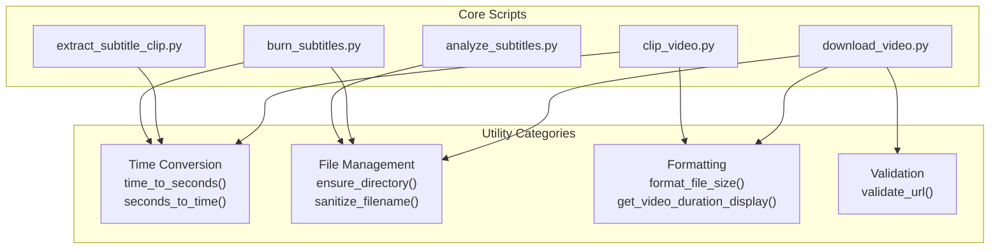
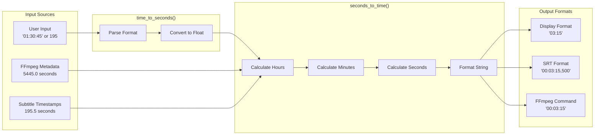
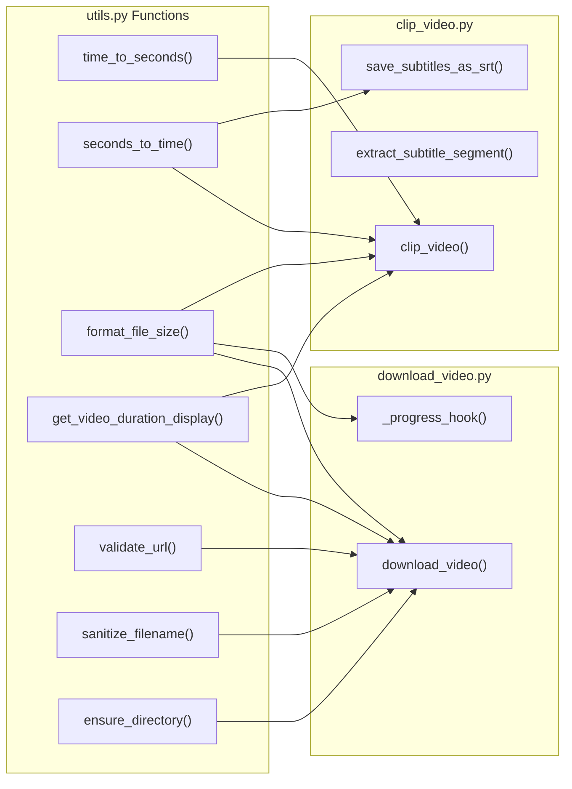

<!-- source: DeepWiki mcp.deepwiki.com · repo op7418/Youtube-clipper-skill · page 4.6 Utilities Module · fetched 2026-10-26 -->

# Utilities Module

<details>
<summary>Relevant source files</summary>

The following files were used as context for generating this wiki page:

- [scripts/__init__.py](scripts/__init__.py)
- [scripts/clip_video.py](scripts/clip_video.py)
- [scripts/download_video.py](scripts/download_video.py)

</details>


## Purpose and Scope

The Utilities Module (`scripts/utils.py`) provides shared helper functions used across all core scripts in the YouTube Clipper Skill. This module centralizes common operations such as time conversion, file management, data formatting, and validation to ensure consistency and reduce code duplication.

This page documents the utility functions and their usage patterns. For documentation on individual scripts that use these utilities, see [Core Scripts](#4).

---

## Overview

The utilities module serves as a foundational layer that supports all video processing operations. It provides five categories of functionality:

| Category | Functions | Primary Purpose |
|----------|-----------|-----------------|
| Time Conversion | `time_to_seconds()`, `seconds_to_time()` | Convert between time formats for FFmpeg and display |
| File Management | `ensure_directory()`, `sanitize_filename()` | Handle file paths and directory creation |
| Formatting | `format_file_size()`, `get_video_duration_display()` | Format data for user-friendly display |
| Validation | `validate_url()` | Validate user inputs |
| Video Information | `get_video_duration_display()` | Extract and display video metadata |

**Sources:** [scripts/clip_video.py:13-18](), [scripts/download_video.py:18-24]()

---

## Module Architecture



**Sources:** [scripts/clip_video.py:13-18](), [scripts/download_video.py:18-24]()

---

## Time Conversion Functions

### time_to_seconds()

Converts time strings or numeric values to floating-point seconds. This function handles multiple input formats to provide flexibility for both programmatic and user inputs.

**Function Signature (inferred):**
```python
def time_to_seconds(time_input: Union[str, int, float]) -> float
```

**Supported Input Formats:**
- Numeric seconds: `195` → `195.0`
- Time strings with hours: `"01:30:45"` → `5445.0`
- Time strings without hours: `"03:15"` → `195.0`
- Time strings with decimal seconds: `"00:03:15.500"` → `195.5`

**Usage Example:**

[scripts/clip_video.py:53-61]() demonstrates conversion of start and end times:
```python
# Accepts both string and numeric inputs
if isinstance(start_time, str):
    start_seconds = time_to_seconds(start_time)
else:
    start_seconds = float(start_time)
```

**Sources:** [scripts/clip_video.py:14](), [scripts/clip_video.py:53-61]()

---

### seconds_to_time()

Converts numeric seconds to formatted time strings suitable for display or FFmpeg commands.

**Function Signature (inferred):**
```python
def seconds_to_time(
    seconds: float,
    include_hours: bool = False,
    use_comma: bool = False
) -> str
```

**Parameters:**
- `seconds`: Numeric seconds to convert
- `include_hours`: Force HH:MM:SS format even for durations under 1 hour
- `use_comma`: Use comma separator for milliseconds (SRT format requirement)

**Output Formats:**
- Standard: `"03:15"` (MM:SS)
- With hours: `"00:03:15"` (HH:MM:SS)
- SRT format: `"00:03:15,500"` (HH:MM:SS,mmm with comma)

**Usage Examples:**

[scripts/clip_video.py:77-79]() shows display formatting:
```python
print(f"   起始时间: {seconds_to_time(start_seconds)} ({start_seconds}s)")
print(f"   结束时间: {seconds_to_time(end_seconds)} ({end_seconds}s)")
```

[scripts/clip_video.py:191-192]() demonstrates SRT subtitle timestamp generation:
```python
start_time = seconds_to_time(sub['start'], include_hours=True, use_comma=True)
end_time = seconds_to_time(sub['end'], include_hours=True, use_comma=True)
```

**Sources:** [scripts/clip_video.py:15](), [scripts/clip_video.py:77-79](), [scripts/clip_video.py:191-192]()

---

## Time Conversion Flow



**Sources:** [scripts/clip_video.py:53-61](), [scripts/clip_video.py:191-192]()

---

## File Management Functions

### ensure_directory()

Creates directory structures if they don't exist, with support for nested paths.

**Function Signature (inferred):**
```python
def ensure_directory(path: Union[str, Path]) -> Path
```

**Behavior:**
- Creates parent directories as needed (`parents=True`)
- Silently succeeds if directory already exists (`exist_ok=True`)
- Returns `Path` object for chaining operations

**Usage Example:**

[scripts/download_video.py:58]() uses this to prepare output directories:
```python
output_dir = ensure_directory(output_dir)
```

**Sources:** [scripts/download_video.py:24](), [scripts/download_video.py:58]()

---

### sanitize_filename()

Removes or replaces characters that are invalid in filenames across different operating systems.

**Function Signature (inferred):**
```python
def sanitize_filename(filename: str, replacement: str = '_') -> str
```

**Character Handling:**
- Removes: `< > : " / \ | ? *`
- Replaces with: underscore or specified replacement character
- Preserves: alphanumerics, spaces, hyphens, periods

**Platform Considerations:**
- Windows: Removes reserved characters and device names (CON, PRN, etc.)
- Unix/Linux: Primarily removes `/` and null bytes
- macOS: Removes `:` and `/`

**Usage Context:**

Used in [scripts/download_video.py:20]() when processing video titles to create safe filenames for output directories and files.

**Sources:** [scripts/download_video.py:20]()

---

## Formatting Functions

### format_file_size()

Converts byte counts to human-readable file size strings with appropriate units.

**Function Signature (inferred):**
```python
def format_file_size(bytes: int, decimal_places: int = 2) -> str
```

**Unit Conversion:**
- Bytes: `< 1024` → `"512 B"`
- Kilobytes: `< 1024²` → `"1.5 KB"`
- Megabytes: `< 1024³` → `"25.3 MB"`
- Gigabytes: `≥ 1024³` → `"1.2 GB"`

**Usage Examples:**

[scripts/download_video.py:134]() formats downloaded file size:
```python
print(f"   大小: {format_file_size(file_size)}")
```

[scripts/download_video.py:162-163]() displays download progress:
```python
downloaded = format_file_size(d['downloaded_bytes'])
total = format_file_size(d['total_bytes'])
```

[scripts/clip_video.py:120]() shows clipped video size:
```python
print(f"   文件大小: {format_file_size(output_size)}")
```

**Sources:** [scripts/download_video.py:22](), [scripts/clip_video.py:16](), [scripts/download_video.py:134](), [scripts/download_video.py:162-163](), [scripts/clip_video.py:120]()

---

### get_video_duration_display()

Formats video duration in seconds to a human-readable string.

**Function Signature (inferred):**
```python
def get_video_duration_display(duration_seconds: float) -> str
```

**Output Examples:**
- `195` seconds → `"3:15"` or `"3分15秒"`
- `3661` seconds → `"1:01:01"` or `"1小时1分1秒"`

**Implementation Note:**
This function may return localized strings based on system locale or configuration settings.

**Usage Examples:**

[scripts/download_video.py:100]() displays total video duration:
```python
print(f"   时长: {get_video_duration_display(duration)}")
```

[scripts/clip_video.py:79]() shows segment duration:
```python
print(f"   片段时长: {get_video_duration_display(duration)}")
```

**Sources:** [scripts/download_video.py:22](), [scripts/clip_video.py:17](), [scripts/download_video.py:100](), [scripts/clip_video.py:79]()

---

## Validation Functions

### validate_url()

Validates that a given string is a properly formatted YouTube URL.

**Function Signature (inferred):**
```python
def validate_url(url: str) -> bool
```

**Accepted URL Formats:**
- Standard: `https://www.youtube.com/watch?v=VIDEO_ID`
- Short: `https://youtu.be/VIDEO_ID`
- Mobile: `https://m.youtube.com/watch?v=VIDEO_ID`
- Embedded: `https://www.youtube.com/embed/VIDEO_ID`
- With timestamps: `https://youtube.com/watch?v=VIDEO_ID&t=123s`

**Validation Logic:**
- Checks domain matches YouTube patterns
- Validates presence of video ID
- Accepts both HTTP and HTTPS protocols

**Usage Example:**

[scripts/download_video.py:49-50]() validates URL before download:
```python
if not validate_url(url):
    raise ValueError(f"Invalid YouTube URL: {url}")
```

**Sources:** [scripts/download_video.py:19](), [scripts/download_video.py:49-50]()

---

## Cross-Script Dependencies

The following diagram maps specific utility functions to the scripts that depend on them, bridging natural language descriptions to actual code entities:



**Sources:** [scripts/download_video.py:18-24](), [scripts/clip_video.py:13-18]()

---

## Common Usage Patterns

### Pattern 1: Time Parameter Flexibility

Scripts accept both string and numeric time inputs, using `time_to_seconds()` for normalization:

[scripts/clip_video.py:53-61]()
```python
# Convert time to seconds
if isinstance(start_time, str):
    start_seconds = time_to_seconds(start_time)
else:
    start_seconds = float(start_time)
```

This pattern enables both programmatic usage (passing numeric seconds) and user-friendly command-line usage (passing time strings like `"01:30:00"`).

**Sources:** [scripts/clip_video.py:53-61]()

---

### Pattern 2: Safe Path Creation

All file operations use `ensure_directory()` to guarantee output paths exist:

[scripts/download_video.py:58]()
```python
output_dir = ensure_directory(output_dir)
```

[scripts/clip_video.py:83]()
```python
output_path.parent.mkdir(parents=True, exist_ok=True)
```

**Sources:** [scripts/download_video.py:58](), [scripts/clip_video.py:83]()

---

### Pattern 3: User-Friendly Progress Display

File sizes and durations are consistently formatted for display using `format_file_size()` and `get_video_duration_display()`:

[scripts/download_video.py:162-172]()
```python
downloaded = format_file_size(d['downloaded_bytes'])
total = format_file_size(d['total_bytes'])
speed_str = format_file_size(speed) + '/s' if speed else 'N/A'
print(f"\r   [{bar}] {percent:.1f}% - {downloaded}/{total} - {speed_str}", end='', flush=True)
```

**Sources:** [scripts/download_video.py:162-172]()

---

### Pattern 4: SRT Timestamp Generation

The `seconds_to_time()` function with specific parameters generates SRT-compliant timestamps:

[scripts/clip_video.py:191-193]()
```python
start_time = seconds_to_time(sub['start'], include_hours=True, use_comma=True)
end_time = seconds_to_time(sub['end'], include_hours=True, use_comma=True)
f.write(f"{start_time} --> {end_time}\n")
```

The `include_hours=True` ensures three-component timestamps (HH:MM:SS), and `use_comma=True` uses comma separators for milliseconds as required by the SRT specification.

**Sources:** [scripts/clip_video.py:191-193]()

---

## Design Rationale

### Centralization Benefits

By centralizing common operations in a utilities module:

1. **Consistency**: All scripts use identical formatting logic for file sizes, durations, and timestamps
2. **Maintainability**: Bug fixes and improvements in one location benefit all scripts
3. **Testability**: Utility functions can be tested independently of script logic
4. **Reusability**: New scripts can immediately leverage existing utilities

### Type Flexibility

Utility functions accept multiple input types (e.g., `Union[str, float]` for time parameters) to support:

- **Command-line usage**: Users can pass `"01:30:00"` as strings
- **Programmatic usage**: Scripts can pass `5400.0` as floats
- **API integration**: External systems can use either format

### Error Handling

Utility functions follow consistent error handling patterns:

- Invalid inputs raise `ValueError` with descriptive messages
- File operations raise `FileNotFoundError` or `IOError` as appropriate
- Type coercion failures are caught and re-raised with context

**Sources:** [scripts/clip_video.py:64-65](), [scripts/download_video.py:49-50]()

---

## Integration Points

### With FFmpeg

Time conversion functions generate FFmpeg-compatible timestamp formats:

[scripts/clip_video.py:88-96]()
```python
cmd = [
    ffmpeg_path,
    '-ss', str(start_seconds),  # FFmpeg accepts numeric seconds
    '-i', str(video_path),
    '-t', str(duration),
    '-c', 'copy',
    '-y',
    str(output_path)
]
```

FFmpeg accepts numeric seconds directly, so `time_to_seconds()` output can be passed as strings without additional formatting.

**Sources:** [scripts/clip_video.py:88-96]()

---

### With yt-dlp

File management utilities prepare directories and sanitize filenames for yt-dlp output:

[scripts/download_video.py:58-70]()
```python
output_dir = ensure_directory(output_dir)

ydl_opts = {
    'outtmpl': str(output_dir / '%(id)s.%(ext)s'),
    # ... other options
}
```

The output template uses video ID directly to avoid filename sanitization issues, but `sanitize_filename()` is available for processing video titles.

**Sources:** [scripts/download_video.py:58-70]()

---

### With Subtitle Processing

Time conversion and formatting utilities support subtitle manipulation:

[scripts/clip_video.py:125-172]() demonstrates subtitle segment extraction using `time_to_seconds()` for boundary checking and `seconds_to_time()` for SRT output generation.

**Sources:** [scripts/clip_video.py:125-172](), [scripts/clip_video.py:174-202]()

---

## File Location

The utilities module is located at:
- **Path**: `scripts/utils.py`
- **Imported by**: All core processing scripts in `scripts/` directory
- **Dependencies**: Python standard library only (no external packages)

**Sources:** [scripts/clip_video.py:13](), [scripts/download_video.py:18]()

---

