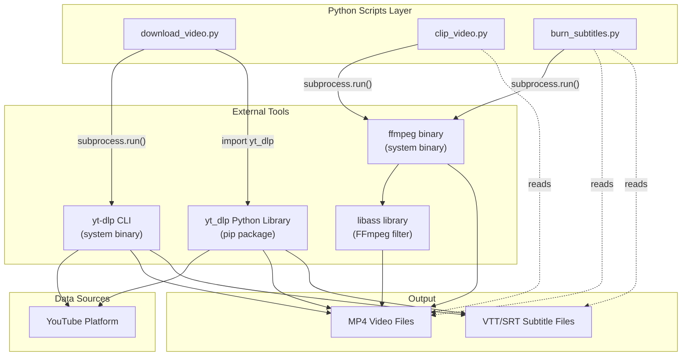
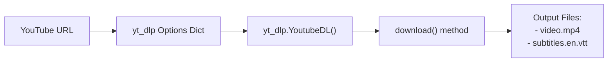
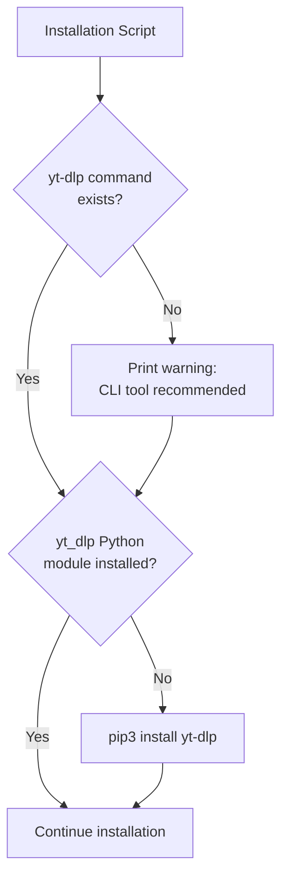
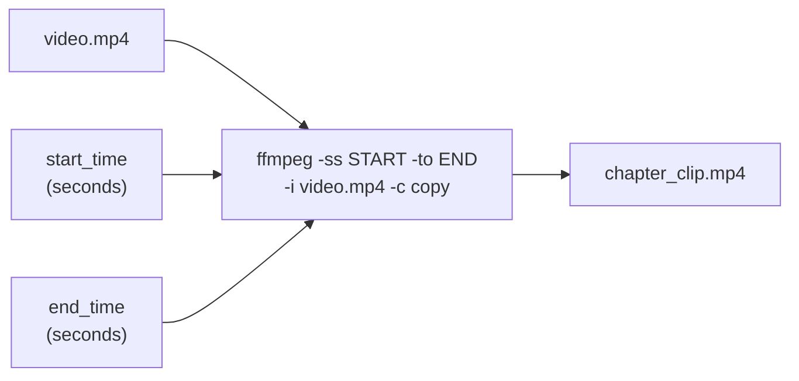
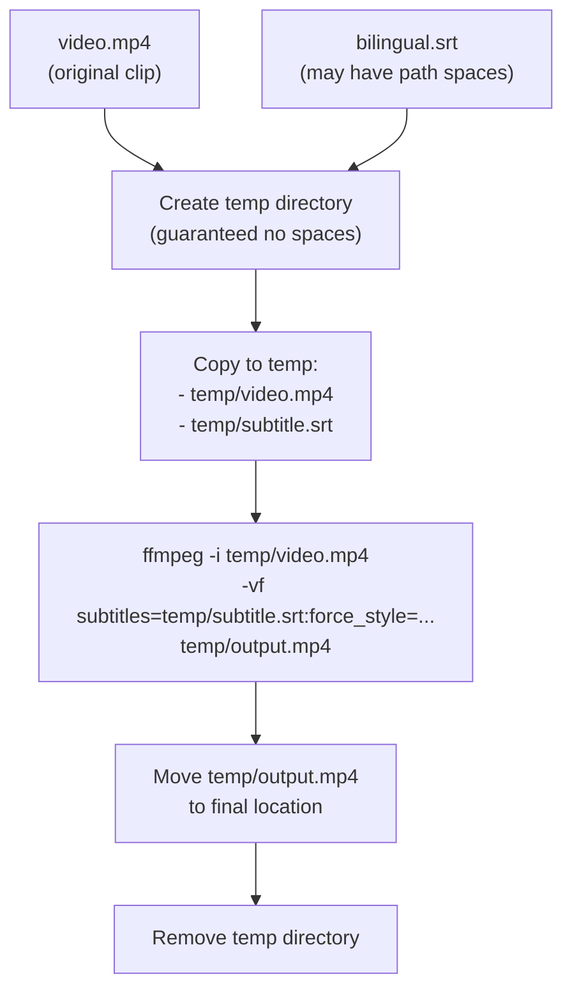
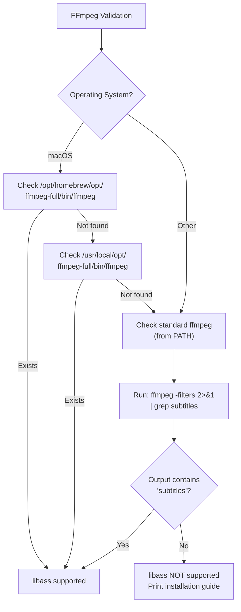
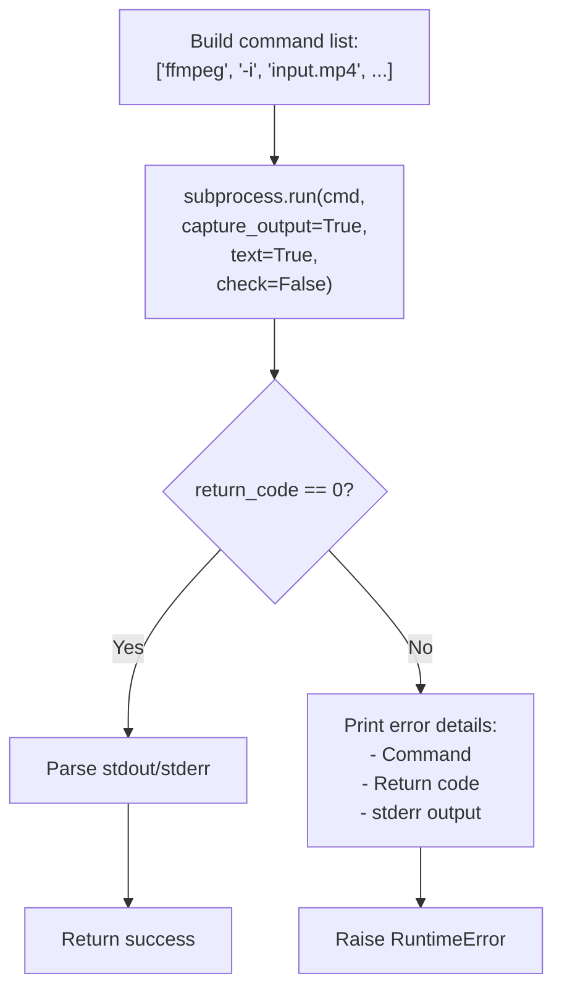

<!-- source: DeepWiki mcp.deepwiki.com · repo op7418/Youtube-clipper-skill · page 5 External Tools · fetched 2026-10-26 -->

# External Tools

<details>
<summary>Relevant source files</summary>

The following files were used as context for generating this wiki page:

- [README.md](README.md)
- [TECHNICAL_NOTES.md](TECHNICAL_NOTES.md)
- [install_as_skill.sh](install_as_skill.sh)

</details>


The YouTube Clipper Skill relies on two critical external command-line tools: **yt-dlp** for downloading YouTube videos and subtitles, and **FFmpeg** for video processing and subtitle rendering. These tools are invoked as subprocesses from Python scripts and form the foundation of the system's video processing capabilities. This page documents how these tools are integrated, configured, and verified within the skill.

For configuration options that control these tools' behavior, see [Configuration](#6). For troubleshooting common issues with these tools, see [Troubleshooting](#8).

---

## External Tool Architecture

The system integrates external tools through subprocess execution, with Python scripts acting as orchestrators that prepare arguments, invoke commands, and process results.



**Sources:** [README.md:54-84](), [TECHNICAL_NOTES.md:1-80](), Diagram 1 from high-level architecture

---

## yt-dlp Integration

### Purpose and Usage

yt-dlp is used exclusively for downloading YouTube videos and subtitles. The system uses both the Python library (`yt_dlp`) for programmatic access and verifies the CLI tool's presence during installation.

### Implementation in download_video.py

The download script uses the `yt_dlp` Python library with extensive configuration options:



**Format Selection Logic:**

The format string prioritizes quality while limiting file size: `bestvideo[height<=1080][ext=mp4]+bestaudio[ext=m4a]/best[height<=1080][ext=mp4]/best`

This selection strategy [TECHNICAL_NOTES.md:309-319]():
1. Attempts to combine best video (≤1080p, MP4) with best audio (M4A)
2. Falls back to single best file (≤1080p, MP4)
3. Final fallback to any best available format

**Subtitle Configuration:**

```python
'writesubtitles': True,
'writeautomaticsub': True,  # Fallback to auto-generated
'subtitleslangs': ['en'],
'subtitlesformat': 'vtt',
```

Priority order [TECHNICAL_NOTES.md:328-338]():
1. Human-authored subtitles (if available)
2. YouTube automatic subtitles (fallback)

**Sources:** [TECHNICAL_NOTES.md:306-353](), [README.md:54-58]()

---

### Configuration Options

The following environment variables control yt-dlp behavior:

| Variable | Default | Purpose | Example |
|----------|---------|---------|---------|
| `MAX_VIDEO_HEIGHT` | 1080 | Maximum video resolution | `720`, `1080`, `1440`, `2160` |
| `YT_DLP_PROXY` | None | HTTP/SOCKS5 proxy | `http://proxy:8080` |
| `YT_DLP_RATE_LIMIT` | None | Download speed limit | `5M` (5 MB/s) |

**Sources:** [README.md:133-151]()

---

### Installation Detection

The installation script verifies yt-dlp presence in two forms:



Detection logic [install_as_skill.sh:139-150]():
- Uses `command -v yt-dlp` to check CLI availability
- Installs Python package via `pip3 install yt-dlp`
- Warns if CLI tool is missing but continues installation

**Sources:** [install_as_skill.sh:139-150]()

---

### Output File Naming

yt-dlp generates files using this template pattern:

```
'outtmpl': '%(title)s [%(id)s].%(ext)s'
```

Example output [TECHNICAL_NOTES.md:341-348]():
```
Anthropic's Amodei on AI [Ckt1cj0xjRM].mp4
Anthropic's Amodei on AI [Ckt1cj0xjRM].en.vtt
```

The video ID inclusion provides:
- **Uniqueness:** Prevents filename collisions
- **Traceability:** Enables reverse-lookup to original video

**Sources:** [TECHNICAL_NOTES.md:340-353]()

---

## FFmpeg Integration

### Purpose and Usage

FFmpeg performs two critical operations:
1. **Video clipping:** Frame-accurate segment extraction ([clip_video.py]())
2. **Subtitle burning:** Hardcoding subtitles into video ([burn_subtitles.py]())

### Video Clipping Implementation

The `clip_video.py` script executes FFmpeg with precise time-based extraction:



**Command Structure:**
```bash
ffmpeg -ss <start_seconds> -to <end_seconds> -i <input_video> \
       -c copy -avoid_negative_ts make_zero <output_video>
```

Key arguments:
- `-ss`: Start timestamp (seeks to position)
- `-to`: End timestamp (duration limit)
- `-c copy`: Stream copy (no re-encoding, preserves quality)
- `-avoid_negative_ts make_zero`: Ensures valid timestamps

**Sources:** [README.md:16-17](), Diagram 2 from high-level architecture

---

### Subtitle Burning Implementation

The `burn_subtitles.py` script uses FFmpeg's `subtitles` filter with critical workarounds:



**Critical Issue: Path Space Handling**

FFmpeg's `subtitles` filter cannot process file paths containing spaces [TECHNICAL_NOTES.md:83-163](). All quote/escape attempts fail:
- ❌ `subtitles="/path/with spaces/sub.srt"`
- ❌ `subtitles='/path/with spaces/sub.srt'`
- ❌ `subtitles=/path/with\ spaces/sub.srt`

**Solution:** Temporary directory workaround [TECHNICAL_NOTES.md:117-148]():
1. Create temp directory with `tempfile.mkdtemp()` (no spaces guaranteed)
2. Copy input files to temp directory
3. Execute FFmpeg with space-free paths
4. Move output back to original location
5. Clean up temporary files

**Subtitle Styling:**

```bash
subtitles=subtitle.srt:force_style='FontSize=24,MarginV=30'
```

Style parameters [TECHNICAL_NOTES.md:372-388]():
- `FontSize=24`: Text size (scaled for 1080p)
- `MarginV=30`: Bottom margin in pixels
- Default rendering: White text with black outline

| Resolution | FontSize | MarginV |
|------------|----------|---------|
| 720p       | 20       | 20      |
| 1080p      | 24       | 30      |
| 4K         | 48       | 60      |

**Sources:** [TECHNICAL_NOTES.md:83-163](), [TECHNICAL_NOTES.md:356-388](), [README.md:18-19]()

---

### FFmpeg Path Detection

Both scripts detect FFmpeg location through environment variable or system PATH:

```python
ffmpeg_path = os.getenv('FFMPEG_PATH') or shutil.which('ffmpeg')
```

If `FFMPEG_PATH` is set in `.env`, it takes precedence. Otherwise, the system searches PATH.

**Sources:** [README.md:134-135]()

---

## libass Requirement

### Purpose and Critical Nature

The `libass` library enables FFmpeg's `subtitles` filter, which is essential for burning subtitles into video. Without libass support, subtitle burning fails completely.

### Detection and Validation



Detection implementation [TECHNICAL_NOTES.md:66-79]():

**macOS Specific Paths:**
- Apple Silicon: `/opt/homebrew/opt/ffmpeg-full/bin/ffmpeg`
- Intel Mac: `/usr/local/opt/ffmpeg-full/bin/ffmpeg`

**libass Test Command:**
```bash
ffmpeg -filters 2>&1 | grep subtitles
# Expected output: "subtitles    V->V  (...)"
```

**Sources:** [TECHNICAL_NOTES.md:5-80](), [install_as_skill.sh:152-191]()

---

### Platform-Specific Installation

#### macOS

**Problem:** Homebrew's standard `ffmpeg` formula excludes libass to reduce package size.

**Solution:** Install `ffmpeg-full` [TECHNICAL_NOTES.md:28-43]():

```bash
# Remove standard ffmpeg (if present)
brew uninstall ffmpeg

# Install ffmpeg-full (includes libass)
brew install ffmpeg-full

# Verify
/opt/homebrew/opt/ffmpeg-full/bin/ffmpeg -filters 2>&1 | grep subtitles
```

#### Ubuntu/Debian

```bash
sudo apt-get install ffmpeg libass-dev
```

#### Generic/Source Build

```bash
# Install libass development files
sudo apt-get install libass-dev

# Build FFmpeg with libass support
./configure --enable-libass
make
sudo make install
```

**Sources:** [TECHNICAL_NOTES.md:28-57](), [README.md:67-84]()

---

### Installation Script Validation

The installation script performs comprehensive FFmpeg/libass validation [install_as_skill.sh:152-191]():

1. **Check ffmpeg-full** (macOS only)
   - Apple Silicon path: `/opt/homebrew/opt/ffmpeg-full/bin/ffmpeg`
   - Intel Mac path: `/usr/local/opt/ffmpeg-full/bin/ffmpeg`

2. **Check standard FFmpeg** (all platforms)
   - Uses `command -v ffmpeg`
   - Extracts version with `ffmpeg -version`

3. **Validate libass support**
   - Executes `ffmpeg -filters 2>&1 | grep -q "subtitles"`
   - Sets `LIBASS_SUPPORTED=true/false` flag

4. **Report results**
   - ✅ FFmpeg with libass: All features available
   - ⚠️ FFmpeg without libass: Clipping works, burning fails
   - ❌ No FFmpeg: Installation incomplete

**Sources:** [install_as_skill.sh:152-191]()

---

## Subprocess Execution Pattern

Both tools follow a consistent subprocess execution pattern in Python scripts:



**Common subprocess parameters:**
- `capture_output=True`: Capture stdout/stderr
- `text=True`: Decode output as strings
- `check=False`: Manual return code checking for better error messages

**Error handling best practice [TECHNICAL_NOTES.md:445-475]():**
```python
result = subprocess.run(cmd, capture_output=True, text=True)
if result.returncode != 0:
    print(f"❌ Command failed:")
    print(f"   Command: {' '.join(cmd)}")
    print(f"   Return code: {result.returncode}")
    print(f"   Error output:")
    print(result.stderr)
    raise RuntimeError("Command failed")
```

**Sources:** [TECHNICAL_NOTES.md:444-475]()

---

## Dependency Matrix

Summary of which Python scripts depend on which external tools:

| Script | yt-dlp CLI | yt_dlp Library | FFmpeg | libass |
|--------|------------|----------------|--------|--------|
| `download_video.py` | Optional¹ | **Required** | - | - |
| `analyze_subtitles.py` | - | - | - | - |
| `clip_video.py` | - | - | **Required** | - |
| `burn_subtitles.py` | - | - | **Required** | **Required** |
| `extract_subtitle_clip.py` | - | - | - | - |

¹ CLI tool recommended but library can work standalone

**Sources:** Diagram 3 from high-level architecture, [README.md:54-66]()

---

## Version Requirements

| Tool | Minimum Version | Recommendation | Notes |
|------|----------------|----------------|-------|
| Python | 3.8+ | 3.10+ | Required for scripts |
| yt-dlp | Latest | Update frequently | YouTube changes require updates |
| FFmpeg | 4.0+ | Latest | Version 4.0+ has stable `subtitles` filter |
| libass | 0.13+ | Latest | Bundled with FFmpeg-full |

**Sources:** [README.md:50-66]()

---

## Configuration Summary

Environment variables controlling external tool behavior:

```bash
# FFmpeg binary path (auto-detected if empty)
FFMPEG_PATH=

# yt-dlp network settings
YT_DLP_PROXY=http://proxy:8080
YT_DLP_RATE_LIMIT=5M

# Video quality constraints
MAX_VIDEO_HEIGHT=1080

# Subtitle rendering style
SUBTITLE_FONT_SIZE=24
SUBTITLE_MARGIN_V=30
```

For complete configuration reference, see [Configuration](#6).

**Sources:** [README.md:129-154]()

---

