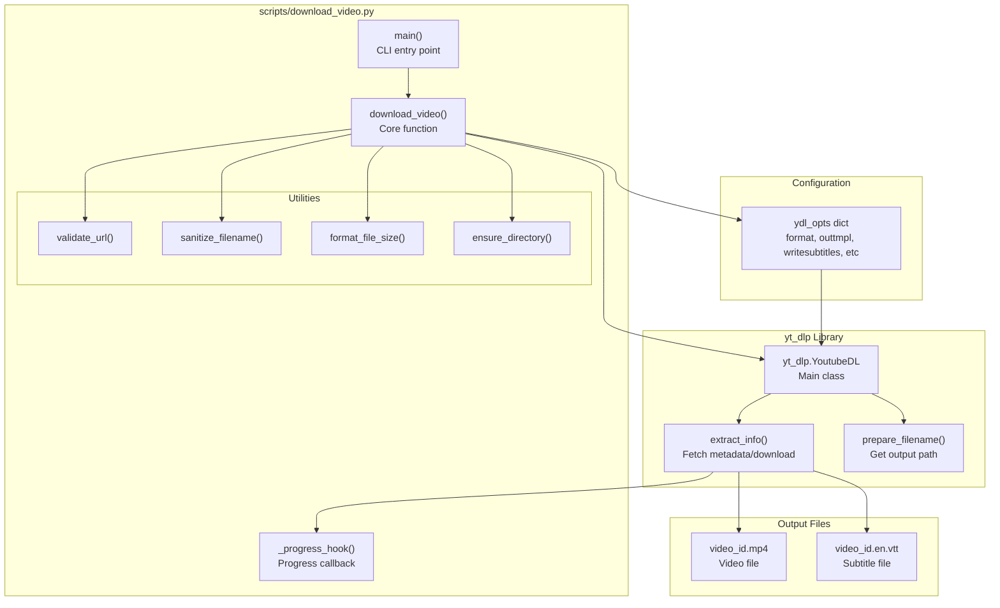
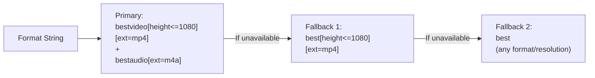
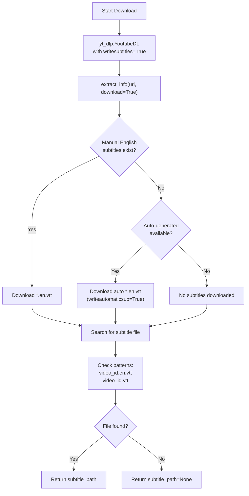
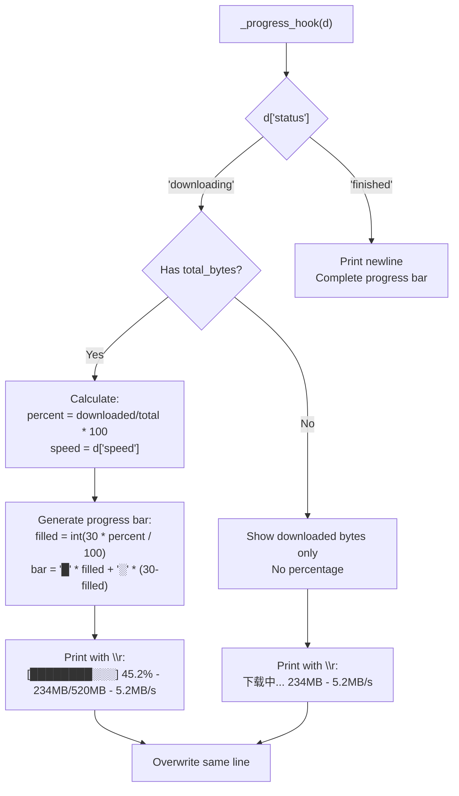
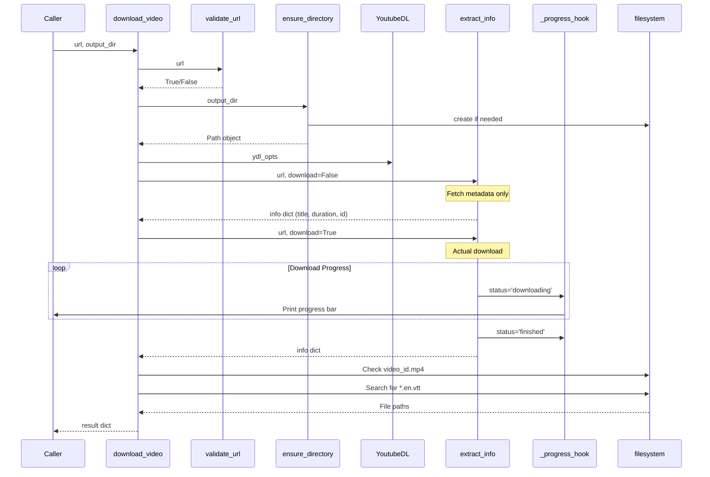

<!-- source: DeepWiki mcp.deepwiki.com · repo op7418/Youtube-clipper-skill · page 5.1 yt-dlp Integration · fetched 2026-10-26 -->

# yt-dlp Integration

<details>
<summary>Relevant source files</summary>

The following files were used as context for generating this wiki page:

- [TECHNICAL_NOTES.md](TECHNICAL_NOTES.md)
- [references/yt-dlp-guide.md](references/yt-dlp-guide.md)
- [scripts/download_video.py](scripts/download_video.py)

</details>


## Purpose and Scope

This document details how the YouTube Clipper Skill integrates with yt-dlp for video and subtitle acquisition. The integration is implemented in [scripts/download_video.py]() and uses the yt-dlp Python library to download YouTube videos with quality constraints, subtitle extraction, and progress monitoring.

For FFmpeg-based video processing, see [FFmpeg Integration](#5.2). For subtitle format conversion after download, see [Subtitle Format Conversion](#7.4).

---

## Installation Requirements

yt-dlp is installed as a Python package dependency during system setup. The [install_as_skill.sh]() script installs it via pip, and [scripts/download_video.py:12-16]() verifies its availability at runtime:

```python
try:
    import yt_dlp
except ImportError:
    print("❌ Error: yt-dlp not installed")
    print("Please install: pip install yt-dlp")
    sys.exit(1)
```

Installation methods:
- **Homebrew**: `brew install yt-dlp`
- **pip**: `pip install yt-dlp`
- **System package managers**: `apt-get install yt-dlp`

**Sources**: [scripts/download_video.py:12-16](), [references/yt-dlp-guide.md:6-28]()

---

## Integration Architecture

The following diagram shows how yt-dlp integrates with the download module:



**Sources**: [scripts/download_video.py:27-154](), [scripts/utils.py]()

---

## Configuration Dictionary

The `download_video()` function configures yt-dlp through the `ydl_opts` dictionary at [scripts/download_video.py:65-87]():

| Option | Value | Purpose |
|--------|-------|---------|
| `format` | `bestvideo[height<=1080][ext=mp4]+bestaudio[ext=m4a]/best[height<=1080][ext=mp4]/best` | Format selection with 1080p limit |
| `outtmpl` | `%(id)s.%(ext)s` | Output filename template using video ID |
| `writesubtitles` | `True` | Download manual subtitles if available |
| `writeautomaticsub` | `True` | Fallback to auto-generated subtitles |
| `subtitleslangs` | `['en']` | English subtitles only |
| `subtitlesformat` | `'vtt'` | VTT format (converted to SRT later) |
| `writethumbnail` | `False` | Skip thumbnail download |
| `quiet` | `False` | Show download messages |
| `progress_hooks` | `[_progress_hook]` | Progress callback function |

The configuration prioritizes compatibility (mp4 format), reasonable file sizes (1080p limit), and reliable subtitle acquisition (auto-generated as fallback).

**Sources**: [scripts/download_video.py:65-87](), [TECHNICAL_NOTES.md:307-354]()

---

## Format Selection Logic

The format string at [scripts/download_video.py:67]() implements a fallback chain:



### Format String Components

```
bestvideo[height<=1080][ext=mp4]+bestaudio[ext=m4a]/best[height<=1080][ext=mp4]/best
│         │              │        │         │       │                           │
│         │              │        │         │       │                           └─ Final fallback
│         │              │        │         │       └─ Fallback: single stream 1080p mp4
│         │              │        │         └─ Merge with best audio (m4a)
│         │              │        └─ Combine operator
│         │              └─ Prefer mp4 container
│         └─ Limit resolution to 1080p maximum
└─ Best video quality
```

### Resolution Limit Rationale

The 1080p constraint serves multiple purposes (documented in [TECHNICAL_NOTES.md:321-325]()):

1. **File Size**: 4K videos can exceed 5-10GB
2. **Processing Speed**: FFmpeg operations on 4K are significantly slower
3. **Output Target**: Short video platforms primarily use 1080p or lower
4. **Storage Efficiency**: Reduces disk space requirements

**Sources**: [scripts/download_video.py:67](), [TECHNICAL_NOTES.md:307-354](), [references/yt-dlp-guide.md:62-104]()

---

## Subtitle Download Process

The subtitle extraction workflow follows this pattern:



### Subtitle File Location

The subtitle search logic at [scripts/download_video.py:112-124]() checks multiple patterns:

```python
subtitle_exts = ['.en.vtt', '.vtt']
for ext in subtitle_exts:
    potential_sub = video_path.with_suffix(ext)
    if not potential_sub.exists():
        stem = video_path.stem
        potential_sub = video_path.parent / f"{stem}.en.vtt"
    if potential_sub.exists():
        subtitle_path = potential_sub
        break
```

Expected subtitle filenames for video ID `abc123`:
- `abc123.en.vtt` (language-specific)
- `abc123.vtt` (generic)

**Sources**: [scripts/download_video.py:72-76](), [scripts/download_video.py:112-124](), [references/yt-dlp-guide.md:45-59]()

---

## Progress Monitoring

The `_progress_hook()` function at [scripts/download_video.py:156-182]() provides real-time download feedback:



### Progress Display Format

When `total_bytes` is available:
```
[██████████████████░░░░░░░░░░] 62.4% - 324MB/520MB - 4.8MB/s
```

When only `downloaded_bytes` is available:
```
下载中... 324MB - 4.8MB/s
```

The `\r` carriage return character enables in-place updates without scrolling.

**Sources**: [scripts/download_video.py:156-182](), [scripts/utils.py]()

---

## Output File Management

### Filename Template

The `outtmpl` parameter at [scripts/download_video.py:70]() uses video ID for filenames:

```python
'outtmpl': str(output_dir / '%(id)s.%(ext)s')
```

This produces:
- Video: `Ckt1cj0xjRM.mp4`
- Subtitle: `Ckt1cj0xjRM.en.vtt`

### Benefits of ID-based Naming

Using video IDs instead of titles (documented in [TECHNICAL_NOTES.md:340-353]()):

1. **Uniqueness**: IDs are globally unique, preventing collisions
2. **Special Characters**: Avoids issues with spaces, Unicode, or special characters in titles
3. **Traceability**: Can locate original video using ID
4. **Path Safety**: No escaping or sanitization needed

### Return Value Structure

The `download_video()` function returns a dictionary at [scripts/download_video.py:142-149]():

```python
{
    'video_path': str,      # Absolute path to .mp4 file
    'subtitle_path': str,   # Absolute path to .vtt file (or None)
    'title': str,           # Original video title
    'duration': int,        # Duration in seconds
    'file_size': int,       # Video file size in bytes
    'video_id': str         # YouTube video ID
}
```

**Sources**: [scripts/download_video.py:70](), [scripts/download_video.py:142-149](), [TECHNICAL_NOTES.md:340-353]()

---

## Download Workflow

This diagram shows the complete execution flow through `download_video()`:



**Sources**: [scripts/download_video.py:27-154]()

---

## Error Handling

The integration implements error handling at multiple levels:

### 1. URL Validation

[scripts/download_video.py:49-50]() checks URL validity before attempting download:

```python
if not validate_url(url):
    raise ValueError(f"Invalid YouTube URL: {url}")
```

### 2. Import Verification

[scripts/download_video.py:12-16]() verifies yt-dlp availability at module load:

```python
try:
    import yt_dlp
except ImportError:
    print("❌ Error: yt-dlp not installed")
    print("Please install: pip install yt-dlp")
    sys.exit(1)
```

### 3. Download Exceptions

[scripts/download_video.py:151-153]() catches and reports download failures:

```python
except Exception as e:
    print(f"\n❌ 下载失败: {str(e)}")
    raise
```

### 4. File Verification

[scripts/download_video.py:130-131]() validates that files were created:

```python
if not video_path.exists():
    raise Exception("Video file not found after download")
```

**Sources**: [scripts/download_video.py:12-16](), [scripts/download_video.py:49-50](), [scripts/download_video.py:130-131](), [scripts/download_video.py:151-153]()

---

## Common Issues and Solutions

### Issue 1: Subtitles Not Found

**Symptom**: [scripts/download_video.py:138-140]() prints warning:
```
⚠️  未找到英文字幕
提示：某些视频可能没有字幕或需要自动生成
```

**Causes**:
- Video has no English subtitles
- Subtitles disabled by uploader
- Private/restricted video

**Solutions**:
1. Check with `yt-dlp --list-subs URL`
2. Try different language: modify `subtitleslangs` in config
3. Enable auto-subtitles: `writeautomaticsub: True` (already enabled)

### Issue 2: Format Not Available

**Symptom**: yt-dlp falls back to lower quality

**Causes**:
- Requested format (1080p mp4) not available
- Video only available in WEBM or other formats

**Solutions**:
- The format string includes fallbacks: `/best[height<=1080][ext=mp4]/best`
- System automatically selects best available format
- Check available formats: `yt-dlp -F URL`

### Issue 3: Download Speed Throttling

**Symptom**: Very slow download speeds

**Causes** (from [references/yt-dlp-guide.md:259-265]()):
- YouTube rate limiting
- Network congestion
- Geographic restrictions

**Solutions**:
1. Use proxy: Set `YT_DLP_PROXY` in `.env` file
2. Rate limit: Set `YT_DLP_RATE_LIMIT` to avoid triggering throttling
3. Retry after delay: YouTube may reset limits

### Issue 4: Region Restrictions

**Symptom**: "Video unavailable" error

**Solutions**:
1. Use proxy from allowed region
2. Check video availability: `yt-dlp --geo-bypass URL`
3. Use cookies if logged in: `--cookies-from-browser chrome`

**Sources**: [scripts/download_video.py:138-140](), [references/yt-dlp-guide.md:244-283](), [TECHNICAL_NOTES.md:307-354]()

---

## Configuration via Environment Variables

While most yt-dlp settings are hardcoded in [scripts/download_video.py:65-87](), some aspects can be configured via `.env` file:

| Variable | Effect | Usage |
|----------|--------|-------|
| `YT_DLP_PROXY` | HTTP/SOCKS5 proxy | Bypass geographic restrictions |
| `YT_DLP_RATE_LIMIT` | Download speed limit | Avoid throttling (e.g., `4.2M`) |
| `MAX_VIDEO_HEIGHT` | Resolution limit | Override default 1080p |
| `OUTPUT_DIR` | Download destination | Change output directory |

These are loaded by the configuration system and can influence download behavior if the scripts are modified to read them.

**Sources**: [.env.example](), [references/yt-dlp-guide.md:130-148]()

---

## Python API vs CLI Usage

The system uses yt-dlp's Python API exclusively (not the CLI):

| Aspect | Python API | CLI |
|--------|------------|-----|
| Import | `import yt_dlp` | N/A (subprocess) |
| Usage | `YoutubeDL(opts).download(url)` | `yt-dlp [options] URL` |
| Progress | `progress_hooks` callback | STDOUT parsing |
| Error Handling | Python exceptions | Exit codes |
| Integration | Direct function calls | Subprocess management |

### Why Python API?

1. **Type Safety**: Direct access to info dictionaries with type hints
2. **Error Handling**: Python exceptions vs parsing stderr
3. **Progress Monitoring**: Callback functions vs STDOUT parsing
4. **No Subprocess**: Avoids shell escaping and platform differences
5. **Better Integration**: Can import and reuse across multiple scripts

**Sources**: [scripts/download_video.py:12](), [scripts/download_video.py:90-105](), [references/yt-dlp-guide.md:199-241]()

---

