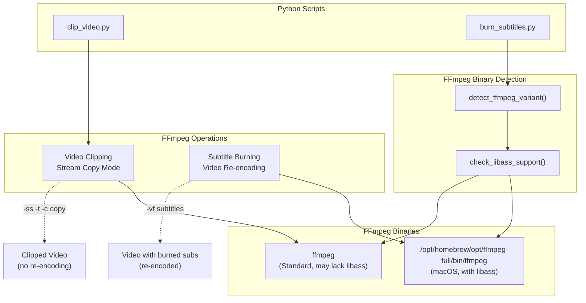
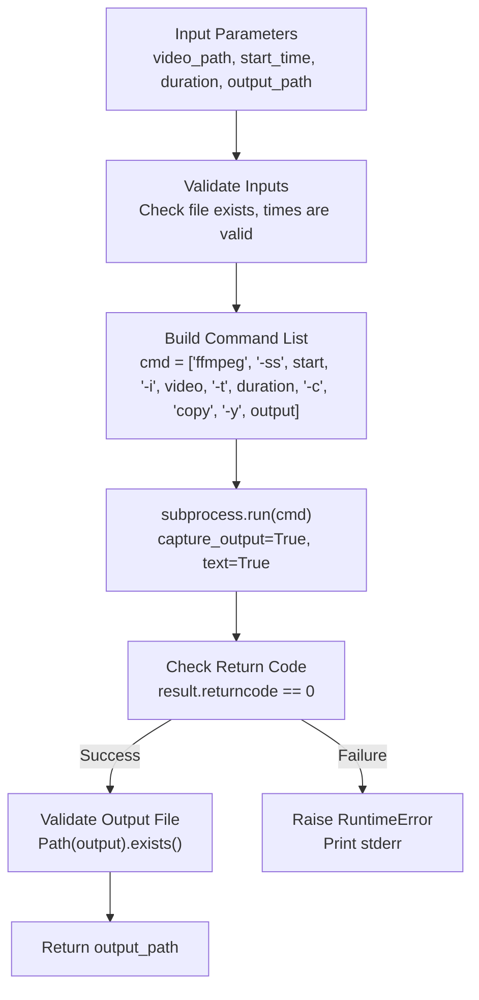
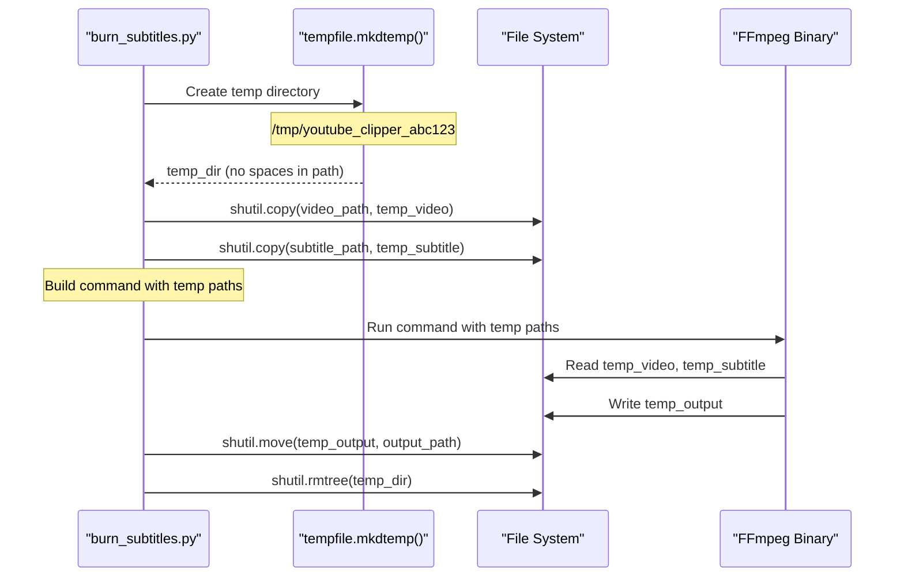
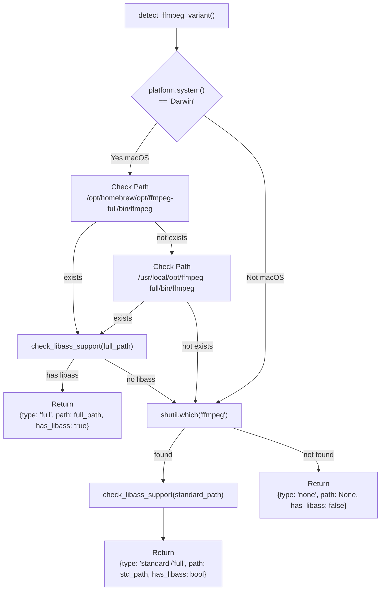
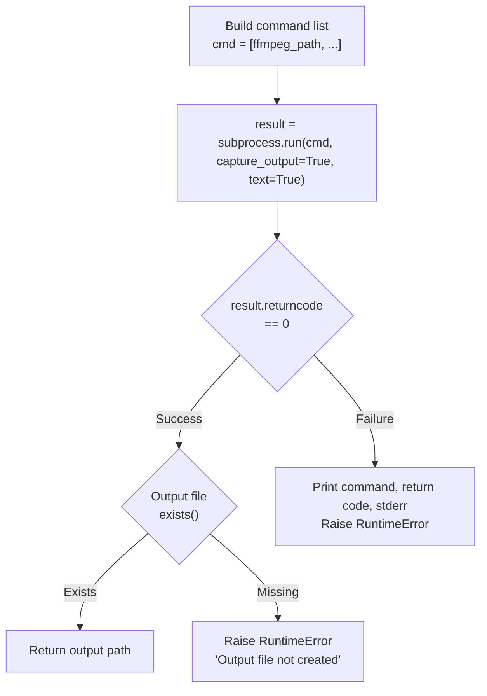

<!-- source: DeepWiki mcp.deepwiki.com · repo op7418/Youtube-clipper-skill · page 5.2 FFmpeg Integration · fetched 2026-10-26 -->

# FFmpeg Integration

<details>
<summary>Relevant source files</summary>

The following files were used as context for generating this wiki page:

- [TECHNICAL_NOTES.md](TECHNICAL_NOTES.md)
- [references/ffmpeg-guide.md](references/ffmpeg-guide.md)
- [scripts/burn_subtitles.py](scripts/burn_subtitles.py)

</details>


This document explains how FFmpeg is integrated into the YouTube Clipper Skill for video processing operations. FFmpeg is the primary external tool used for two critical functions: precise video clipping and subtitle burning to video. 

For information about FFmpeg's libass dependency, see [libass Requirement](#5.3). For the video clipping script implementation, see [clip_video.py](#4.3). For the subtitle burning script implementation, see [burn_subtitles.py](#4.4).

## Overview

FFmpeg is invoked as a subprocess from Python scripts to perform video processing operations. The system uses two distinct FFmpeg command patterns depending on the operation.



**Sources:** [scripts/clip_video.py](), [scripts/burn_subtitles.py:19-97](), [TECHNICAL_NOTES.md:5-80]()

## Video Clipping Commands

Video clipping uses FFmpeg's stream copy mode (`-c copy`) to extract segments without re-encoding. This ensures fast processing and zero quality loss.

### Command Structure

The basic clipping command pattern is constructed in [scripts/clip_video.py]():

| Parameter | Purpose | Example Value |
|-----------|---------|---------------|
| `-ss` | Start time (seek position) | `120.5` (2 minutes, 0.5 seconds) |
| `-i` | Input video file | `video.mp4` |
| `-t` | Duration to extract | `180` (3 minutes) |
| `-c copy` | Copy streams without re-encoding | (flag, no value) |
| `-y` | Overwrite output file | (flag, no value) |

### Implementation

The clipping function constructs and executes the FFmpeg command:



**Example command generated:**
```bash
ffmpeg -ss 120.5 -i input.mp4 -t 180 -c copy -y output.mp4
```

**Sources:** [scripts/clip_video.py](), [references/ffmpeg-guide.md:33-48]()

### Time Format Handling

The system accepts time in seconds as a float and passes it directly to FFmpeg. FFmpeg's `-ss` parameter supports multiple formats:

| Format | Example | Description |
|--------|---------|-------------|
| Seconds | `90.5` | 90.5 seconds |
| `HH:MM:SS` | `01:30:00` | 1 hour, 30 minutes |
| `HH:MM:SS.mmm` | `01:30:00.500` | With milliseconds |

The Python scripts use seconds (float) internally and rely on FFmpeg's automatic conversion.

**Sources:** [scripts/utils.py](), [scripts/clip_video.py]()

## Subtitle Burning Commands

Subtitle burning requires FFmpeg with libass support and uses the `subtitles` video filter. Unlike clipping, this operation re-encodes the video.

### Command Structure

The subtitle burning command is constructed in [scripts/burn_subtitles.py:194-204]():

```python
subtitle_filter = f"subtitles={temp_subtitle}:force_style='FontSize={font_size},MarginV={margin_v}'"

cmd = [
    ffmpeg_path,
    '-i', temp_video,
    '-vf', subtitle_filter,
    '-c:a', 'copy',
    '-y',
    temp_output
]
```

| Parameter | Purpose | Example Value |
|-----------|---------|---------------|
| `-i` | Input video file | `temp_video.mp4` |
| `-vf` | Video filter specification | `subtitles=sub.srt:force_style='FontSize=24,MarginV=30'` |
| `-c:a copy` | Copy audio stream without re-encoding | (flag with value) |
| `-y` | Overwrite output file | (flag, no value) |

### Subtitle Filter Parameters

The `subtitles` filter accepts style options via `force_style`:

| Style Parameter | Purpose | Default | Recommended Range |
|----------------|---------|---------|-------------------|
| `FontSize` | Subtitle font size in points | 24 | 20-28 (1080p) |
| `MarginV` | Vertical margin from bottom (pixels) | 30 | 20-40 |
| `FontName` | Font family name | System default | Any installed font |
| `Bold` | Bold text | 0 | 0 or 1 |

**Sources:** [scripts/burn_subtitles.py:123-244](), [references/ffmpeg-guide.md:109-133](), [TECHNICAL_NOTES.md:356-388]()

### Temporary Directory Workaround

FFmpeg's `subtitles` filter cannot handle file paths containing spaces, even when quoted or escaped. The solution is to copy files to a temporary directory with a guaranteed space-free path.



**Implementation in [scripts/burn_subtitles.py:179-244]():**

1. Create temporary directory: `tempfile.mkdtemp(prefix='youtube_clipper_')`
2. Copy input files to temporary directory with simple names
3. Execute FFmpeg with space-free temporary paths
4. Move output file to final destination
5. Clean up temporary directory in `finally` block

This approach is transparent to users—they can use paths with spaces for input and output.

**Sources:** [scripts/burn_subtitles.py:179-244](), [TECHNICAL_NOTES.md:82-163]()

## FFmpeg Variant Detection

The system must detect whether FFmpeg has libass support, which is required for subtitle burning. On macOS, the standard Homebrew FFmpeg lacks libass, requiring `ffmpeg-full` instead.

### Detection Flow



**Sources:** [scripts/burn_subtitles.py:19-70](), [TECHNICAL_NOTES.md:5-80]()

### libass Support Check

The `check_libass_support()` function verifies libass by checking for the `subtitles` filter:

**Implementation in [scripts/burn_subtitles.py:73-96]():**

```python
def check_libass_support(ffmpeg_path: str) -> bool:
    result = subprocess.run(
        [ffmpeg_path, '-filters'],
        capture_output=True,
        text=True,
        timeout=5
    )
    return 'subtitles' in result.stdout.lower()
```

The command `ffmpeg -filters` outputs all available filters. If `subtitles` appears in the output, FFmpeg was compiled with libass support.

**Sources:** [scripts/burn_subtitles.py:73-96](), [TECHNICAL_NOTES.md:59-79]()

### Installation Guidance

When libass support is missing, the system displays platform-specific installation instructions via `install_ffmpeg_full_guide()` in [scripts/burn_subtitles.py:99-121]():

| Platform | Installation Command | FFmpeg Path |
|----------|---------------------|-------------|
| macOS (Apple Silicon) | `brew install ffmpeg-full` | `/opt/homebrew/opt/ffmpeg-full/bin/ffmpeg` |
| macOS (Intel) | `brew install ffmpeg-full` | `/usr/local/opt/ffmpeg-full/bin/ffmpeg` |
| Ubuntu/Debian | `sudo apt-get install ffmpeg libass-dev` | `/usr/bin/ffmpeg` |
| From source | `./configure --enable-libass && make install` | Varies |

**Sources:** [scripts/burn_subtitles.py:99-121](), [references/ffmpeg-guide.md:6-29]()

## Performance Optimization

### Stream Copy vs Re-encoding

The system uses different processing strategies based on the operation:

| Operation | Mode | Speed | Quality Impact | Command Flag |
|-----------|------|-------|----------------|--------------|
| Video clipping | Stream copy | Very fast (10-50x realtime) | None (lossless) | `-c copy` |
| Subtitle burning | Re-encoding | Slow (0.5-2x realtime) | Slight (re-compression) | `-vf subtitles` |

Stream copy (`-c copy`) is fast because it copies compressed video/audio streams directly without decoding and re-encoding. Re-encoding is necessary for subtitle burning because the video frames must be modified.

**Sources:** [scripts/clip_video.py](), [scripts/burn_subtitles.py:194-204](), [references/ffmpeg-guide.md:33-48]()

### Hardware Acceleration

FFmpeg supports hardware-accelerated encoding, though the current implementation does not use it. Potential acceleration options documented in [references/ffmpeg-guide.md:135-144]():

| Platform | Acceleration Type | FFmpeg Flag | Typical Speedup |
|----------|------------------|-------------|-----------------|
| macOS | VideoToolbox | `-hwaccel videotoolbox` | 2-4x |
| NVIDIA GPU | CUDA | `-hwaccel cuda` | 3-10x |
| Intel GPU | QSV | `-hwaccel qsv` | 2-5x |

Hardware acceleration could be added to the subtitle burning command for faster processing on supported systems.

**Sources:** [references/ffmpeg-guide.md:135-144]()

### Multi-threading

FFmpeg automatically uses multiple CPU threads, but the number can be controlled:

```bash
ffmpeg -threads 4 -i input.mp4 ...
```

The current implementation relies on FFmpeg's auto-detection (typically uses all available cores).

**Sources:** [references/ffmpeg-guide.md:147-151]()

## Common Command Patterns

### Video Clipping (Stream Copy)

**Generated by [scripts/clip_video.py]():**

```bash
ffmpeg -ss 120.5 -i input.mp4 -t 180 -c copy -y output.mp4
```

- Starts at 120.5 seconds
- Extracts 180 seconds (3 minutes)
- No re-encoding
- Fast and lossless

### Subtitle Burning (Re-encoding)

**Generated by [scripts/burn_subtitles.py:197-204]():**

```bash
ffmpeg -i video.mp4 \
  -vf "subtitles=subtitle.srt:force_style='FontSize=24,MarginV=30'" \
  -c:a copy \
  -y output.mp4
```

- Burns SRT subtitles onto video
- Re-encodes video stream
- Copies audio stream (no audio re-encoding)
- Custom subtitle style

### Bilingual Subtitle Burning

**Used for bilingual SRT files:**

```bash
ffmpeg -i video.mp4 \
  -vf "subtitles=bilingual.srt:force_style='FontSize=24,MarginV=30'" \
  -c:a copy \
  -y output.mp4
```

Each subtitle entry in the SRT contains two lines (English and target language), both rendered by FFmpeg.

**Sources:** [scripts/burn_subtitles.py:194-204](), [references/ffmpeg-guide.md:109-118](), [TECHNICAL_NOTES.md:356-388]()

## Error Handling

### Command Execution Pattern

All FFmpeg commands follow this error handling pattern:



**Key error information captured:**
- Command that was executed
- FFmpeg's exit code
- FFmpeg's stderr output (error messages)
- Whether output file was created

**Sources:** [scripts/clip_video.py](), [scripts/burn_subtitles.py:210-223]()

### Common Error Scenarios

| Error | Cause | Detection | Solution |
|-------|-------|-----------|----------|
| "No such filter: 'subtitles'" | FFmpeg lacks libass | `check_libass_support()` returns `False` | Install `ffmpeg-full` or compile with libass |
| "Unable to find '/path/with'" | Path contains spaces | FFmpeg stderr shows truncated path | Use temporary directory workaround |
| Return code 1 | Invalid time range | FFmpeg stderr shows error | Validate start time and duration |
| Output file not created | FFmpeg failed silently | `Path(output).exists()` returns `False` | Check FFmpeg stderr for details |

**Sources:** [scripts/burn_subtitles.py:19-97](), [TECHNICAL_NOTES.md:5-163](), [references/ffmpeg-guide.md:154-173]()

---

