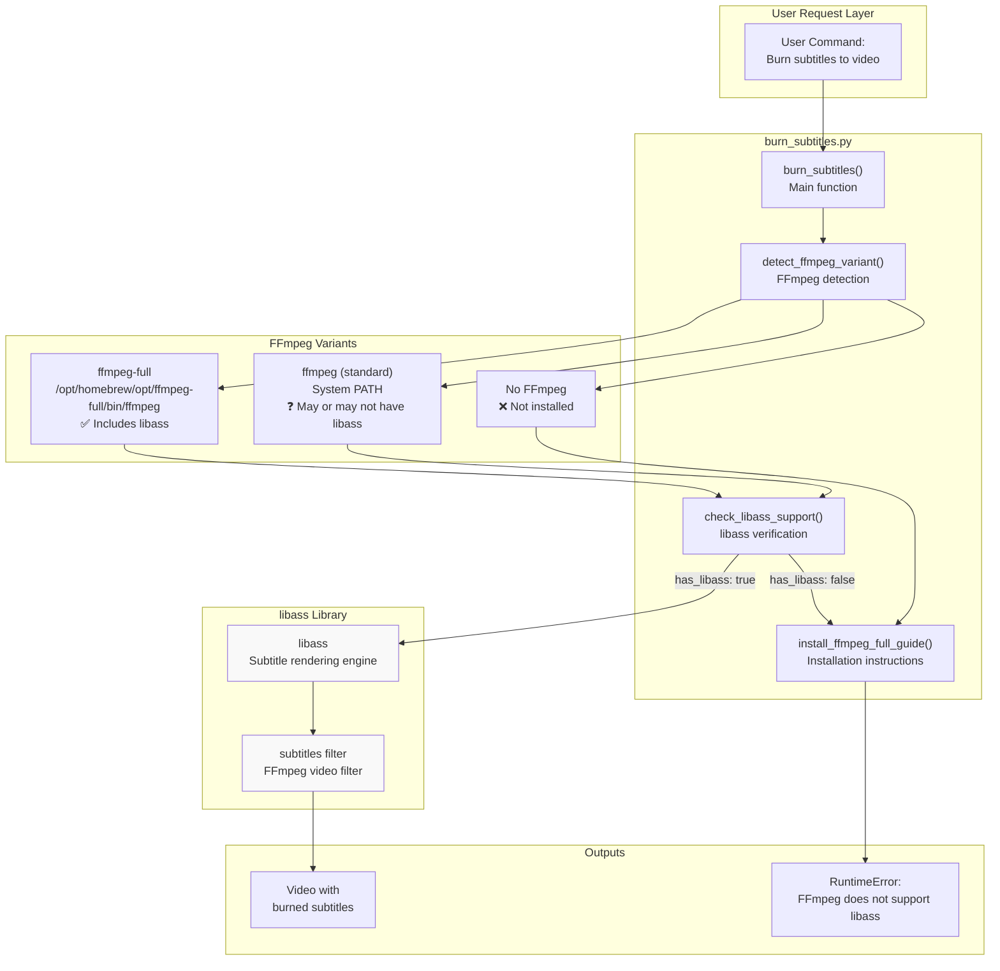
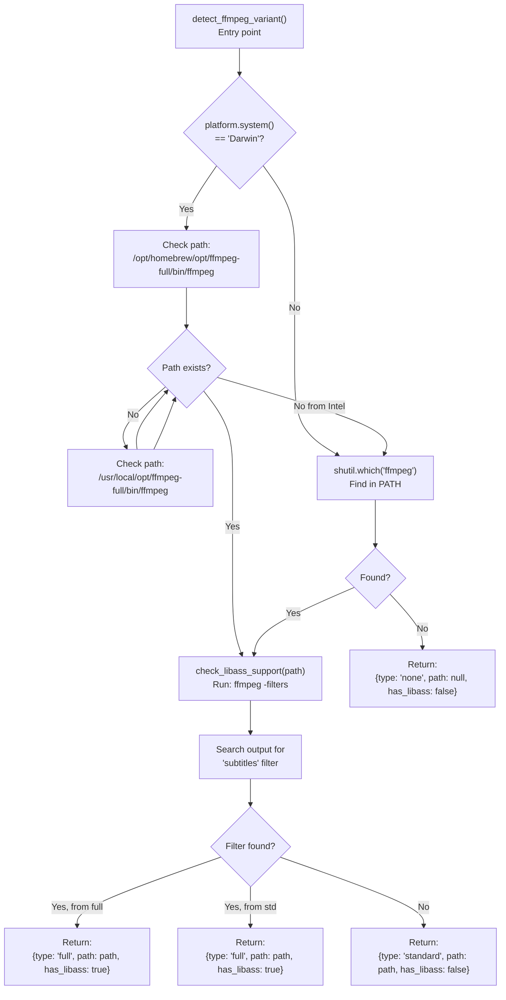
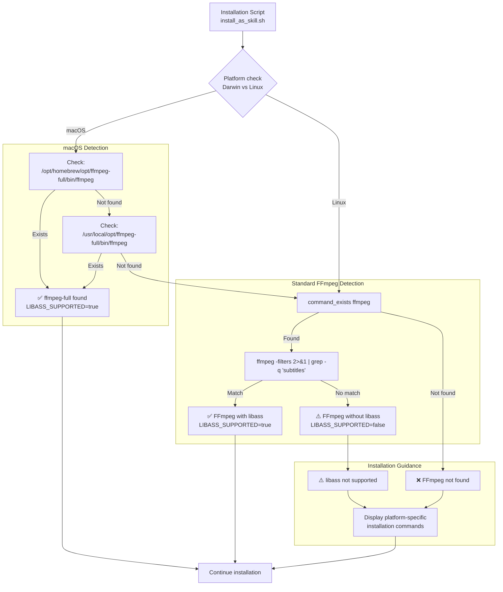

<!-- source: DeepWiki mcp.deepwiki.com · repo op7418/Youtube-clipper-skill · page 5.3 libass Requirement · fetched 2026-10-26 -->

# libass Requirement

<details>
<summary>Relevant source files</summary>

The following files were used as context for generating this wiki page:

- [TECHNICAL_NOTES.md](TECHNICAL_NOTES.md)
- [install_as_skill.sh](install_as_skill.sh)
- [scripts/burn_subtitles.py](scripts/burn_subtitles.py)

</details>


This page documents the critical libass library dependency for FFmpeg-based subtitle burning functionality. libass is a subtitle rendering library that enables FFmpeg's `subtitles` filter, which is required for hardcoding subtitles into video files.

For general FFmpeg usage and integration patterns, see [FFmpeg Integration](#5.2). For the script that uses libass, see [burn_subtitles.py](#4.4). For troubleshooting subtitle burning failures, see [FFmpeg and libass Problems](#8.2).

## Purpose and Critical Role

libass is a portable subtitle renderer for the ASS (Advanced SubStation Alpha) and SSA (SubStation Alpha) subtitle formats. In the YouTube Clipper Skill, libass is essential because:

1. **Subtitle Burning Dependency**: The `subtitles` filter in FFmpeg requires libass to render subtitles onto video frames
2. **Not Included by Default**: Many FFmpeg distributions exclude libass to reduce package size
3. **No Workaround**: Without libass, subtitle burning cannot be performed—there is no alternative filter

**Key Limitation**: Standard Homebrew FFmpeg on macOS does not include libass support. Users must install `ffmpeg-full` or compile from source.

Sources: [TECHNICAL_NOTES.md:5-24]()

## System Architecture: libass in the Processing Pipeline



**Diagram: libass Dependency Chain**

This diagram shows how `burn_subtitles.py` detects FFmpeg variants and verifies libass support before attempting subtitle burning operations.

Sources: [scripts/burn_subtitles.py:19-70](), [scripts/burn_subtitles.py:123-172]()

## Detection Logic

The system implements a multi-stage detection process in `burn_subtitles.py` to locate FFmpeg with libass support:

### Detection Function Flow



**Diagram: FFmpeg Detection Algorithm**

This flowchart maps directly to the `detect_ffmpeg_variant()` function logic, showing platform-specific paths and verification steps.

Sources: [scripts/burn_subtitles.py:19-70](), [scripts/burn_subtitles.py:73-96]()

### Detection Implementation Details

The detection process consists of three key functions:

| Function | Purpose | Key Logic |
|----------|---------|-----------|
| `detect_ffmpeg_variant()` | Locate FFmpeg executable | Checks platform-specific paths, then PATH |
| `check_libass_support()` | Verify libass availability | Runs `ffmpeg -filters`, searches for "subtitles" |
| `install_ffmpeg_full_guide()` | Provide installation help | Displays platform-specific instructions |

**Priority Order (macOS)**:
1. `/opt/homebrew/opt/ffmpeg-full/bin/ffmpeg` (Apple Silicon)
2. `/usr/local/opt/ffmpeg-full/bin/ffmpeg` (Intel)
3. `ffmpeg` in system PATH
4. Error if none found

**Priority Order (Other Platforms)**:
1. `ffmpeg` in system PATH
2. Error if not found

Sources: [scripts/burn_subtitles.py:32-48](), [scripts/burn_subtitles.py:50-62]()

### libass Verification Method

The `check_libass_support()` function verifies libass by checking for the `subtitles` filter:

```python
# Simplified logic from burn_subtitles.py:84-93
subprocess.run([ffmpeg_path, '-filters'], capture_output=True, text=True)
return 'subtitles' in result.stdout.lower()
```

This works because:
- The `subtitles` filter is only available when FFmpeg is compiled with libass
- Running `ffmpeg -filters` lists all available filters
- Searching for "subtitles" confirms libass support

Sources: [scripts/burn_subtitles.py:73-96]()

## Platform-Specific Installation

### macOS Installation

On macOS, the recommended approach is to install `ffmpeg-full` via Homebrew, which includes libass and other subtitle-related libraries.

```bash
# Install ffmpeg-full
brew install ffmpeg-full

# Verify installation (Apple Silicon)
/opt/homebrew/opt/ffmpeg-full/bin/ffmpeg -filters 2>&1 | grep subtitles

# Verify installation (Intel)
/usr/local/opt/ffmpeg-full/bin/ffmpeg -filters 2>&1 | grep subtitles
```

**Installation Paths by Architecture**:

| Architecture | FFmpeg Path |
|-------------|-------------|
| Apple Silicon (M1/M2/M3) | `/opt/homebrew/opt/ffmpeg-full/bin/ffmpeg` |
| Intel (x86_64) | `/usr/local/opt/ffmpeg-full/bin/ffmpeg` |

**Why not standard FFmpeg?**
- `brew install ffmpeg` excludes libass to minimize package size
- Standard FFmpeg cannot burn subtitles
- `ffmpeg-full` is required for this functionality

Sources: [TECHNICAL_NOTES.md:28-43](), [install_as_skill.sh:159-166]()

### Linux Installation

On Linux systems, install libass development libraries before compiling FFmpeg or use distribution packages with libass support.

#### Ubuntu/Debian

```bash
# Option 1: Install pre-built FFmpeg with libass
sudo apt-get update
sudo apt-get install ffmpeg

# Option 2: Build from source
sudo apt-get install libass-dev
./configure --enable-libass
make
sudo make install
```

#### Verification

```bash
# Check for subtitles filter
ffmpeg -filters 2>&1 | grep subtitles
```

Expected output when libass is available:
```
 ... subtitles          V->V       Render text subtitles onto input video using libass.
```

Sources: [TECHNICAL_NOTES.md:46-57]()

### Installation During Skill Setup

The installation script `install_as_skill.sh` performs automatic detection during setup:



**Diagram: Installation Script Detection Flow**

The installation script provides immediate feedback about FFmpeg and libass availability, guiding users to install the correct variant.

Sources: [install_as_skill.sh:152-191]()

## Verification Methods

### Command-Line Verification

The most reliable verification method is to check for the `subtitles` filter:

```bash
# List all filters and search for subtitles
ffmpeg -filters 2>&1 | grep subtitles

# Expected output with libass:
# ... subtitles          V->V       Render text subtitles onto input video using libass.
#
# No output = libass not available
```

### Programmatic Verification

The `check_libass_support()` function in `burn_subtitles.py` provides programmatic verification:

```python
# From burn_subtitles.py:73-96
def check_libass_support(ffmpeg_path: str) -> bool:
    result = subprocess.run(
        [ffmpeg_path, '-filters'],
        capture_output=True,
        text=True,
        timeout=5
    )
    return 'subtitles' in result.stdout.lower()
```

This function:
1. Executes `ffmpeg -filters`
2. Captures stdout
3. Searches for "subtitles" string (case-insensitive)
4. Returns boolean result

Sources: [scripts/burn_subtitles.py:73-96]()

### Error Messages

When libass is not available, the system provides clear error messages:

| Scenario | Error Message | Location |
|----------|---------------|----------|
| FFmpeg not found | `FFmpeg not found` | [burn_subtitles.py:165]() |
| No libass support | `FFmpeg does not support libass (subtitles filter)` | [burn_subtitles.py:169]() |
| Installation needed | Displays `install_ffmpeg_full_guide()` output | [burn_subtitles.py:99-121]() |

The installation guide includes platform-specific instructions and verification commands.

Sources: [scripts/burn_subtitles.py:163-172](), [scripts/burn_subtitles.py:99-121]()

## Common Issues and Solutions

### Issue: "No such filter: 'subtitles'"

**Symptom**: FFmpeg fails with error message indicating the `subtitles` filter is not available.

**Root Cause**: FFmpeg was compiled without libass support.

**Solution**:
- **macOS**: Install `ffmpeg-full` instead of standard `ffmpeg`
- **Linux**: Install `libass-dev` and recompile FFmpeg with `--enable-libass`

Sources: [TECHNICAL_NOTES.md:10-13](), [TECHNICAL_NOTES.md:21-24]()

### Issue: Path Detection Fails on macOS

**Symptom**: Script cannot find `ffmpeg-full` even though it's installed.

**Diagnosis**: Check both possible installation paths:

```bash
# Apple Silicon
ls -la /opt/homebrew/opt/ffmpeg-full/bin/ffmpeg

# Intel Mac
ls -la /usr/local/opt/ffmpeg-full/bin/ffmpeg
```

**Solution**: Ensure Homebrew installed to the correct location for your architecture.

Sources: [scripts/burn_subtitles.py:34-40]()

### Issue: Standard FFmpeg Reports No libass

**Symptom**: Installed FFmpeg doesn't have `subtitles` filter.

**Verification**:
```bash
ffmpeg -filters 2>&1 | grep subtitles
# No output = no libass
```

**Solutions by Platform**:

| Platform | Command |
|----------|---------|
| macOS | `brew uninstall ffmpeg && brew install ffmpeg-full` |
| Ubuntu/Debian | `sudo apt-get install libass-dev` then recompile |
| From source | Add `--enable-libass` to configure flags |

Sources: [TECHNICAL_NOTES.md:46-57](), [install_as_skill.sh:186-191]()

## Integration with burn_subtitles.py

The `burn_subtitles()` function integrates libass detection at the beginning of its execution:


**Diagram: Runtime libass Verification Sequence**

This sequence diagram shows the function call chain when `burn_subtitles()` verifies libass availability before attempting to burn subtitles.

Sources: [scripts/burn_subtitles.py:160-172](), [scripts/burn_subtitles.py:19-70]()

### Function Call Chain

1. **User calls `burn_subtitles()`** with video and subtitle paths
2. **`detect_ffmpeg_variant()`** executes to locate FFmpeg
3. **`check_libass_support()`** verifies the `subtitles` filter exists
4. **Decision point**:
   - If libass available: proceed with FFmpeg subtitle burning
   - If libass missing: call `install_ffmpeg_full_guide()` and raise `RuntimeError`

Sources: [scripts/burn_subtitles.py:123-172]()

## Configuration Options

While libass itself has no user-configurable options in this system, the environment variables affect how FFmpeg with libass is used:

| Environment Variable | Purpose | Effect on libass |
|---------------------|---------|------------------|
| `FFMPEG_PATH` | Override FFmpeg executable path | Can point to specific FFmpeg build with libass |
| `SUBTITLE_FONT_SIZE` | Font size for burned subtitles | Passed to libass via `force_style` |
| `SUBTITLE_MARGIN_V` | Bottom margin for subtitles | Passed to libass via `force_style` |

The `burn_subtitles()` function uses these parameters when constructing the FFmpeg filter:

```python
# From burn_subtitles.py:195
subtitle_filter = f"subtitles={temp_subtitle}:force_style='FontSize={font_size},MarginV={margin_v}'"
```

These style parameters are interpreted by libass when rendering subtitles onto video frames.

Sources: [scripts/burn_subtitles.py:195]()

## Summary

libass is a non-optional dependency for subtitle burning functionality in the YouTube Clipper Skill. The system implements robust detection and provides clear installation guidance when libass is unavailable. On macOS, users must install `ffmpeg-full` rather than standard FFmpeg. The detection logic in `burn_subtitles.py` verifies libass support before attempting any subtitle burning operations, preventing cryptic FFmpeg errors.

Sources: [TECHNICAL_NOTES.md:1-57](), [scripts/burn_subtitles.py:1-287](), [install_as_skill.sh:152-191]()

---

