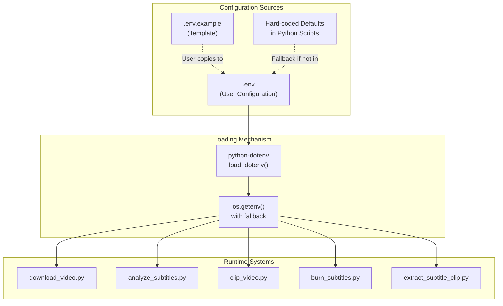
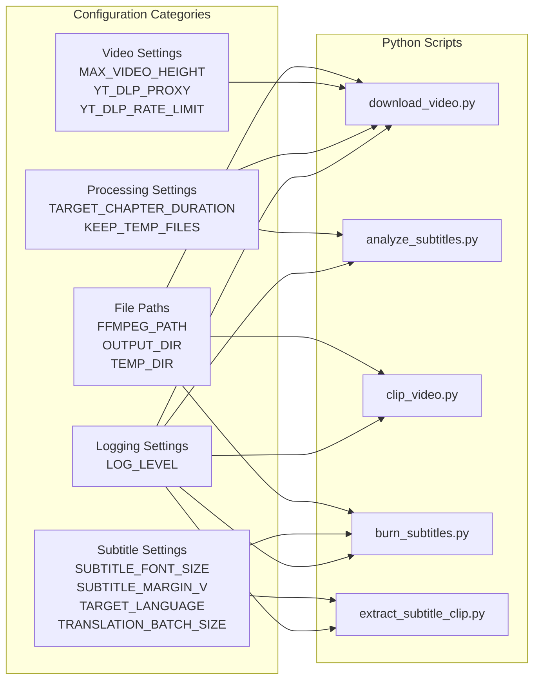
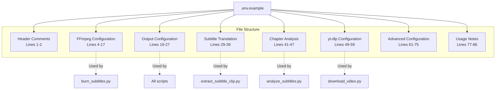
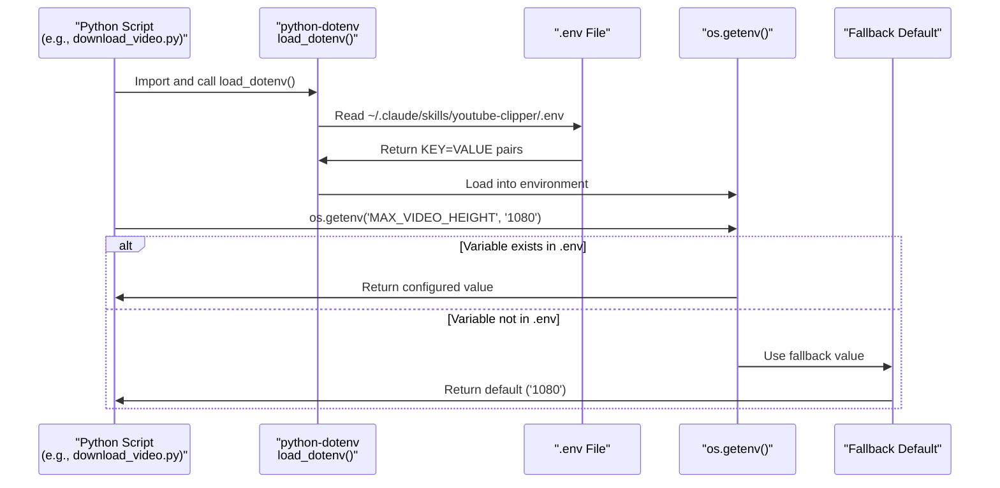
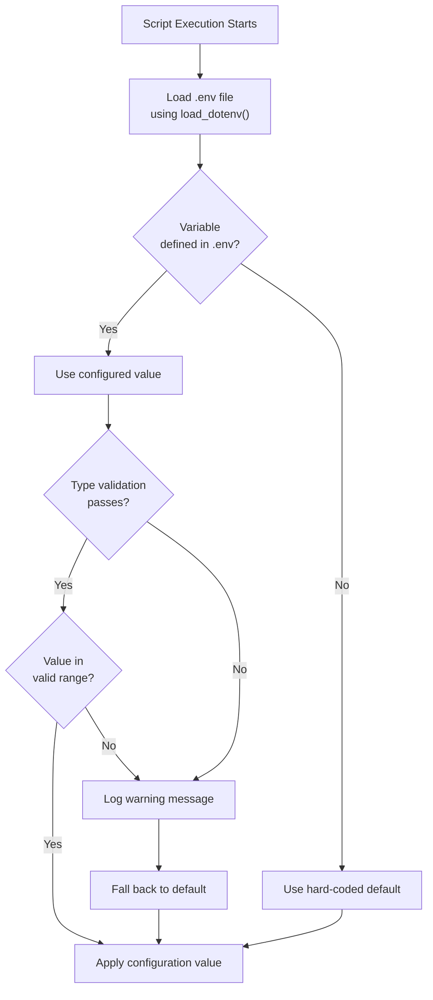

<!-- source: DeepWiki mcp.deepwiki.com · repo op7418/Youtube-clipper-skill · page 6 Configuration · fetched 2026-10-26 -->

# Configuration

<details>
<summary>Relevant source files</summary>

The following files were used as context for generating this wiki page:

- [.env.example](.env.example)
- [README.md](README.md)
- [README.zh-CN.md](README.zh-CN.md)

</details>


This document describes the YouTube Clipper Skill's configuration system, which allows users to customize system behavior through environment variables. The configuration system controls video download quality, subtitle styling, translation parameters, output directories, and processing options without requiring code modifications.

For detailed reference of all available configuration variables, see [Environment Variables Reference](#6.1). For specific configuration domains, see [Video Download Settings](#6.2), [Subtitle and Translation Settings](#6.3), and [Processing and Output Settings](#6.4).

## Configuration System Overview

The YouTube Clipper Skill uses a three-tier configuration system: a template file ([.env.example:1-86]()), a user-editable file (`.env`), and hard-coded defaults in Python scripts. This design ensures the system operates correctly even without explicit configuration while allowing extensive customization for advanced users.



**Configuration Flow in YouTube Clipper Skill**

The configuration system loads environment variables using the `python-dotenv` library, which reads the `.env` file at skill initialization. Each Python script accesses configuration through `os.getenv()` calls with fallback default values.

**Sources:** [.env.example:1-86](), [README.md:127-154]()

## Configuration File Location

After installation, the configuration file is located at:

```
~/.claude/skills/youtube-clipper/.env
```

The installation script creates this file by copying [.env.example:1-86]() to the skill directory. Users can edit this file directly or allow Claude Code to modify it through natural language commands.

| Configuration File | Purpose | Modification |
|-------------------|---------|--------------|
| `.env.example` | Template with all available options and documentation | Read-only reference |
| `.env` | Active configuration used by scripts | User-editable |
| Python script defaults | Fallback values when `.env` entry is missing | Requires code modification |

**Sources:** [README.md:127-154](), [.env.example:1-86]()

## Configuration Categories

The configuration system organizes variables into five functional categories, each controlling specific aspects of the processing pipeline.



**Configuration Category to Script Mapping**

Each configuration category affects specific Python scripts. For example, `SUBTITLE_FONT_SIZE` and `SUBTITLE_MARGIN_V` are only used by `burn_subtitles.py`, while `MAX_VIDEO_HEIGHT` is exclusively consumed by `download_video.py`.

**Sources:** [.env.example:1-86](), Diagram 5 from high-level architecture

### File Paths Configuration

| Variable | Purpose | Default | Example |
|----------|---------|---------|---------|
| `FFMPEG_PATH` | Explicit path to FFmpeg binary | Auto-detected | `/opt/homebrew/opt/ffmpeg-full/bin/ffmpeg` |
| `OUTPUT_DIR` | Base directory for all outputs | `./youtube-clips` | `/Users/username/Videos/clips` |
| `TEMP_DIR` | Temporary file storage (workaround for path spaces) | System temp directory | `/tmp/youtube-clipper` |

**Sources:** [.env.example:8-23]()

### Video Settings Configuration

| Variable | Purpose | Default | Valid Values |
|----------|---------|---------|--------------|
| `MAX_VIDEO_HEIGHT` | Maximum video resolution for download | `1080` | `720`, `1080`, `1440`, `2160` |
| `YT_DLP_PROXY` | Proxy server for yt-dlp downloads | Empty (no proxy) | `http://proxy:port`, `socks5://proxy:port` |
| `YT_DLP_RATE_LIMIT` | Download speed limit | Empty (unlimited) | `50K`, `4.2M` |

**Sources:** [.env.example:25-28](), [.env.example:50-59]()

### Subtitle and Translation Configuration

| Variable | Purpose | Default | Valid Values |
|----------|---------|---------|--------------|
| `SUBTITLE_FONT_SIZE` | Font size for burned subtitles | `24` | Any positive integer |
| `SUBTITLE_MARGIN_V` | Vertical margin from bottom (pixels) | `30` | Any positive integer |
| `TARGET_LANGUAGE` | Translation target language | `中文` (Chinese) | Any language name |
| `TRANSLATION_BATCH_SIZE` | Number of subtitle lines per API call | `20` | `15-25` recommended |

**Sources:** [.env.example:14-16](), [.env.example:32-39]()

### Processing Configuration

| Variable | Purpose | Default | Valid Values |
|----------|---------|---------|--------------|
| `TARGET_CHAPTER_DURATION` | Desired chapter length in seconds | `180` (3 minutes) | `180-300` recommended |
| `KEEP_TEMP_FILES` | Retain temporary files for debugging | `false` | `true`, `false` |
| `LOG_LEVEL` | Logging verbosity | `INFO` | `DEBUG`, `INFO`, `WARNING`, `ERROR` |

**Sources:** [.env.example:44-47](), [.env.example:63-75]()

## Configuration Template Structure

The [.env.example:1-86]() file serves as both a template and documentation reference. Its structure demonstrates the organization and available options:



**Configuration Template Organization**

Each section in `.env.example` groups related variables and includes:
- Descriptive comments explaining purpose
- Default values or "leave empty" guidance
- Valid value ranges or examples
- Platform-specific path examples

**Sources:** [.env.example:1-86]()

## Configuration Loading Mechanism

The configuration system uses a two-stage loading process implemented through the `python-dotenv` library:



**Configuration Loading Sequence**

Each Python script imports `python-dotenv` and calls `load_dotenv()` early in execution. This reads the `.env` file and populates environment variables. Subsequent `os.getenv()` calls retrieve values with fallback defaults if the variable is not defined.

**Sources:** [.env.example:1-86](), README context

## Modifying Configuration

Configuration changes require editing the `.env` file. Changes take effect on the next skill invocation, as configuration is loaded at script startup.

### Edit Configuration Manually

```bash
# Open configuration file in editor
nano ~/.claude/skills/youtube-clipper/.env

# Or use your preferred editor
code ~/.claude/skills/youtube-clipper/.env
```

### Edit Through Claude Code

Users can request configuration changes through natural language:

```
Change the maximum video quality to 720p
```

```
Set the translation batch size to 25
```

Claude Code will modify the `.env` file accordingly and confirm the change.

### Configuration Syntax Rules

The `.env` file follows these syntax conventions:

| Rule | Example | Notes |
|------|---------|-------|
| No quotes needed for values | `MAX_VIDEO_HEIGHT=1080` | Values are read as-is |
| Empty values are valid | `FFMPEG_PATH=` | Triggers auto-detection or uses default |
| Comments start with `#` | `# This is a comment` | Ignored by parser |
| Tilde expansion supported | `OUTPUT_DIR=~/Videos/clips` | Expands to user home directory |
| No spaces around `=` | `LOG_LEVEL=INFO` (correct) | `LOG_LEVEL = INFO` may cause issues |

**Sources:** [.env.example:77-86]()

## Configuration Validation and Defaults

The system implements a robust default mechanism ensuring operation without explicit configuration:



**Configuration Validation Flow**

Scripts perform type checking and range validation on configuration values. Invalid values trigger warning messages and fall back to defaults, ensuring the system continues operating even with malformed configuration.

### Example Default Values

Common defaults used throughout the system:

```python
# Example from download_video.py (conceptual)
max_height = os.getenv('MAX_VIDEO_HEIGHT', '1080')
output_dir = os.getenv('OUTPUT_DIR', './youtube-clips')
proxy = os.getenv('YT_DLP_PROXY', '')  # Empty string means no proxy

# Example from burn_subtitles.py (conceptual)
font_size = int(os.getenv('SUBTITLE_FONT_SIZE', '24'))
margin_v = int(os.getenv('SUBTITLE_MARGIN_V', '30'))

# Example from analyze_subtitles.py (conceptual)
target_duration = int(os.getenv('TARGET_CHAPTER_DURATION', '180'))
```

**Sources:** [.env.example:1-86](), script module descriptions from architecture

## Configuration Impact Summary

The table below summarizes which configuration variables affect which processing stages:

| Processing Stage | Configuration Variables Used | Critical Variables |
|------------------|----------------------------|-------------------|
| Environment Detection | `FFMPEG_PATH`, `LOG_LEVEL` | `FFMPEG_PATH` (if not auto-detected) |
| Video Download | `MAX_VIDEO_HEIGHT`, `YT_DLP_PROXY`, `YT_DLP_RATE_LIMIT`, `OUTPUT_DIR` | `MAX_VIDEO_HEIGHT`, `OUTPUT_DIR` |
| AI Chapter Analysis | `TARGET_CHAPTER_DURATION`, `LOG_LEVEL` | `TARGET_CHAPTER_DURATION` |
| Video Clipping | `OUTPUT_DIR`, `TEMP_DIR`, `LOG_LEVEL` | `OUTPUT_DIR` |
| Subtitle Translation | `TRANSLATION_BATCH_SIZE`, `TARGET_LANGUAGE` | `TARGET_LANGUAGE` |
| Subtitle Burning | `FFMPEG_PATH`, `SUBTITLE_FONT_SIZE`, `SUBTITLE_MARGIN_V`, `TEMP_DIR` | `SUBTITLE_FONT_SIZE`, `SUBTITLE_MARGIN_V` |
| Output Organization | `OUTPUT_DIR`, `KEEP_TEMP_FILES` | `OUTPUT_DIR` |

Variables marked as "Critical" have the most significant impact on output quality or functionality. Non-critical variables primarily affect performance, logging, or convenience features.

**Sources:** [.env.example:1-86](), Diagram 5 from high-level architecture, [README.md:127-154]()

---

For detailed documentation of each configuration variable, proceed to [Environment Variables Reference](#6.1). For domain-specific configuration guidance, see [Video Download Settings](#6.2), [Subtitle and Translation Settings](#6.3), or [Processing and Output Settings](#6.4).

---

