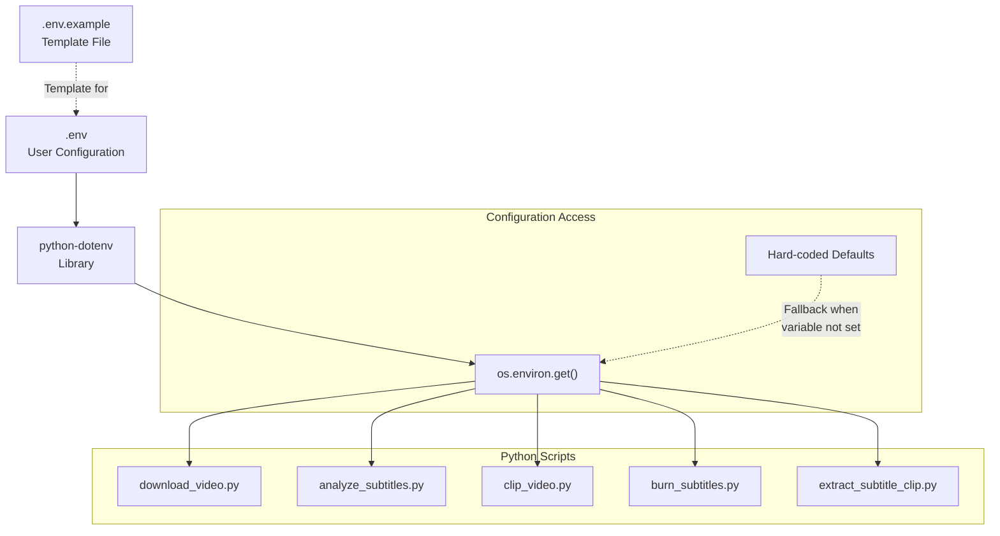
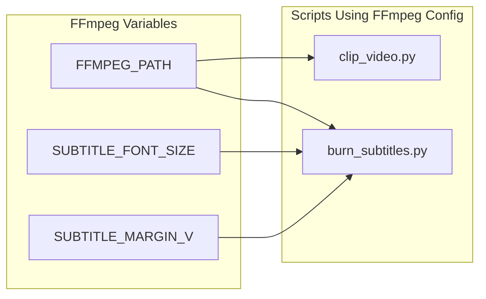
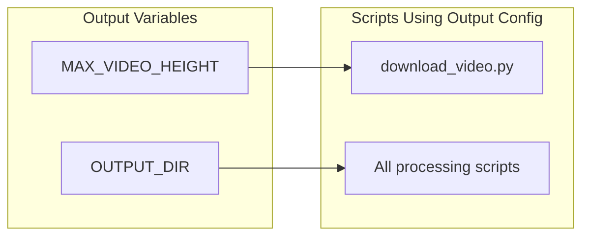
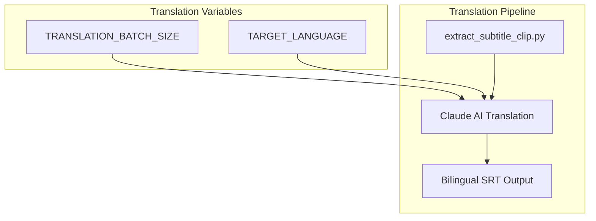
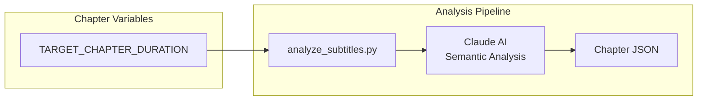
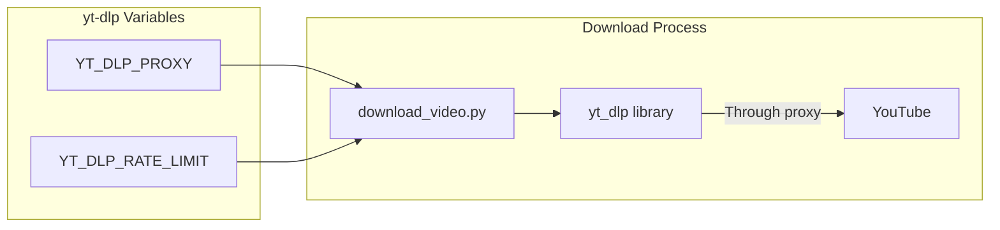
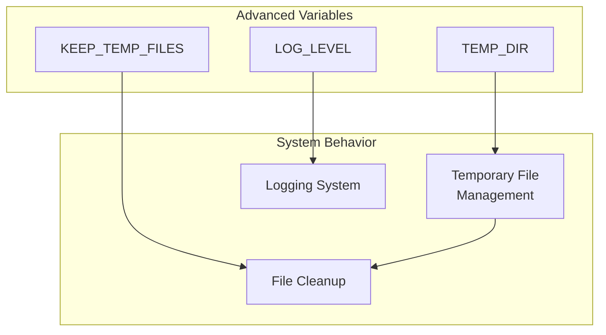

<!-- source: DeepWiki mcp.deepwiki.com · repo op7418/Youtube-clipper-skill · page 6.1 Environment Variables Reference · fetched 2026-10-26 -->

# Environment Variables Reference

<details>
<summary>Relevant source files</summary>

The following files were used as context for generating this wiki page:

- [.env.example](.env.example)
- [README.md](README.md)
- [README.zh-CN.md](README.zh-CN.md)

</details>


This page provides a comprehensive reference for all environment variables used by the YouTube Clipper Skill. These variables are configured in the `.env` file located at `~/.claude/skills/youtube-clipper/.env` and control various aspects of video processing, subtitle handling, output management, and external tool integration.

For conceptual information about specific configuration categories, see:
- [Video Download Settings](#6.2) for video quality and download behavior
- [Subtitle and Translation Settings](#6.3) for subtitle styling and translation
- [Processing and Output Settings](#6.4) for chapter duration and file management

**Sources:** [.env.example:1-86]()

---

## Configuration Loading Mechanism



All scripts use `python-dotenv` to load environment variables from the `.env` file. If a variable is not defined, scripts fall back to hard-coded default values. The `.env.example` file serves as a template showing all available configuration options.

**Sources:** [.env.example:1-86](), [README.md:127-153]()

---

## Variable Reference by Category

### FFmpeg Configuration



**Sources:** [.env.example:4-17]()

#### FFMPEG_PATH

| Attribute | Value |
|-----------|-------|
| **Purpose** | Specifies the path to the FFmpeg executable |
| **Type** | String (file path) |
| **Default** | Auto-detected by searching system PATH |
| **Valid Values** | Absolute path to FFmpeg binary |
| **Used By** | `clip_video.py`, `burn_subtitles.py` |
| **Example** | `/opt/homebrew/opt/ffmpeg-full/bin/ffmpeg` (macOS Apple Silicon)<br>`/usr/local/opt/ffmpeg-full/bin/ffmpeg` (macOS Intel)<br>`/usr/bin/ffmpeg` (Linux) |

**When to Set:** Only required if FFmpeg is not in the system PATH or if you need to use a specific FFmpeg installation (e.g., `ffmpeg-full` on macOS for libass support).

**Sources:** [.env.example:8-12]()

#### SUBTITLE_FONT_SIZE

| Attribute | Value |
|-----------|-------|
| **Purpose** | Controls the font size of burned-in subtitles |
| **Type** | Integer |
| **Default** | `24` |
| **Valid Values** | Any positive integer (recommended: 18-30) |
| **Used By** | `burn_subtitles.py` |
| **Example** | `24` |

**Impact:** Larger values make subtitles more readable but take up more screen space. Smaller values reduce visibility on high-resolution videos.

**Sources:** [.env.example:14-15]()

#### SUBTITLE_MARGIN_V

| Attribute | Value |
|-----------|-------|
| **Purpose** | Sets the vertical margin (bottom padding) for burned-in subtitles |
| **Type** | Integer (pixels) |
| **Default** | `30` |
| **Valid Values** | Any positive integer (recommended: 20-50) |
| **Used By** | `burn_subtitles.py` |
| **Example** | `30` |

**Impact:** Higher values move subtitles further from the bottom edge of the video. Useful to avoid overlapping with video content.

**Sources:** [.env.example:14-16]()

---

### Output Configuration



**Sources:** [.env.example:18-28]()

#### OUTPUT_DIR

| Attribute | Value |
|-----------|-------|
| **Purpose** | Defines the base directory for all output files |
| **Type** | String (directory path) |
| **Default** | `./youtube-clips` (relative to current working directory) |
| **Valid Values** | Any valid directory path (absolute or relative) |
| **Used By** | All scripts that generate output files |
| **Example** | `./youtube-clips`<br>`~/Videos/youtube-clips`<br>`/tmp/clips` |

**Directory Structure:** Each processing session creates a timestamped subdirectory under `OUTPUT_DIR` in the format `YYYYMMDD_HHMMSS/`.

**Sources:** [.env.example:22-23]()

#### MAX_VIDEO_HEIGHT

| Attribute | Value |
|-----------|-------|
| **Purpose** | Limits the maximum video resolution for downloads |
| **Type** | Integer (pixels) |
| **Default** | `1080` |
| **Valid Values** | `720`, `1080`, `1440`, `2160` |
| **Used By** | `download_video.py` |
| **Example** | `1080` |

**Impact:** Higher values download better quality but larger files. The actual resolution depends on what YouTube provides; this is an upper limit.

**Sources:** [.env.example:25-27]()

---

### Translation Configuration



**Sources:** [.env.example:29-40]()

#### TRANSLATION_BATCH_SIZE

| Attribute | Value |
|-----------|-------|
| **Purpose** | Number of subtitle lines to translate in a single API call |
| **Type** | Integer |
| **Default** | `20` |
| **Valid Values** | 1-50 (recommended: 20-25) |
| **Used By** | Translation batching logic in subtitle processing |
| **Example** | `20` |

**Optimization:** The batch translation strategy reduces API calls by ~95%. Larger batches are more efficient but may hit API limits. Smaller batches provide better error recovery.

**Trade-offs:**
- **Smaller (10-15):** More API calls, slower processing, better error isolation
- **Recommended (20-25):** Optimal balance of efficiency and reliability
- **Larger (30-50):** Fewer API calls, but higher risk of timeout or context loss

**Sources:** [.env.example:33-35]()

#### TARGET_LANGUAGE

| Attribute | Value |
|-----------|-------|
| **Purpose** | Specifies the target language for subtitle translation |
| **Type** | String |
| **Default** | `中文` (Chinese) |
| **Valid Values** | Any language name that Claude AI understands |
| **Used By** | Translation prompt construction in subtitle processing |
| **Example** | `中文`, `日语`, `韩语`, `西班牙语`, `Français` |

**Format:** The bilingual subtitle output always includes English as the first line and the target language as the second line for each subtitle entry.

**Sources:** [.env.example:37-39]()

---

### Chapter Analysis Configuration



**Sources:** [.env.example:41-48]()

#### TARGET_CHAPTER_DURATION

| Attribute | Value |
|-----------|-------|
| **Purpose** | Guides the AI to generate chapters of approximately this duration |
| **Type** | Integer (seconds) |
| **Default** | `180` (3 minutes) |
| **Valid Values** | 60-600 (recommended: 180-300) |
| **Used By** | `analyze_subtitles.py` |
| **Example** | `180` (3 minutes)<br>`240` (4 minutes)<br>`300` (5 minutes) |

**Behavior:** This is a target, not a strict limit. The AI will prioritize semantic coherence over exact duration, creating chapters at natural topic boundaries.

**Impact:**
- **Shorter (60-120s):** More granular chapters, suitable for highlight reels
- **Medium (180-300s):** Balanced chapters, good for general content
- **Longer (300-600s):** Fewer, more comprehensive chapters

**Sources:** [.env.example:45-47]()

---

### yt-dlp Configuration



**Sources:** [.env.example:49-60]()

#### YT_DLP_PROXY

| Attribute | Value |
|-----------|-------|
| **Purpose** | Routes download traffic through a proxy server |
| **Type** | String (URL) |
| **Default** | Empty (no proxy) |
| **Valid Values** | `http://host:port`<br>`https://host:port`<br>`socks5://host:port` |
| **Used By** | `download_video.py` |
| **Example** | `http://proxy.example.com:8080`<br>`socks5://127.0.0.1:1080` |

**Use Cases:**
- Bypass geographic restrictions
- Improve download speeds in restricted networks
- Route through corporate proxies

**Sources:** [.env.example:53-55]()

#### YT_DLP_RATE_LIMIT

| Attribute | Value |
|-----------|-------|
| **Purpose** | Limits the download speed to avoid network congestion or rate limiting |
| **Type** | String (bandwidth) |
| **Default** | Empty (unlimited) |
| **Valid Values** | Format: `<number><unit>` where unit is `K` (KB/s) or `M` (MB/s) |
| **Used By** | `download_video.py` |
| **Example** | `50K` (50 KB/s)<br>`4.2M` (4.2 MB/s)<br>`1M` (1 MB/s) |

**Use Cases:**
- Prevent bandwidth saturation on slow connections
- Comply with network usage policies
- Background downloading without disrupting other activities

**Sources:** [.env.example:57-59]()

---

### Advanced Configuration



**Sources:** [.env.example:61-76]()

#### TEMP_DIR

| Attribute | Value |
|-----------|-------|
| **Purpose** | Specifies a custom directory for temporary files (workaround for paths with spaces) |
| **Type** | String (directory path) |
| **Default** | System default temporary directory |
| **Valid Values** | Any valid directory path without spaces |
| **Used By** | `burn_subtitles.py` |
| **Example** | `/tmp/youtube-clipper`<br>`~/temp` |

**Critical Use Case:** On systems where the default temporary directory path contains spaces, FFmpeg's subtitle filter may fail. Setting a space-free `TEMP_DIR` resolves this issue.

**Sources:** [.env.example:65-67]()

#### KEEP_TEMP_FILES

| Attribute | Value |
|-----------|-------|
| **Purpose** | Controls whether temporary files are retained after processing |
| **Type** | Boolean |
| **Default** | `false` |
| **Valid Values** | `true`, `false` |
| **Used By** | All scripts that create temporary files |
| **Example** | `false` |

**Debugging:** Set to `true` to inspect intermediate processing files when troubleshooting issues. Remember to manually clean up temporary files when debugging is complete.

**Sources:** [.env.example:69-71]()

#### LOG_LEVEL

| Attribute | Value |
|-----------|-------|
| **Purpose** | Controls the verbosity of logging output |
| **Type** | String (log level name) |
| **Default** | `INFO` |
| **Valid Values** | `DEBUG`, `INFO`, `WARNING`, `ERROR` |
| **Used By** | All scripts (if logging is implemented) |
| **Example** | `INFO` |

**Log Levels:**
- **DEBUG:** Detailed diagnostic information, useful for development and troubleshooting
- **INFO:** Confirmation that things are working as expected (default)
- **WARNING:** Indication of potential issues that don't prevent operation
- **ERROR:** Serious problems that may prevent some functionality

**Sources:** [.env.example:73-75]()

---

## Environment Variable Usage Map

This diagram shows which scripts access which environment variables:

```mermaid
graph TB
    subgraph "Scripts"
        DV["download_video.py"]
        AS["analyze_subtitles.py"]
        CV["clip_video.py"]
        BS["burn_subtitles.py"]
        ESC["extract_subtitle_clip.py"]
    end
    
    subgraph "Path Variables"
        FFMPEG["FFMPEG_PATH"]
        OUTPUT["OUTPUT_DIR"]
        TEMP["TEMP_DIR"]
    end
    
    subgraph "Video Variables"
        HEIGHT["MAX_VIDEO_HEIGHT"]
        PROXY["YT_DLP_PROXY"]
        RATE["YT_DLP_RATE_LIMIT"]
    end
    
    subgraph "Subtitle Variables"
        FONTSIZE["SUBTITLE_FONT_SIZE"]
        MARGIN["SUBTITLE_MARGIN_V"]
        BATCHSIZE["TRANSLATION_BATCH_SIZE"]
        LANG["TARGET_LANGUAGE"]
    end
    
    subgraph "Processing Variables"
        DURATION["TARGET_CHAPTER_DURATION"]
        KEEP["KEEP_TEMP_FILES"]
        LOGLEVEL["LOG_LEVEL"]
    end
    
    HEIGHT --> DV
    PROXY --> DV
    RATE --> DV
    OUTPUT --> DV
    
    DURATION --> AS
    OUTPUT --> AS
    
    FFMPEG --> CV
    OUTPUT --> CV
    
    FFMPEG --> BS
    FONTSIZE --> BS
    MARGIN --> BS
    TEMP --> BS
    OUTPUT --> BS
    
    BATCHSIZE --> ESC
    LANG --> ESC
    OUTPUT --> ESC
    
    KEEP -.-> DV
    KEEP -.-> CV
    KEEP -.-> BS
    KEEP -.-> ESC
    
    LOGLEVEL -.-> DV
    LOGLEVEL -.-> AS
    LOGLEVEL -.-> CV
    LOGLEVEL -.-> BS
    LOGLEVEL -.-> ESC
```



**Note:** Dashed lines indicate optional variables that may be checked but have universal fallback defaults.

**Sources:** [.env.example:1-86](), [README.md:127-153]()

---

## Configuration File Structure

The `.env` file follows a standard key-value format with sections for organizational clarity:

| Section | Variables | Purpose |
|---------|-----------|---------|
| **FFmpeg Configuration** | `FFMPEG_PATH`, `SUBTITLE_FONT_SIZE`, `SUBTITLE_MARGIN_V` | Video processing and subtitle rendering |
| **Output Configuration** | `OUTPUT_DIR`, `MAX_VIDEO_HEIGHT` | File destinations and video quality |
| **Translation Configuration** | `TRANSLATION_BATCH_SIZE`, `TARGET_LANGUAGE` | Subtitle translation behavior |
| **Chapter Analysis Configuration** | `TARGET_CHAPTER_DURATION` | AI chapter generation guidance |
| **yt-dlp Configuration** | `YT_DLP_PROXY`, `YT_DLP_RATE_LIMIT` | Download behavior and network routing |
| **Advanced Configuration** | `TEMP_DIR`, `KEEP_TEMP_FILES`, `LOG_LEVEL` | System behavior and debugging |

**Syntax Rules:**
- One variable per line in the format `KEY=value`
- No quotes needed around values
- Empty values are treated as unset (system will use defaults)
- Lines starting with `#` are comments and ignored
- Tilde (`~`) expands to user home directory in paths

**Sources:** [.env.example:1-86]()

---

## Default Values Summary

| Variable | Default Value | Fallback Behavior |
|----------|--------------|-------------------|
| `FFMPEG_PATH` | Auto-detected | Searches system PATH for `ffmpeg` |
| `SUBTITLE_FONT_SIZE` | `24` | Hard-coded in `burn_subtitles.py` |
| `SUBTITLE_MARGIN_V` | `30` | Hard-coded in `burn_subtitles.py` |
| `OUTPUT_DIR` | `./youtube-clips` | Uses current working directory |
| `MAX_VIDEO_HEIGHT` | `1080` | Hard-coded in `download_video.py` |
| `TRANSLATION_BATCH_SIZE` | `20` | Hard-coded in translation logic |
| `TARGET_LANGUAGE` | `中文` | Hard-coded in translation prompt |
| `TARGET_CHAPTER_DURATION` | `180` | Hard-coded in `analyze_subtitles.py` |
| `YT_DLP_PROXY` | Empty | No proxy used |
| `YT_DLP_RATE_LIMIT` | Empty | No speed limit |
| `TEMP_DIR` | System default | Uses Python's `tempfile.gettempdir()` |
| `KEEP_TEMP_FILES` | `false` | Temporary files deleted after processing |
| `LOG_LEVEL` | `INFO` | Standard logging verbosity |

**Sources:** [.env.example:1-86](), [README.md:133-151]()

---

## Platform-Specific Recommendations

### macOS (Apple Silicon)

```bash
# Recommended FFmpeg path
FFMPEG_PATH=/opt/homebrew/opt/ffmpeg-full/bin/ffmpeg

# Typical output directory
OUTPUT_DIR=~/Videos/youtube-clips

# Higher quality on newer hardware
MAX_VIDEO_HEIGHT=1080
```

### macOS (Intel)

```bash
# Recommended FFmpeg path
FFMPEG_PATH=/usr/local/opt/ffmpeg-full/bin/ffmpeg

# Typical output directory
OUTPUT_DIR=~/Videos/youtube-clips

# Higher quality on newer hardware
MAX_VIDEO_HEIGHT=1080
```

### Linux (Ubuntu/Debian)

```bash
# Default FFmpeg path (usually auto-detected)
FFMPEG_PATH=/usr/bin/ffmpeg

# Typical output directory
OUTPUT_DIR=~/Videos/youtube-clips

# Adjust based on system resources
MAX_VIDEO_HEIGHT=1080
```

**Sources:** [.env.example:8-12](), [README.md:54-83]()

---

## Configuration Validation

The system does not perform explicit validation of environment variables at startup. Invalid values may cause runtime errors during processing. Common issues:

| Issue | Symptom | Resolution |
|-------|---------|------------|
| Invalid `FFMPEG_PATH` | "FFmpeg not found" error | Verify path exists and is executable |
| Invalid `MAX_VIDEO_HEIGHT` | Download fails or uses wrong quality | Use only: 720, 1080, 1440, 2160 |
| Invalid `TRANSLATION_BATCH_SIZE` | API errors or slow translation | Keep between 10-30 |
| Invalid `LOG_LEVEL` | No effect or errors | Use: DEBUG, INFO, WARNING, ERROR |
| Spaces in `TEMP_DIR` | Subtitle burning fails | Use path without spaces |

**Sources:** [README.md:236-278]()

---

