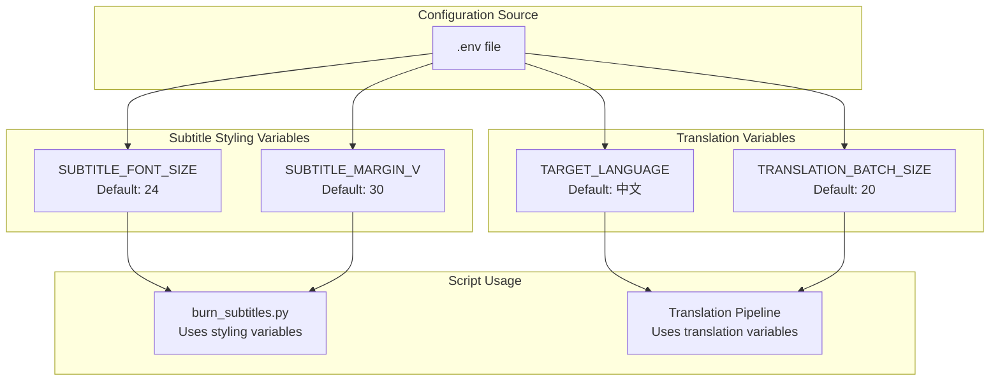
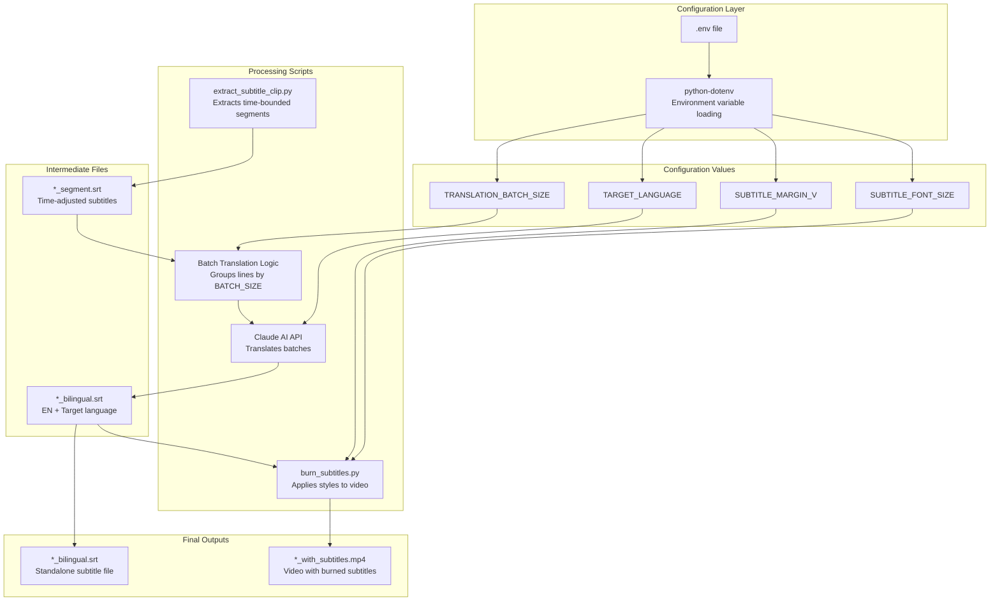
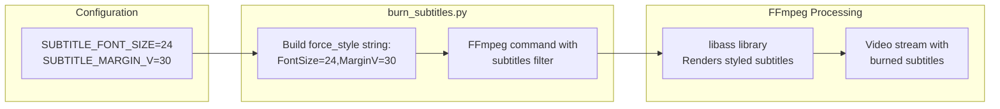
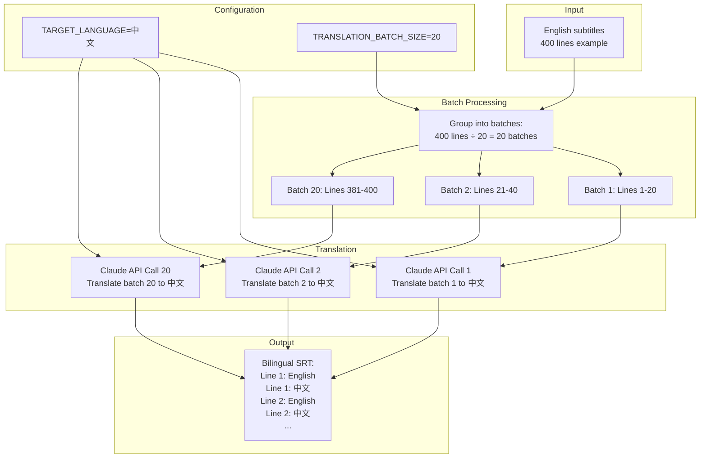
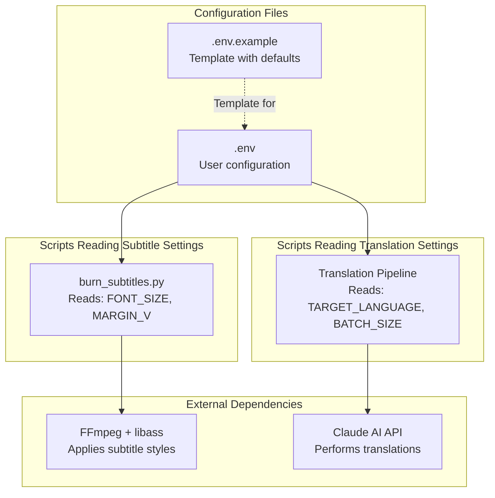

<!-- source: DeepWiki mcp.deepwiki.com · repo op7418/Youtube-clipper-skill · page 6.3 Subtitle and Translation Settings · fetched 2026-10-26 -->

# Subtitle and Translation Settings

<details>
<summary>Relevant source files</summary>

The following files were used as context for generating this wiki page:

- [.env.example](.env.example)
- [README.md](README.md)
- [README.zh-CN.md](README.zh-CN.md)

</details>


This document covers the configuration variables related to subtitle rendering and translation in the YouTube Clipper Skill. These settings control both the visual appearance of burned subtitles and the efficiency of the translation pipeline.

For general environment variable setup and structure, see [Environment Variables Reference](#6.1). For advanced details on the batch translation algorithm, see [Batch Translation Optimization](#7.1). For the structure of generated bilingual subtitle files, see [Bilingual Subtitle Format](#7.3).

---

## Configuration Variables Overview

The subtitle and translation settings are defined in the `.env` file and control two distinct aspects of the system:

1. **Subtitle Styling** - Visual appearance when subtitles are burned into video files
2. **Translation Processing** - Target language and batch optimization parameters



**Sources**: [.env.example:14-40](), [README.md:143-147]()

---

## Subtitle Styling Settings

These variables control how subtitles appear when burned into video files using FFmpeg's `subtitles` filter.

### SUBTITLE_FONT_SIZE

Defines the font size in points for rendered subtitles.

| Property | Value |
|----------|-------|
| Variable Name | `SUBTITLE_FONT_SIZE` |
| Default Value | `24` |
| Valid Range | `8` to `72` (practical range) |
| Used By | `burn_subtitles.py` |
| FFmpeg Mapping | `force_style='FontSize=<value>'` parameter |

**Example Configuration**:
```bash
# Small subtitles for high-resolution videos
SUBTITLE_FONT_SIZE=18

# Default size for 1080p videos
SUBTITLE_FONT_SIZE=24

# Large subtitles for accessibility
SUBTITLE_FONT_SIZE=32
```

**Sources**: [.env.example:14-15]()

### SUBTITLE_MARGIN_V

Defines the vertical margin in pixels from the bottom of the video frame.

| Property | Value |
|----------|-------|
| Variable Name | `SUBTITLE_MARGIN_V` |
| Default Value | `30` |
| Valid Range | `0` to `100` (practical range) |
| Used By | `burn_subtitles.py` |
| FFmpeg Mapping | `force_style='MarginV=<value>'` parameter |

**Example Configuration**:
```bash
# Subtitles closer to bottom edge
SUBTITLE_MARGIN_V=15

# Default positioning
SUBTITLE_MARGIN_V=30

# Subtitles higher up (avoid overlap with video content)
SUBTITLE_MARGIN_V=60
```

**Usage Note**: The margin is measured from the bottom of the frame upward. Larger values move subtitles higher on screen.

**Sources**: [.env.example:16]()

---

## Translation Settings

These variables control the translation pipeline that converts English subtitles to the target language using Claude AI.

### TARGET_LANGUAGE

Specifies the target language for subtitle translation.

| Property | Value |
|----------|-------|
| Variable Name | `TARGET_LANGUAGE` |
| Default Value | `中文` (Chinese) |
| Valid Values | Any language name in the format Claude AI understands |
| Used By | Translation pipeline in batch processing |
| Common Values | `中文`, `日语`, `韩语`, `西班牙语`, `法语`, `德语` |

**Example Configuration**:
```bash
# Chinese (default)
TARGET_LANGUAGE=中文

# Japanese
TARGET_LANGUAGE=日语

# Korean
TARGET_LANGUAGE=韩语

# Spanish
TARGET_LANGUAGE=西班牙语
```

**Implementation Detail**: The language name is passed directly to Claude AI's translation prompt. The system does not validate language names; Claude AI interprets the request.

**Sources**: [.env.example:37-39](), [README.md:147]()

### TRANSLATION_BATCH_SIZE

Defines how many subtitle lines are grouped together for a single translation API call.

| Property | Value |
|----------|-------|
| Variable Name | `TRANSLATION_BATCH_SIZE` |
| Default Value | `20` |
| Recommended Range | `20` to `25` |
| Used By | Batch translation logic |
| Performance Impact | Reduces API calls by ~95% compared to line-by-line translation |

**Example Configuration**:
```bash
# Conservative batching (more API calls, safer)
TRANSLATION_BATCH_SIZE=15

# Default batching (recommended)
TRANSLATION_BATCH_SIZE=20

# Aggressive batching (fewer API calls)
TRANSLATION_BATCH_SIZE=25
```

**Performance Trade-offs**:

| Batch Size | API Calls (400 lines) | Speed | Context Quality |
|------------|----------------------|-------|-----------------|
| 1 (no batching) | 400 | Baseline (slowest) | N/A |
| 15 | ~27 | ~15x faster | Good |
| 20 | ~20 | ~20x faster | Excellent |
| 25 | ~16 | ~25x faster | Very good |
| 50+ | <10 | Fastest | May lose context |

**Warning**: Batch sizes above 30 may cause:
- Context overflow in API requests
- Reduced translation quality for context-dependent phrases
- Potential API timeouts

**Sources**: [.env.example:33-35](), [README.md:144]()

---

## Configuration Flow Through the System

This diagram shows how subtitle and translation settings flow from the `.env` file through the processing pipeline to final outputs.



**Sources**: [.env.example:1-86](), [README.md:113-123]()

---

## How Styling Settings Are Applied

The `SUBTITLE_FONT_SIZE` and `SUBTITLE_MARGIN_V` variables are converted into FFmpeg's ASS subtitle styling format when burning subtitles.



**FFmpeg Command Structure**:
```
ffmpeg -i input.mp4 -vf "subtitles=file.srt:force_style='FontSize=24,MarginV=30'" output.mp4
```

The `force_style` parameter overrides the default subtitle styling with custom values from the configuration.

**Sources**: [.env.example:14-16]()

---

## How Translation Settings Are Applied

The `TARGET_LANGUAGE` and `TRANSLATION_BATCH_SIZE` variables control the batch translation pipeline that converts English subtitles to bilingual format.



**Optimization Impact**: Without batching (batch size = 1), the same 400-line subtitle would require 400 API calls instead of 20, increasing processing time by ~20x and API costs proportionally.

**Sources**: [README.md:211-216]()

---

## Common Configuration Patterns

### Pattern 1: High-Quality Output for Social Media

Optimized for professional appearance with readable subtitles.

```bash
# Larger font for mobile viewing
SUBTITLE_FONT_SIZE=28

# Higher margin to avoid UI elements
SUBTITLE_MARGIN_V=50

# Chinese for target audience
TARGET_LANGUAGE=中文

# Standard batching
TRANSLATION_BATCH_SIZE=20
```

**Use Case**: Creating clips for Xiaohongshu, Douyin, or WeChat

**Sources**: [README.md:14-20]()

### Pattern 2: Fast Processing for Long Videos

Optimized for speed when processing lengthy content.

```bash
# Standard font
SUBTITLE_FONT_SIZE=24

# Standard margin
SUBTITLE_MARGIN_V=30

# Target language
TARGET_LANGUAGE=中文

# Aggressive batching for speed
TRANSLATION_BATCH_SIZE=25
```

**Use Case**: Processing multi-hour lectures or interviews where speed is prioritized

**Sources**: [.env.example:33-35]()

### Pattern 3: Multi-Language Support

Configuration for creating outputs in multiple languages (requires manual .env updates between runs).

```bash
# Standard styling
SUBTITLE_FONT_SIZE=24
SUBTITLE_MARGIN_V=30

# Change this between runs for different languages
TARGET_LANGUAGE=日语  # First run: Japanese
# TARGET_LANGUAGE=韩语  # Second run: Korean
# TARGET_LANGUAGE=西班牙语  # Third run: Spanish

# Standard batching
TRANSLATION_BATCH_SIZE=20
```

**Use Case**: Creating the same video clip with subtitles in different languages for international audiences

**Sources**: [.env.example:37-39]()

---

## Variable Defaults and Fallback Behavior

When subtitle and translation variables are not explicitly set in `.env`, the system uses the following default values:

| Variable | Default Value | Fallback Source |
|----------|---------------|-----------------|
| `SUBTITLE_FONT_SIZE` | `24` | Hard-coded in `burn_subtitles.py` |
| `SUBTITLE_MARGIN_V` | `30` | Hard-coded in `burn_subtitles.py` |
| `TARGET_LANGUAGE` | `中文` | Hard-coded in translation logic |
| `TRANSLATION_BATCH_SIZE` | `20` | Hard-coded in batch processing |

**Behavior**: The system runs successfully even without a `.env` file, using these defaults. This ensures immediate usability while allowing customization for advanced users.

**Sources**: [.env.example:1-86]()

---

## Validation and Error Handling

### Font Size Validation

The system does not validate `SUBTITLE_FONT_SIZE` values at the configuration level. Invalid values are caught by FFmpeg during subtitle burning:

- **Too small** (< 8): Subtitles may be invisible
- **Too large** (> 100): May extend beyond frame boundaries
- **Non-numeric**: FFmpeg error, subtitle burning fails

### Margin Validation

Similar to font size, `SUBTITLE_MARGIN_V` validation occurs at FFmpeg execution:

- **Negative values**: FFmpeg error
- **Extremely large** (> frame height): Subtitles positioned off-screen
- **Non-numeric**: FFmpeg error

### Target Language Validation

`TARGET_LANGUAGE` is not validated. Claude AI interprets the value:

- **Valid language name**: Translates correctly
- **Invalid/typo**: Claude AI may ask for clarification or default to English
- **Empty**: May default to English or fail translation

### Batch Size Validation

`TRANSLATION_BATCH_SIZE` impacts only performance and quality:

- **Too small** (< 10): Excessive API calls, slow processing
- **Too large** (> 30): Context overflow, quality degradation
- **Non-numeric**: Runtime error during batch grouping

**Sources**: [.env.example:1-86]()

---

## Integration Points Summary



**Key Integration Points**:
1. **burn_subtitles.py** - Reads styling variables, constructs FFmpeg commands
2. **Translation Pipeline** - Reads language/batch settings, calls Claude AI
3. **FFmpeg** - Renders subtitles with configured styles via libass
4. **Claude AI** - Translates batches to target language

**Sources**: [.env.example:1-86](), [README.md:127-153]()

---

