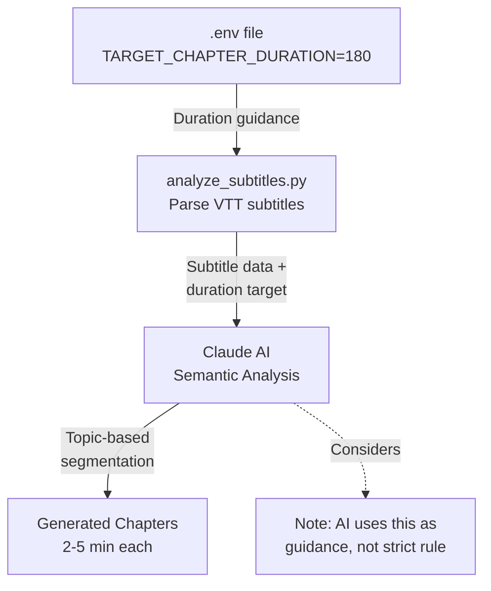
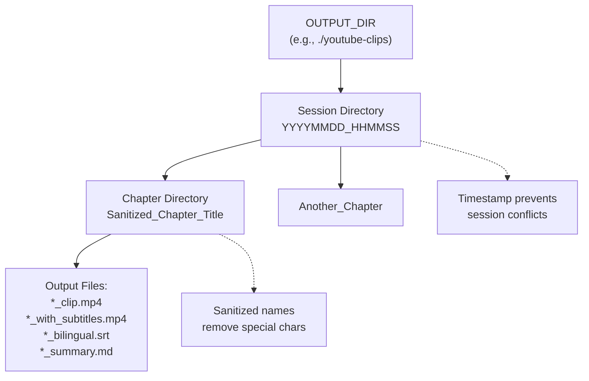
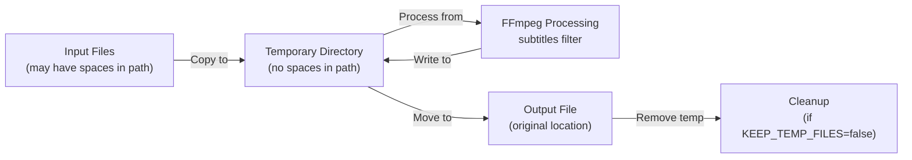
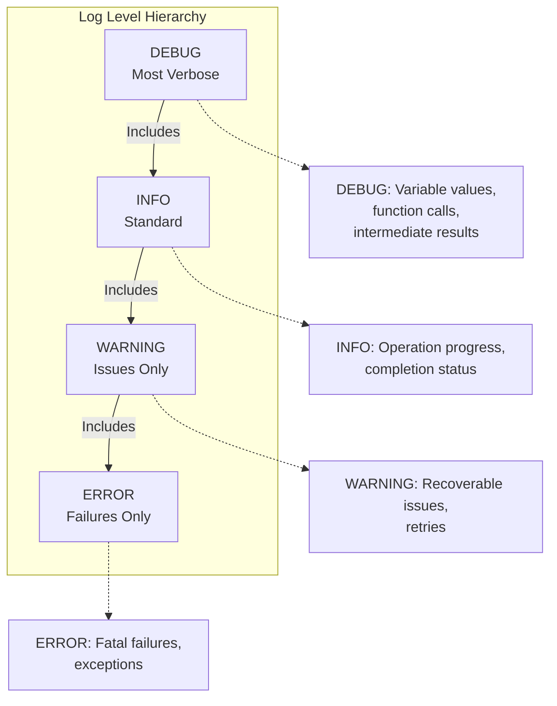
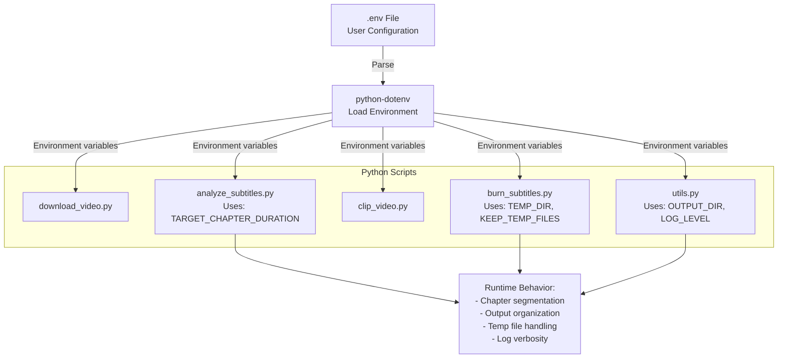

<!-- source: DeepWiki mcp.deepwiki.com · repo op7418/Youtube-clipper-skill · page 6.4 Processing and Output Settings · fetched 2026-10-26 -->

# Processing and Output Settings

<details>
<summary>Relevant source files</summary>

The following files were used as context for generating this wiki page:

- [.env.example](.env.example)
- [README.md](README.md)
- [SKILL.md](SKILL.md)

</details>


This document covers configuration settings that control chapter processing behavior, output file organization, temporary file management, and logging verbosity. For video quality and download settings, see [6.2](#6.2). For subtitle and translation settings, see [6.3](#6.3).

## Overview

Processing and output settings control how the system generates chapters, organizes output files, manages temporary data, and logs operations. These settings are defined in the `.env` file and affect the behavior of multiple scripts throughout the processing pipeline.

**Key Configuration Variables:**
- `TARGET_CHAPTER_DURATION` - Guides AI chapter segmentation
- `OUTPUT_DIR` - Determines output file location
- `TEMP_DIR` - Temporary storage for path workarounds
- `KEEP_TEMP_FILES` - Controls cleanup behavior
- `LOG_LEVEL` - Controls logging verbosity

Sources: [.env.example:1-86](), [README.md:129-154]()

---

## Target Chapter Duration

### Configuration

The `TARGET_CHAPTER_DURATION` setting guides the AI semantic analysis to generate chapters of approximately the specified length.

| Variable | Type | Default | Range | Purpose |
|----------|------|---------|-------|---------|
| `TARGET_CHAPTER_DURATION` | integer | `180` | `120-300` | Target chapter length in seconds |

**Recommended Values:**
- `180` (3 minutes) - Balanced for social media clips
- `240` (4 minutes) - Longer-form content
- `300` (5 minutes) - Maximum recommended length

Sources: [.env.example:42-47](), [README.md:149-150]()

### Usage in Chapter Analysis

The `analyze_subtitles.py` script uses this value as guidance when preparing data for AI analysis. The actual chapter boundaries are determined semantically by Claude AI based on content structure, not mechanically by time.



**Diagram: Chapter Duration Configuration Flow**

The duration value informs the AI's decision-making but does not override semantic boundaries. If a natural topic transition occurs at 4 minutes, the AI will create a chapter boundary there rather than forcing a 3-minute split mid-topic.

Sources: [SKILL.md:96-144]()

### Effect on Chapter Generation

**Example: 25-minute video with different duration targets**

| Target Duration | Expected Chapters | Actual Behavior |
|-----------------|-------------------|-----------------|
| `120` (2 min) | 12-13 chapters | 10-15 chapters (adjusted for topic boundaries) |
| `180` (3 min) | 8-9 chapters | 7-10 chapters (semantic optimization) |
| `300` (5 min) | 5 chapters | 5-7 chapters (broader topics) |

The AI balances the target duration with content semantics:
- Shorter durations: More granular topic splitting
- Longer durations: Broader topic grouping
- Always: Natural transition points respected

Sources: [SKILL.md:122-127](), [README.md:196-209]()

---

## Output Directory Configuration

### OUTPUT_DIR Setting

The `OUTPUT_DIR` variable specifies where processed files are written.

| Variable | Type | Default | Example Values |
|----------|------|---------|----------------|
| `OUTPUT_DIR` | string | `./youtube-clips` | `~/Videos/clips`<br/>`/tmp/output` |

**Path Resolution:**
- Relative paths: Resolved from current working directory
- Absolute paths: Used as-is
- Tilde expansion: `~` expands to user home directory

Sources: [.env.example:20-23](), [README.md:137-138]()

### Output Directory Structure

The system creates a three-level hierarchy to organize output files:



**Diagram: Output Directory Hierarchy**

**Directory Creation Example:**
```
./youtube-clips/
└── 20260122_143022/           # Session timestamp
    ├── AGI_Definition/          # Chapter 1
    │   ├── AGI_Definition_clip.mp4
    │   ├── AGI_Definition_with_subtitles.mp4
    │   ├── AGI_Definition_bilingual.srt
    │   └── AGI_Definition_summary.md
    └── China_AI_Landscape/      # Chapter 2
        ├── China_AI_Landscape_clip.mp4
        └── China_AI_Landscape_bilingual.srt
```

Sources: [SKILL.md:239-262](), [README.md:112-124]()

### File Naming Convention

Chapter directory names are derived from chapter titles with sanitization:

**Sanitization Rules:**
1. Remove special characters: `/ \ : * ? " < > |`
2. Replace spaces with underscores
3. Limit length to 100 characters
4. Preserve alphanumeric and underscore characters

**Sanitization Examples:**

| Original Chapter Title | Sanitized Directory Name |
|------------------------|--------------------------|
| `"AGI: A New Era"` | `AGI_A_New_Era` |
| `"China's AI Gap"` | `Chinas_AI_Gap` |
| `"Impact of Chip Bans (2023)"` | `Impact_of_Chip_Bans_2023` |

This sanitization occurs in utility functions used across multiple scripts.

Sources: [SKILL.md:347-350](), [README.md:270-277]()

---

## Temporary File Management

### Purpose of Temporary Files

The system uses temporary files to work around FFmpeg's inability to handle file paths containing spaces when using the `subtitles` filter. This is a critical workaround implemented in `burn_subtitles.py`.



**Diagram: Temporary File Lifecycle**

Sources: [SKILL.md:285-291]()

### TEMP_DIR Configuration

| Variable | Type | Default | Behavior |
|----------|------|---------|----------|
| `TEMP_DIR` | string | (empty) | Empty: Use system default temp directory<br/>Specified: Use provided path |

**System Default Temporary Directories:**
- macOS/Linux: `/tmp/` or `$TMPDIR`
- Windows: `%TEMP%` directory

**Custom TEMP_DIR Usage:**
```bash
# Example 1: Use specific directory
TEMP_DIR=/var/tmp/youtube-clipper

# Example 2: Use user temp space
TEMP_DIR=~/.cache/youtube-clipper
```

Sources: [.env.example:65-67]()

### KEEP_TEMP_FILES Configuration

| Variable | Type | Default | Values |
|----------|------|---------|--------|
| `KEEP_TEMP_FILES` | boolean | `false` | `true` - Keep temporary files<br/>`false` - Delete after processing |

**When to Use:**
- `false` (default): Normal operation, saves disk space
- `true`: Debugging subtitle burning issues, inspecting intermediate files

**Files Created in Temporary Directory:**
- Copied video file (during subtitle burning)
- Copied subtitle file (during subtitle burning)
- Intermediate output file (before moving to final location)

Sources: [.env.example:69-71]()

### Implementation in burn_subtitles.py

The temporary file mechanism is implemented in the subtitle burning script to avoid FFmpeg path parsing issues:

**Process Flow:**
1. Check if `TEMP_DIR` is configured, otherwise use system temp
2. Create unique temporary directory
3. Copy input video and subtitle files to temp directory
4. Execute FFmpeg using temp directory paths
5. Move output file to final destination
6. Clean up temp directory (unless `KEEP_TEMP_FILES=true`)

This workaround is necessary because FFmpeg's `subtitles` filter cannot reliably parse paths with spaces, even when properly escaped or quoted.

Sources: [SKILL.md:205-211](), [SKILL.md:285-291]()

---

## Logging Configuration

### LOG_LEVEL Setting

The `LOG_LEVEL` variable controls the verbosity of logging output across all Python scripts.

| Variable | Type | Default | Valid Values |
|----------|------|---------|--------------|
| `LOG_LEVEL` | string | `INFO` | `DEBUG`, `INFO`, `WARNING`, `ERROR` |

Sources: [.env.example:73-75]()

### Logging Levels Explained



**Diagram: Logging Level Hierarchy**

### Log Output by Level

**DEBUG Level:**
- Function entry/exit
- Variable values during processing
- FFmpeg command construction
- API request/response details
- File operation details

**INFO Level (Default):**
- Processing stage start/completion
- Video download progress
- Chapter generation results
- Translation batch progress
- File creation notifications

**WARNING Level:**
- Subtitle download fallback to auto-generated
- Translation retry attempts
- Temporary file cleanup issues
- Non-critical configuration warnings

**ERROR Level:**
- Missing dependencies
- FFmpeg execution failures
- API call failures (after retries)
- File I/O errors
- Invalid configuration values

Sources: [.env.example:73-75]()

### Logging Configuration Usage

**Example Configurations:**

```bash
# Development/Debugging
LOG_LEVEL=DEBUG

# Production/Normal Use
LOG_LEVEL=INFO

# Minimal Output
LOG_LEVEL=WARNING
```

**Effect on Operations:**

| Operation | DEBUG Output | INFO Output | WARNING Output |
|-----------|--------------|-------------|----------------|
| Video Download | yt-dlp command, format selection | Download progress, completion | Errors only |
| Chapter Analysis | Full subtitle text, AI prompts | Chapter count, titles | Failures only |
| Subtitle Burning | FFmpeg command, temp paths | Start/completion | FFmpeg errors |
| Translation | Each batch, API calls | Batch progress percentage | Retry attempts |

The logging system uses Python's standard `logging` module, configured through `python-dotenv` loading of the `.env` file.

Sources: [.env.example:73-75]()

---

## Configuration Integration

### How Settings Flow Through the System



**Diagram: Configuration Variable Flow from .env to Scripts**

Sources: [.env.example:1-86](), [README.md:127-154]()

### Configuration Defaults

When environment variables are not set, the system uses built-in defaults:

| Setting | Default Value | Fallback Behavior |
|---------|---------------|-------------------|
| `TARGET_CHAPTER_DURATION` | `180` | Used if not specified in `.env` |
| `OUTPUT_DIR` | `./youtube-clips` | Creates in current directory |
| `TEMP_DIR` | (empty) | Uses system temp directory |
| `KEEP_TEMP_FILES` | `false` | Cleans up after processing |
| `LOG_LEVEL` | `INFO` | Standard verbosity |

These defaults ensure the system works without explicit configuration while allowing customization for advanced use cases.

Sources: [.env.example:1-86](), [README.md:127-154]()

---

## Practical Configuration Examples

### Basic Configuration

Minimal `.env` for typical usage:

```bash
# Standard settings - most users don't need to change these
TARGET_CHAPTER_DURATION=180
OUTPUT_DIR=./youtube-clips
LOG_LEVEL=INFO
```

### Development/Debugging Configuration

For troubleshooting issues:

```bash
# Maximum verbosity and temp file preservation
TARGET_CHAPTER_DURATION=180
OUTPUT_DIR=./youtube-clips
TEMP_DIR=/tmp/youtube-clipper-debug
KEEP_TEMP_FILES=true
LOG_LEVEL=DEBUG
```

### Production Configuration

For automated processing:

```bash
# Specific output location, minimal logging
TARGET_CHAPTER_DURATION=240
OUTPUT_DIR=/var/www/clips
TEMP_DIR=/fast-ssd/temp
KEEP_TEMP_FILES=false
LOG_LEVEL=WARNING
```

### Short-Form Content Configuration

Optimized for social media:

```bash
# Shorter chapters for TikTok/Reels/Shorts
TARGET_CHAPTER_DURATION=120
OUTPUT_DIR=~/Videos/social-media
LOG_LEVEL=INFO
```

Sources: [.env.example:1-86](), [README.md:127-154]()

---

## Summary Table

| Configuration | Controls | Used By | Impact |
|---------------|----------|---------|--------|
| `TARGET_CHAPTER_DURATION` | AI chapter length guidance | `analyze_subtitles.py` | Chapter granularity (2-5 min) |
| `OUTPUT_DIR` | Output file location | All scripts via `utils.py` | Where files are saved |
| `TEMP_DIR` | Temporary file location | `burn_subtitles.py` | Workaround for path issues |
| `KEEP_TEMP_FILES` | Cleanup behavior | `burn_subtitles.py` | Debugging capability |
| `LOG_LEVEL` | Logging verbosity | All scripts | Console output detail |

Sources: [.env.example:1-86](), [SKILL.md:1-374]()

---

