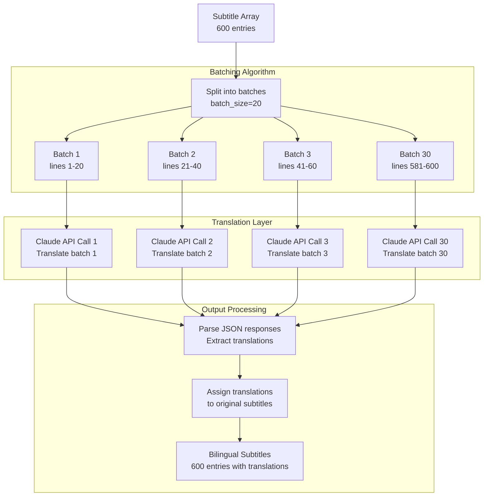
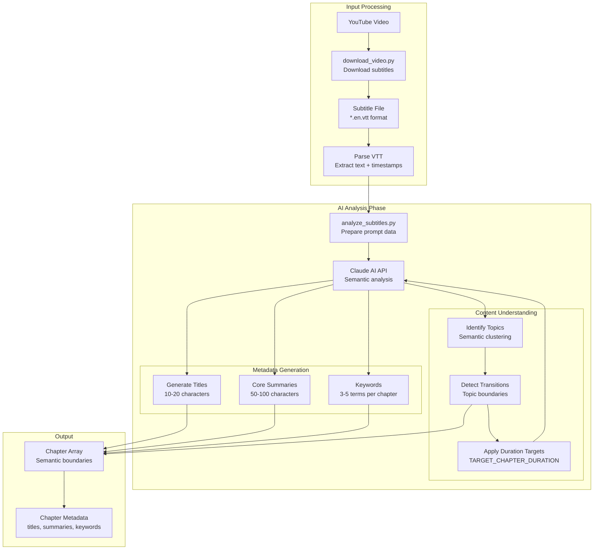
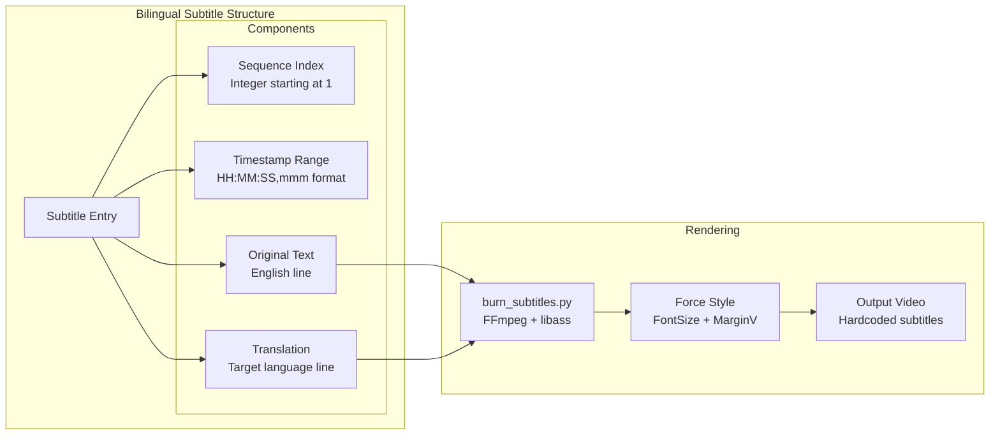
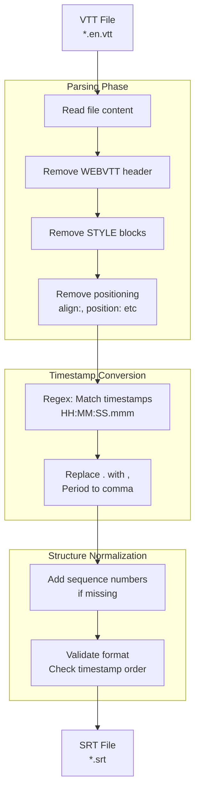
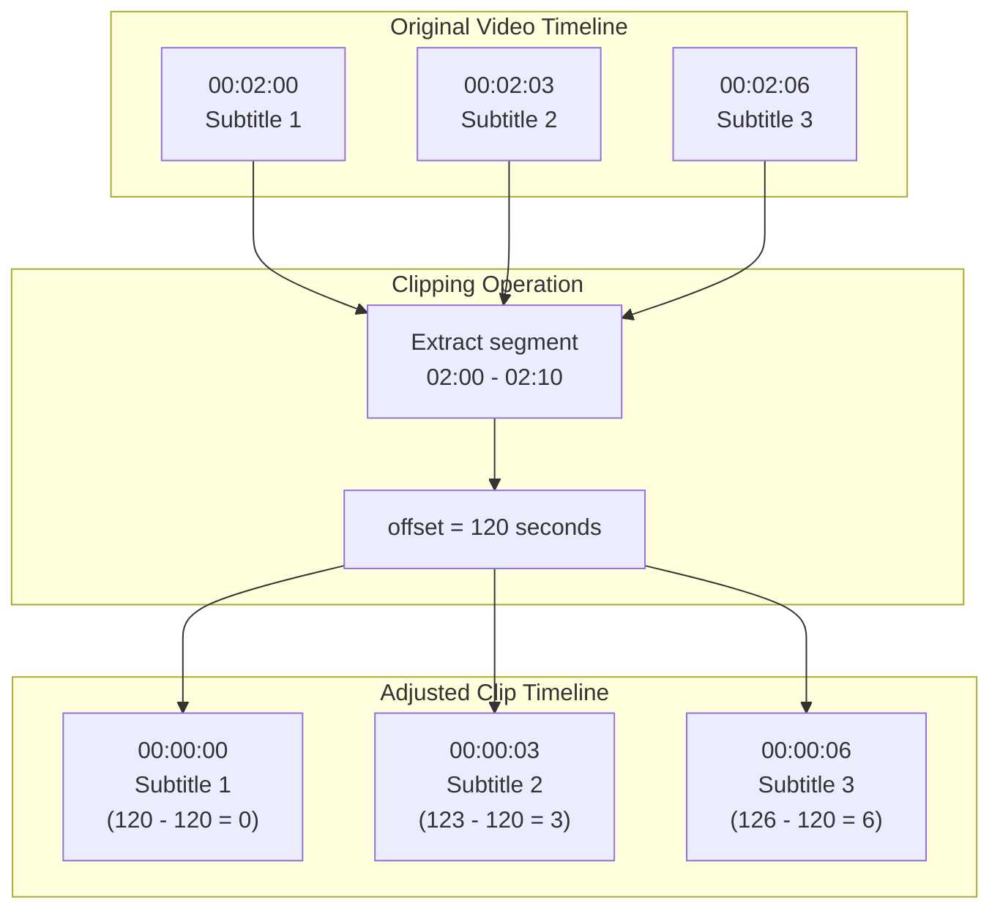

<!-- source: DeepWiki mcp.deepwiki.com · repo op7418/Youtube-clipper-skill · page 7 Advanced Topics · fetched 2026-10-26 -->

# Advanced Topics

<details>
<summary>Relevant source files</summary>

The following files were used as context for generating this wiki page:

- [README.md](README.md)
- [README.zh-CN.md](README.zh-CN.md)
- [TECHNICAL_NOTES.md](TECHNICAL_NOTES.md)

</details>


This page documents the advanced features and optimization strategies that distinguish the YouTube Clipper Skill from simpler video processing tools. These capabilities leverage AI for intelligent content analysis and employ algorithmic optimizations to reduce computational overhead and API costs.

For basic usage patterns, see [Basic Usage](#2.2). For configuration of advanced features, see [Configuration](#6). For the underlying architecture, see [Architecture](#3).

---

## Batch Translation Optimization

### Problem Statement

Naive subtitle translation processes each subtitle line individually through separate API calls. For a typical 30-minute video with 600 subtitle entries, this results in 600 API requests, leading to:

- Slow processing time (serial API calls)
- High API costs (per-request overhead)
- Rate limiting issues
- Poor translation consistency (no shared context)

### Batching Strategy

The system groups 20-25 consecutive subtitle lines into a single batch and translates them in one API call. This achieves a **95% reduction in API calls** (600 calls → 30 calls).

**Batch Size Selection**: The 20-25 line range is empirically optimized:
- **< 20 lines**: Insufficient API call reduction
- **20-25 lines**: Optimal balance of efficiency and quality
- **> 30 lines**: Token limits and reduced translation quality



**Sources**: [README.md:211-216](), [TECHNICAL_NOTES.md:261-305]()

### Implementation Details

The batching algorithm groups consecutive subtitles while preserving:
1. **Context continuity**: Batches maintain temporal proximity
2. **Order preservation**: Translation order matches input order
3. **Boundary integrity**: No subtitle is split across batches

Configuration parameter:
- `TRANSLATION_BATCH_SIZE`: Controls batch size (default: 20)

Referenced in: [.env.example]() configuration file

### Translation Quality Assurance

The batch translation prompt instructs Claude to:
- Translate each line independently (maintain line-level granularity)
- Preserve context across the batch
- Return a JSON array where index N contains the translation of input line N
- Maintain consistent terminology throughout the batch

**Sources**: [TECHNICAL_NOTES.md:273-304]()

---

## AI Semantic Analysis

### Semantic Chapter Generation

Unlike mechanical time-based video splitters that divide content at arbitrary intervals, this system uses Claude AI to understand content semantics and identify natural topic boundaries.



**Sources**: [README.md:192-209](), [scripts/analyze_subtitles.py]()

### Analysis Process

The semantic analysis pipeline operates in phases:

#### 1. Content Understanding
Claude analyzes the complete subtitle transcript to:
- Identify distinct topics and themes
- Understand narrative structure
- Recognize speaker transitions (if applicable)
- Detect conceptual clusters

#### 2. Boundary Detection
Topic boundaries are identified by:
- Semantic discontinuities (topic shifts)
- Natural pauses in dialogue
- Transition phrases ("moving on to...", "next we'll discuss...")
- Context switches

#### 3. Duration Optimization
Chapters are constrained by:
- `TARGET_CHAPTER_DURATION`: 180-300 seconds (configurable)
- Minimum viable duration (prevents excessive fragmentation)
- Complete thought boundaries (doesn't truncate mid-topic)

**Example Output**:
```
Mechanical splitting (30 min video → 6 chapters of 5 minutes):
[00:00-05:00], [05:00-10:00], [10:00-15:00], ...
❌ Topic may be cut mid-sentence

AI semantic analysis (30 min video → 8-12 variable-length chapters):
[00:00-03:15] "AGI as exponential curve"
[03:15-07:30] "China's AI development gap"  
[07:30-11:45] "Impact of chip restrictions"
✅ Each chapter is a complete topic
```

**Sources**: [README.md:196-209](), [TECHNICAL_NOTES.md:1-5]()

### Chapter Metadata Structure

Each generated chapter contains:

| Field | Type | Description | Example |
|-------|------|-------------|---------|
| `title` | string | Concise chapter title (10-20 chars) | "AGI Definition" |
| `start_time` | float | Start timestamp in seconds | 0.0 |
| `end_time` | float | End timestamp in seconds | 195.5 |
| `summary` | string | Core content summary (50-100 chars) | "Discussion of AGI as continuous exponential curve" |
| `keywords` | array | Key terms (3-5 items) | ["AGI", "exponential", "timeline"] |

**Sources**: [scripts/analyze_subtitles.py]()

---

## Bilingual Subtitle Format

### Structure

The system generates bilingual subtitle files where each subtitle entry contains both the original English text and the translated target language (default: Chinese) on separate lines.

**Standard SRT Format**:
```srt
1
00:00:00,000 --> 00:00:03,500
This is the English subtitle
这是中文字幕

2
00:00:03,500 --> 00:00:07,000
Another English line
另一行中文
```



**Sources**: [README.md:218-232](), [TECHNICAL_NOTES.md:356-388]()

### File Generation

Bilingual subtitle files are created by:
1. Extracting subtitle segment from original VTT file ([scripts/extract_subtitle_clip.py]())
2. Converting VTT format to SRT format
3. Adjusting timestamps relative to clip start time
4. Batch translating English lines
5. Interleaving English and translated lines in SRT entries

Output location: `./youtube-clips/<timestamp>/<chapter_name>/<chapter_name>_bilingual.srt`

**Sources**: [scripts/extract_subtitle_clip.py](), [README.md:115-123]()

### Subtitle Styling and Burning

When subtitles are burned into video, FFmpeg applies styling through the `libass` library:

**Style Parameters**:
| Parameter | Default Value | Purpose |
|-----------|---------------|---------|
| `FontSize` | 24 | Text size (optimized for 1080p) |
| `MarginV` | 30 | Bottom margin in pixels |
| `Font` | System default | Font family |
| `Color` | White (`&HFFFFFF`) | Text color |
| `OutlineColor` | Black (`&H000000`) | Outline/shadow color |

**Resolution-Specific Recommendations**:
| Resolution | FontSize | MarginV |
|------------|----------|---------|
| 720p | 20 | 20 |
| 1080p | 24 | 30 |
| 4K (2160p) | 48 | 60 |

Configuration: Set via `SUBTITLE_FONT_SIZE` and `SUBTITLE_MARGIN_V` in [.env]()

**FFmpeg Command Structure**:
```bash
ffmpeg -i input.mp4 -vf "subtitles=subtitle.srt:force_style='FontSize=24,MarginV=30'" output.mp4
```

Implementation: [scripts/burn_subtitles.py]()

**Sources**: [TECHNICAL_NOTES.md:356-388](), [scripts/burn_subtitles.py]()

---

## Subtitle Format Conversion

### VTT to SRT Differences

YouTube provides subtitles in WebVTT (`.vtt`) format, which must be converted to SubRip (`.srt`) format for broader compatibility and FFmpeg subtitle burning.

**Format Comparison**:

| Feature | VTT | SRT |
|---------|-----|-----|
| Header | `WEBVTT` required | No header |
| Sequence numbers | Optional | Required (1, 2, 3...) |
| Timestamp separator | Period (`.`) | Comma (`,`) |
| Styling support | Yes (CSS-like) | No |
| Positioning | Yes (align, position) | No |
| Cue settings | Supported | Not supported |

**Example Comparison**:
```
VTT:
WEBVTT

00:00:00.000 --> 00:00:03.500 align:start position:0%
This is a subtitle

SRT:
1
00:00:00,000 --> 00:00:03,500
This is a subtitle
```

**Sources**: [TECHNICAL_NOTES.md:166-213]()

### Conversion Algorithm



**Sources**: [TECHNICAL_NOTES.md:186-206]()

### Implementation Details

The conversion process is implemented in [scripts/extract_subtitle_clip.py]() and uses the following transformations:

#### 1. Header Removal
Strip the `WEBVTT` header and any metadata blocks:
```python
content = content.replace('WEBVTT\n\n', '')
content = re.sub(r'STYLE.*?-->', '', content, flags=re.DOTALL)
```

#### 2. Timestamp Format Conversion
Replace period with comma in timestamps (critical for SRT compatibility):
```python
content = re.sub(
    r'(\d{2}:\d{2}:\d{2})\.(\d{3})',  # Match HH:MM:SS.mmm
    r'\1,\2',                           # Replace with HH:MM:SS,mmm
    content
)
```

#### 3. Positioning and Styling Removal
VTT cue settings are removed as they are not supported in SRT:
- `align:start`, `align:middle`, `align:end`
- `position:X%`
- `line:X%`
- `size:X%`

#### 4. Sequence Number Generation
If VTT entries lack sequence numbers, generate them sequentially starting from 1.

**Sources**: [scripts/extract_subtitle_clip.py](), [TECHNICAL_NOTES.md:188-206]()

### Timestamp Adjustment for Clips

When extracting a subtitle segment for a video clip, timestamps must be adjusted relative to the clip's start time:



**Adjustment Formula**:
```python
adjusted_time = original_time_seconds - clip_start_time_seconds
adjusted_time = max(0.0, adjusted_time)  # Ensure non-negative
```

**Boundary Handling**:
1. **Subtitle fully within range**: Include with adjusted timestamps
2. **Subtitle fully outside range**: Exclude from output
3. **Subtitle crosses start boundary**: Adjust start to 0.0
4. **Subtitle crosses end boundary**: Adjust end to clip duration

Implementation: [scripts/extract_subtitle_clip.py](), utility functions in [scripts/utils.py]()

**Sources**: [TECHNICAL_NOTES.md:215-258](), [scripts/extract_subtitle_clip.py]()

---

## Integration with Core Scripts

The advanced features documented on this page are implemented across multiple core scripts:

| Feature | Primary Script | Supporting Scripts |
|---------|----------------|-------------------|
| Batch Translation | [scripts/analyze_subtitles.py]() | [scripts/utils.py]() |
| Semantic Analysis | [scripts/analyze_subtitles.py]() | None |
| Bilingual Formatting | [scripts/extract_subtitle_clip.py]() | [scripts/utils.py]() |
| VTT→SRT Conversion | [scripts/extract_subtitle_clip.py]() | [scripts/utils.py]() |
| Subtitle Burning | [scripts/burn_subtitles.py]() | [scripts/utils.py]() |

For detailed documentation of individual scripts, see [Core Scripts](#4).

**Sources**: [README.md:1-320](), [TECHNICAL_NOTES.md:1-490]()

---

