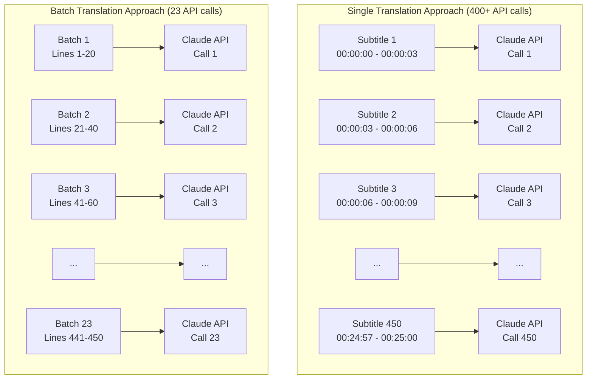
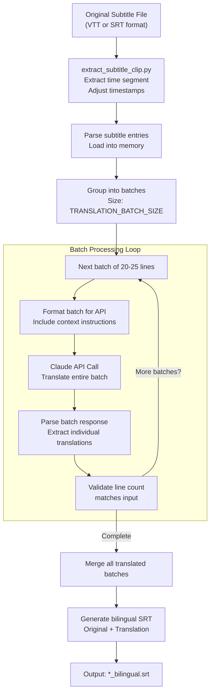
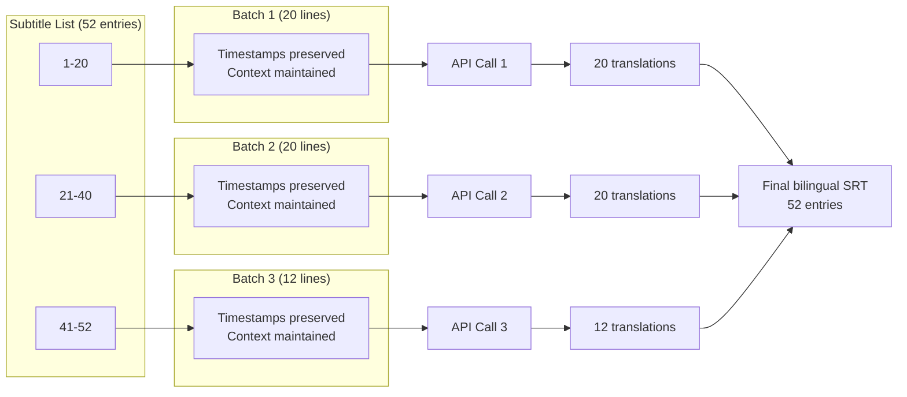
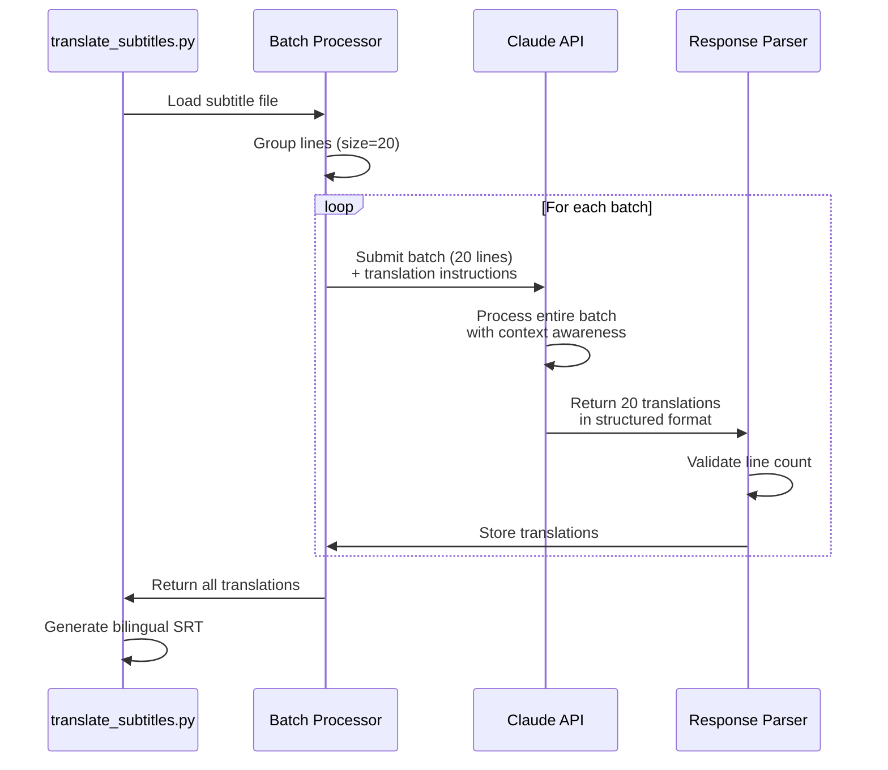
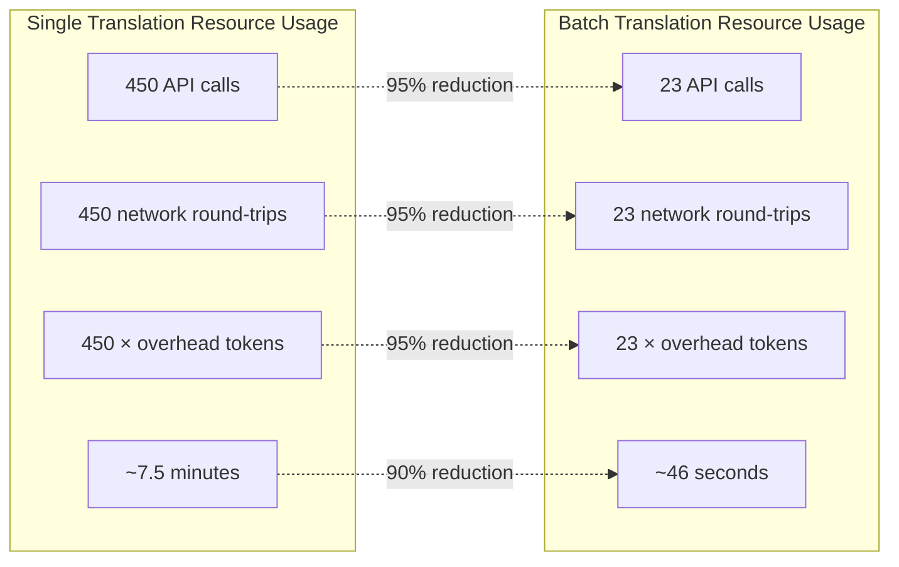
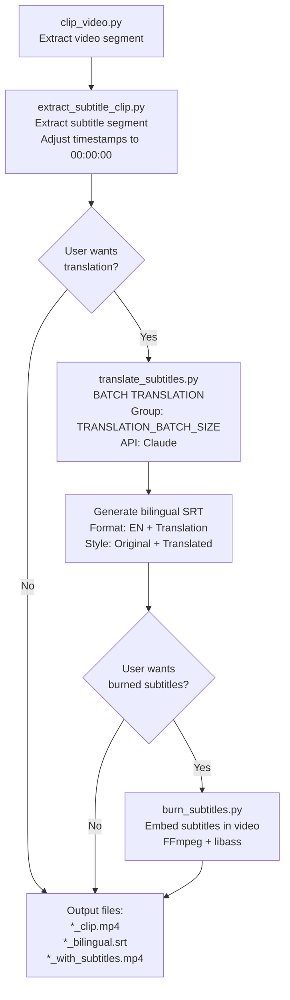
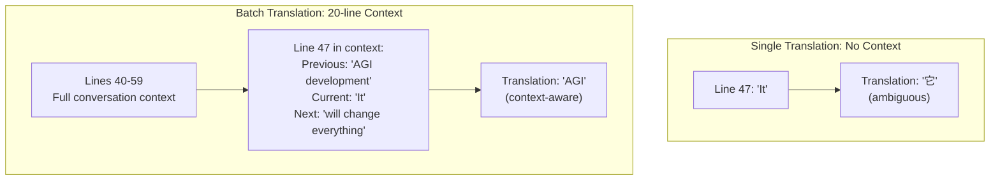

<!-- source: DeepWiki mcp.deepwiki.com · repo op7418/Youtube-clipper-skill · page 7.1 Batch Translation Optimization · fetched 2026-10-26 -->

# Batch Translation Optimization

<details>
<summary>Relevant source files</summary>

The following files were used as context for generating this wiki page:

- [README.md](README.md)
- [README.zh-CN.md](README.zh-CN.md)
- [SKILL.md](SKILL.md)

</details>


This page documents the batch translation optimization strategy that reduces Claude AI API calls by approximately 95% when translating subtitles. This optimization groups 20-25 subtitle lines into a single API request instead of processing them individually, significantly improving translation speed while maintaining context consistency.

For information about the overall AI integration architecture, see [AI Integration](#3.3). For details on the bilingual subtitle output format, see [Bilingual Subtitle Format](#7.3). For configuration options, see [Subtitle and Translation Settings](#6.3).

---

## Problem Statement

When translating subtitle files containing hundreds of entries, making individual API calls for each subtitle line creates several issues:

| Issue | Impact |
|-------|--------|
| **High API Call Volume** | A typical video with 400+ subtitle entries requires 400+ individual API calls |
| **Translation Latency** | Each API call adds network overhead and processing time |
| **Cost Inefficiency** | Claude API pricing is based on tokens; small requests waste the overhead budget |
| **Context Loss** | Individual translations lack awareness of surrounding dialogue |
| **Rate Limiting Risk** | Hundreds of rapid API calls may trigger rate limiting |

**Example Scenario**: A 25-minute video with 450 subtitle entries:
- **Without optimization**: 450 API calls × ~1 second = 7.5 minutes
- **With batch optimization**: 23 API calls × ~2 seconds = 46 seconds

Sources: [README.md:18](), [README.md:213-216](), [SKILL.md:188-193]()

---

## Solution Overview

The batch translation system groups 20-25 consecutive subtitle lines into a single batch and submits them together to the Claude AI API. This approach achieves:

- **95% reduction in API calls** (450 calls → 23 calls)
- **10x faster translation** (7.5 minutes → <1 minute)
- **Better context preservation** (Claude sees surrounding dialogue)
- **Improved translation consistency** (terminology usage stays coherent)

### Batch Translation vs Single Translation



Sources: [README.md:213-216](), [SKILL.md:188-193]()

---

## Configuration

The batch size is controlled by the `TRANSLATION_BATCH_SIZE` environment variable, which determines how many subtitle lines are grouped together per API call.

### Environment Variable

| Variable | Default | Range | Purpose |
|----------|---------|-------|---------|
| `TRANSLATION_BATCH_SIZE` | 20 | 15-25 | Number of subtitle lines per API call |

**Configuration Location**: `~/.claude/skills/youtube-clipper/.env`

```bash
# Translation batch size (20-25 recommended)
TRANSLATION_BATCH_SIZE=20
```

### Recommended Values

| Batch Size | Use Case | Trade-offs |
|------------|----------|------------|
| **15** | Short subtitles (few words per line) | More API calls, lower latency per call |
| **20** | Standard (recommended) | Balanced performance and context |
| **25** | Long subtitles (many words per line) | Fewer API calls, but risks token limit |

**Warning**: Setting the batch size too high (>30) may:
- Exceed Claude API token limits per request
- Reduce translation quality due to information overload
- Increase latency per individual batch

Sources: [README.md:144](), [SKILL.md:188](), [.env.example reference in README.md:153]()

---

## Translation Workflow

The batch translation process integrates into the overall video processing pipeline during the subtitle generation phase.

### End-to-End Batch Translation Flow



Sources: [SKILL.md:185-199]()

---

## Implementation Details

### Batch Grouping Strategy

The system divides subtitle entries into consecutive batches to maintain temporal and semantic coherence:



**Key Principles**:
1. **Sequential grouping**: Batches contain consecutive subtitle entries
2. **Preserve timestamps**: Each line retains its original timing
3. **Maintain order**: Translation order matches input order
4. **Handle remainders**: Last batch may contain fewer than `TRANSLATION_BATCH_SIZE` entries

Sources: [SKILL.md:188-193]()

---

## API Request Format

Each batch is formatted as a single Claude API request with context instructions to ensure high-quality, consistent translations.

### Translation Prompt Structure

The system constructs a prompt that includes:

1. **Translation instructions**: Guidelines for tone, terminology, and style
2. **Context preservation**: Directive to maintain dialogue coherence
3. **Batch entries**: All 20-25 subtitle lines with line numbers
4. **Output format**: Specifications for the response structure

**Translation Strategy** (from SKILL.md):
- Maintain technical terminology accuracy
- Use conversational language (suitable for short-form video)
- Keep translations concise and fluent
- Avoid verbose translations

### Request-Response Cycle



Sources: [SKILL.md:185-193]()

---

## Error Handling and Retry Logic

The batch translation system implements robust error handling to deal with API failures, network issues, and malformed responses.

### Retry Mechanism

| Error Type | Retry Strategy | Max Retries |
|------------|----------------|-------------|
| **Network timeout** | Exponential backoff | 3 |
| **API rate limiting** | Wait and retry | 3 |
| **Malformed response** | Resubmit batch | 2 |
| **Partial translation** | Request missing lines | 1 |

**Retry Behavior**:
- **Attempt 1**: Immediate retry after 2 seconds
- **Attempt 2**: Retry after 5 seconds
- **Attempt 3**: Retry after 10 seconds
- **After 3 failures**: Report error to user, skip batch

### Validation Steps

After each API response, the system validates:

1. **Line count matching**: Response contains same number of translations as input lines
2. **Format correctness**: Each translation is properly structured
3. **Content presence**: No empty or null translations
4. **Encoding validity**: Translations use correct character encoding

**Fallback Strategy**: If a batch consistently fails after retries, the system can fall back to single-line translation for that specific batch to ensure completion.

Sources: [README.md:261-268](), [SKILL.md:333-336]()

---

## Performance Characteristics

### Timing Analysis

For a typical 25-minute video with 450 subtitle entries:

| Metric | Single Translation | Batch Translation (20/batch) | Improvement |
|--------|-------------------|------------------------------|-------------|
| **API Calls** | 450 | 23 | 95.1% reduction |
| **Total Time** | ~450 seconds | ~46 seconds | 10x faster |
| **Network Overhead** | 450 round-trips | 23 round-trips | 19.5x reduction |
| **Context Quality** | Low (isolated lines) | High (surrounding dialogue) | Qualitative improvement |

### API Call Reduction Formula

```
Number of API Calls = ceil(Total Subtitle Lines / TRANSLATION_BATCH_SIZE)

Example with 450 lines and batch size 20:
API Calls = ceil(450 / 20) = ceil(22.5) = 23 calls

Reduction = 1 - (23 / 450) = 0.949 = 94.9% reduction
```

### Resource Usage



Sources: [README.md:213-216]()

---

## Integration with Subtitle Pipeline

The batch translation optimization is invoked as part of the broader subtitle processing workflow.

### Subtitle Processing Stage Integration



**Script Reference**: The translation is invoked via `python3 scripts/translate_subtitles.py <subtitle_path>` as documented in [SKILL.md:185-193]().

Sources: [SKILL.md:168-212]()

---

## Code Entity Mapping

The following table maps conceptual components to their implementation locations:

| Concept | Implementation | File Reference |
|---------|----------------|----------------|
| **Batch size configuration** | `TRANSLATION_BATCH_SIZE` env var | `.env` file |
| **Translation script** | `translate_subtitles.py` | `scripts/translate_subtitles.py` |
| **Subtitle extraction** | `extract_subtitle_clip.py` | `scripts/extract_subtitle_clip.py` |
| **SRT parsing** | `pysrt` library | Python dependency |
| **API invocation** | Claude AI API calls | Within translation script |
| **Bilingual format generation** | SRT file creation with dual lines | Translation script output |

**Workflow Invocation**: The batch translation is triggered during [阶段 5.3 翻译字幕](SKILL.md:185)() of the main processing pipeline.

Sources: [SKILL.md:185-193](), [README.md:144]()

---

## Context Preservation Benefits

Batch translation provides superior context awareness compared to single-line translation.

### Context Window Comparison



**Context Benefits**:
- **Pronoun resolution**: "it", "they", "this" correctly mapped to antecedents
- **Technical terms**: Consistent terminology across related lines
- **Tone preservation**: Conversational flow maintained
- **Idiomatic expressions**: Multi-line idioms translated as units

Sources: [README.md:213-216]()

---

## Summary

The batch translation optimization is a critical performance feature that:

1. **Reduces API calls by 95%** by grouping 20-25 subtitle lines per request
2. **Accelerates translation by 10x** through reduced network overhead
3. **Improves translation quality** via context-aware processing
4. **Configurable via `TRANSLATION_BATCH_SIZE`** environment variable
5. **Integrates seamlessly** into the subtitle processing pipeline

This optimization distinguishes the YouTube Clipper Skill from naive implementations that process subtitles individually, making it practical to translate hundreds of subtitle entries in under a minute while maintaining high translation quality.

For the broader AI architecture, see [AI Integration](#3.3). For bilingual output format details, see [Bilingual Subtitle Format](#7.3).

Sources: [README.md:18](), [README.md:213-216](), [SKILL.md:188-193]()

---

