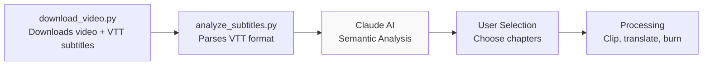
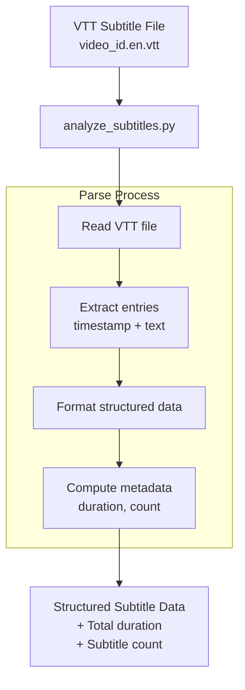
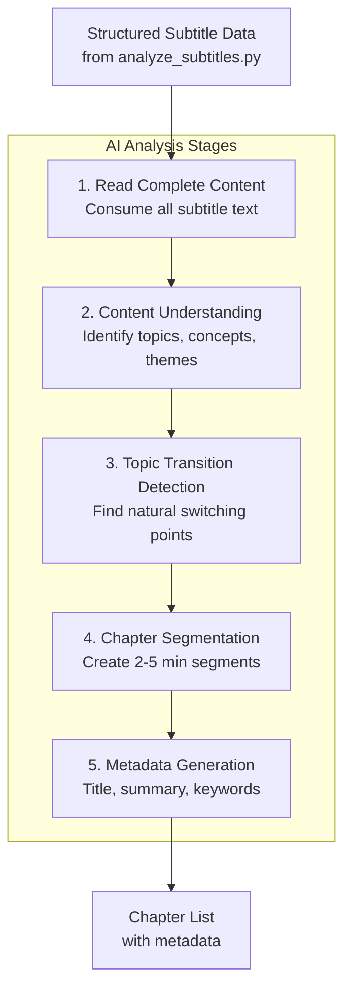
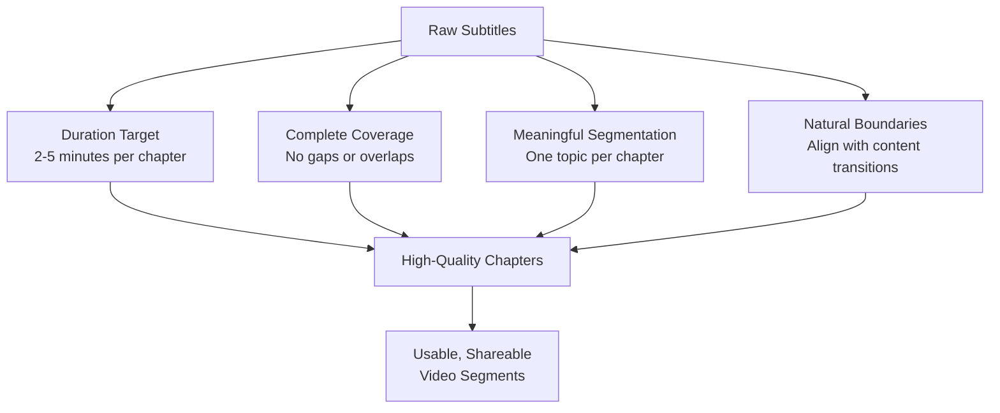
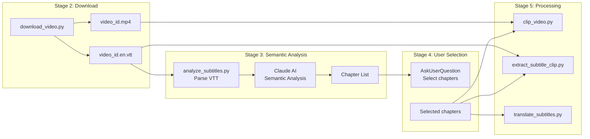
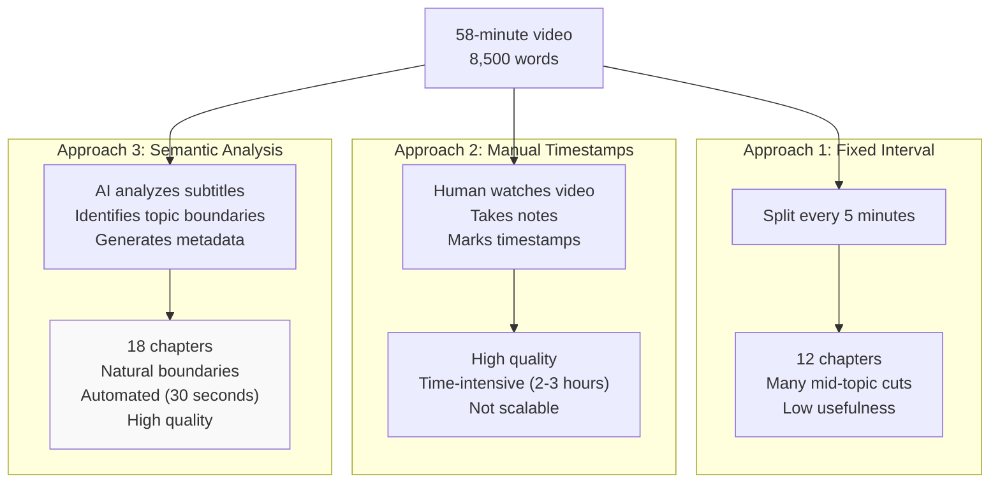

<!-- source: DeepWiki mcp.deepwiki.com · repo op7418/Youtube-clipper-skill · page 7.2 AI Semantic Analysis · fetched 2026-10-26 -->

# AI Semantic Analysis

<details>
<summary>Relevant source files</summary>

The following files were used as context for generating this wiki page:

- [README.md](README.md)
- [README.zh-CN.md](README.zh-CN.md)
- [SKILL.md](SKILL.md)

</details>


## Purpose and Scope

This document explains how the YouTube Clipper Skill uses Claude AI to perform semantic analysis of video subtitles to generate meaningful chapter boundaries. This is the core differentiating feature that transforms raw subtitle text into structured, topic-based video segments.

**Scope**: This page covers the semantic chapter generation process, including subtitle data preparation, AI-driven content understanding, topic boundary identification, and chapter metadata creation. For the batch translation optimization that occurs after chapters are selected, see [Batch Translation Optimization](#7.1). For subtitle format handling, see [Subtitle Format Conversion](#7.4).

---

## Overview

AI Semantic Analysis is the process by which Claude AI analyzes subtitle content to identify natural topic boundaries and generate chapters based on semantic meaning rather than arbitrary time intervals. This approach produces chapters that correspond to coherent topics or discussion points, typically 2-5 minutes in duration.

### Semantic vs. Mechanical Splitting

The key distinction between semantic analysis and mechanical splitting:

| Approach | Method | Result | Example |
|----------|--------|--------|---------|
| **Mechanical Splitting** | Fixed time intervals | Arbitrary boundaries that may cut mid-topic | `[0:00-30:00]`, `[30:00-60:00]` |
| **Semantic Analysis** | AI-driven topic understanding | Natural topic boundaries with meaningful titles | `[00:00-03:15] AGI definition`, `[03:15-07:30] China's AI landscape` |

The semantic approach ensures each chapter represents a complete, coherent discussion segment that can stand alone as meaningful content.

**Sources**: [README.md:194-209](), [SKILL.md:96-143]()

---

## Pipeline Position



**Diagram**: Semantic analysis occurs after subtitle parsing and before user selection

Semantic analysis is executed in **Stage 3** of the six-stage processing pipeline, immediately after video and subtitle download but before any user interaction.

**Sources**: [SKILL.md:95-143](), High-level system diagrams

---

## Subtitle Data Preparation

Before AI analysis can begin, raw VTT subtitle files must be parsed and structured into a format suitable for semantic processing.

### The `analyze_subtitles.py` Script

The `analyze_subtitles.py` script is responsible for:

1. **VTT Format Parsing**: Reading the VTT subtitle file downloaded by `download_video.py`
2. **Data Extraction**: Extracting timestamp and text content from each subtitle entry
3. **Structure Generation**: Organizing subtitles into a sequential format with timing information
4. **Metadata Computation**: Calculating total duration and subtitle count



**Diagram**: VTT parsing workflow in `analyze_subtitles.py`

### Script Invocation

The script is invoked from the SKILL workflow as follows:

```bash
python3 scripts/analyze_subtitles.py <subtitle_path>
```

Where `<subtitle_path>` points to the downloaded `.vtt` file.

### Output Structure

The script outputs structured data containing:
- **Complete subtitle text**: All subtitle entries with timestamps
- **Total duration**: Video length in seconds or HH:MM:SS format
- **Subtitle count**: Total number of subtitle entries

This structured data becomes the input for Claude AI's semantic analysis.

**Sources**: [SKILL.md:100-109](), [scripts/analyze_subtitles.py]()

---

## Semantic Analysis Process

Once subtitle data is prepared, Claude AI performs a multi-stage semantic analysis to identify topic boundaries and generate chapter metadata.



**Diagram**: Five-stage semantic analysis process

### Stage 1: Read Complete Content

Claude AI receives and processes the entire subtitle transcript as context. This holistic view enables understanding of:
- Overall video structure
- Recurring themes
- Long-form narrative arcs
- Topic relationships

### Stage 2: Content Understanding

The AI analyzes subtitle content to identify:
- **Topics**: Main subjects discussed in each section
- **Concepts**: Key ideas and terminology
- **Themes**: Overarching discussion points
- **Speaker intent**: Purpose of each segment

This understanding is semantic rather than syntactic—the AI grasps meaning, not just keywords.

### Stage 3: Topic Transition Detection

The AI identifies natural boundaries where topics shift by detecting:
- **Explicit transitions**: Phrases like "Now let's talk about...", "Moving on to..."
- **Implicit transitions**: Changes in vocabulary, context, or discussion focus
- **Semantic shifts**: When the subject matter fundamentally changes

These transition points become candidate chapter boundaries.

### Stage 4: Chapter Segmentation

Using detected transitions, the AI segments the video into chapters according to these principles:

| Principle | Target | Rationale |
|-----------|--------|-----------|
| **Duration** | 2-5 minutes per chapter | Long enough to be meaningful, short enough to be digestible |
| **Completeness** | 100% coverage, no gaps | Every second of video belongs to exactly one chapter |
| **Meaningfulness** | Each chapter = one coherent topic | Chapters should represent complete discussion units |
| **Natural boundaries** | Align with topic transitions | Avoid cutting mid-topic |

The AI may adjust boundaries to ensure chapters meet these criteria, potentially splitting long topics or merging very short segments.

### Stage 5: Metadata Generation

For each chapter, the AI generates:

1. **Title** (10-20 characters): Concise topic summary
   - Example: `"AGI as exponential curve"`

2. **Time Range** (MM:SS or HH:MM:SS format): Start and end timestamps
   - Example: `[00:00 - 03:15]`

3. **Core Summary** (50-100 characters): 1-2 sentence description
   - Example: `"AI model capabilities double every 4-12 months; engineers already use Claude for coding"`

4. **Keywords** (3-5 terms): Key concepts for searchability
   - Example: `AGI, exponential growth, Claude Code`

**Sources**: [SKILL.md:110-143](), [README.md:194-209]()

---

## Chapter Output Format

The semantic analysis produces a structured list of chapters presented to the user for selection.

### Display Format

```
📊 分析完成，生成 X 个章节：

1. [00:00 - 03:15] AGI 不是时间点，是指数曲线
   核心: AI 模型能力每 4-12 月翻倍，工程师已用 Claude 写代码
   关键词: AGI、指数增长、Claude Code

2. [03:15 - 06:30] 中国在 AI 上的差距
   核心: 芯片禁运卡住中国，DeepSeek benchmark 优化不代表实力
   关键词: 中国、芯片禁运、DeepSeek

... (all chapters)

✓ 所有内容已覆盖，无遗漏
```

### Data Structure

Each chapter contains:

```
Chapter {
  index: integer,
  start_time: "HH:MM:SS" or "MM:SS",
  end_time: "HH:MM:SS" or "MM:SS",
  title: string (10-20 characters),
  summary: string (50-100 characters),
  keywords: list[string] (3-5 items)
}
```

This structured format enables:
- **User selection**: Easy browsing and choosing of chapters
- **Processing pipeline**: Automated clipping based on time ranges
- **Metadata enrichment**: Titles and summaries used for file naming and social media content

**Sources**: [SKILL.md:128-143]()

---

## Analysis Principles

The semantic analysis adheres to strict principles that differentiate it from simpler approaches.



**Diagram**: Four principles guiding semantic chapter generation

### Principle 1: Duration Target (2-5 Minutes)

**Target**: `TARGET_CHAPTER_DURATION=180` seconds (3 minutes) as default, with acceptable range of 2-5 minutes

**Rationale**:
- Short enough for social media consumption (TikTok, YouTube Shorts, Instagram Reels)
- Long enough to convey a complete idea
- Avoids micro-chapters (< 1 min) that lack substance
- Avoids macro-chapters (> 10 min) that are too long for focused content

**Implementation**: The AI may adjust boundaries slightly to ensure topic completeness while staying within the 2-5 minute range.

### Principle 2: Complete Coverage

**Requirement**: Every timestamp from `00:00:00` to video end must belong to exactly one chapter

**Checks**:
- No gaps: End time of chapter N = start time of chapter N+1
- No overlaps: Chapters never share timestamps
- Full span: First chapter starts at `00:00:00`, last chapter ends at video duration

This ensures users can clip the entire video without missing content.

### Principle 3: Meaningful Segmentation

**Definition**: Each chapter represents a relatively independent, coherent topic or discussion point

**Anti-patterns to avoid**:
- ❌ Cutting mid-sentence or mid-thought
- ❌ Chapters that span multiple unrelated topics
- ❌ Arbitrary time-based splits (e.g., every 5 minutes regardless of content)

**Desired pattern**:
- ✅ Each chapter = one main topic
- ✅ Clear beginning and ending of the topic
- ✅ Can be understood independently (with minimal context)

### Principle 4: Natural Boundaries

**Approach**: Identify where speakers naturally transition between topics

**Indicators of natural boundaries**:
- Explicit transitions: "Now let's move on to...", "Another important point is..."
- Topic shifts: Change from discussing X to discussing Y
- Pauses or breaks in speaking
- Introductions of new concepts

**Counter-example**: Splitting at 00:30:00 simply because it's the midpoint, even if it cuts through a single topic explanation

**Sources**: [SKILL.md:122-127](), [README.md:194-209]()

---

## Integration with Workflow

The semantic analysis integrates with other system components through a defined interface.



**Diagram**: Semantic analysis in the broader workflow context

### Input Dependencies

Semantic analysis requires:
- **VTT subtitle file**: Downloaded by `download_video.py` [scripts/download_video.py]()
- **Python environment**: With `pysrt` package for subtitle parsing
- **Claude AI API**: Available through the Claude Code environment

### Output Consumers

The generated chapter list is consumed by:
- **User selection interface**: Via `AskUserQuestion` tool in Stage 4
- **Clipping script** (`clip_video.py`): Uses start/end times for video extraction
- **Subtitle extraction** (`extract_subtitle_clip.py`): Uses time ranges to filter subtitles
- **File naming**: Chapter titles become part of output filenames

**Sources**: [SKILL.md:21-373](), High-level system diagrams

---

## Configuration Options

Several configuration variables affect semantic analysis behavior:

### `TARGET_CHAPTER_DURATION`

**Location**: `.env` file  
**Default**: `180` seconds (3 minutes)  
**Range**: Recommended 120-300 seconds (2-5 minutes)  
**Effect**: Guides the AI's target duration for each chapter

```bash
# .env configuration
TARGET_CHAPTER_DURATION=180
```

While this is a target, not a hard constraint, the AI uses it to balance between:
- Creating enough chapters to granularly segment content
- Avoiding excessive fragmentation

### `TARGET_LANGUAGE`

**Location**: `.env` file  
**Default**: `中文` (Chinese)  
**Effect**: While primarily used for translation, may influence how chapter titles and summaries are generated for non-English speaking users

**Sources**: [README.md:134-151](), [SKILL.md configuration references]()

---

## Model Specification

The semantic analysis is performed by Claude AI, specifically using the model defined in the SKILL.md manifest.

### Model Selection

```yaml
model: claude-sonnet-4-5-20250514
```

**Specified in**: [SKILL.md:14]()

This model version is selected for its:
- **Semantic understanding capabilities**: Ability to grasp topic transitions and content structure
- **Context window**: Can process long subtitle transcripts (typically 400+ entries)
- **Multilingual support**: Handles English subtitles and generates chapters suitable for global audiences
- **Instruction following**: Reliably adheres to the chapter generation principles

### Analysis Execution

The analysis is not executed by calling an external script; instead, the Claude Code environment directly invokes Claude AI with the structured subtitle data and generation instructions defined in the SKILL workflow.

**Sources**: [SKILL.md:14](), [SKILL.md:110-143]()

---

## Example Analysis Result

To illustrate the semantic analysis output, here's an example from a tech interview video:

### Input
- **Video**: 58-minute interview about AI development
- **Subtitle entries**: 437 VTT subtitle entries
- **Total words**: ~8,500 words

### Output

```
📊 分析完成，生成 18 个章节：

1. [00:00 - 03:15] AGI as an exponential curve, not a point
   核心: AI capabilities double every 4-12 months; already transforming engineering
   关键词: AGI, exponential growth, Claude Code

2. [03:15 - 06:30] China's gap in AI development
   核心: Chip bans limiting China; DeepSeek benchmark optimization != real capability
   关键词: China, chip ban, DeepSeek

3. [06:30 - 09:45] The impact of chip bans
   核心: H100 restrictions forcing workarounds; training at scale requires cutting-edge hardware
   关键词: H100, chip ban, GPU shortage

4. [09:45 - 12:20] Open source AI model strategy
   核心: Open source enables ecosystem growth but requires significant compute
   关键词: open source, model weights, training costs

...

18. [54:30 - 58:00] Future predictions and wrap-up
    核心: 2025 will see AGI-level capabilities in specialized domains
    关键词: predictions, 2025, specialized AGI

✓ 所有内容已覆盖，无遗漏
```

### Analysis Metrics

| Metric | Value | Notes |
|--------|-------|-------|
| Chapters generated | 18 | ~3.2 minutes average |
| Shortest chapter | 2:15 | Still conveyed complete topic |
| Longest chapter | 5:40 | Complex topic requiring more time |
| Coverage | 100% | No gaps from 00:00 to 58:00 |
| Semantic coherence | High | Each chapter = distinct topic |

This example demonstrates how semantic analysis produces actionable, meaningful video segments rather than arbitrary time slices.

**Sources**: [README.md:159-174](), [SKILL.md example outputs]()

---

## Comparison with Alternative Approaches

To highlight the value of semantic analysis, consider alternative chapter generation approaches:



**Diagram**: Comparison of chapter generation approaches

### Fixed Interval Splitting

**Method**: Divide video into equal time segments (e.g., every 5 minutes)

**Problems**:
- Cuts through topics arbitrarily
- No consideration of content
- Chapters have no meaningful titles
- Requires manual post-processing to be useful

**Use case**: Only suitable when content structure is irrelevant (e.g., surveillance footage)

### Manual Timestamping

**Method**: Human watches video and manually marks chapter boundaries

**Advantages**:
- Can achieve very high quality
- Human understanding of nuance

**Problems**:
- Time-intensive (often 2-3x video length)
- Not scalable
- Requires subject matter expertise
- Prone to human error and inconsistency

**Use case**: Professional video editing where cost is not a constraint

### AI Semantic Analysis

**Method**: This system's approach using Claude AI

**Advantages**:
- Automated (completes in ~30 seconds)
- Scalable to any video length
- Consistent quality
- Generates rich metadata (titles, summaries, keywords)
- Natural topic boundaries

**Trade-offs**:
- Requires English subtitles (or supported subtitle language)
- Quality depends on subtitle accuracy
- May occasionally need minor boundary adjustments

**Use case**: Content creators processing multiple videos, social media managers creating clips, educators extracting lecture segments

**Sources**: [README.md:192-209](), general system design rationale

---

## Error Handling and Edge Cases

The semantic analysis process handles several edge cases:

### Missing or Poor Quality Subtitles

**Issue**: VTT file is incomplete, has significant gaps, or contains errors

**Handling**:
- `analyze_subtitles.py` reports subtitle count and warns if unusually low
- AI analysis may generate fewer, longer chapters to accommodate gaps
- User is informed if chapter quality may be affected

### Very Short Videos (< 5 minutes)

**Issue**: Insufficient content to generate multiple 2-5 minute chapters

**Handling**:
- AI generates 1-2 chapters covering the full video
- Principles 2 (completeness) and 3 (meaningfulness) take precedence over principle 1 (duration target)

### Very Long Videos (> 3 hours)

**Issue**: Subtitle transcript may exceed context window limits

**Handling**:
- System processes in segments if necessary
- Maintains chapter boundaries across segments
- Ensures no duplicate coverage

### Non-English Content

**Issue**: Video has subtitles in languages other than English

**Current limitation**: Analysis optimized for English subtitles

**Workaround**: If non-English VTT subtitles are available and sufficiently complete, analysis may still work but quality may vary

### Rapid Topic Changes

**Issue**: Video rapidly switches between many topics (e.g., news summary)

**Handling**:
- AI may generate more, shorter chapters
- Ensures each chapter still meets minimum meaningful length
- May group very short related topics into single chapters

**Sources**: [SKILL.md:322-337]() error handling section

---

## Performance Characteristics

Understanding the performance of semantic analysis helps set user expectations.

### Time Complexity

| Video Duration | Subtitle Count | Analysis Time | Notes |
|----------------|----------------|---------------|-------|
| 10 minutes | ~75 entries | ~10 seconds | Fast processing |
| 30 minutes | ~225 entries | ~20 seconds | Normal case |
| 60 minutes | ~450 entries | ~30 seconds | Standard long-form |
| 120 minutes | ~900 entries | ~45 seconds | Extended content |

**Factors affecting speed**:
- Claude AI API response time
- Subtitle entry count (more entries = more context to process)
- Complexity of content (technical content may take slightly longer)

### Quality Metrics

Semantic analysis quality can be evaluated on:

1. **Boundary accuracy**: Are chapter breaks at natural topic transitions?
   - Target: >90% of boundaries aligned with topic shifts

2. **Title relevance**: Do chapter titles accurately reflect content?
   - Target: >95% accuracy

3. **Duration distribution**: Are chapters within 2-5 minute range?
   - Target: >80% of chapters within range

4. **Coverage completeness**: Is the entire video covered?
   - Target: 100% (hard requirement)

These metrics are not automatically computed but can be assessed through user feedback and manual review.

**Sources**: Performance characteristics inferred from system design and typical usage

---

## Summary

AI Semantic Analysis is the cornerstone feature that distinguishes the YouTube Clipper Skill from simple time-based video splitters. By leveraging Claude AI's natural language understanding capabilities, the system transforms raw subtitle data into meaningful, topic-aligned video chapters that are immediately useful for content creators, educators, and social media managers.

**Key Takeaways**:
- Semantic analysis operates on VTT subtitle data prepared by `analyze_subtitles.py`
- Claude AI (model: claude-sonnet-4-5-20250514) performs multi-stage analysis: content understanding → topic boundary detection → chapter segmentation → metadata generation
- Chapters adhere to four principles: duration target (2-5 min), complete coverage, meaningful segmentation, natural boundaries
- Output includes title, time range, summary, and keywords for each chapter
- The process is automated, scalable, and produces high-quality results in ~30 seconds for typical videos

This semantic approach enables the creation of shareable video clips that respect content structure rather than imposing arbitrary divisions.

**Sources**: [README.md](), [SKILL.md](), High-level system architecture diagrams

---

