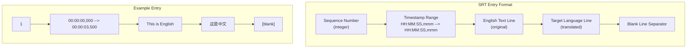
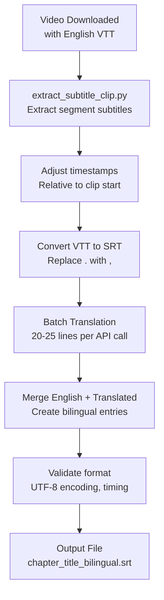
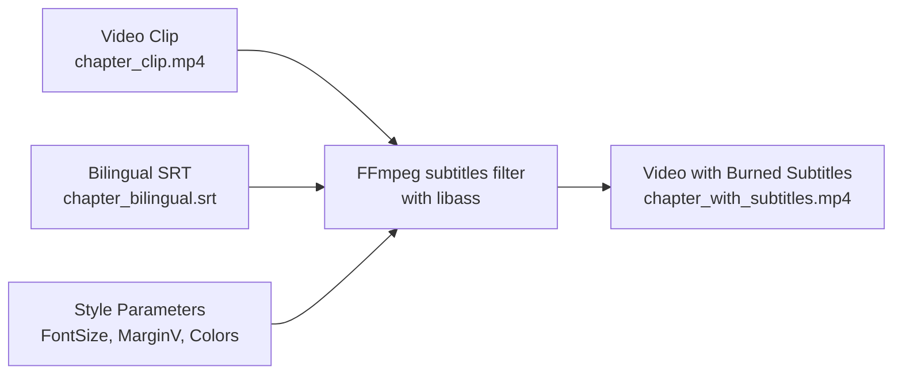
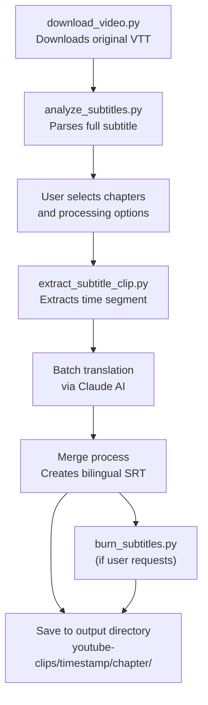

<!-- source: DeepWiki mcp.deepwiki.com · repo op7418/Youtube-clipper-skill · page 7.3 Bilingual Subtitle Format · fetched 2026-10-26 -->

# Bilingual Subtitle Format

<details>
<summary>Relevant source files</summary>

The following files were used as context for generating this wiki page:

- [README.md](README.md)
- [SKILL.md](SKILL.md)
- [references/subtitle-formatting.md](references/subtitle-formatting.md)

</details>


This document describes the structure, generation, and usage of bilingual subtitle files in the YouTube Clipper Skill. Bilingual subtitles contain both the original English text and translated target language text within a single SRT file, enabling viewers to see both languages simultaneously when burned into videos.

**Scope**: This page covers the specific bilingual subtitle format implementation, including SRT structure, merging strategy, and rendering considerations. For details on the translation optimization strategy, see [Batch Translation Optimization](#7.1). For subtitle format conversion between VTT and SRT, see [Subtitle Format Conversion](#7.4). For the burning process itself, see [burn_subtitles.py](#4.4).

---

## Format Structure

Bilingual subtitles use the standard SRT format with a specific multi-line text convention: each subtitle entry contains two lines of text, with the original English line first, followed by the translated target language line.

### SRT Structure

```
Sequence Number
Start Timestamp --> End Timestamp
English Text Line
Target Language Text Line

[blank line separator]
```

**Example**:

```srt
1
00:00:00,000 --> 00:00:03,500
This is the English subtitle
这是中文字幕

2
00:00:03,500 --> 00:00:07,000
Another English line
另一行中文

3
00:00:07,000 --> 00:00:10,500
Technical terms remain accurate
技术术语保持准确性
```

### Format Characteristics

| Aspect | Specification |
|--------|---------------|
| **File Extension** | `.srt` |
| **Encoding** | UTF-8 without BOM |
| **Timestamp Format** | `HH:MM:SS,mmm` (comma separator) |
| **Text Lines per Entry** | 2 (English first, target language second) |
| **Line Order** | English (line 1), Target Language (line 2) |
| **Separator** | Single blank line between entries |

**Sources**: [references/subtitle-formatting.md:178-210](), [README.md:218-232]()

---

## Bilingual Subtitle Format Structure



**Sources**: [references/subtitle-formatting.md:184-194]()

---

## Generation Pipeline

The bilingual subtitle file is generated through a multi-stage process that extracts, translates, and merges subtitle segments.

### Bilingual Subtitle Generation Process



**Sources**: [SKILL.md:168-199]()

---

## Generation Process Details

### Stage 1: Subtitle Extraction

The `extract_subtitle_clip.py` script extracts the subtitle segment corresponding to the video clip's time range.

**Process**:
1. Parse the full VTT subtitle file
2. Filter entries within the clip's start and end times
3. Adjust timestamps relative to clip start (subtract start time)
4. Convert VTT format to SRT format

**Key Operations**:
- **Time filtering**: Only include subtitles where `start_time >= clip_start AND end_time <= clip_end`
- **Timestamp adjustment**: `new_time = original_time - clip_start_time`
- **Format conversion**: Change `.` millisecond separator to `,`

**Sources**: [SKILL.md:178-183](), [scripts/extract_subtitle_clip.py]()

### Stage 2: Batch Translation

The subtitle lines are translated using Claude AI with an optimized batching strategy to reduce API calls by 95%.

**Batch Configuration**:
- **Batch size**: 20-25 subtitle lines per API request
- **Configuration variable**: `TRANSLATION_BATCH_SIZE` in `.env`
- **Default target language**: Chinese (中文)

**Translation Strategy**:
- Preserve technical terminology accuracy
- Use colloquial expressions suitable for short videos
- Maintain concise, fluent phrasing
- Preserve context consistency across batches

For detailed information on the batch translation optimization, see [Batch Translation Optimization](#7.1).

**Sources**: [SKILL.md:185-193](), [README.md:213-216]()

### Stage 3: Bilingual Merging

After translation completes, the English and translated lines are merged into a single bilingual SRT file.

**Merging Algorithm**:
```
For each subtitle entry:
    1. Copy sequence number
    2. Copy timestamp range (unchanged)
    3. Line 1: English text (original)
    4. Line 2: Target language text (translated)
    5. Add blank line separator
```

**Output Format**:
```srt
[sequence]
[timestamp]
[English line]
[Target language line]

```

**Sources**: [SKILL.md:194-199](), [references/subtitle-formatting.md:184-194]()

---

## Rendering and Styling

Bilingual subtitles are burned into videos using FFmpeg's `subtitles` filter with the libass library.

### FFmpeg Burning Process



**Sources**: [SKILL.md:202-212](), [scripts/burn_subtitles.py]()

### Default Style Configuration

The `burn_subtitles.py` script applies consistent styling to bilingual subtitles:

| Parameter | Default Value | Purpose |
|-----------|---------------|---------|
| `FontSize` | 24 | Readable on 1080p video |
| `MarginV` | 30 | Bottom margin in pixels |
| `PrimaryColour` | White | Main text color |
| `OutlineColour` | Black | Text outline for contrast |
| `BorderStyle` | 1 | Outline around text |
| `Alignment` | 2 | Bottom center |

**Configuration Source**: These values can be customized via environment variables:
- `SUBTITLE_FONT_SIZE` in `.env` (default: 24)
- `SUBTITLE_MARGIN_V` in `.env` (default: 30)

**Example FFmpeg Command** (from burn_subtitles.py):
```bash
ffmpeg -i video.mp4 \
  -vf "subtitles=bilingual.srt:force_style='FontSize=24,MarginV=30'" \
  -c:a copy \
  output_with_subtitles.mp4
```

**Sources**: [references/subtitle-formatting.md:196-210](), [SKILL.md:206-211]()

---

## File Organization and Naming

Bilingual subtitle files follow a consistent naming convention and are organized within the chapter-specific output directory.

### Output Directory Structure

```
./youtube-clips/
└── YYYYMMDD_HHMMSS/
    └── Chapter_Title/
        ├── Chapter_Title_clip.mp4
        ├── Chapter_Title_bilingual.srt      # Bilingual subtitle file
        ├── Chapter_Title_with_subtitles.mp4
        └── Chapter_Title_summary.md
```

### File Naming Convention

**Pattern**: `<sanitized_chapter_title>_bilingual.srt`

**Sanitization Rules**:
1. Remove special characters: `/ \ : * ? " < > |`
2. Replace spaces with underscores
3. Limit length to 100 characters
4. Preserve alphanumeric and basic punctuation

**Example Transformations**:
```
"AI Development: China's Gap" → "AI_Development_Chinas_Gap_bilingual.srt"
"What is AGI?" → "What_is_AGI_bilingual.srt"
```

**Sources**: [SKILL.md:242-254](), [README.md:113-123]()

---

## Bilingual Subtitle File Lifecycle



**Sources**: [SKILL.md:163-254]()

---

## Technical Considerations

### Encoding Requirements

**Mandatory Encoding**: UTF-8 without BOM (Byte Order Mark)

**Why UTF-8 without BOM**:
- FFmpeg's libass library expects UTF-8
- BOM characters can cause parsing errors in subtitle filters
- Ensures proper display of non-ASCII characters (Chinese, etc.)

**Encoding Verification**:
```bash
file -i bilingual.srt
# Expected output: bilingual.srt: text/plain; charset=utf-8
```

**Sources**: [references/subtitle-formatting.md:307-327]()

### Timestamp Synchronization

Bilingual subtitles maintain the same timing as the original English subtitles. The timestamp adjustment process ensures synchronization with the clipped video segment.

**Timing Rules**:
1. **Start time**: Must match or slightly precede the spoken content
2. **End time**: Must match or slightly exceed the spoken content duration
3. **No overlap**: Adjacent subtitle end/start times should not overlap
4. **Adjustment**: All timestamps are relative to clip start (0:00:00,000)

**Example Adjustment**:
```
Original VTT (full video):
00:02:30.000 --> 00:02:33.500
Text content

After extraction (clip starts at 00:02:00):
00:00:30,000 --> 00:00:33,500
Text content
```

**Sources**: [references/subtitle-formatting.md:243-301]()

### Display Characteristics

When bilingual subtitles are rendered on video:

**Visual Layout**:
```
┌─────────────────────────────────┐
│                                 │
│         Video Frame             │
│                                 │
│                                 │
│    [English text line]          │ ← Line 1 (smaller vertical space)
│    [Target language line]       │ ← Line 2 (immediately below)
└─────────────────────────────────┘
  ↑ MarginV=30px from bottom
```

**Line Spacing**: FFmpeg libass automatically calculates appropriate spacing between the two lines based on font size. The two lines are rendered as a single subtitle unit with automatic vertical stacking.

**Sources**: [references/subtitle-formatting.md:196-210]()

---

## Common Issues and Solutions

### Issue: Subtitles Display as Gibberish

**Cause**: Incorrect encoding (not UTF-8)

**Solution**: Convert to UTF-8 without BOM
```bash
iconv -f GBK -t UTF-8 input.srt > output.srt
sed -i '1s/^\xEF\xBB\xBF//' output.srt  # Remove BOM if present
```

**Sources**: [references/subtitle-formatting.md:397-411]()

### Issue: Chinese Text Too Crowded

**Cause**: Font size too small for bilingual display

**Solution**: Increase font size and bottom margin in `.env`:
```bash
SUBTITLE_FONT_SIZE=28
SUBTITLE_MARGIN_V=40
```

**Sources**: [references/subtitle-formatting.md:417-422]()

### Issue: Timestamp Format Errors

**Cause**: VTT format (`.` separator) used instead of SRT (`,` separator)

**Solution**: The conversion process in `extract_subtitle_clip.py` handles this automatically by replacing `.` with `,` in timestamp strings.

**Sources**: [references/subtitle-formatting.md:94-104]()

---

## Integration with Other Components

### Relationship to Batch Translation

The bilingual subtitle format is the output product of the batch translation process. The [Batch Translation Optimization](#7.1) system groups 20-25 subtitle lines together for translation, and the results are merged line-by-line with the original English text to create the bilingual format.

### Relationship to Subtitle Burning

The bilingual SRT file serves as input to the `burn_subtitles.py` script (see [burn_subtitles.py](#4.4)), which uses FFmpeg to hardcode the subtitles into the video file. The burning process applies the style configuration to render both lines simultaneously.

### Relationship to Format Conversion

The bilingual subtitle generation process includes VTT-to-SRT conversion as a preliminary step. For details on the conversion logic, see [Subtitle Format Conversion](#7.4).

**Sources**: [SKILL.md:163-234]()

---

