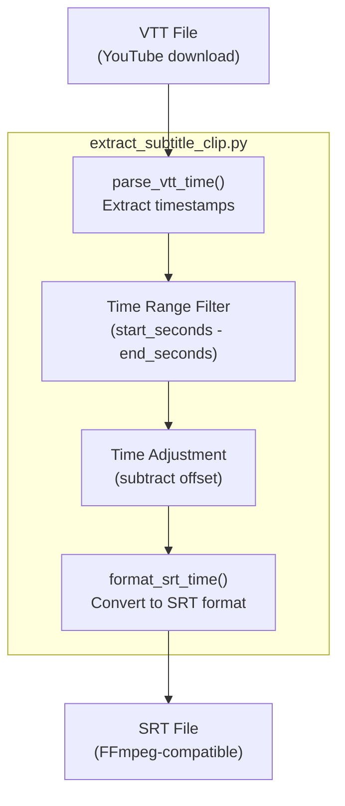
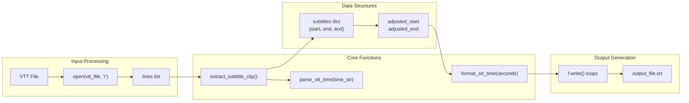
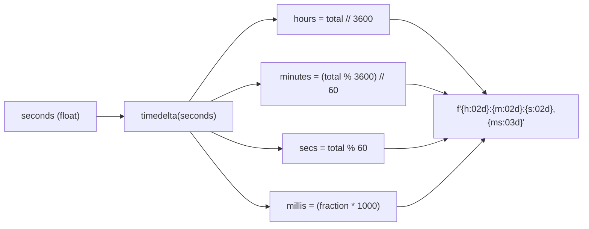
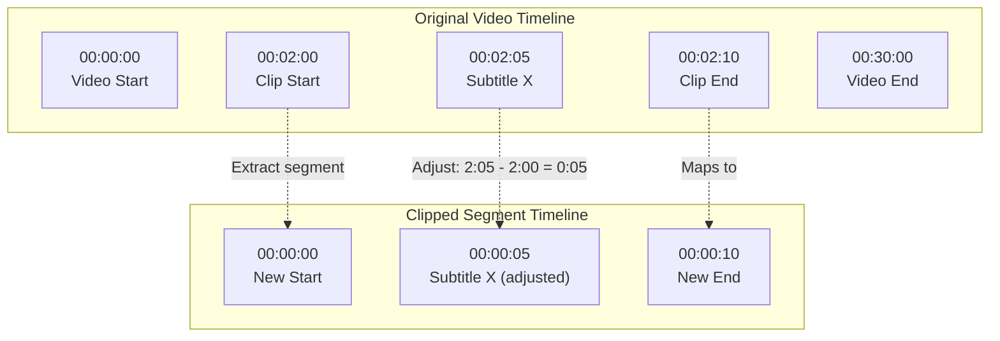
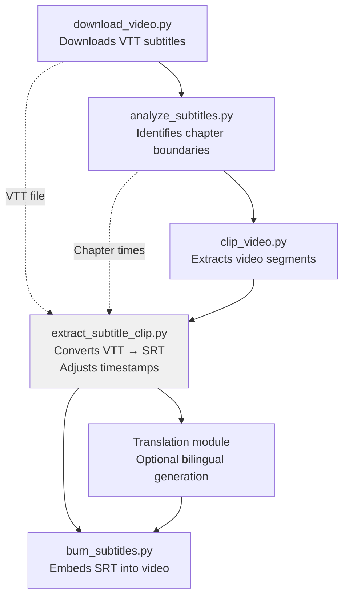

<!-- source: DeepWiki mcp.deepwiki.com · repo op7418/Youtube-clipper-skill · page 7.4 Subtitle Format Conversion · fetched 2026-10-26 -->

# Subtitle Format Conversion

<details>
<summary>Relevant source files</summary>

The following files were used as context for generating this wiki page:

- [TECHNICAL_NOTES.md](TECHNICAL_NOTES.md)
- [references/subtitle-formatting.md](references/subtitle-formatting.md)
- [scripts/extract_subtitle_clip.py](scripts/extract_subtitle_clip.py)

</details>


This document describes the subtitle format conversion system used in YouTube Clipper Skill, specifically the transformation from VTT (WebVTT) format to SRT (SubRip) format. The conversion process handles timestamp format differences, time adjustment for video segments, and encoding normalization.

For information about how subtitles are downloaded, see [Video Download Settings](#6.2). For subtitle burning and styling, see [Bilingual Subtitle Format](#7.3).

## Purpose and Scope

The subtitle format conversion system serves two primary functions:

1. **Format Normalization**: Converts YouTube's native VTT subtitle format to the widely-compatible SRT format used by FFmpeg's subtitle burning filters
2. **Time Adjustment**: Recalculates subtitle timestamps relative to extracted video clip boundaries, ensuring subtitles align with clipped segments

The conversion is implemented in [scripts/extract_subtitle_clip.py]() and processes subtitle data during the video clipping workflow.

Sources: [scripts/extract_subtitle_clip.py:1-115](), [TECHNICAL_NOTES.md:166-213]()

## Format Specifications

### VTT Format Structure

VTT (Web Video Text Tracks) is YouTube's default subtitle format with the following characteristics:

| Component | Specification |
|-----------|--------------|
| File Header | Mandatory `WEBVTT` line |
| Timestamp Delimiter | Period (`.`) for milliseconds |
| Style Support | Yes (CSS-like cues) |
| Position Control | Yes (align, position, line) |
| Sequence Numbers | Optional |

**Example VTT Structure:**
```
WEBVTT

1
00:00:00.000 --> 00:00:03.500
First subtitle text

2
00:00:03.500 --> 00:00:07.000
Second subtitle text
```

Sources: [references/subtitle-formatting.md:7-53](), [TECHNICAL_NOTES.md:166-176]()

### SRT Format Structure

SRT (SubRip) is the conversion target format with these characteristics:

| Component | Specification |
|-----------|--------------|
| File Header | None |
| Timestamp Delimiter | Comma (`,`) for milliseconds |
| Style Support | No (but FFmpeg can override) |
| Position Control | No |
| Sequence Numbers | Mandatory (sequential from 1) |

**Example SRT Structure:**
```
1
00:00:00,000 --> 00:00:03,500
First subtitle text

2
00:00:03,500 --> 00:00:07,000
Second subtitle text
```

Sources: [references/subtitle-formatting.md:55-91](), [TECHNICAL_NOTES.md:166-176]()

### Format Comparison Matrix

| Attribute | VTT | SRT |
|-----------|-----|-----|
| Millisecond Separator | `.` (period) | `,` (comma) |
| Header Required | `WEBVTT` | None |
| Metadata Support | Yes (STYLE, NOTE) | No |
| Speaker Tags | `<v Name>text</v>` | Plain text only |
| FFmpeg Compatibility | Limited | Full |

Sources: [references/subtitle-formatting.md:94-104]()

## Conversion Pipeline

### Overall Process Flow



**Conversion Pipeline Flow**

Sources: [scripts/extract_subtitle_clip.py:33-102]()

### Code Entity Mapping



**Function and Data Structure Relationships**

Sources: [scripts/extract_subtitle_clip.py:10-102]()

## Implementation Details

### Time Parsing Function

The `parse_vtt_time()` function converts VTT timestamp strings to seconds:

**Implementation:** [scripts/extract_subtitle_clip.py:10-22]()

**Parsing Logic:**
1. Splits timestamp by `:` delimiter
2. Handles two formats:
   - `HH:MM:SS.mmm` (3 parts): hours, minutes, seconds
   - `MM:SS.mmm` (2 parts): minutes, seconds only
3. Returns total seconds as float

**Example Transformations:**
- `00:02:30.500` → `150.5` seconds
- `05:47.250` → `347.25` seconds
- `01:23:45.678` → `5025.678` seconds

The function accepts period-delimited milliseconds (VTT format) in input and performs direct numeric conversion.

Sources: [scripts/extract_subtitle_clip.py:10-22](), [TECHNICAL_NOTES.md:177-184]()

### Time Formatting Function

The `format_srt_time()` function converts seconds back to SRT timestamp format:

**Implementation:** [scripts/extract_subtitle_clip.py:24-31]()

**Formatting Process:**



**Key Transformation:**
- Uses `timedelta` for reliable time arithmetic
- Extracts components via modulo operations
- Formats with zero-padding (`:02d`, `:03d`)
- **Changes delimiter from `.` to `,` for milliseconds**

**Example Output:**
- `150.5` seconds → `00:02:30,500`
- `5025.678` seconds → `01:23:45,678`

Sources: [scripts/extract_subtitle_clip.py:24-31](), [TECHNICAL_NOTES.md:177-184]()

### Main Extraction Algorithm

The `extract_subtitle_clip()` function implements the complete conversion:

**Implementation:** [scripts/extract_subtitle_clip.py:33-102]()

**Algorithm Steps:**

| Step | Operation | Code Location |
|------|-----------|---------------|
| 1. Parse time range | Convert start/end strings to seconds | Lines 36-37 |
| 2. Read VTT file | Load all lines into memory | Lines 45-46 |
| 3. Scan for timestamps | Find lines containing `-->` | Lines 55 |
| 4. Extract time boundaries | Parse start/end for each subtitle | Lines 58-62 |
| 5. Filter by range | Check if `start >= range_start AND end <= range_end` | Lines 65 |
| 6. Collect text | Gather non-empty lines after timestamp | Lines 67-73 |
| 7. Adjust timestamps | Subtract clip start time from all timestamps | Lines 76-77 |
| 8. Write SRT format | Generate sequence numbers and formatted output | Lines 90-95 |

**Range Filtering Logic:**
```python
if sub_start >= start_seconds and sub_end <= end_seconds:
    # Include subtitle in output
```

Only subtitles fully contained within the specified time range are included. Partial overlaps are excluded to prevent truncated content.

Sources: [scripts/extract_subtitle_clip.py:33-102](), [TECHNICAL_NOTES.md:214-258]()

## Time Adjustment for Clipped Segments

### Adjustment Necessity

When a video segment is extracted (e.g., 2:00-2:10 from original video), subtitle timestamps must be recalculated relative to the new zero point.

**Problem Scenario:**



**Timeline Adjustment Logic**

Sources: [TECHNICAL_NOTES.md:214-258]()

### Adjustment Implementation

**Code Location:** [scripts/extract_subtitle_clip.py:76-77]()

```python
adjusted_start = sub_start - start_seconds
adjusted_end = sub_end - start_seconds
```

**Mathematical Formula:**
- `adjusted_time = original_time - clip_start_time`
- Result is clamped to `max(0.0, adjusted_time)` to prevent negative timestamps

**Example Calculation:**

| Original Timestamp | Clip Start | Calculation | Adjusted Timestamp |
|--------------------|------------|-------------|-------------------|
| 00:02:00 | 00:02:00 | 120 - 120 | 00:00:00 |
| 00:02:05 | 00:02:00 | 125 - 120 | 00:00:05 |
| 00:02:10 | 00:02:00 | 130 - 120 | 00:00:10 |

Sources: [scripts/extract_subtitle_clip.py:76-77](), [TECHNICAL_NOTES.md:233-250]()

### Boundary Case Handling

**Edge Cases:**

1. **Subtitle starts before clip**: Excluded by range filter `sub_start >= start_seconds`
2. **Subtitle ends after clip**: Excluded by range filter `sub_end <= end_seconds`
3. **Subtitle partially overlaps**: Excluded (conservative approach prevents truncation)
4. **Empty time range**: Results in zero subtitles extracted

The implementation uses strict boundary checking to ensure only complete, fully-contained subtitles are included in the output.

Sources: [scripts/extract_subtitle_clip.py:65](), [TECHNICAL_NOTES.md:251-258]()

## Encoding and Special Character Handling

### Character Encoding

**Standard:** UTF-8 without BOM (Byte Order Mark)

**Reading:** [scripts/extract_subtitle_clip.py:45]()
```python
open(vtt_file, 'r', encoding='utf-8')
```

**Writing:** [scripts/extract_subtitle_clip.py:90]()
```python
open(output_file, 'w', encoding='utf-8')
```

All file operations explicitly specify UTF-8 encoding to ensure consistent handling of international characters in subtitle text.

Sources: [scripts/extract_subtitle_clip.py:45,90](), [references/subtitle-formatting.md:305-328]()

### VTT Metadata Removal

During conversion, the following VTT-specific elements are stripped:

| Element | Pattern | Reason |
|---------|---------|--------|
| WEBVTT Header | Line 1 of file | SRT has no header |
| Position Tags | `align:start position:0%` | SRT doesn't support positioning |
| Speaker Tags | `<v SpeakerName>` | SRT uses plain text |
| Style Blocks | `STYLE { ... }` | SRT has no style support |
| NOTE Sections | `NOTE comment text` | SRT has no comment syntax |

The current implementation in `extract_subtitle_clip.py` handles these implicitly by:
- Not copying the WEBVTT header
- Ignoring metadata in timestamp lines (splits on `-->` and takes only time portions)
- Preserving only the text content lines

Sources: [scripts/extract_subtitle_clip.py:55-73](), [references/subtitle-formatting.md:112-145](), [TECHNICAL_NOTES.md:207-211]()

## Integration with Workflow

### Usage in Processing Pipeline

The `extract_subtitle_clip.py` script is invoked during video clipping operations when subtitle extraction is requested:

**Command-Line Interface:**
```bash
python extract_subtitle_clip.py <vtt_file> <start_time> <end_time> <output_file>
```

**Example:**
```bash
python extract_subtitle_clip.py video.en.vtt 00:05:47 00:09:19 chapter_01.srt
```

**Parameters:**
- `vtt_file`: Downloaded VTT subtitle from yt-dlp
- `start_time`: Chapter start timestamp (HH:MM:SS format)
- `end_time`: Chapter end timestamp (HH:MM:SS format)
- `output_file`: Output SRT file path

Sources: [scripts/extract_subtitle_clip.py:103-114]()

### Workflow Integration Diagram



**Position in Processing Pipeline**

The conversion occurs after video clipping but before optional translation and subtitle burning, ensuring SRT files are available for downstream processing.

Sources: [scripts/extract_subtitle_clip.py:1-115](), Architecture Diagrams

## Output Format Validation

### SRT Structure Requirements

Generated SRT files must conform to the following structure:

**Sequential Block Format:**
```
<sequence_number>
<start_time> --> <end_time>
<text_line_1>
[<text_line_n>]
<blank_line>
```

**Implementation:** [scripts/extract_subtitle_clip.py:90-95]()

```python
for idx, sub in enumerate(subtitles, 1):
    f.write(f"{idx}\n")
    f.write(f"{format_srt_time(sub['start'])} --> {format_srt_time(sub['end'])}\n")
    f.write(f"{sub['text']}\n")
    f.write("\n")
```

**Validation Points:**
1. Sequence numbers start at 1 and increment sequentially
2. Timestamps use comma delimiter: `HH:MM:SS,mmm`
3. Each subtitle block ends with blank line separator
4. Text preserves original formatting (single line in this implementation)

Sources: [scripts/extract_subtitle_clip.py:90-95](), [references/subtitle-formatting.md:60-91]()

### Output Verification

The script prints conversion statistics:

**Console Output:** [scripts/extract_subtitle_clip.py:39-43,87,97-99]()

```
📝 提取字幕片段...
   输入: video.en.vtt
   时间范围: 00:05:47 - 00:09:19
   时间范围（秒）: 347.0s - 559.0s
   找到 42 条字幕
✅ 字幕提取完成
   输出文件: chapter_01.srt
   字幕条数: 42
```

This feedback enables verification that the correct time range was processed and the expected number of subtitles was extracted.

Sources: [scripts/extract_subtitle_clip.py:39-43,87,97-99]()

---

