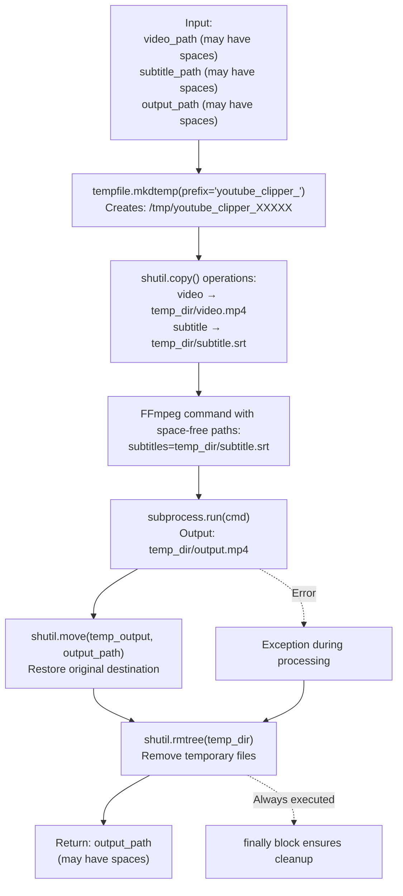
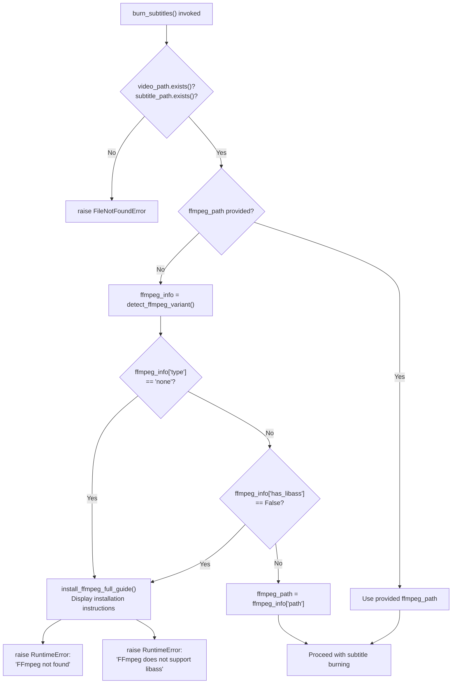

<!-- source: DeepWiki mcp.deepwiki.com · repo op7418/Youtube-clipper-skill · page 8.2 FFmpeg and libass Problems · fetched 2026-10-26 -->

# FFmpeg and libass Problems

<details>
<summary>Relevant source files</summary>

The following files were used as context for generating this wiki page:

- [TECHNICAL_NOTES.md](TECHNICAL_NOTES.md)
- [references/ffmpeg-guide.md](references/ffmpeg-guide.md)
- [scripts/burn_subtitles.py](scripts/burn_subtitles.py)

</details>


This page documents FFmpeg-related issues encountered during subtitle burning operations, specifically the missing libass support problem and the file path space problem. It covers detection logic, root causes, and implemented solutions.

For general FFmpeg integration patterns, see [FFmpeg Integration](#5.2). For libass installation requirements, see [libass Requirement](#5.3). For broader troubleshooting topics, see [Troubleshooting](#8).

## Missing libass Support

### Problem Description

Standard FFmpeg installations, particularly through Homebrew on macOS, do not include the libass library required for the `subtitles` filter. This prevents subtitle burning operations from functioning.

**Error Manifestation:**
```
No such filter: 'subtitles'
```

The error occurs when [scripts/burn_subtitles.py:195]() attempts to execute the FFmpeg command with the subtitles filter.

**Detection Command:**
```bash
ffmpeg -filters 2>&1 | grep subtitles
# Returns empty if libass is not supported
```

### Root Cause

| Component | Issue | Impact |
|-----------|-------|--------|
| Homebrew `ffmpeg` formula | Excludes non-core libraries to reduce package size | No `subtitles` filter available |
| libass library | Not compiled into standard builds | Cannot render subtitles to video frames |
| `subtitles` filter | Requires libass at compile time | Filter registration fails without libass |

Sources: [TECHNICAL_NOTES.md:5-24]()

### FFmpeg Variant Detection Flow

The system implements a multi-stage detection process in [scripts/burn_subtitles.py:19-70]() to locate a compatible FFmpeg installation:


Sources: [scripts/burn_subtitles.py:19-70]()

### libass Support Verification

The `check_libass_support()` function at [scripts/burn_subtitles.py:73-96]() verifies libass availability:

```python
# Executes: ffmpeg -filters
# Searches stdout for 'subtitles' string
# Returns: bool indicating libass support
```

| Verification Step | Implementation | Purpose |
|-------------------|----------------|---------|
| Execute `-filters` | `subprocess.run([ffmpeg_path, '-filters'])` | List all available filters |
| Search output | `'subtitles' in result.stdout.lower()` | Check for subtitles filter |
| Timeout protection | `timeout=5` | Prevent hanging |
| Exception handling | `return False` on exception | Graceful degradation |

Sources: [scripts/burn_subtitles.py:73-96]()

### Platform-Specific Installation Solutions

#### macOS

The system recommends `ffmpeg-full` which includes libass by default:

```bash
brew install ffmpeg-full
```

**Installation Paths:**
- Apple Silicon: `/opt/homebrew/opt/ffmpeg-full/bin/ffmpeg`
- Intel: `/usr/local/opt/ffmpeg-full/bin/ffmpeg`

The `install_ffmpeg_full_guide()` function at [scripts/burn_subtitles.py:99-120]() provides platform-specific installation instructions when libass is missing.

Sources: [TECHNICAL_NOTES.md:26-43](), [references/ffmpeg-guide.md:7-13]()

#### Linux (Ubuntu/Debian)

```bash
sudo apt-get install libass-dev
# Then compile FFmpeg from source with --enable-libass
./configure --enable-libass
make
sudo make install
```

Sources: [TECHNICAL_NOTES.md:45-56]()

#### Verification After Installation

```bash
ffmpeg -filters 2>&1 | grep subtitles
# Expected output: subtitles V->V (Render text subtitles onto input video.)
```

Sources: [references/ffmpeg-guide.md:28-29]()

## File Path Space Problem

### Problem Description

The FFmpeg `subtitles` filter fails to parse file paths containing spaces, even when properly quoted or escaped. This is a known FFmpeg limitation in the filter path parser.

**Error Manifestation:**
```
[Parsed_subtitles_0 @ 0x...] Unable to find '/path/with'
```

The path is truncated at the first space character (`/path/with spaces` becomes `/path/with`).

### Failed Escaping Attempts

| Method | Example | Result |
|--------|---------|--------|
| Double quotes | `subtitles="/path/with spaces/sub.srt"` | ❌ Fails |
| Single quotes | `subtitles='/path/with spaces/sub.srt'` | ❌ Fails |
| Backslash escape | `subtitles=/path/with\ spaces/sub.srt` | ❌ Fails |
| Mixed quotes | `subtitles="'/path/with spaces/sub.srt'"` | ❌ Fails |
| `-filter_complex` | Same issue across all filter options | ❌ Fails |

Sources: [TECHNICAL_NOTES.md:83-112](), [TECHNICAL_NOTES.md:155-162]()

### Temporary Directory Workaround

The system implements a temporary directory strategy in [scripts/burn_subtitles.py:123-244]() to eliminate spaces from all file paths during processing:



Sources: [scripts/burn_subtitles.py:179-244](), [TECHNICAL_NOTES.md:113-148]()

### Implementation Details

The `burn_subtitles()` function implements the workaround:

**Temporary Directory Creation:**
```python
# Line 180: Creates directory with guaranteed space-free path
temp_dir = tempfile.mkdtemp(prefix='youtube_clipper_')
# Example result: /tmp/youtube_clipper_a1b2c3d4
```

**File Path Mapping:**

| Original Path | Temporary Path | Rationale |
|---------------|----------------|-----------|
| `video_path` (any) | `temp_dir/video.mp4` | Fixed filename, no spaces |
| `subtitle_path` (any) | `temp_dir/subtitle.srt` | Fixed filename, no spaces |
| `output_path` (any) | `temp_dir/output.mp4` | Fixed filename, no spaces |

**FFmpeg Command Construction:**
```python
# Lines 195-204: All paths are space-free
subtitle_filter = f"subtitles={temp_subtitle}:force_style='FontSize={font_size},MarginV={margin_v}'"

cmd = [
    ffmpeg_path,
    '-i', temp_video,
    '-vf', subtitle_filter,
    '-c:a', 'copy',
    '-y',
    temp_output
]
```

**Cleanup Guarantee:**
```python
# Lines 239-244: finally block ensures cleanup even on failure
finally:
    try:
        shutil.rmtree(temp_dir, ignore_errors=True)
    except Exception:
        pass
```

Sources: [scripts/burn_subtitles.py:179-244]()

### Why This Approach Works

| Aspect | Explanation |
|--------|-------------|
| `tempfile.mkdtemp()` | Generates paths in `/tmp/` directory without spaces |
| Platform independence | Works on macOS, Linux, Windows (`tempfile` is cross-platform) |
| User transparency | Input/output paths can contain any characters |
| No FFmpeg patches | Avoids need to modify or wait for FFmpeg fixes |
| Atomic operations | File copies and moves are atomic on most filesystems |

Sources: [TECHNICAL_NOTES.md:150-154]()

## Detection and Error Handling

### Error Flow in burn_subtitles()



Sources: [scripts/burn_subtitles.py:148-171]()

### Installation Guide Output

When libass support is missing, the system provides platform-specific guidance via [scripts/burn_subtitles.py:99-120]():

**macOS:**
```
⚠️  需要安装 ffmpeg-full 才能烧录字幕

macOS 安装方法:
  brew install ffmpeg-full

安装后，FFmpeg 路径:
  /opt/homebrew/opt/ffmpeg-full/bin/ffmpeg  (Apple Silicon)
  /usr/local/opt/ffmpeg-full/bin/ffmpeg     (Intel)

验证安装:
  ffmpeg -filters 2>&1 | grep subtitles
```

**Other Platforms:**
```
其他系统:
  请从源码编译 FFmpeg，确保包含 libass 支持
  参考: https://trac.ffmpeg.org/wiki/CompilationGuide
```

Sources: [scripts/burn_subtitles.py:99-120]()

## Subtitle Style Application

When libass is available, the system applies custom styles through the `force_style` parameter:

**Style Configuration:**

| Parameter | Default | Purpose | Range |
|-----------|---------|---------|-------|
| `FontSize` | 24 | Text size in points | 16-48 (depends on resolution) |
| `MarginV` | 30 | Vertical margin from bottom (pixels) | 20-60 |

**Command Construction:**
```python
# Line 195
subtitle_filter = f"subtitles={temp_subtitle}:force_style='FontSize={font_size},MarginV={margin_v}'"
```

**Example FFmpeg Command:**
```bash
ffmpeg -i video.mp4 \
  -vf "subtitles=/tmp/youtube_clipper_xyz/subtitle.srt:force_style='FontSize=24,MarginV=30'" \
  -c:a copy \
  output.mp4
```

Sources: [scripts/burn_subtitles.py:195](), [TECHNICAL_NOTES.md:356-388]()

## Summary of Solutions

| Problem | Detection Method | Solution | Implementation |
|---------|------------------|----------|----------------|
| Missing libass | `check_libass_support()` checks filter list | Install `ffmpeg-full` (macOS) or compile with `--enable-libass` | `detect_ffmpeg_variant()` |
| Path contains spaces | N/A (FFmpeg limitation) | Copy files to temp directory without spaces | `tempfile.mkdtemp()` workaround |
| Wrong FFmpeg variant | Platform-specific path detection | Auto-detect `ffmpeg-full` paths on macOS | Priority check in `detect_ffmpeg_variant()` |
| Installation verification | Run `ffmpeg -filters` and search output | Provide verification command in error message | `install_ffmpeg_full_guide()` |

Sources: [TECHNICAL_NOTES.md:478-489](), [scripts/burn_subtitles.py:19-244]()

---

