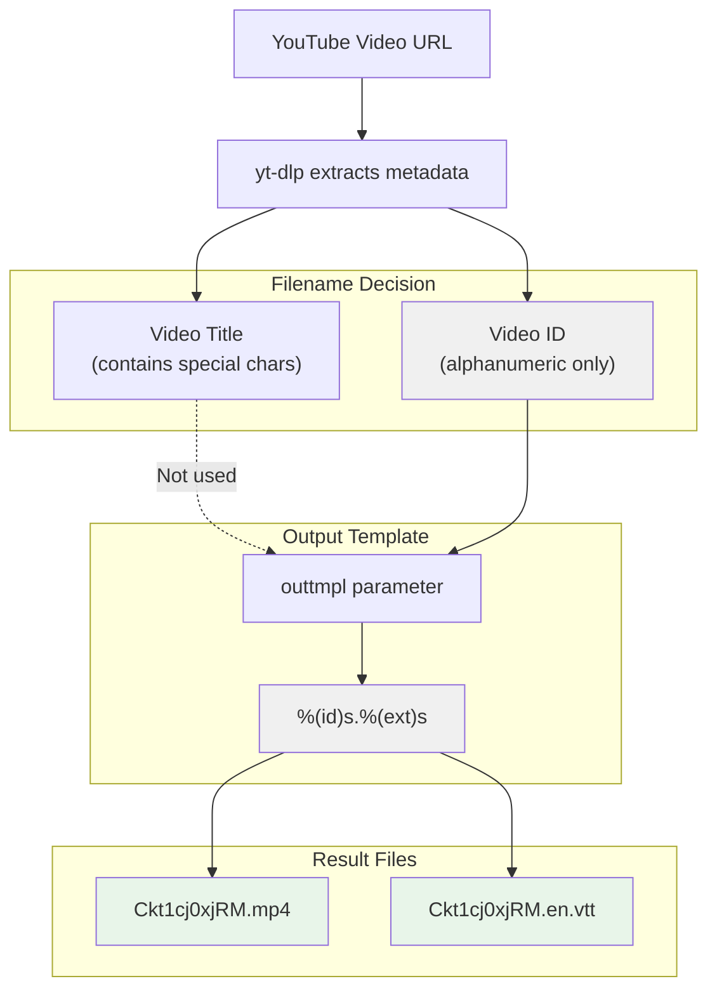
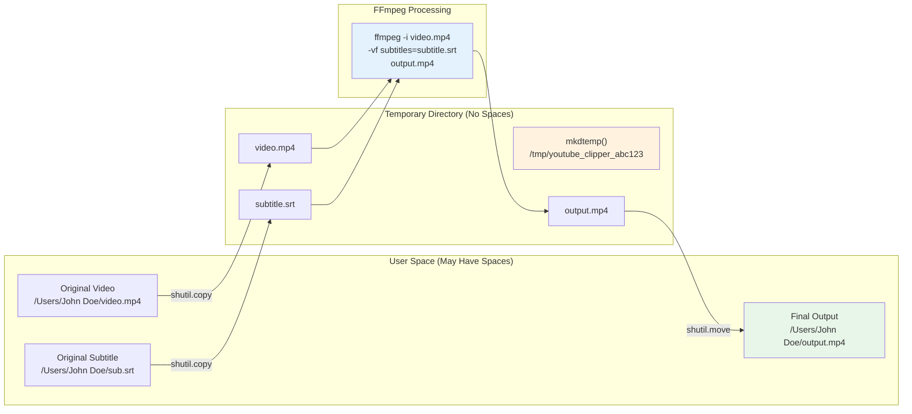
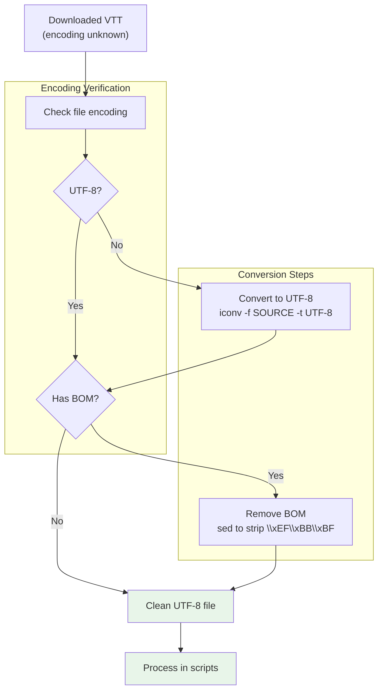
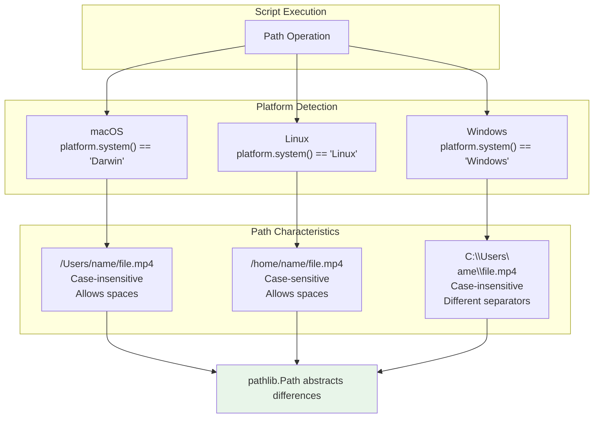
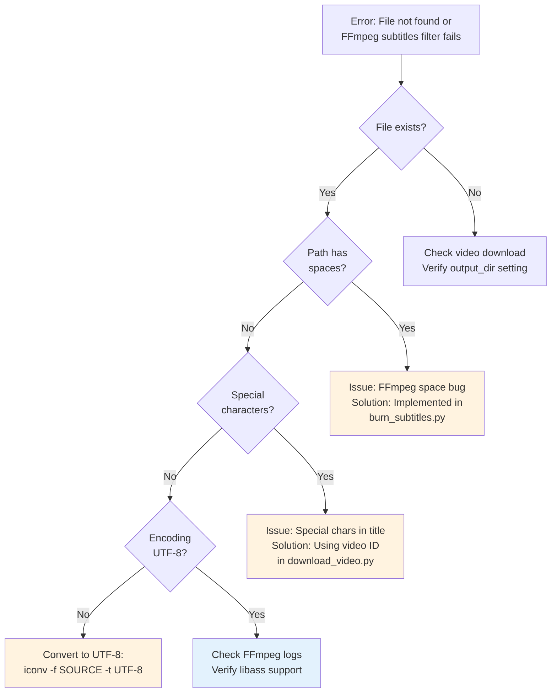

<!-- source: DeepWiki mcp.deepwiki.com · repo op7418/Youtube-clipper-skill · page 8.4 File Path and Encoding Issues · fetched 2026-10-26 -->

# File Path and Encoding Issues

<details>
<summary>Relevant source files</summary>

The following files were used as context for generating this wiki page:

- [FIXES_AND_IMPROVEMENTS.md](FIXES_AND_IMPROVEMENTS.md)
- [TECHNICAL_NOTES.md](TECHNICAL_NOTES.md)
- [references/subtitle-formatting.md](references/subtitle-formatting.md)

</details>


This document addresses common problems related to file paths and character encoding encountered when processing YouTube videos. These issues can cause failures during video download, subtitle processing, or FFmpeg operations.

For issues specifically related to FFmpeg and libass installation, see [FFmpeg and libass Problems](#8.2). For general download problems, see [Download and Network Issues](#8.3).

## Overview of Path and Encoding Problems

The YouTube Clipper Skill encounters file path and encoding issues in three main areas:

1. **Special characters in video titles** causing filename problems
2. **Spaces in file paths** breaking FFmpeg subtitle filters
3. **Subtitle encoding** issues preventing proper text display

These problems can manifest during different stages of the processing pipeline and require specific workarounds.

Sources: [FIXES_AND_IMPROVEMENTS.md:58-93](), [TECHNICAL_NOTES.md:83-163]()

## File Path Special Characters Problem

### Problem Description

YouTube video titles often contain special characters that create problems when used in filenames:

| Character Type | Examples | Issues Caused |
|---------------|----------|---------------|
| Special punctuation | `'` `"` `:` `?` `*` | Shell command parsing errors |
| Unicode characters | `：` (full-width colon) | Path resolution failures |
| Spaces | Multiple consecutive spaces | Inconsistent path handling |
| Slashes | `/` `\` | Directory separator conflicts |

**Real-world example**: A video titled `Anthropic's Amodei on AI： Power and Risk` contains:
- Single quote (`'`) causing shell escaping issues
- Full-width colon (`：`) instead of regular colon
- Multiple spaces

Sources: [FIXES_AND_IMPROVEMENTS.md:58-69]()

### Original Implementation Issue

The initial implementation used video titles in output filenames:

```python
# Original approach (problematic)
'outtmpl': str(output_dir / '%(title)s [%(id)s].%(ext)s')
# Result: "Anthropic's Amodei on AI： Power and Risk [Ckt1cj0xjRM].mp4"
```

This caused:
- File not found errors when paths were passed to other scripts
- Shell command failures when quotes weren't properly escaped
- Inconsistent behavior across different operating systems

Sources: [FIXES_AND_IMPROVEMENTS.md:73-82](), [scripts/download_video.py:67]()

### Solution: Video ID-Based Filenames

The system now uses YouTube video IDs instead of titles for filenames:

```python
# Fixed approach
'outtmpl': str(output_dir / '%(id)s.%(ext)s')
# Result: "Ckt1cj0xjRM.mp4"
```

**Advantages**:
- Video IDs contain only alphanumeric characters, hyphens, and underscores
- Guaranteed uniqueness (no filename conflicts)
- Consistent length and format (typically 11 characters)
- Safe for all operating systems and shell commands
- Traceable back to original video

Sources: [FIXES_AND_IMPROVEMENTS.md:83-92](), [scripts/download_video.py:67]()

### Filename Sanitization Flow



Sources: [scripts/download_video.py:45-92]()

## FFmpeg Path Space Limitation

### The Core Problem

FFmpeg's `subtitles` filter has a known bug where it cannot correctly parse file paths containing spaces, regardless of quoting or escaping attempts.

**Failed attempts** (all produce the same error):

```bash
# Attempt 1: Double quotes
ffmpeg -i video.mp4 -vf "subtitles='/path/with spaces/sub.srt'" output.mp4

# Attempt 2: Escaped spaces
ffmpeg -i video.mp4 -vf "subtitles=/path/with\ spaces/sub.srt" output.mp4

# Attempt 3: Mixed quoting
ffmpeg -i video.mp4 -vf subtitles="'/path/with spaces/sub.srt'" output.mp4

# Error (all cases):
# [Parsed_subtitles_0 @ 0x...] Unable to find '/path/with'
```

Note how the path is **truncated at the first space** (`/path/with spaces` → `/path/with`).

Sources: [TECHNICAL_NOTES.md:83-110]()

### Temporary Directory Workaround

The only reliable solution is to copy files to a temporary directory with a space-free path:



Sources: [TECHNICAL_NOTES.md:113-148](), [scripts/burn_subtitles.py:1-150]()

### Implementation in burn_subtitles.py

The temporary directory solution is implemented in [scripts/burn_subtitles.py:60-150]():

**Key steps**:

1. **Create temporary directory** with guaranteed space-free path:
   ```python
   temp_dir = tempfile.mkdtemp(prefix='youtube_clipper_')
   # Result: /tmp/youtube_clipper_xyz789
   ```

2. **Copy input files** to temporary directory with simple names:
   ```python
   temp_video = os.path.join(temp_dir, 'video.mp4')
   temp_subtitle = os.path.join(temp_dir, 'subtitle.srt')
   ```

3. **Run FFmpeg** with space-free paths:
   ```python
   cmd = [ffmpeg_path, '-i', temp_video, '-vf', 
          f'subtitles={temp_subtitle}:force_style=...', temp_output]
   ```

4. **Move result** back to original output location:
   ```python
   shutil.move(temp_output, output_path)
   ```

5. **Clean up** temporary directory:
   ```python
   shutil.rmtree(temp_dir, ignore_errors=True)
   ```

Sources: [scripts/burn_subtitles.py:60-150](), [TECHNICAL_NOTES.md:113-163]()

### Why This Approach Works

| Aspect | Details |
|--------|---------|
| `tempfile.mkdtemp()` | Creates directories like `/tmp/youtube_clipper_xyz789` (no spaces) |
| Platform compatibility | Works on Linux, macOS, Windows (uses OS temp directory) |
| User transparency | Original input/output paths can contain any characters |
| Performance | Copy overhead is minimal compared to FFmpeg processing time |
| Cleanup | `finally` block ensures temp files are removed even on error |

Sources: [TECHNICAL_NOTES.md:150-163]()

## Subtitle Encoding Issues

### Common Encoding Problems

Subtitle files from various sources may have encoding issues:

| Problem | Symptoms | Common Sources |
|---------|----------|----------------|
| Non-UTF-8 encoding | Garbled text, mojibake characters | Chinese/Japanese subtitles (GBK, Shift-JIS) |
| UTF-8 BOM | First subtitle displays incorrectly | Windows text editors |
| Mixed encoding | Some lines display correctly, others don't | Manual subtitle editing |
| Invalid characters | FFmpeg parsing errors | Corrupted downloads |

Sources: [references/subtitle-formatting.md:305-328]()

### Encoding Detection and Conversion

The system expects **UTF-8 encoding without BOM** for all subtitle files.



Sources: [references/subtitle-formatting.md:307-328]()

### Encoding Verification Commands

**Check current encoding**:
```bash
file -i subtitle.srt
# Output: subtitle.srt: text/plain; charset=utf-8
```

**Convert GBK to UTF-8**:
```bash
iconv -f GBK -t UTF-8 input.srt > output.srt
```

**Remove UTF-8 BOM**:
```bash
sed -i '1s/^\xEF\xBB\xBF//' subtitle.srt
```

**Python encoding detection**:
```python
# Open with explicit UTF-8 (will fail if not UTF-8)
with open(subtitle_path, 'r', encoding='utf-8') as f:
    content = f.read()
```

Sources: [references/subtitle-formatting.md:312-328]()

### Why UTF-8 Without BOM

| Requirement | Reason |
|------------|--------|
| UTF-8 encoding | Supports all languages (English, Chinese, Japanese, etc.) |
| No BOM | BOM (`\xEF\xBB\xBF`) causes FFmpeg to display incorrectly in first subtitle |
| Consistent encoding | All scripts assume UTF-8, avoiding conversion overhead |
| Standard compliance | SRT and VTT specifications recommend UTF-8 |

Sources: [references/subtitle-formatting.md:305-328]()

## Cross-Platform Path Handling

### Using pathlib for Portability

The codebase uses Python's `pathlib` module to ensure cross-platform compatibility:

```python
from pathlib import Path

# ✅ Correct: Platform-independent
video_path = Path('/path/to/video.mp4')
output_path = output_dir / 'video.mp4'

# ❌ Avoid: Platform-specific
video_path = '/path/to/video.mp4'  # Unix-style
output_path = output_dir + '\\video.mp4'  # Windows-style
```

Sources: [TECHNICAL_NOTES.md:416-441](), [scripts/utils.py:1-200]()

### Path Construction Patterns

| Pattern | Example | Notes |
|---------|---------|-------|
| Join paths | `base_dir / 'video.mp4'` | Use `/` operator with Path objects |
| Check existence | `path.exists()` | Returns True/False |
| Get parent | `path.parent` | Returns parent directory as Path |
| Get filename | `path.name` | Returns filename with extension |
| Get stem | `path.stem` | Returns filename without extension |
| Convert to string | `str(path)` | When passing to external commands |

Sources: [TECHNICAL_NOTES.md:416-441]()

### Platform-Specific Considerations



Sources: [scripts/burn_subtitles.py:20-45]()

### FFmpeg Path Handling

When passing paths to FFmpeg:

1. **Convert Path objects to strings**: `str(path)`
2. **Use list-style subprocess calls**: Avoids shell escaping issues
3. **Use temporary directory for spaces**: As described above

```python
# ✅ Correct: List-style command
cmd = [
    str(ffmpeg_path),
    '-i', str(input_path),
    '-vf', f'subtitles={str(subtitle_path)}',
    str(output_path)
]
subprocess.run(cmd, check=True)

# ❌ Avoid: String-style command (requires manual escaping)
cmd = f'{ffmpeg_path} -i {input_path} -vf subtitles={subtitle_path} {output_path}'
subprocess.run(cmd, shell=True)  # Unsafe
```

Sources: [scripts/burn_subtitles.py:90-150](), [scripts/clip_video.py:1-100]()

## Troubleshooting Steps

### Diagnosing File Path Problems



Sources: [FIXES_AND_IMPROVEMENTS.md:1-293](), [TECHNICAL_NOTES.md:1-490]()

### Common Error Messages and Solutions

| Error Message | Cause | Solution |
|---------------|-------|----------|
| `Unable to find '/path/with'` | Path contains spaces | Automatic: `burn_subtitles.py` uses temp directory |
| `File not found: 'video_title.mp4'` | Special characters in filename | Fixed: Video IDs used in `download_video.py:67` |
| `UnicodeDecodeError` | Non-UTF-8 subtitle encoding | Convert: `iconv -f GBK -t UTF-8 input.srt > output.srt` |
| First subtitle garbled | UTF-8 BOM present | Remove: `sed -i '1s/^\xEF\xBB\xBF//' subtitle.srt` |
| `No such file or directory` | Path object not converted to string | Convert: `str(path)` before passing to subprocess |

Sources: [FIXES_AND_IMPROVEMENTS.md:1-293](), [TECHNICAL_NOTES.md:83-163](), [references/subtitle-formatting.md:395-423]()

### Verification Commands

**Test file path handling**:
```bash
# Create test file with spaces
mkdir -p "/tmp/test path/youtube-clips"
touch "/tmp/test path/youtube-clips/test.srt"

# Python pathlib should handle this correctly
python3 -c "from pathlib import Path; p = Path('/tmp/test path/youtube-clips/test.srt'); print(p.exists())"
```

**Test subtitle encoding**:
```bash
# Check encoding
file -i subtitle.srt

# Test UTF-8 validity
iconv -f UTF-8 -t UTF-8 subtitle.srt > /dev/null && echo "Valid UTF-8"
```

**Test FFmpeg with subtitle**:
```bash
# This should work (no spaces)
ffmpeg -i video.mp4 -vf subtitles=/tmp/test.srt -t 5 test_output.mp4

# This will fail (spaces in path)
ffmpeg -i video.mp4 -vf "subtitles=/tmp/test path/test.srt" -t 5 test_output.mp4
```

Sources: [TECHNICAL_NOTES.md:1-490]()

### Prevention Best Practices

The codebase implements these preventive measures:

1. **Video IDs for downloads** [scripts/download_video.py:67]()
   - Eliminates special character problems at the source

2. **Temporary directory for FFmpeg** [scripts/burn_subtitles.py:60-150]()
   - Automatically handles space-in-path issues

3. **Path objects throughout** [scripts/utils.py:1-200]()
   - Ensures cross-platform compatibility

4. **Explicit UTF-8 encoding** [scripts/extract_subtitle_clip.py:1-100]()
   - Prevents encoding-related failures

5. **Error messages with context** [TECHNICAL_NOTES.md:444-475]()
   - Helps users diagnose issues quickly

Sources: [FIXES_AND_IMPROVEMENTS.md:207-237](), [TECHNICAL_NOTES.md:444-490]()

---

