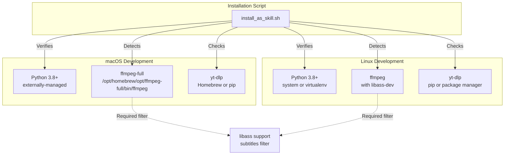
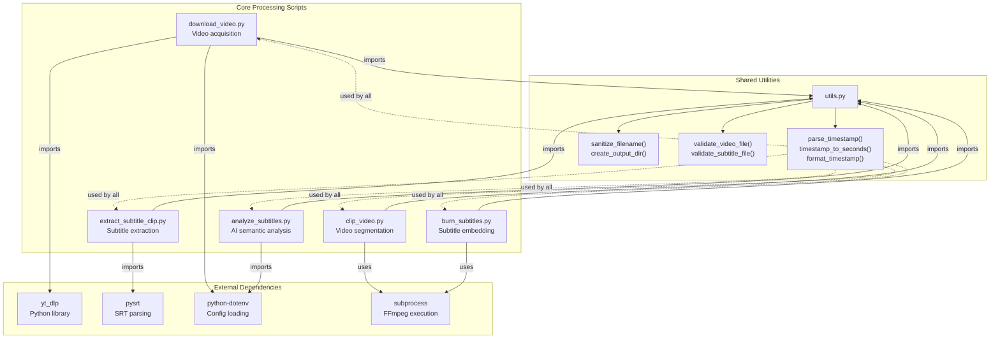
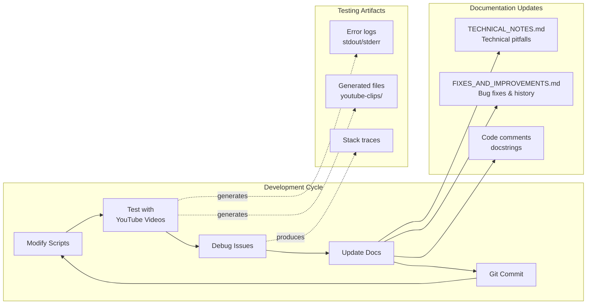
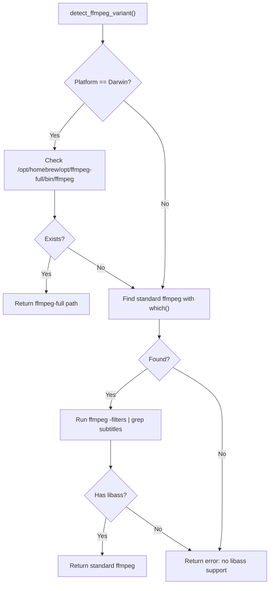
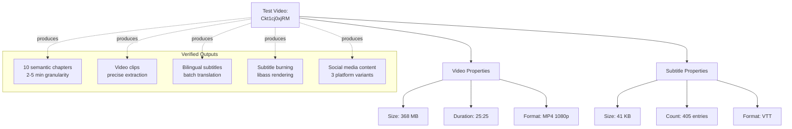

<!-- source: DeepWiki mcp.deepwiki.com · repo op7418/Youtube-clipper-skill · page 9 Development · fetched 2026-10-26 -->

# Development

<details>
<summary>Relevant source files</summary>

The following files were used as context for generating this wiki page:

- [.gitignore](.gitignore)
- [FIXES_AND_IMPROVEMENTS.md](FIXES_AND_IMPROVEMENTS.md)
- [TECHNICAL_NOTES.md](TECHNICAL_NOTES.md)

</details>


This document provides technical guidance for developers working with the YouTube Clipper Skill codebase. It covers the repository structure, development practices, testing procedures, and contribution guidelines. For architectural details about how components interact, see [Architecture](#3). For detailed documentation of individual scripts, see [Core Scripts](#4).

## Development Environment

### Prerequisites

The YouTube Clipper Skill requires a specific development environment with both Python dependencies and external binary tools.

**Python Requirements:**
- Python 3.8 or higher
- Package dependencies: `yt-dlp`, `pysrt`, `python-dotenv`

**External Tools:**
- `yt-dlp` CLI tool for video downloading
- `FFmpeg` with `libass` support for video processing and subtitle burning
- Standard Unix utilities (`which`, `grep`, `mktemp`)

**Platform Considerations:**



Sources: [install_as_skill.sh](), [TECHNICAL_NOTES.md:1-79]()

### Installing Dependencies

On macOS with externally-managed Python environments, use the `--break-system-packages` flag:

```bash
pip3 install --break-system-packages yt-dlp pysrt python-dotenv
```

For FFmpeg with libass support on macOS:

```bash
brew install ffmpeg-full
```

The standard Homebrew `ffmpeg` formula does not include libass. The `detect_ffmpeg_variant()` function in `burn_subtitles.py` checks for the appropriate FFmpeg installation.

Sources: [FIXES_AND_IMPROVEMENTS.md:9-24](), [TECHNICAL_NOTES.md:5-79]()

## Repository Organization

The repository follows a modular structure with clear separation between source code, documentation, configuration, and outputs.

```mermaid
graph TB
    Root["Repository Root"]
    
    subgraph "Source Code"
        Scripts["scripts/<br/>Python modules"]
        Download["download_video.py"]
        Analyze["analyze_subtitles.py"]
        Clip["clip_video.py"]
        Burn["burn_subtitles.py"]
        Extract["extract_subtitle_clip.py"]
        Utils["utils.py"]
    end
    
    subgraph "Configuration & Setup"
        EnvExample[".env.example<br/>Configuration template"]
        EnvFile[".env<br/>User configuration"]
        Install["install_as_skill.sh<br/>Setup automation"]
    end
    
    subgraph "Documentation"
        ReadmeEN["README.md"]
        ReadmeCN["README.zh-CN.md"]
        SkillDoc["SKILL.md"]
        TechNotes["TECHNICAL_NOTES.md"]
        Fixes["FIXES_AND_IMPROVEMENTS.md"]
    end
    
    subgraph "Development Files"
        GitIgnore[".gitignore<br/>Exclusion patterns"]
        GitHub[".github/<br/>Repository metadata"]
        Refs["references/<br/>Technical guides"]
    end
    
    subgraph "Runtime Generated"
        Output["youtube-clips/<br/>Output directory"]
        Temp["temp/<br/>Temporary files"]
    end
    
    Root --> Scripts
    Scripts --> Download
    Scripts --> Analyze
    Scripts --> Clip
    Scripts --> Burn
    Scripts --> Extract
    Scripts --> Utils
    
    Root --> EnvExample
    Root --> EnvFile
    Root --> Install
    
    Root --> ReadmeEN
    Root --> ReadmeCN
    Root --> SkillDoc
    Root --> TechNotes
    Root --> Fixes
    
    Root --> GitIgnore
    Root --> GitHub
    Root --> Refs
    
    Root -.->|"Creates"| Output
    Root -.->|"Creates"| Temp
    
    Utils -.->|"Imported by"| Download
    Utils -.->|"Imported by"| Analyze
    Utils -.->|"Imported by"| Clip
    Utils -.->|"Imported by"| Burn
    Utils -.->|"Imported by"| Extract
```



Sources: [.gitignore:1-52]()

### Key Directories and Files

| Path | Purpose | Generated? |
|------|---------|-----------|
| `scripts/` | All Python processing modules | No |
| `scripts/utils.py` | Shared utility functions across all scripts | No |
| `.env` | User-specific configuration (not committed) | Yes |
| `.env.example` | Configuration template with defaults | No |
| `TECHNICAL_NOTES.md` | Technical pitfalls and solutions | No |
| `FIXES_AND_IMPROVEMENTS.md` | Development history and bug fixes | No |
| `youtube-clips/` | Output directory for processed videos | Yes |
| `temp/` | Temporary files during processing | Yes |

The `.gitignore` file excludes runtime-generated content to keep the repository clean:

- Python artifacts: `__pycache__/`, `*.pyc`, `.eggs/`
- Configuration: `.env`, `.env.local`
- Outputs: `youtube-clips/`, `outputs/`, `downloads/`, `temp/`
- Media files: `*.mp4`, `*.vtt`, `*.srt`
- Test files: `test_*.py`, `*_test.py`

Sources: [.gitignore:1-52]()

## Script Interdependencies

Understanding the dependency relationships between scripts is essential for development work.



Sources: [scripts/utils.py](), [scripts/download_video.py](), [scripts/analyze_subtitles.py](), [scripts/clip_video.py](), [scripts/burn_subtitles.py](), [scripts/extract_subtitle_clip.py]()

### Module Responsibilities

The `utils.py` module serves as the foundation for all processing scripts. It provides:

- **Time Conversion**: `parse_timestamp()`, `timestamp_to_seconds()`, `format_timestamp()`
- **File Management**: `sanitize_filename()`, `create_output_dir()`, `ensure_directory_exists()`
- **Validation**: `validate_video_file()`, `validate_subtitle_file()`, `check_file_exists()`
- **Path Handling**: Cross-platform path resolution using `pathlib.Path`

Each script imports from `utils.py` rather than duplicating functionality. This centralization simplifies maintenance and ensures consistent behavior across the system.

Sources: [scripts/utils.py]()

## Development Workflow

The typical development cycle involves modifying scripts, testing with real YouTube videos, and documenting any issues or improvements.



### Iterative Testing Process

Development follows an iterative testing approach documented in `FIXES_AND_IMPROVEMENTS.md`. The file records:

- **Problem Description**: Detailed error messages and symptoms
- **Root Cause**: Analysis of why the issue occurred
- **Solution**: Code changes with before/after examples
- **Verification**: Testing results confirming the fix

For example, the division by zero error in the download progress hook was fixed by adding a null check:

```python
# Before (line 161):
if 'downloaded_bytes' in d and 'total_bytes' in d:
    percent = d['downloaded_bytes'] / d['total_bytes'] * 100

# After:
if 'downloaded_bytes' in d and 'total_bytes' in d and d['total_bytes']:
    percent = d['downloaded_bytes'] / d['total_bytes'] * 100
```

Sources: [FIXES_AND_IMPROVEMENTS.md:28-54](), [scripts/download_video.py:156-178]()

## Recent Fixes and Improvements

The development history is thoroughly documented in `FIXES_AND_IMPROVEMENTS.md`, which tracks all significant bugs and improvements. Understanding this history helps avoid reintroducing solved problems.

### Major Fixes Implemented

| Issue | Impact | Solution | Status |
|-------|--------|----------|--------|
| Missing Python dependencies | Module import failures | Install with `--break-system-packages` | ✅ Fixed |
| Download progress division by zero | Crash during download | Null check for `total_bytes` | ✅ Fixed |
| Special characters in filenames | Path handling failures | Use video ID instead of title | ✅ Fixed |
| Output directory location | User confusion | Changed from `~/Videos` to `./youtube-clips` | ✅ Fixed |

### Special Characters in Filenames

The original implementation used video titles in output filenames via the template `'outtmpl': str(output_dir / '%(title)s [%(id)s].%(ext)s')`. This caused problems when titles contained:

- Single quotes (`'`)
- Full-width colons (`：` instead of `:`)
- Special Unicode characters

The fix changed to using only the video ID, which contains only safe characters (letters, numbers, hyphens, underscores):

```python
# Fixed template (line 67):
'outtmpl': str(output_dir / '%(id)s.%(ext)s')
```

This produces clean filenames like `Ckt1cj0xjRM.mp4` instead of `Anthropic's Amodei on AI： Power and Risk [Ckt1cj0xjRM].mp4`.

Sources: [FIXES_AND_IMPROVEMENTS.md:58-93](), [scripts/download_video.py:67]()

### Output Directory Change

User feedback indicated confusion about output location. The original default was `~/Videos/youtube-clips/`, which users didn't expect. The fix changed the default to `./youtube-clips/` (current working directory):

```python
# In utils.py (line 146):
# Before:
if base_dir is None:
    base_dir = Path.home() / "Videos" / "youtube-clips"

# After:
if base_dir is None:
    base_dir = Path.cwd() / "youtube-clips"
```

This aligns with user expectations and makes output files easier to locate.

Sources: [FIXES_AND_IMPROVEMENTS.md:96-134](), [scripts/utils.py:131-148]()

## Technical Pitfalls

The `TECHNICAL_NOTES.md` file documents critical technical challenges encountered during development. Developers modifying the codebase should review these to avoid common mistakes.

### FFmpeg libass Support Detection

Standard FFmpeg installations often lack libass support, which is required for the `subtitles` filter used in subtitle burning. The system implements a detection strategy:



Sources: [TECHNICAL_NOTES.md:5-79](), [scripts/burn_subtitles.py]()

### Temporary Directory Workaround for Path Spaces

FFmpeg's `subtitles` filter cannot handle file paths containing spaces, even with proper quoting or escaping. The solution uses a temporary directory with guaranteed space-free paths:

```python
# Pattern used in burn_subtitles.py:
temp_dir = tempfile.mkdtemp(prefix='youtube_clipper_')  # e.g., /tmp/youtube_clipper_abc123
try:
    # Copy files to temp_dir
    temp_video = os.path.join(temp_dir, 'video.mp4')
    temp_subtitle = os.path.join(temp_dir, 'subtitle.srt')
    shutil.copy(video_path, temp_video)
    shutil.copy(subtitle_path, temp_subtitle)
    
    # Process with space-free paths
    # ...
    
finally:
    shutil.rmtree(temp_dir, ignore_errors=True)
```

This approach is transparent to the user while working around FFmpeg's limitation.

Sources: [TECHNICAL_NOTES.md:82-163](), [scripts/burn_subtitles.py]()

### VTT to SRT Conversion

YouTube provides subtitles in VTT format, but FFmpeg's subtitle filter works better with SRT format. The key differences:

| Aspect | VTT | SRT |
|--------|-----|-----|
| Header | `WEBVTT` required | No header |
| Time separator | `.` (dot) | `,` (comma) |
| Sequence numbers | Optional | Required |
| Styling | Supported | Not supported |

The conversion must handle these differences while preserving subtitle content and timing.

Sources: [TECHNICAL_NOTES.md:166-213]()

### Batch Translation Optimization

A 30-minute video typically has 600 subtitle entries. Translating each individually would require 600 API calls. Batching 20-25 subtitles per call reduces this to ~30 calls, saving 95% of API usage while maintaining translation quality through context preservation.

The batch size of 20-25 is empirically determined:
- **Too small (< 20)**: Unnecessary API overhead
- **Too large (> 30)**: Translation quality degrades
- **Optimal (20-25)**: Best balance of efficiency and quality

Sources: [TECHNICAL_NOTES.md:260-305]()

## Testing and Verification

The system has been validated through real-world testing with actual YouTube videos. The test case documented in `FIXES_AND_IMPROVEMENTS.md` provides a comprehensive verification of all features.

### Test Video Specifications



Sources: [FIXES_AND_IMPROVEMENTS.md:240-272]()

### Verified Functionality

The complete workflow has been tested end-to-end:

1. **Environment Detection**: yt-dlp and FFmpeg libass support confirmed
2. **Video Download**: 368 MB video with 405 subtitles downloaded successfully
3. **AI Chapter Analysis**: 10 semantic chapters generated (not mechanical time-based splits)
4. **Video Clipping**: Precise 2-minute segment extracted using FFmpeg
5. **Subtitle Processing**: 35 subtitles extracted, time-adjusted, and translated
6. **Subtitle Burning**: Bilingual subtitles embedded using libass filter
7. **Content Generation**: Three platform-specific social media variants created

Each stage produced the expected outputs with correct formatting and no data loss.

Sources: [FIXES_AND_IMPROVEMENTS.md:153-204]()

### Testing Approach

When making changes to the codebase:

1. **Unit-level testing**: Test individual functions with known inputs
2. **Integration testing**: Run complete workflows with test videos
3. **Error scenario testing**: Verify error handling for missing dependencies, invalid inputs, network failures
4. **Cross-platform testing**: Verify behavior on both macOS and Linux
5. **Documentation**: Update `FIXES_AND_IMPROVEMENTS.md` and `TECHNICAL_NOTES.md` with findings

The `.gitignore` file excludes test files (`test_*.py`, `*_test.py`) from version control, allowing developers to create local test scripts without cluttering the repository.

Sources: [.gitignore:39-47](), [FIXES_AND_IMPROVEMENTS.md:153-204]()

## Code Quality Practices

### Error Handling

All scripts implement comprehensive error handling with informative messages:

- Check for missing dependencies at import time
- Validate input files before processing
- Capture subprocess output for debugging
- Provide actionable error messages with installation instructions

### Path Handling

Use `pathlib.Path` exclusively for cross-platform compatibility. The codebase avoids string concatenation for paths, which fails on Windows.

### Documentation

Code should be self-documenting with:
- Clear function names describing purpose
- Docstrings explaining parameters and return values
- Inline comments for non-obvious logic
- Updates to `TECHNICAL_NOTES.md` for complex solutions

Sources: [TECHNICAL_NOTES.md:444-475]()

## Configuration Management

The `.env.example` file serves as the template for user configuration. When adding new configuration options:

1. Add the variable to `.env.example` with a descriptive comment
2. Set a reasonable default value
3. Document the option in the Configuration section of the wiki
4. Implement fallback logic if the variable is not set

The `.env` file is excluded from version control to protect user-specific settings and API keys.

Sources: [.env.example](), [.gitignore:15-18]()

## Contributing Guidelines

### Before Submitting Changes

1. Test changes with real YouTube videos
2. Verify no regressions in existing functionality
3. Update documentation files (`TECHNICAL_NOTES.md`, `FIXES_AND_IMPROVEMENTS.md`)
4. Ensure `.gitignore` patterns cover any new generated files
5. Follow existing code style and patterns

### Documentation Standards

When documenting fixes or improvements:

- Include the full error message
- Explain the root cause
- Show before/after code with line numbers
- Document verification steps
- Mark status (✅ Fixed, ⚠️ Workaround, ❌ Unsolved)

Sources: [FIXES_AND_IMPROVEMENTS.md:1-292](), [TECHNICAL_NOTES.md:1-490]()

---

