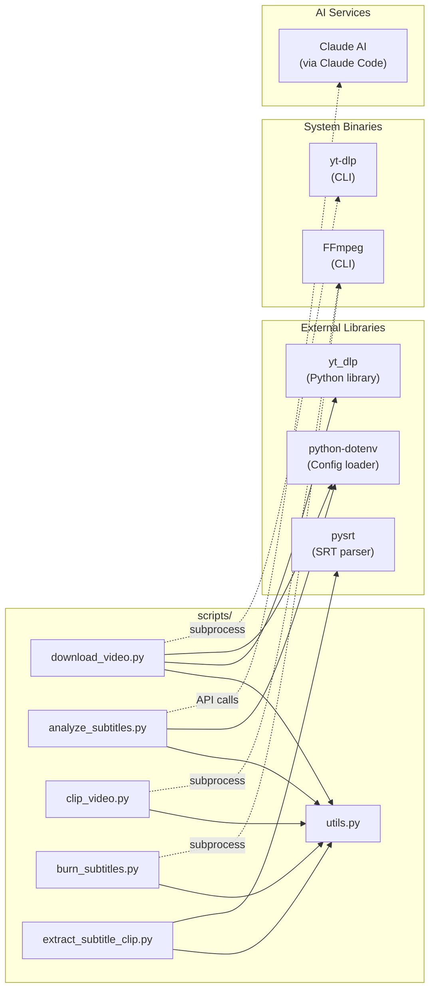
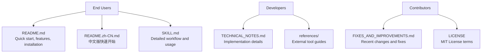
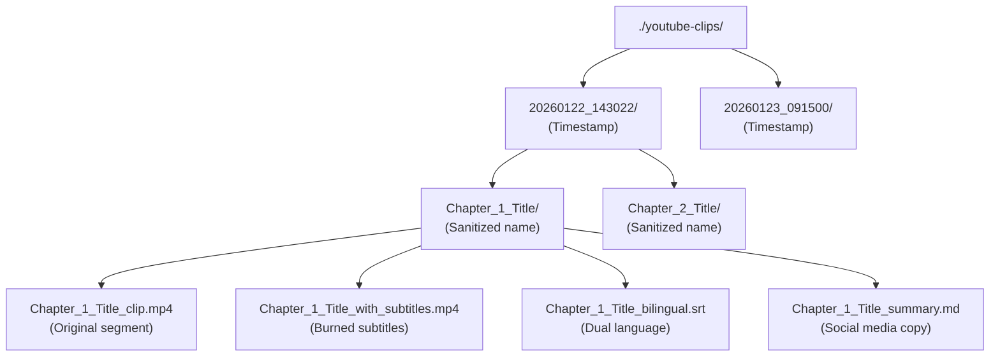
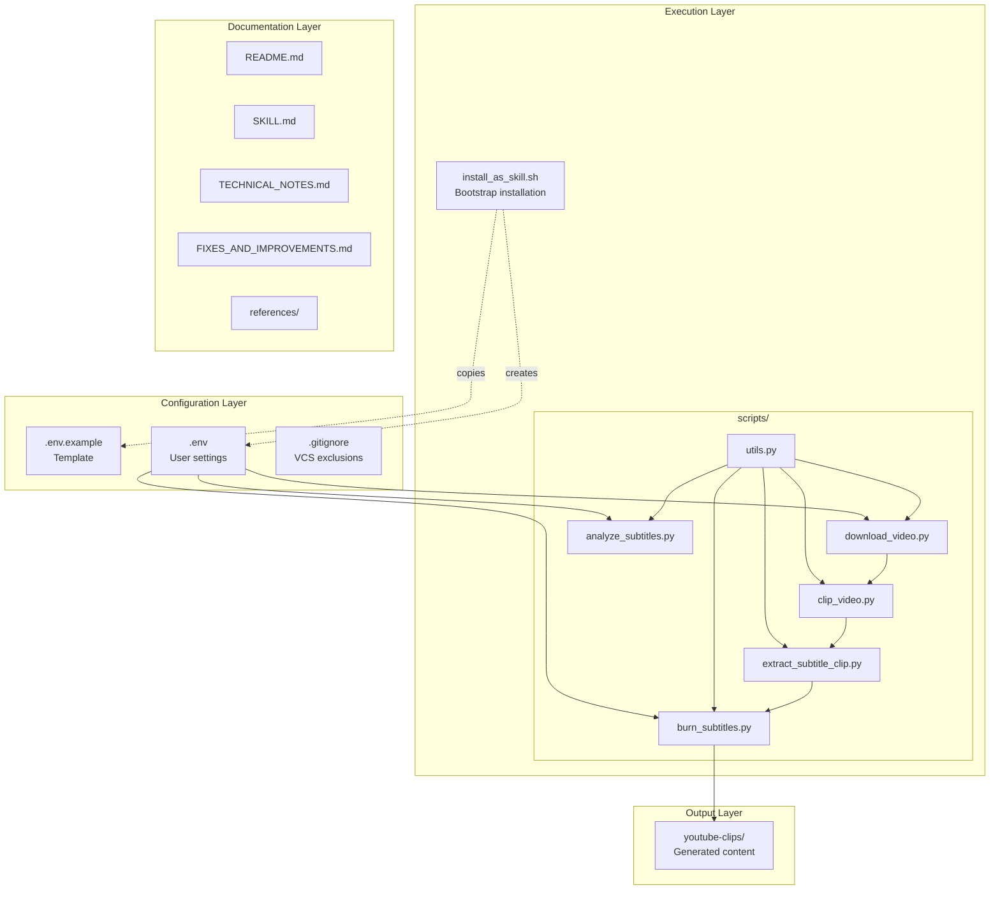

<!-- source: DeepWiki mcp.deepwiki.com · repo op7418/Youtube-clipper-skill · page 9.1 Project Structure · fetched 2026-10-26 -->

# Project Structure

<details>
<summary>Relevant source files</summary>

The following files were used as context for generating this wiki page:

- [.gitignore](.gitignore)
- [README.md](README.md)
- [scripts/__init__.py](scripts/__init__.py)

</details>


This document describes the physical organization of the YouTube Clipper Skill repository, including directory layout, file purposes, and the role of each component. For installation procedures, see [Installation](#2.1). For detailed information about individual Python scripts, see [Core Scripts](#4).

The repository follows a flat structure with most source code in the `scripts/` directory, documentation at the root level, and configuration managed through `.env` files. The skill is designed to be installed into `~/.claude/skills/youtube-clipper/` for use within the Claude Code environment.

---

## Repository Root Structure

The repository root contains three primary categories of files: documentation, configuration templates, and the installation script. All Python source code resides in the `scripts/` subdirectory.

```mermaid
graph TB
    Root["Repository Root<br/>(~/.claude/skills/youtube-clipper/)"]
    
    Root --> Scripts["scripts/<br/>Python modules"]
    Root --> Refs["references/<br/>Technical guides"]
    Root --> GitHub[".github/<br/>Metadata"]
    
    Root --> ConfigFiles["Configuration Files"]
    Root --> DocFiles["Documentation Files"]
    Root --> InstallFiles["Installation Files"]
    
    ConfigFiles --> EnvExample[".env.example<br/>Configuration template"]
    ConfigFiles --> GitIgnore[".gitignore<br/>Git exclusions"]
    
    DocFiles --> ReadmeEN["README.md<br/>English documentation"]
    DocFiles --> ReadmeCN["README.zh-CN.md<br/>Chinese documentation"]
    DocFiles --> SkillMD["SKILL.md<br/>Detailed usage guide"]
    DocFiles --> TechNotes["TECHNICAL_NOTES.md<br/>Implementation notes"]
    DocFiles --> Fixes["FIXES_AND_IMPROVEMENTS.md<br/>Changelog"]
    DocFiles --> License["LICENSE<br/>MIT License"]
    
    InstallFiles --> InstallScript["install_as_skill.sh<br/>Setup automation"]
    
    Scripts --> InitPy["__init__.py"]
    Scripts --> DownloadPy["download_video.py"]
    Scripts --> AnalyzePy["analyze_subtitles.py"]
    Scripts --> ClipPy["clip_video.py"]
    Scripts --> BurnPy["burn_subtitles.py"]
    Scripts --> ExtractPy["extract_subtitle_clip.py"]
    Scripts --> UtilsPy["utils.py"]
```



**Directory Tree Structure:**
```
youtube-clipper/
├── .github/                    # GitHub metadata
├── references/                 # Technical reference documents
├── scripts/                    # Python source code
│   ├── __init__.py            # Package initialization
│   ├── download_video.py      # Video acquisition
│   ├── analyze_subtitles.py   # AI chapter analysis
│   ├── clip_video.py          # Video segmentation
│   ├── burn_subtitles.py      # Subtitle embedding
│   ├── extract_subtitle_clip.py # Subtitle extraction
│   └── utils.py               # Shared utilities
├── .env.example               # Configuration template
├── .gitignore                 # Git exclusions
├── install_as_skill.sh        # Installation script
├── LICENSE                    # MIT License
├── README.md                  # English documentation
├── README.zh-CN.md           # Chinese documentation
├── SKILL.md                   # Detailed usage guide
├── TECHNICAL_NOTES.md        # Implementation notes
└── FIXES_AND_IMPROVEMENTS.md # Changelog
```

Sources: [README.md:1-320](), [.gitignore:1-52](), [scripts/__init__.py:1-8]()

---

## Source Code Directory: scripts/

All Python source code resides in the `scripts/` directory, which is structured as a Python package. Each script has a single, well-defined responsibility in the video processing pipeline.

### Core Processing Scripts

| File | Purpose | Primary Dependencies |
|------|---------|---------------------|
| `download_video.py` | Downloads YouTube videos and subtitles using yt-dlp | `yt_dlp`, `utils.py` |
| `analyze_subtitles.py` | Analyzes subtitle content to generate semantic chapters | Claude AI, `utils.py` |
| `clip_video.py` | Extracts video segments using FFmpeg | FFmpeg, `utils.py` |
| `burn_subtitles.py` | Burns subtitles into video files | FFmpeg with libass, `utils.py` |
| `extract_subtitle_clip.py` | Extracts and adjusts subtitle segments | `pysrt`, `utils.py` |
| `utils.py` | Provides shared utility functions for time conversion, file management, and validation | `python-dotenv`, `os`, `re` |

### Script Dependency Graph



### Package Initialization

The `scripts/__init__.py` file defines the package metadata:

- `__version__`: "1.0.0"
- `__author__`: "Claude Code"

[scripts/__init__.py:1-8]()

Sources: [README.md:42-46](), [README.md:60-66](), [scripts/__init__.py:1-8]()

---

## Configuration Files

### .env.example

The configuration template located at [.env.example]() provides default values and documentation for all environment variables. During installation, this file is copied to `.env` where users can customize settings. Key configuration categories include:

- File paths (FFmpeg location, output directories)
- Video download settings (quality limits, proxy configuration)
- Subtitle settings (font size, margins, target language)
- Processing settings (batch sizes, chapter duration targets)
- Logging levels

For complete configuration reference, see [Environment Variables Reference](#6.1).

### .gitignore

The [.gitignore:1-52]() file excludes several categories of files from version control:

**Python Artifacts:**
- `__pycache__/`, `*.py[cod]`, `*.egg-info/`
- Virtual environments: `venv/`, `env/`, `ENV/`

**Configuration:**
- `.env`, `.env.local`, `.env.*.local`

**Output Directories:**
- `youtube-clips/`, `outputs/`, `downloads/`, `temp/`, `tmp/`

**Media Files:**
- `*.mp4`, `*.webm`, `*.mkv`, `*.avi`, `*.vtt`, `*.srt`

**Development Files:**
- IDE configurations: `.vscode/`, `.idea/`
- Test files: `test_*.py`, `*_test.py`
- Logs: `*.log`, `logs/`

Sources: [.gitignore:1-52](), [README.md:129-154]()

---

## Documentation Structure

Documentation is organized into multiple files targeting different audiences and use cases:

### Primary Documentation



| File | Target Audience | Contents |
|------|----------------|----------|
| `README.md` | End users | Features overview, installation instructions, basic usage, troubleshooting |
| `README.zh-CN.md` | Chinese-speaking users | Full Chinese translation of README |
| `SKILL.md` | Advanced users | Complete workflow documentation, detailed usage patterns |
| `TECHNICAL_NOTES.md` | Developers | Architecture decisions, implementation notes, design rationale |
| `FIXES_AND_IMPROVEMENTS.md` | Developers/Contributors | Changelog, bug fixes, lessons learned |
| `LICENSE` | Legal compliance | MIT License text |

### References Directory

The `references/` directory contains technical reference materials for external dependencies and file format specifications. This typically includes:

- FFmpeg command reference
- yt-dlp usage patterns
- Subtitle format specifications (VTT, SRT)
- libass filter documentation

Sources: [README.md:282-287]()

---

## Installation Script: install_as_skill.sh

The [install_as_skill.sh]() script automates the installation process by performing these operations:

1. **Directory Creation**: Creates `~/.claude/skills/youtube-clipper/`
2. **File Copying**: Copies all necessary files to the skill directory
3. **Dependency Installation**: Installs Python packages (`yt-dlp`, `pysrt`, `python-dotenv`)
4. **Dependency Verification**: Checks for system dependencies (Python 3.8+, yt-dlp, FFmpeg)
5. **Configuration Setup**: Creates `.env` file from `.env.example` template
6. **Permission Setting**: Makes scripts executable

The script provides status messages throughout the process and reports any missing dependencies.

Sources: [README.md:36-47]()

---

## Output Directory Structure

Video processing outputs are written to `./youtube-clips/` by default (configurable via `OUTPUT_DIR` in `.env`). The output follows a three-level hierarchy to prevent file conflicts and maintain clear provenance.

### Output Hierarchy



**Directory Structure:**
```
./youtube-clips/
└── 20260122_143022/              # Timestamp: YYYYMMDD_HHMMSS
    ├── Chapter_1_AGI_Definition/
    │   ├── Chapter_1_AGI_Definition_clip.mp4
    │   ├── Chapter_1_AGI_Definition_with_subtitles.mp4
    │   ├── Chapter_1_AGI_Definition_bilingual.srt
    │   └── Chapter_1_AGI_Definition_summary.md
    └── Chapter_2_China_AI_Landscape/
        ├── Chapter_2_China_AI_Landscape_clip.mp4
        ├── Chapter_2_China_AI_Landscape_with_subtitles.mp4
        ├── Chapter_2_China_AI_Landscape_bilingual.srt
        └── Chapter_2_China_AI_Landscape_summary.md
```

### File Types Per Chapter

Each processed chapter can generate up to four file types:

1. **`*_clip.mp4`**: Video segment extracted from source (always generated)
2. **`*_with_subtitles.mp4`**: Video with burned-in bilingual subtitles (optional)
3. **`*_bilingual.srt`**: Separate bilingual subtitle file (optional)
4. **`*_summary.md`**: Social media content summary (optional)

The actual files generated depend on user selections during the workflow.

Sources: [README.md:112-124](), [.gitignore:32-37]()

---

## Files by Functional Category

The following diagram categorizes repository files by their primary function, showing the relationship between code, configuration, documentation, and output.



### Category Breakdown

**Execution Layer:**
- Installation automation: `install_as_skill.sh`
- Core processing: All Python scripts in `scripts/`
- Shared utilities: `utils.py`

**Configuration Layer:**
- Template: `.env.example`
- User configuration: `.env` (created during installation)
- Version control: `.gitignore`

**Documentation Layer:**
- User guides: `README.md`, `README.zh-CN.md`, `SKILL.md`
- Technical documentation: `TECHNICAL_NOTES.md`, `FIXES_AND_IMPROVEMENTS.md`
- Reference materials: `references/` directory
- Legal: `LICENSE`

**Output Layer:**
- Generated content: `youtube-clips/` directory (excluded from VCS)
- Temporary files: Cleaned up after processing by default

Sources: [README.md:1-320](), [.gitignore:1-52](), [scripts/__init__.py:1-8]()

---

## Installation Target Directory

When installed via `install_as_skill.sh` or `npx skills`, the entire repository is copied to:

```
~/.claude/skills/youtube-clipper/
```

This location allows Claude Code to discover and invoke the skill. The directory structure remains identical to the source repository, with the addition of a `.env` file created from `.env.example`.

The skill is invoked by Claude Code when users provide natural language commands related to YouTube video clipping. For workflow details, see [Understanding the Workflow](#2.3).

Sources: [README.md:28-47]()

---

