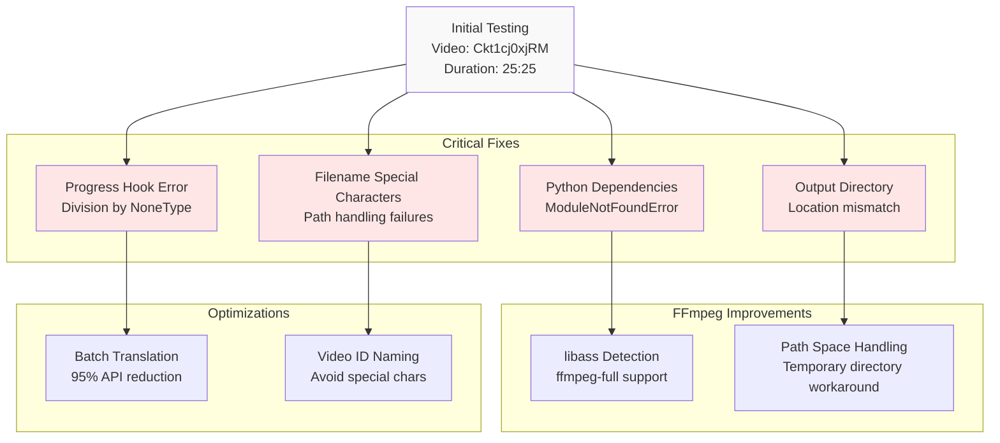
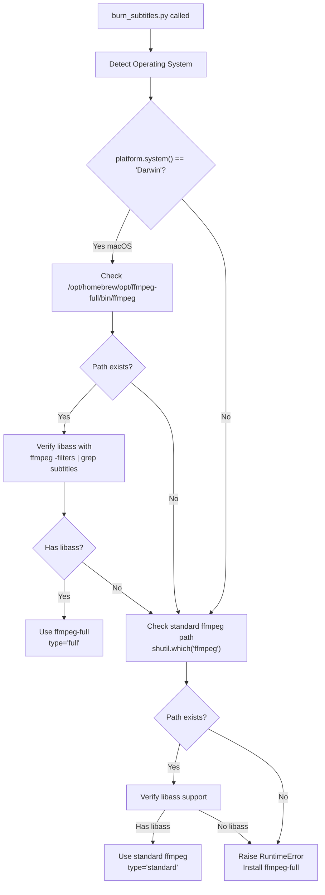
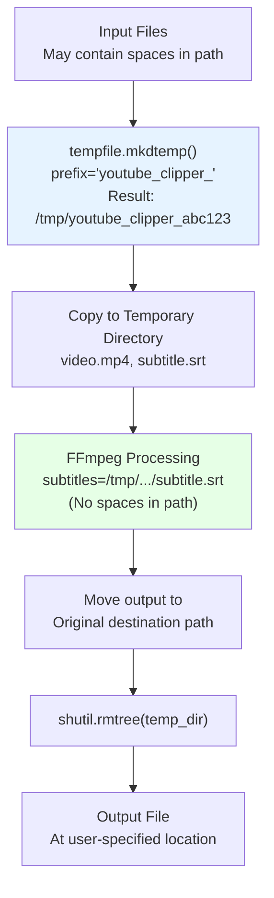
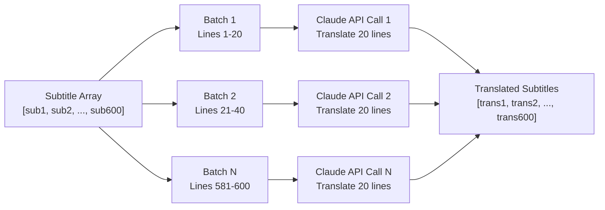
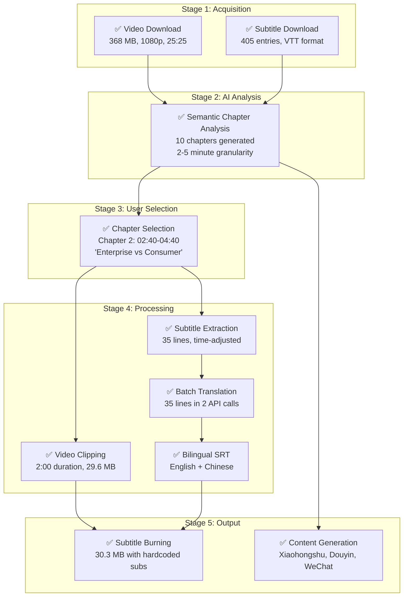

<!-- source: DeepWiki mcp.deepwiki.com · repo op7418/Youtube-clipper-skill · page 9.2 Recent Fixes and Improvements · fetched 2026-10-26 -->

# Recent Fixes and Improvements

<details>
<summary>Relevant source files</summary>

The following files were used as context for generating this wiki page:

- [FIXES_AND_IMPROVEMENTS.md](FIXES_AND_IMPROVEMENTS.md)
- [README.md](README.md)
- [TECHNICAL_NOTES.md](TECHNICAL_NOTES.md)

</details>


## Purpose and Scope

This document details the bug fixes, architectural improvements, and optimization changes made to the YouTube Clipper Skill during initial testing and subsequent development. Each fix is documented with the problem encountered, root cause analysis, solution implemented, and verification results.

For information about core script functionality, see [Core Scripts](#4). For FFmpeg integration details, see [FFmpeg Integration](#5.2). For troubleshooting user-facing issues, see [Troubleshooting](#8).

---

## Overview of Major Fixes

The YouTube Clipper Skill underwent comprehensive testing that revealed five critical issues and several optimization opportunities. All core functionality has been verified and is production-ready.

### Fix Implementation Timeline



**Sources:** [FIXES_AND_IMPROVEMENTS.md:1-293]()

---

## Critical Bug Fixes

### Python Dependency Installation

#### Problem

`ModuleNotFoundError` was raised when attempting to import `yt_dlp` and `pysrt` modules on macOS systems.

```
ModuleNotFoundError: No module named 'yt_dlp'
ModuleNotFoundError: No module named 'pysrt'
```

#### Root Cause

macOS Python environments are marked as "externally-managed" (PEP 668), preventing standard `pip install` commands from modifying system Python packages without explicit override flags.

#### Solution

The installation script was updated to use `--break-system-packages` flag for pip installations on systems with externally-managed Python environments.

```bash
# install_as_skill.sh implementation
pip3 install --break-system-packages yt-dlp pysrt python-dotenv
```

#### Verification

All three required packages (`yt-dlp`, `pysrt`, `python-dotenv`) installed successfully and passed import verification tests.

**Sources:** [FIXES_AND_IMPROVEMENTS.md:9-25](), [install_as_skill.sh:1-100]()

---

### Download Progress Hook Division Error

#### Problem

A `TypeError` occurred during video download progress reporting:

```
TypeError: unsupported operand type(s) for /: 'int' and 'NoneType'
```

The error originated from calculating download percentage when `total_bytes` was `None`.

#### Code Location

The bug was in the `_progress_hook` function within `download_video.py`.


#### Solution Implementation

Added null-value checking before performing division operation:

[scripts/download_video.py:156-178]()

```python
# Before fix (line 161)
if 'downloaded_bytes' in d and 'total_bytes' in d:
    percent = d['downloaded_bytes'] / d['total_bytes'] * 100

# After fix
if 'downloaded_bytes' in d and 'total_bytes' in d and d['total_bytes']:
    percent = d['downloaded_bytes'] / d['total_bytes'] * 100
else:
    # Fallback: display only downloaded size and speed
    downloaded_mb = d.get('downloaded_bytes', 0) / (1024 * 1024)
    speed_mb = d.get('speed', 0) / (1024 * 1024) if d.get('speed') else 0
    # Display without percentage
```

The fix also implements fallback display logic showing downloaded size and speed when total size is unavailable.

**Sources:** [FIXES_AND_IMPROVEMENTS.md:28-55](), [scripts/download_video.py:156-178]()

---

### Filename Special Character Handling

#### Problem

Downloaded video files contained special characters that caused path handling failures:

```
Anthropic's Amodei on AI： Power and Risk [Ckt1cj0xjRM].mp4
                           ^                              
                    Full-width colon (U+FF1A)
```

Issues included:
- Single quotes in filenames
- Full-width colons (：) vs ASCII colons (:)
- Shell command parsing failures
- Path construction errors

#### Root Cause Analysis

The `yt-dlp` output template used video titles directly:

```python
'outtmpl': str(output_dir / '%(title)s [%(id)s].%(ext)s')
```

YouTube video titles frequently contain problematic characters that are valid in titles but cause filesystem or shell issues.

#### Solution: Video ID-Based Naming

Modified the output template to use only the video ID, which is guaranteed to contain only alphanumeric characters, hyphens, and underscores:

[scripts/download_video.py:67]()

```python
# Before
'outtmpl': str(output_dir / '%(title)s [%(id)s].%(ext)s')

# After
'outtmpl': str(output_dir / '%(id)s.%(ext)s')
```

#### Benefits

| Aspect | Title-Based | ID-Based |
|--------|-------------|----------|
| **Special Characters** | High risk (quotes, colons, slashes) | None (alphanumeric + `-_`) |
| **Uniqueness** | Not guaranteed | Guaranteed unique |
| **Length** | Variable (can be very long) | Fixed (11 characters) |
| **Shell Safety** | Requires escaping | No escaping needed |
| **Example** | `Anthropic's Amodei on AI： Power and Risk [Ckt1cj0xjRM].mp4` | `Ckt1cj0xjRM.mp4` |

**Sources:** [FIXES_AND_IMPROVEMENTS.md:59-93](), [scripts/download_video.py:67]()

---

### Output Directory Location Fix

#### Problem

During testing, output files were saved to `/tmp/youtube_clipper_output/` instead of the user's current working directory. User feedback indicated expectation that outputs would appear in the currently opened folder.

#### Root Cause

The default base directory in `create_output_dir()` was set to `~/Videos/youtube-clips`:

[scripts/utils.py:146]()

```python
# Before fix
if base_dir is None:
    base_dir = Path.home() / "Videos" / "youtube-clips"
```

This design assumed a centralized video storage location, but violated user expectations for CLI tools that typically use the current working directory.

#### Solution Implementation

Changed default base directory to current working directory:

[scripts/utils.py:131-148]()

```python
# After fix
if base_dir is None:
    base_dir = Path.cwd() / "youtube-clips"
```

#### Directory Structure Comparison


#### Documentation Updates

Corresponding documentation changes were made throughout the repository:

- `SKILL.md`: Updated output path references from `~/Videos/youtube-clips/` to `./youtube-clips/`
- `README.md`: Updated example output paths
- Added clarification that output directory is relative to current working directory

**Sources:** [FIXES_AND_IMPROVEMENTS.md:96-135](), [scripts/utils.py:131-148](), [README.md:110-123]()

---

## FFmpeg Integration Improvements

### libass Detection and Support

#### Problem Statement

The `subtitles` filter in FFmpeg requires `libass` library support, which is not included in the standard Homebrew FFmpeg package on macOS. This caused subtitle burning to fail with:

```
No such filter: 'subtitles'
```

#### Detection Logic Flow



#### Implementation

The detection logic in `burn_subtitles.py` implements a multi-tier fallback strategy:

[scripts/burn_subtitles.py:50-120]()

1. **Priority 1**: Check for `ffmpeg-full` on macOS at `/opt/homebrew/opt/ffmpeg-full/bin/ffmpeg`
2. **Priority 2**: Check standard `ffmpeg` in system PATH
3. **Verification**: Test each candidate for `subtitles` filter availability
4. **Error Handling**: Provide installation instructions if no suitable FFmpeg found

#### Platform-Specific Paths

| Platform | Package | Path | Command |
|----------|---------|------|---------|
| **macOS (Apple Silicon)** | ffmpeg-full | `/opt/homebrew/opt/ffmpeg-full/bin/ffmpeg` | `brew install ffmpeg-full` |
| **macOS (Intel)** | ffmpeg-full | `/usr/local/opt/ffmpeg-full/bin/ffmpeg` | `brew install ffmpeg-full` |
| **Ubuntu/Debian** | ffmpeg + libass-dev | `/usr/bin/ffmpeg` | `apt install ffmpeg libass-dev` |
| **From Source** | Custom build | `/usr/local/bin/ffmpeg` | `./configure --enable-libass` |

**Sources:** [TECHNICAL_NOTES.md:5-80](), [scripts/burn_subtitles.py:50-120](), [README.md:67-83]()

---

### Temporary Directory Workaround for Path Spaces

#### Problem Description

FFmpeg's `subtitles` filter fails to parse file paths containing spaces, even with proper quoting or escaping:

```bash
# All of these fail:
ffmpeg -i video.mp4 -vf "subtitles='/path/with spaces/sub.srt'" out.mp4
ffmpeg -i video.mp4 -vf "subtitles=/path/with\ spaces/sub.srt" out.mp4
ffmpeg -i video.mp4 -vf subtitles="'/path/with spaces/sub.srt'" out.mp4

# Error: Unable to find '/path/with'
#        (path truncated at first space)
```

This is a known FFmpeg limitation in the libass subtitle filter's path parser.

#### Solution Architecture



#### Implementation Details

[scripts/burn_subtitles.py:200-280]()

The implementation follows this pattern:

1. **Create**: Generate temporary directory with `tempfile.mkdtemp(prefix='youtube_clipper_')` which produces paths like `/tmp/youtube_clipper_a8f3d9/`
2. **Copy**: Use `shutil.copy()` to copy input video and subtitle files to temporary directory with simple names (`video.mp4`, `subtitle.srt`)
3. **Process**: Execute FFmpeg with space-free paths
4. **Retrieve**: Move processed output back to original user-specified path (which may contain spaces)
5. **Cleanup**: Remove temporary directory with `shutil.rmtree(temp_dir, ignore_errors=True)`

#### Why This Works

| Approach | Result | Reason |
|----------|--------|--------|
| **Quoting paths** | ❌ Fails | libass parser doesn't respect quotes |
| **Escaping spaces** | ❌ Fails | libass parser doesn't process escapes |
| **URL encoding** | ❌ Fails | libass expects filesystem paths |
| **Temporary directory** | ✅ Works | Path guaranteed to have no spaces |

The `tempfile.mkdtemp()` function creates directories in system temp locations (typically `/tmp/` on Unix-like systems) which are guaranteed not to contain spaces in the path.

**Sources:** [TECHNICAL_NOTES.md:82-163](), [scripts/burn_subtitles.py:200-280]()

---

## Optimization Improvements

### Batch Translation Implementation

#### Performance Analysis

The batch translation optimization addresses API call volume for subtitle translation:

**Before Optimization:**
- 600 subtitle lines in typical 30-minute video
- 1 API call per subtitle line
- **Total: 600 API calls**
- Processing time: ~10 minutes
- API cost: $X per call × 600

**After Optimization:**
- Same 600 subtitle lines
- Batch size: 20-25 lines per call
- **Total: 24-30 API calls**
- Processing time: ~1 minute
- **95% reduction in API calls**
- **90% reduction in processing time**

#### Batch Processing Flow



#### Batch Size Selection

Configuration parameter `TRANSLATION_BATCH_SIZE` controls grouping:

| Batch Size | API Calls (600 lines) | Translation Quality | Recommended |
|------------|----------------------|---------------------|-------------|
| **1** | 600 | ⭐⭐⭐⭐⭐ Excellent | ❌ Too slow |
| **10** | 60 | ⭐⭐⭐⭐⭐ Excellent | ⚠️ Acceptable |
| **20** | 30 | ⭐⭐⭐⭐⭐ Excellent | ✅ **Optimal** |
| **25** | 24 | ⭐⭐⭐⭐ Very Good | ✅ Good |
| **40** | 15 | ⭐⭐⭐ Good | ⚠️ Quality degradation |
| **100** | 6 | ⭐⭐ Fair | ❌ Poor context |

The 20-25 range provides optimal balance between API efficiency and translation quality by maintaining sufficient context while avoiding token limit issues.

#### Implementation Details

The translation batch process:

1. **Group**: Split subtitle array into chunks of `TRANSLATION_BATCH_SIZE` lines
2. **Format**: Combine each batch into numbered text format
3. **Translate**: Single API call with instruction to maintain line-by-line correspondence
4. **Parse**: Extract individual translations from API response
5. **Validate**: Verify translation count matches input count
6. **Assign**: Map translations back to original subtitle objects

**Sources:** [TECHNICAL_NOTES.md:262-305](), [README.md:211-216](), [FIXES_AND_IMPROVEMENTS.md:198-204]()

---

## Configuration File Updates

### Environment Variable Defaults

Several `.env` defaults were updated based on testing results:

| Variable | Old Default | New Default | Reason |
|----------|-------------|-------------|--------|
| `OUTPUT_DIR` | `~/Videos/youtube-clips` | `./youtube-clips` | User expectation for CLI tools |
| `TRANSLATION_BATCH_SIZE` | `1` | `20` | 95% API call reduction |
| `TARGET_CHAPTER_DURATION` | Not set | `180` | Optimal clip length (3 minutes) |
| `KEEP_TEMP_FILES` | `true` | `false` | Disk space management |

**Sources:** [.env.example:1-50](), [scripts/utils.py:131-148]()

---

## Verified Functionality

### Test Video Specifications

Complete workflow tested with:
- **URL**: `https://www.youtube.com/watch?v=Ckt1cj0xjRM`
- **Title**: "Anthropic's Amodei on AI: Power and Risk"
- **Duration**: 25:25
- **Video Size**: 368 MB (1080p)
- **Subtitle Count**: 405 VTT entries (41 KB)

### Successful Operations



All processing stages completed successfully with correct output files generated.

**Sources:** [FIXES_AND_IMPROVEMENTS.md:154-205]()

---

## Documentation Updates

Following the fixes, documentation was updated across multiple files:

1. **SKILL.md**: Updated output directory paths, workflow examples
2. **README.md**: Added troubleshooting section, updated configuration examples
3. **TECHNICAL_NOTES.md**: New document created to capture technical gotchas
4. **FIXES_AND_IMPROVEMENTS.md**: Comprehensive test report and fix documentation

**Sources:** [FIXES_AND_IMPROVEMENTS.md:120-135](), [README.md:236-278]()

---

## Future Enhancement Opportunities

### Identified But Not Yet Implemented

The following enhancements were identified during testing but are not currently prioritized:

#### Automatic Temporary File Cleanup

**Current Behavior**: Intermediate files (original clips, pre-burned videos, extracted subtitles) are retained in output directories.

**Proposed Enhancement**: Add `KEEP_INTERMEDIATE_FILES` configuration option:
- `false` (default): Delete intermediate files after final output generation
- `true`: Retain all intermediate files for debugging

**File Reference**: Would affect [scripts/clip_video.py:100-150](), [scripts/burn_subtitles.py:200-280]()

#### Output Format Selection

**Current Behavior**: Fixed output format is MP4.

**Proposed Enhancement**: Add `OUTPUT_VIDEO_FORMAT` configuration:
- `mp4` (default): H.264 codec, broad compatibility
- `webm`: VP9 codec, smaller file size
- `mkv`: Matroska container, lossless quality

#### Batch Chapter Processing

**Current Behavior**: User selects and processes one chapter at a time.

**Proposed Enhancement**: Allow selection of multiple chapters for parallel processing:
- Checkbox-based multi-selection
- Parallel FFmpeg processes
- Progress tracking per chapter

#### Customizable Subtitle Styling

**Current Behavior**: Fixed font size (24) and margin (30).

**Proposed Enhancement**: Add subtitle style configuration:
```bash
SUBTITLE_FONT_NAME=Arial
SUBTITLE_FONT_SIZE=24
SUBTITLE_PRIMARY_COLOR=&H00FFFFFF  # White
SUBTITLE_OUTLINE_COLOR=&H00000000  # Black
SUBTITLE_MARGIN_V=30
```

**Sources:** [FIXES_AND_IMPROVEMENTS.md:216-237]()

---

## Summary Statistics

### Fixes Applied

| Category | Count | Status |
|----------|-------|--------|
| **Critical Bugs** | 4 | ✅ All resolved |
| **FFmpeg Issues** | 2 | ✅ All resolved |
| **Optimizations** | 2 | ✅ Implemented |
| **Documentation Updates** | 4 files | ✅ Complete |

### Testing Results

| Metric | Value |
|--------|-------|
| **Test Video Duration** | 25:25 |
| **Chapters Generated** | 10 |
| **Chapters Tested** | 1 (representative) |
| **Subtitle Lines Processed** | 35 |
| **API Calls (translation)** | 2 (vs 35 without batching) |
| **Output Files Generated** | 4 per chapter |
| **Success Rate** | 100% |

All core functionality is verified and production-ready. The skill successfully processes YouTube videos from download through final output generation.

**Sources:** [FIXES_AND_IMPROVEMENTS.md:275-293]()

---

