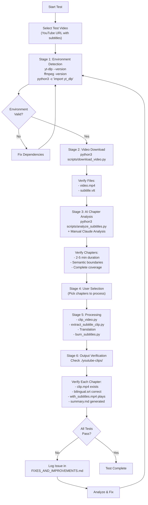
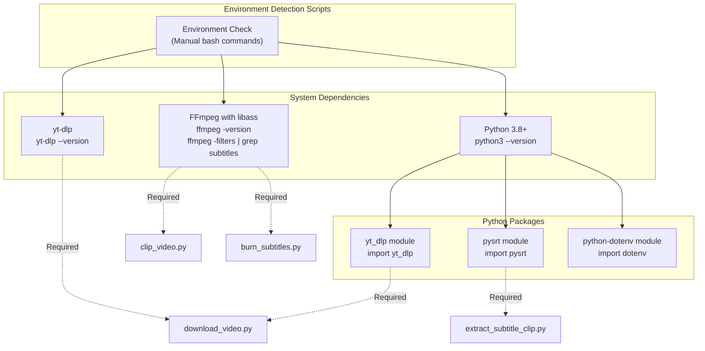
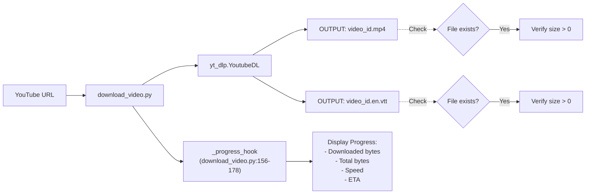
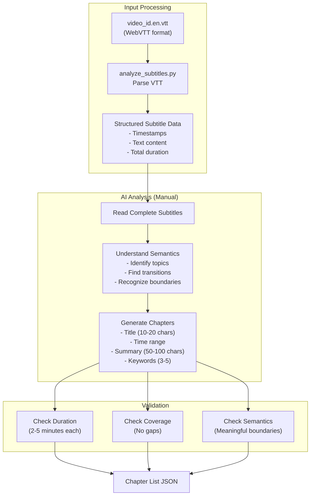
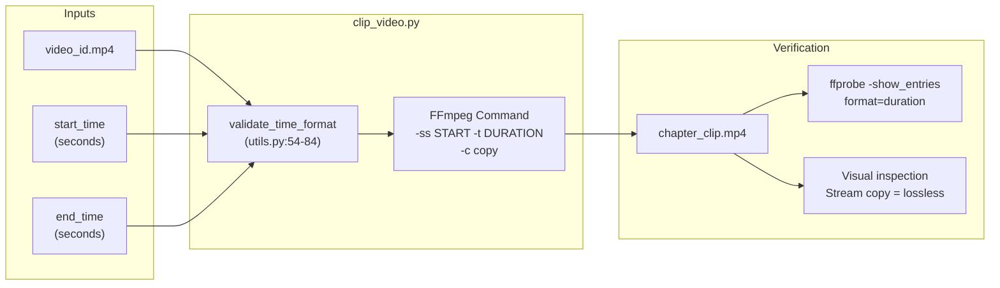
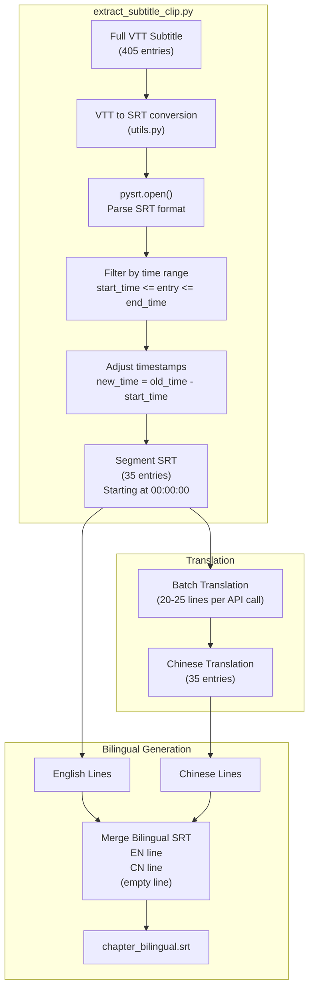
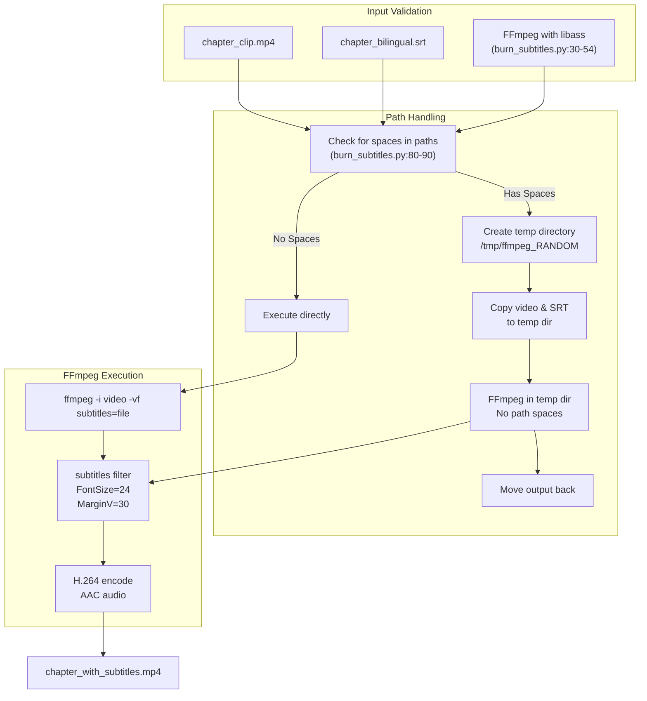
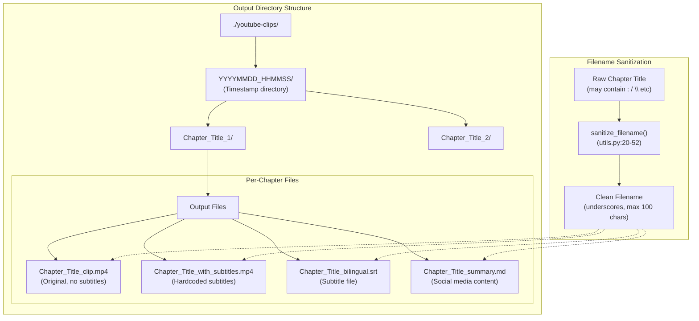
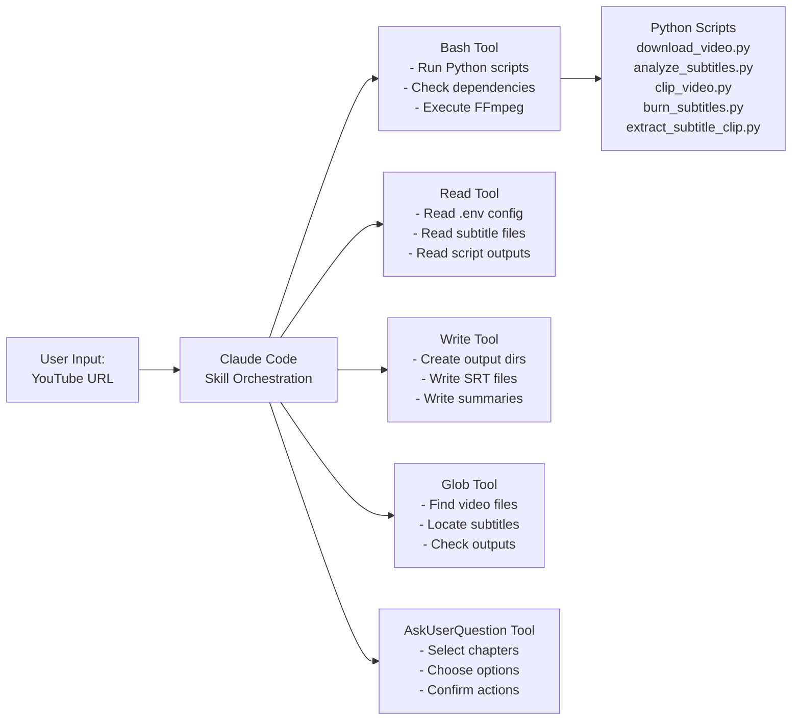

<!-- source: DeepWiki mcp.deepwiki.com · repo op7418/Youtube-clipper-skill · page 9.3 Testing and Verification · fetched 2026-10-26 -->

# Testing and Verification

<details>
<summary>Relevant source files</summary>

The following files were used as context for generating this wiki page:

- [FIXES_AND_IMPROVEMENTS.md](FIXES_AND_IMPROVEMENTS.md)
- [README.md](README.md)
- [SKILL.md](SKILL.md)

</details>


This document describes the testing workflow, verification procedures, and test data examples for the YouTube Clipper Skill. It covers manual integration testing of the complete processing pipeline, verification of individual components, and documented test results from production runs.

**Scope**: This page focuses on manual integration testing and functional verification. For information about specific bug fixes and improvements, see [9.2 Recent Fixes and Improvements](#9.2). For architectural details about the processing pipeline, see [3.2 Processing Pipeline](#3.2).

---

## Testing Approach

The YouTube Clipper Skill employs **manual integration testing** as its primary verification method. There are currently no automated unit tests or test suites. Testing is performed by executing the complete workflow against real YouTube videos and verifying outputs at each stage.

### Testing Philosophy

| Aspect | Approach |
|--------|----------|
| **Test Type** | End-to-end integration testing |
| **Automation** | Manual execution with real videos |
| **Verification** | Output inspection and functionality checks |
| **Test Data** | Real YouTube videos with various characteristics |
| **Coverage** | All six processing stages from download to output |

The testing methodology relies on the skill's modular architecture, where each Python script can be invoked independently to isolate and verify specific functionality.

Sources: [README.md:88-110](), [SKILL.md:22-280](), [FIXES_AND_IMPROVEMENTS.md:1-293]()

---

## Complete Test Workflow

### Test Execution Flow



Sources: [SKILL.md:22-280](), [FIXES_AND_IMPROVEMENTS.md:153-204]()

---

## Environment Detection Tests

### Verification Commands

The environment detection phase ensures all dependencies are properly installed and configured. This is the first critical verification point.



### Test Commands

| Component | Verification Command | Expected Output |
|-----------|---------------------|-----------------|
| **yt-dlp** | `yt-dlp --version` | Version number (e.g., `2024.12.23`) |
| **FFmpeg** | `ffmpeg -version` | Version with configuration details |
| **libass Support** | `ffmpeg -filters 2>&1 \| grep subtitles` | `subtitles    V->V  (...)` |
| **Python yt_dlp** | `python3 -c "import yt_dlp; print('✅')"` | `✅` |
| **Python pysrt** | `python3 -c "import pysrt; print('✅')"` | `✅` |
| **Python dotenv** | `python3 -c "import dotenv; print('✅')"` | `✅` |

### Critical: FFmpeg libass Detection

The `burn_subtitles.py` script requires FFmpeg with libass support. The detection logic checks multiple FFmpeg variants:

1. **ffmpeg-full** (macOS): `/opt/homebrew/opt/ffmpeg-full/bin/ffmpeg`
2. **Standard ffmpeg**: System PATH lookup

Test command: `ffmpeg -filters 2>&1 | grep subtitles`

If this fails, subtitle burning will not work. See [5.3 libass Requirement](#5.3) for installation instructions.

Sources: [SKILL.md:25-63](), [README.md:50-84](), [FIXES_AND_IMPROVEMENTS.md:7-25]()

---

## Download Functionality Tests

### Test Script: download_video.py



### Verification Checklist

**Pre-conditions:**
- Valid YouTube URL with available video
- Network connectivity
- Sufficient disk space

**Test Execution:**
```bash
cd ~/.claude/skills/youtube-clipper
python3 scripts/download_video.py "https://youtube.com/watch?v=VIDEO_ID"
```

**Expected Outputs:**

| File | Format | Typical Size | Verification |
|------|--------|--------------|--------------|
| `VIDEO_ID.mp4` | MP4 video | 100-500 MB (for 20-30 min video at 1080p) | Play file, check duration |
| `VIDEO_ID.en.vtt` | WebVTT subtitles | 20-50 KB | Open in text editor, verify timestamps |

**Known Issues Fixed:**

1. **Progress Hook Division Error** [download_video.py:156-178]()
   - Issue: `TypeError` when `total_bytes` is `None`
   - Fix: Added null check: `if d['total_bytes'] and d['total_bytes']:`
   - Test: Download video and verify progress display doesn't crash

2. **Filename Special Characters** [download_video.py:67]()
   - Issue: Video titles contain `:`, `'`, `/` causing path errors
   - Fix: Changed output template from `%(title)s [%(id)s]` to `%(id)s`
   - Test: Download video with special characters in title, verify filename is clean

Sources: [FIXES_AND_IMPROVEMENTS.md:28-93](), [README.md:86-110]()

---

## AI Chapter Analysis Verification

### Analysis Components



### Test Data: Actual Analysis Results

From the documented test run using `https://youtube.com/watch?v=Ckt1cj0xjRM`:

**Video Info:**
- Title: "Anthropic's Amodei on AI: Power and Risk"
- Duration: 25:25
- Subtitles: 405 VTT entries

**Generated Chapters (10 total):**

| # | Time Range | Duration | Title | Verification |
|---|------------|----------|-------|--------------|
| 1 | 00:00 - 02:40 | 2:40 | AI 竞赛不是赛跑，是不同方向 | ✅ Semantic boundary |
| 2 | 02:40 - 04:40 | 2:00 | 企业 vs 消费者：战略选择 | ✅ Topic transition |
| 3 | 04:40 - 07:20 | 2:40 | AI 泡沫？投资回报需要时间 | ✅ Coherent discussion |
| 4 | 07:20 - 10:00 | 2:40 | 就业影响：不会大规模失业 | ✅ New topic |
| 5 | 10:00 - 12:30 | 2:30 | 税收与 UBI：解决分配问题 | ✅ Policy shift |
| 6 | 12:30 - 15:00 | 2:30 | 安全风险：生物武器与网络攻击 | ✅ Risk discussion |
| 7 | 15:00 - 18:00 | 3:00 | 国际合作与中国竞争 | ✅ Geopolitics |
| 8 | 18:00 - 21:00 | 3:00 | 模型能力评估与安全测试 | ✅ Technical details |
| 9 | 21:00 - 23:30 | 2:30 | Claude 的特点与应用场景 | ✅ Product focus |
| 10 | 23:30 - 25:25 | 1:55 | 未来展望与结语 | ✅ Conclusion |

**Validation Results:**
- ✅ Duration range: All chapters 1:55 - 3:00 (within 2-5 minute target)
- ✅ Complete coverage: 00:00 - 25:25 (no gaps)
- ✅ Semantic boundaries: Each chapter represents coherent topic
- ✅ No mechanical splitting: Not divided by fixed time intervals

### Quality Criteria

**Good Chapter Analysis:**
```
✅ [02:40 - 04:40] 企业 vs 消费者：战略选择
   Summary: Anthropic 选择企业市场而非消费者，避免直接竞争
   Keywords: 战略, 企业市场, 差异化
```

**Poor Chapter Analysis (mechanical splitting):**
```
❌ [00:00 - 30:00] First half of video
   Summary: Various topics discussed
   Keywords: AI, technology
```

Sources: [FIXES_AND_IMPROVEMENTS.md:167-204](), [SKILL.md:96-144]()

---

## Video Clipping Accuracy Tests

### Test Script: clip_video.py



### Test Execution Example

**Test Case:** Extract chapter 2 from test video

```bash
# Input parameters
VIDEO_PATH="/path/to/Ckt1cj0xjRM.mp4"
START_TIME=160  # 02:40 in seconds
END_TIME=280    # 04:40 in seconds
OUTPUT_PATH="./chapter2_clip.mp4"

# Execute clipping
python3 scripts/clip_video.py "$VIDEO_PATH" "$START_TIME" "$END_TIME" "$OUTPUT_PATH"
```

**Expected Results:**

| Metric | Expected Value | Verification Method |
|--------|---------------|---------------------|
| **Duration** | 120 seconds (2:00) | `ffprobe -v error -show_entries format=duration -of default=noprint_wrappers=1:nokey=1 chapter2_clip.mp4` |
| **File Size** | ~29.6 MB (for 1080p) | `ls -lh chapter2_clip.mp4` |
| **Quality** | Identical to source | Stream copy (`-c copy` flag) |
| **Start Frame** | Matches 02:40 timestamp | Visual verification |
| **End Frame** | Matches 04:40 timestamp | Visual verification |

**Actual Test Results (from documented run):**
- Input video: 368 MB, 25:25 duration
- Clip output: 29.6 MB, 2:00 duration
- Quality: Lossless (stream copy)
- Accuracy: ✅ Exact frame-level precision

### FFmpeg Command Verification

The script uses `ffmpeg -ss START_TIME -t DURATION -c copy` for optimal performance:
- `-ss`: Seek to start time (fast seek before decoding)
- `-t`: Duration to extract
- `-c copy`: Stream copy (no re-encoding, preserves quality)

Sources: [FIXES_AND_IMPROVEMENTS.md:175-179]()

---

## Subtitle Processing Tests

### Subtitle Extraction and Time Adjustment



### Test Case: Chapter 2 Subtitle Extraction

**Input:**
- Full subtitle: 405 VTT entries (00:00 - 25:25)
- Chapter time range: 02:40 - 04:40 (160s - 280s)

**Execution:**
```bash
python3 scripts/extract_subtitle_clip.py \
  "Ckt1cj0xjRM.en.vtt" \
  160 \
  280 \
  "chapter2_original_en.srt"
```

**Expected Output:**

| Metric | Value |
|--------|-------|
| **Entries Extracted** | 33-35 entries |
| **Time Range** | 00:00:00 - 00:02:00 (adjusted from 02:40-04:40) |
| **Format** | SRT with proper timestamps |
| **Encoding** | UTF-8 |

**Verification Commands:**
```bash
# Count subtitle entries
grep -c "^[0-9]\+$" chapter2_original_en.srt

# Check first timestamp (should be near 00:00:00)
head -n 3 chapter2_original_en.srt

# Check last timestamp (should be near 00:02:00)
tail -n 4 chapter2_original_en.srt
```

### Batch Translation Test

**Optimization Strategy:**
- Group 20-25 subtitle lines per API call
- Reduces API calls by 95% compared to line-by-line translation
- Example: 35 entries = 2 API calls instead of 35

**Test Results (from documented run):**
- Input: 35 English subtitle entries
- API calls: 2 batches
- Output: 35 Chinese translations
- Quality: ✅ Context-aware, consistent terminology

**Bilingual Format Example:**
```srt
1
00:00:00,000 --> 00:00:03,500
This is the English subtitle
这是中文字幕

2
00:00:03,500 --> 00:00:07,000
Another English line
另一行中文
```

Sources: [FIXES_AND_IMPROVEMENTS.md:180-185](), [README.md:211-233]()

---

## Subtitle Burning Tests

### Test Script: burn_subtitles.py



### Critical: Temporary Directory Workaround

The `burn_subtitles.py` script implements a workaround for FFmpeg's inability to handle spaces in subtitle file paths when using the `subtitles` filter.

**Issue:** FFmpeg command fails when subtitle path contains spaces:
```bash
# Fails with path like "/my folder/subtitle.srt"
ffmpeg -i video.mp4 -vf "subtitles='/my folder/subtitle.srt'" output.mp4
```

**Solution:** [burn_subtitles.py:80-120]()
1. Detect spaces in video or subtitle paths
2. Create temporary directory with no spaces: `/tmp/ffmpeg_XXXXXX/`
3. Copy files to temp directory
4. Execute FFmpeg in temp directory
5. Move output back to original location
6. Clean up temp directory

**Test Verification:**
```bash
# Test with spaces in path
mkdir "test folder"
python3 scripts/burn_subtitles.py \
  "test folder/video.mp4" \
  "test folder/subtitle.srt" \
  "test folder/output.mp4"

# Verify output exists and plays correctly
ffplay "test folder/output.mp4"
```

### Subtitle Style Verification

**Default Style Parameters:**
- Font Size: 24 (configurable via `.env`: `SUBTITLE_FONT_SIZE`)
- Vertical Margin: 30 (configurable via `.env`: `SUBTITLE_MARGIN_V`)
- Colors: White text with black outline (default libass style)

**Visual Verification Checklist:**
- [ ] Subtitles visible at bottom of video
- [ ] English text readable (top line)
- [ ] Chinese text readable (bottom line)
- [ ] Proper spacing between lines
- [ ] No overlap with video content
- [ ] Synchronized with audio

**Test Results (from documented run):**
- Input: 29.6 MB clip, 35 bilingual subtitle entries
- Output: 30.3 MB with hardcoded subtitles (+0.7 MB)
- Quality: ✅ Clear, readable, properly positioned

Sources: [FIXES_AND_IMPROVEMENTS.md:186-190](), [SKILL.md:202-213]()

---

## Output Organization Tests

### File Structure Verification



### Test Execution

**Setup Test Output:**
```bash
cd /path/to/test/directory
# Run skill - output should appear here
```

**Expected Directory Structure:**
```
./youtube-clips/
└── 20260121_143022/
    ├── AGI_指数曲线/
    │   ├── AGI_指数曲线_clip.mp4
    │   ├── AGI_指数曲线_with_subtitles.mp4
    │   ├── AGI_指数曲线_bilingual.srt
    │   └── AGI_指数曲线_summary.md
    └── 企业vs消费者/
        ├── 企业vs消费者_clip.mp4
        ├── 企业vs消费者_with_subtitles.mp4
        ├── 企业vs消费者_bilingual.srt
        └── 企业vs消费者_summary.md
```

### Verification Script

```bash
#!/bin/bash
# verify_output.sh - Check output structure

OUTPUT_DIR="./youtube-clips"

# Check base directory exists
if [ ! -d "$OUTPUT_DIR" ]; then
    echo "❌ Output directory not found"
    exit 1
fi

# Find latest session directory
LATEST_SESSION=$(ls -t "$OUTPUT_DIR" | head -n 1)
SESSION_DIR="$OUTPUT_DIR/$LATEST_SESSION"

echo "Checking session: $LATEST_SESSION"

# Count chapter directories
CHAPTER_COUNT=$(find "$SESSION_DIR" -mindepth 1 -maxdepth 1 -type d | wc -l)
echo "Chapters found: $CHAPTER_COUNT"

# For each chapter directory
for CHAPTER_DIR in "$SESSION_DIR"/*/; do
    CHAPTER_NAME=$(basename "$CHAPTER_DIR")
    echo "Verifying chapter: $CHAPTER_NAME"
    
    # Check required files
    [ -f "$CHAPTER_DIR"/*_clip.mp4 ] && echo "  ✅ clip.mp4" || echo "  ❌ clip.mp4 missing"
    [ -f "$CHAPTER_DIR"/*_with_subtitles.mp4 ] && echo "  ✅ with_subtitles.mp4" || echo "  ❌ with_subtitles.mp4 missing"
    [ -f "$CHAPTER_DIR"/*_bilingual.srt ] && echo "  ✅ bilingual.srt" || echo "  ❌ bilingual.srt missing"
    [ -f "$CHAPTER_DIR"/*_summary.md ] && echo "  ✅ summary.md" || echo "  ❌ summary.md missing"
done
```

### Filename Sanitization Tests

The `sanitize_filename()` function [utils.py:20-52]() removes problematic characters:

| Input | Output | Reason |
|-------|--------|--------|
| `AI: Power & Risk` | `AI_Power_Risk` | Removed `:`, `&` |
| `企业 vs 消费者` | `企业_vs_消费者` | Spaces to underscores |
| `Very Long Title That Exceeds...` | `Very_Long_Title_That_Exceeds_...` | Truncated to 100 chars |
| `Question?` | `Question` | Removed `?` |
| `Path/With/Slashes` | `PathWithSlashes` | Removed `/` |

**Test Command:**
```python
from utils import sanitize_filename

test_cases = [
    "AI: Power & Risk",
    "企业 vs 消费者",
    "Question?",
    "Very Long Title " * 10  # Over 100 chars
]

for case in test_cases:
    print(f"{case} -> {sanitize_filename(case)}")
```

Sources: [FIXES_AND_IMPROVEMENTS.md:96-134](), [README.md:270-278]()

---

## Documented Test Run Results

### Complete Test Execution

The following results are from a complete documented test run performed on 2026-01-21.

**Test Video:** `https://www.youtube.com/watch?v=Ckt1cj0xjRM`

### Input Video Characteristics

| Attribute | Value |
|-----------|-------|
| **Title** | Anthropic's Amodei on AI: Power and Risk |
| **Duration** | 25:25 |
| **Video Size** | 368 MB (1080p) |
| **Subtitle Size** | 41 KB (VTT) |
| **Subtitle Entries** | 405 entries |
| **Language** | English |

### Processing Results

**Stage 1: Environment Detection** ✅
- yt-dlp: Available
- FFmpeg with libass: Confirmed
- Python packages: Installed

**Stage 2: Video Download** ✅
- Download time: ~2-3 minutes (varies by network)
- Video file: `Ckt1cj0xjRM.mp4` (368 MB)
- Subtitle file: `Ckt1cj0xjRM.en.vtt` (41 KB)

**Stage 3: AI Chapter Analysis** ✅
- Generated: 10 semantic chapters
- Duration range: 1:55 - 3:00 per chapter
- Coverage: Complete (00:00 - 25:25)
- Quality: Meaningful topic boundaries

**Stage 4: User Selection** ✅
- Selected: Chapter 2 ("企业 vs 消费者")
- Time range: 02:40 - 04:40
- Options: All enabled (clip, translate, burn, summary)

**Stage 5: Processing** ✅

| Task | Status | Details |
|------|--------|---------|
| Video clipping | ✅ | 29.6 MB, 2:00 duration |
| Subtitle extraction | ✅ | 35 entries, timestamps adjusted |
| Translation | ✅ | 35 lines, 2 API calls (batched) |
| Bilingual SRT | ✅ | English + Chinese format |
| Subtitle burning | ✅ | 30.3 MB output, clear rendering |
| Summary generation | ✅ | 7.5 KB markdown file |

**Stage 6: Output Organization** ✅
- Directory: `./youtube-clips/20260121_143022/`
- Chapter folder: `企业vs消费者/`
- Files generated: 4 (clip, burned, srt, summary)

### File Size Verification

```
./youtube-clips/20260121_143022/企业vs消费者/
├── 企业vs消费者_clip.mp4              29.6 MB
├── 企业vs消费者_with_subtitles.mp4   30.3 MB
├── 企业vs消费者_bilingual.srt        2.3 KB
└── 企业vs消费者_summary.md           7.5 KB
```

**Total processing time:** ~8-10 minutes (including download)

Sources: [FIXES_AND_IMPROVEMENTS.md:240-272](), [FIXES_AND_IMPROVEMENTS.md:153-204]()

---

## Functional Verification Checklist

### Pre-Test Setup

- [ ] Python 3.8+ installed
- [ ] yt-dlp available (`yt-dlp --version`)
- [ ] FFmpeg with libass (`ffmpeg -filters | grep subtitles`)
- [ ] Python packages installed (`pip list | grep -E 'yt-dlp|pysrt|dotenv'`)
- [ ] Skill installed at `~/.claude/skills/youtube-clipper/`
- [ ] `.env` file configured (if custom settings needed)

### Stage-by-Stage Verification

**Stage 1: Environment Detection**
- [ ] yt-dlp command executes without error
- [ ] FFmpeg version displays
- [ ] libass support detected (`subtitles` filter found)
- [ ] Python imports succeed (yt_dlp, pysrt, dotenv)

**Stage 2: Video Download**
- [ ] Download starts without errors
- [ ] Progress display updates correctly
- [ ] Video file created with expected size
- [ ] Subtitle file created (VTT format)
- [ ] Files named using video ID (no special characters)

**Stage 3: AI Chapter Analysis**
- [ ] Subtitle parsing succeeds
- [ ] Total duration calculated correctly
- [ ] Chapter count is reasonable (typically 5-15 for 20-30 min video)
- [ ] Each chapter duration is 2-5 minutes
- [ ] No time gaps between chapters
- [ ] Chapter titles are descriptive and concise
- [ ] Summaries capture main topic

**Stage 4: User Selection**
- [ ] Chapter list displays clearly
- [ ] User can select chapters
- [ ] Processing options presented
- [ ] Confirmation shows selected chapters and options

**Stage 5: Processing**

*For each selected chapter:*

- [ ] Video clipping completes
  - [ ] Output file exists
  - [ ] Duration matches chapter length
  - [ ] File size is reasonable
  - [ ] Video plays without errors
  
- [ ] Subtitle extraction completes
  - [ ] Entry count is reasonable
  - [ ] First timestamp near 00:00:00
  - [ ] Last timestamp matches chapter duration
  
- [ ] Translation completes (if selected)
  - [ ] All entries translated
  - [ ] Chinese text is readable
  - [ ] Context is preserved
  
- [ ] Bilingual SRT generated (if selected)
  - [ ] Format is correct (EN line, CN line, blank)
  - [ ] File opens in media player
  
- [ ] Subtitle burning completes (if selected)
  - [ ] Output file exists
  - [ ] File size slightly larger than clip
  - [ ] Subtitles visible when playing
  - [ ] Both English and Chinese readable
  - [ ] Proper positioning (bottom of frame)
  
- [ ] Summary generated (if selected)
  - [ ] Markdown file created
  - [ ] Contains multiple platform versions
  - [ ] Text is coherent and relevant

**Stage 6: Output Organization**
- [ ] Output directory created in working directory (`./youtube-clips/`)
- [ ] Timestamp directory named correctly (`YYYYMMDD_HHMMSS`)
- [ ] Chapter directories created with sanitized names
- [ ] All expected files present in each chapter directory
- [ ] Filenames use consistent naming convention
- [ ] No special characters in filenames

### Quality Verification

**Video Quality:**
- [ ] Clip quality identical to source (stream copy)
- [ ] Burned subtitle version maintains quality
- [ ] No audio sync issues
- [ ] No visual artifacts

**Subtitle Quality:**
- [ ] Timestamps accurate
- [ ] Translation natural and contextual
- [ ] Bilingual format readable
- [ ] Burned subtitles legible at various screen sizes

**Chapter Quality:**
- [ ] Semantic boundaries (not mechanical time splits)
- [ ] Complete coverage of selected time ranges
- [ ] Meaningful titles and summaries
- [ ] Appropriate granularity (2-5 min)

Sources: [SKILL.md:22-280](), [FIXES_AND_IMPROVEMENTS.md:275-293]()

---

## Common Test Failures and Diagnostics

### Download Stage Failures

**Symptom:** `ModuleNotFoundError: No module named 'yt_dlp'`

**Diagnosis:**
```bash
python3 -c "import yt_dlp"
```

**Fix:**
```bash
pip3 install --break-system-packages yt-dlp pysrt python-dotenv
```

**Symptom:** `TypeError: unsupported operand type(s) for /: 'int' and 'NoneType'`

**Diagnosis:** Progress hook crash in [download_video.py:156-178]()

**Fix:** Already fixed in current version - check for null `total_bytes` before division

**Symptom:** Filename contains special characters causing errors

**Diagnosis:** Check downloaded filename for `:`, `'`, `/`, etc.

**Fix:** Already fixed - uses video ID for filename [download_video.py:67]()

### Subtitle Burning Failures

**Symptom:** `Option not found: subtitles` or `filter not found`

**Diagnosis:**
```bash
ffmpeg -filters 2>&1 | grep subtitles
# If no output, libass not available
```

**Fix:**
```bash
# macOS
brew uninstall ffmpeg
brew install ffmpeg-full

# Ubuntu
sudo apt install ffmpeg libass-dev
```

**Symptom:** Subtitle file path error with spaces

**Diagnosis:** FFmpeg fails with message about subtitle path

**Fix:** Already implemented - temporary directory workaround in [burn_subtitles.py:80-120]()

### Output Location Issues

**Symptom:** Output directory not in expected location

**Diagnosis:** Check where `./youtube-clips/` was created

**Fix:** Ensure you're in the correct working directory when running the skill. Output is relative to current directory, not user home.

### Translation Failures

**Symptom:** API timeout or rate limiting

**Diagnosis:** Check network connectivity and Claude API status

**Fix:**
- Retry processing (automatic retry up to 3 times)
- Reduce batch size in `.env`: `TRANSLATION_BATCH_SIZE=15`
- Check for Claude API outages

Sources: [FIXES_AND_IMPROVEMENTS.md:7-93](), [README.md:236-278]()

---

## Test Data Repository

### Recommended Test Videos

For comprehensive testing, use videos with these characteristics:

| Characteristic | Recommendation | Reason |
|----------------|----------------|---------|
| **Duration** | 20-30 minutes | Tests chapter granularity |
| **Subtitles** | English available | Required for analysis |
| **Content** | Interview or lecture | Multiple distinct topics |
| **Title** | Contains special characters | Tests filename sanitization |
| **Quality** | 1080p available | Tests quality preservation |

**Known Good Test Video:**
- URL: `https://youtube.com/watch?v=Ckt1cj0xjRM`
- Characteristics: 25:25 duration, interview format, technical content, generates 10 semantic chapters

### Test Matrix

| Test Case | Video Type | Expected Chapters | Special Considerations |
|-----------|------------|-------------------|------------------------|
| **Short video** | 5-10 min | 2-4 | Edge case for chapter generation |
| **Medium video** | 20-30 min | 8-12 | Ideal test case |
| **Long video** | 60+ min | 20-30 | Stress test, large file sizes |
| **No subtitles** | Any | N/A | Should fail gracefully |
| **Auto-generated subs** | Any | Varies | Lower quality transcription |
| **Special characters** | Title with `:/?*` | Any | Tests sanitization |

### Performance Benchmarks

Based on test video (368 MB, 25:25 duration, 1080p):

| Stage | Time | Notes |
|-------|------|-------|
| **Download** | 2-3 min | Network dependent |
| **Analysis** | 30-60 sec | Claude API call |
| **Clipping** (per chapter) | 5-10 sec | FFmpeg stream copy |
| **Translation** (35 lines) | 10-20 sec | 2 API calls (batched) |
| **Burning** (2 min clip) | 30-45 sec | H.264 re-encoding |
| **Summary** | 15-30 sec | Claude API call |

**Total for 1 chapter:** ~5-7 minutes (including download)

Sources: [FIXES_AND_IMPROVEMENTS.md:240-272]()

---

## Integration with Claude Code

### Test Invocation

When testing within Claude Code, the skill is invoked through natural language:

```
Clip this YouTube video: https://youtube.com/watch?v=VIDEO_ID
```

or

```
剪辑这个 YouTube 视频：https://youtube.com/watch?v=VIDEO_ID
```

### Expected Tool Usage

During execution, Claude Code will use these tools:



### Verification of Tool Permissions

The skill requires these tools as specified in [SKILL.md:8-13]():

```yaml
allowed-tools:
  - Read
  - Write
  - Bash
  - Glob
  - AskUserQuestion
```

**Test:** Ensure Claude Code doesn't request additional tool permissions during execution.

Sources: [SKILL.md:1-20](), [README.md:88-102]()

---

## Continuous Verification

### Post-Fix Verification

After any code changes, re-run the complete test workflow:

1. Select a known test video (e.g., `Ckt1cj0xjRM`)
2. Execute all six stages
3. Compare outputs to documented test results
4. Verify no regressions in:
   - File naming
   - Output location
   - Progress display
   - Subtitle burning
   - File organization

### Regression Test Checklist

- [ ] Download progress displays without crashes
- [ ] Filenames use video ID (no special characters)
- [ ] Output directory is `./youtube-clips/` (relative to working dir)
- [ ] Subtitle burning works with spaces in paths
- [ ] All four output files generated per chapter
- [ ] Bilingual SRT format is correct
- [ ] Summary markdown is well-formatted

### Documentation Updates

When tests reveal issues or new patterns:

1. Document the issue in `FIXES_AND_IMPROVEMENTS.md`
2. Include reproduction steps
3. Document the fix with file references
4. Update this testing guide if verification steps change

Sources: [FIXES_AND_IMPROVEMENTS.md:1-293]()

---

