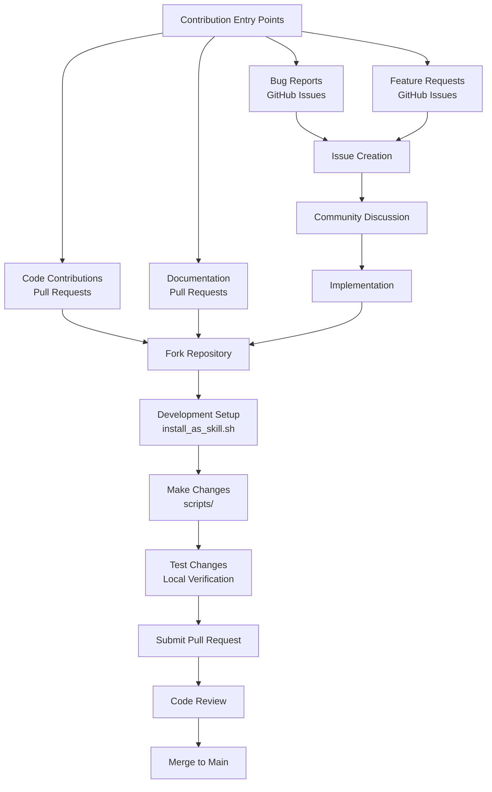
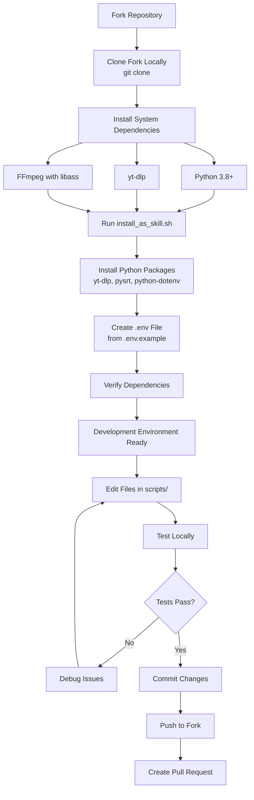
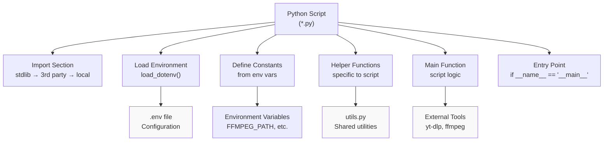
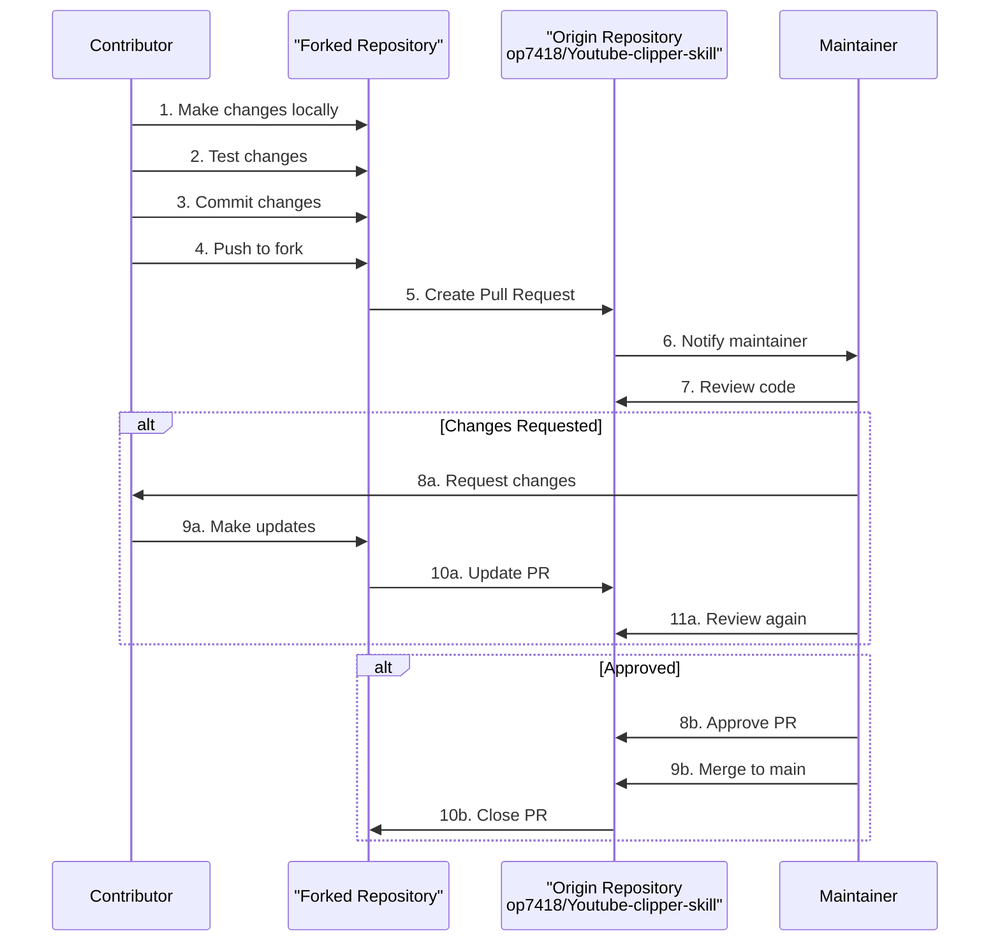

<!-- source: DeepWiki mcp.deepwiki.com · repo op7418/Youtube-clipper-skill · page 9.4 License and Contributing · fetched 2026-10-26 -->

# License and Contributing

<details>
<summary>Relevant source files</summary>

The following files were used as context for generating this wiki page:

- [.github/REPOSITORY_SETTINGS.md](.github/REPOSITORY_SETTINGS.md)
- [LICENSE](LICENSE)
- [README.md](README.md)

</details>


This page provides information about the project's license terms and guidelines for contributing to the YouTube Clipper Skill codebase. It covers the MIT License details, contribution workflow, development setup for contributors, and the process for submitting issues and pull requests.

For information about the project structure and file organization, see [Project Structure](#9.1). For testing procedures, see [Testing and Verification](#9.3).

---

## License Information

The YouTube Clipper Skill is released under the **MIT License**, a permissive open-source license that allows free use, modification, and distribution of the software.

### License Terms

The full license text is located in [LICENSE:1-22]().

| **Permission** | **Details** |
|----------------|-------------|
| **Use** | Commercial and private use permitted |
| **Modify** | Modification and derivative works permitted |
| **Distribute** | Distribution of original or modified versions permitted |
| **Sublicense** | Sublicensing permitted |
| **Liability** | No warranty provided; use at your own risk |

### Copyright

**Copyright (c) 2026 op7418**

The copyright notice and permission notice must be included in all copies or substantial portions of the software, as specified in [LICENSE:7-11]().

### License Display

The license is displayed in the README with a badge:

```markdown
[](LICENSE)
```

This badge appears at [README.md:5]().

**Sources:** [LICENSE:1-22](), [README.md:5]()

---

## Contributing Overview

Contributions to the YouTube Clipper Skill are welcome and encouraged. The project accepts various forms of contributions as outlined in [README.md:290-295]().

### Contribution Types



**Sources:** [README.md:290-295]()

---

## Reporting Issues

Issues are tracked on GitHub at the project repository. Both bug reports and feature requests follow the same submission process.

### Bug Report Guidelines

When reporting a bug, include the following information:

| **Field** | **Description** | **Example** |
|-----------|-----------------|-------------|
| **Environment** | Operating system, Python version, FFmpeg version | macOS 14.0, Python 3.10, FFmpeg 6.0 |
| **Steps to Reproduce** | Exact commands or actions that trigger the bug | Ran `clip video: URL` with specific video ID |
| **Expected Behavior** | What should have happened | Video should clip with subtitles burned |
| **Actual Behavior** | What actually happened | FFmpeg error: "subtitles filter not found" |
| **Error Messages** | Complete error output or logs | Full traceback from terminal |
| **Configuration** | Relevant `.env` settings | `FFMPEG_PATH`, `MAX_VIDEO_HEIGHT` values |

### Feature Request Guidelines

Feature requests should include:

1. **Use Case**: Describe the problem or need
2. **Proposed Solution**: Outline the desired functionality
3. **Alternatives Considered**: Other approaches you've thought about
4. **Impact**: Who would benefit and how

### Issue Submission

```bash
# Navigate to the issues page
# https://github.com/op7418/Youtube-clipper-skill/issues
```

As referenced in [README.md:292]().

**Sources:** [README.md:290-295]()

---

## Development Setup

Contributors need to set up a local development environment to work on the codebase.

### Development Environment Setup Flow



### Installation Commands

```bash
# 1. Fork the repository on GitHub
# 2. Clone your fork
git clone https://github.com/YOUR_USERNAME/Youtube-clipper-skill.git
cd Youtube-clipper-skill

# 3. Install system dependencies
# macOS:
brew install python yt-dlp ffmpeg-full

# Ubuntu:
sudo apt install python3 yt-dlp ffmpeg libass-dev

# 4. Run installation script
bash install_as_skill.sh

# 5. Verify installation
python3 --version  # Should be 3.8+
yt-dlp --version
ffmpeg -filters 2>&1 | grep subtitles  # Verify libass support
```

The [install_as_skill.sh]() script handles dependency installation as documented in [Installation](#2.1).

### Development Directory Structure

After setup, the development directory contains:

```
Youtube-clipper-skill/
├── scripts/
│   ├── download_video.py          # Edit to modify download logic
│   ├── analyze_subtitles.py       # Edit for chapter analysis
│   ├── clip_video.py              # Edit for clipping logic
│   ├── burn_subtitles.py          # Edit for subtitle burning
│   ├── extract_subtitle_clip.py   # Edit for subtitle extraction
│   └── utils.py                   # Edit for shared utilities
├── .env                           # Local configuration
├── .env.example                   # Configuration template
└── install_as_skill.sh            # Installation script
```

See [Project Structure](#9.1) for detailed directory documentation.

**Sources:** [README.md:36-46](), [README.md:50-84]()

---

## Code Contribution Guidelines

When contributing code changes, follow these guidelines to maintain consistency and quality.

### Code Style and Standards

| **Aspect** | **Standard** | **Rationale** |
|------------|--------------|---------------|
| **Language** | Python 3.8+ | Compatibility with Claude Code environment |
| **Imports** | Standard library first, then third-party, then local | PEP 8 convention |
| **Error Handling** | Try-except with specific exceptions | Graceful degradation |
| **Logging** | Use `print()` for user-facing messages | Claude Code CLI integration |
| **Configuration** | Use `.env` variables via `python-dotenv` | Separation of config from code |
| **File Paths** | Use `pathlib.Path` where possible | Cross-platform compatibility |

### Script Organization Pattern

All scripts in `scripts/` follow a common pattern:



For example, [download_video.py]() follows this pattern, as do all other scripts in `scripts/`.

### Utility Function Guidelines

When adding shared functionality:

1. **Add to `utils.py`**: Place reusable functions in [scripts/utils.py]()
2. **Document parameters**: Include docstrings with parameter types and return values
3. **Error handling**: Return `None` or raise specific exceptions
4. **Examples**: Add inline usage examples in comments

Example from `utils.py`:

```python
def format_timestamp(seconds):
    """Convert seconds to HH:MM:SS format."""
    hours = int(seconds // 3600)
    minutes = int((seconds % 3600) // 60)
    secs = int(seconds % 60)
    return f"{hours:02d}:{minutes:02d}:{secs:02d}"
```

See [Utilities Module](#4.6) for documentation of existing utility functions.

### Configuration Changes

When adding new configuration options:

1. **Add to `.env.example`**: Include the new variable with a descriptive comment
2. **Set default value**: Provide a sensible default in the script
3. **Document**: Update [Configuration](#6) documentation
4. **Validate**: Add validation logic for the new setting

Example pattern:

```python
from dotenv import load_dotenv
import os

load_dotenv()

# New configuration with default
NEW_SETTING = os.getenv('NEW_SETTING', 'default_value')
```

**Sources:** [scripts/download_video.py](), [scripts/utils.py](), [.env.example]()

---

## Pull Request Process

### Pull Request Workflow



### Pull Request Checklist

Before submitting a pull request:

- [ ] **Code changes tested locally**: Run the modified scripts with test videos
- [ ] **No new dependencies added**: Unless discussed in an issue first
- [ ] **Configuration documented**: If `.env` variables added, update `.env.example`
- [ ] **Error handling present**: Scripts should not crash on expected failures
- [ ] **File paths work cross-platform**: Test on macOS/Linux if possible
- [ ] **Existing functionality preserved**: No breaking changes without discussion
- [ ] **Comments added**: Complex logic should be explained

### Pull Request Description Template

```markdown
## Description
Brief description of changes

## Motivation
Why this change is needed (link to issue if applicable)

## Changes Made
- List of specific changes
- File modifications
- New functionality added

## Testing
- How you tested the changes
- Test video URLs used (if applicable)
- Configuration used

## Related Issues
Closes #123 (if applicable)
```

### Review Process

1. **Automated checks**: Ensure no syntax errors
2. **Manual review**: Maintainer reviews code logic and style
3. **Testing**: Maintainer may test with various video configurations
4. **Discussion**: Feedback provided via PR comments
5. **Merge**: Once approved, PR is merged to main branch

**Sources:** [README.md:290-295]()

---

## Community and Support

### Communication Channels

| **Channel** | **Purpose** | **Link** |
|-------------|-------------|----------|
| **GitHub Issues** | Bug reports, feature requests | [github.com/op7418/Youtube-clipper-skill/issues](https://github.com/op7418/Youtube-clipper-skill/issues) |
| **Pull Requests** | Code contributions | [github.com/op7418/Youtube-clipper-skill/pulls](https://github.com/op7418/Youtube-clipper-skill/pulls) |
| **README** | User documentation | [README.md]() |

As referenced in [README.md:292]().

### Project Maintenance

The project is maintained by **[op7418](https://github.com/op7418)**, as indicated in [README.md:315]().

### Acknowledgements

The project builds upon several open-source tools:

- **Claude Code**: AI-powered CLI environment ([README.md:307]())
- **yt-dlp**: YouTube download engine ([README.md:308]())
- **FFmpeg**: Video processing framework ([README.md:309]())

**Sources:** [README.md:305-310](), [README.md:315]()

---

## Additional Resources

### Documentation References

For contributors, these documentation pages provide essential context:

- **[Project Structure](#9.1)**: Repository organization and file purposes
- **[Recent Fixes and Improvements](#9.2)**: Recent changes and lessons learned
- **[Testing and Verification](#9.3)**: Testing workflows and verification steps
- **[Core Scripts](#4)**: Detailed documentation of each Python script
- **[Architecture](#3)**: System design and component relationships

### External Documentation

- **[SKILL.md]()**: Complete workflow and technical details
- **[TECHNICAL_NOTES.md]()**: Implementation notes and design decisions
- **[FIXES_AND_IMPROVEMENTS.md]()**: Changelog and bug fixes
- **[references/]()**: FFmpeg, yt-dlp, and subtitle formatting guides

These files provide technical depth for understanding the implementation.

**Sources:** [README.md:281-286]()