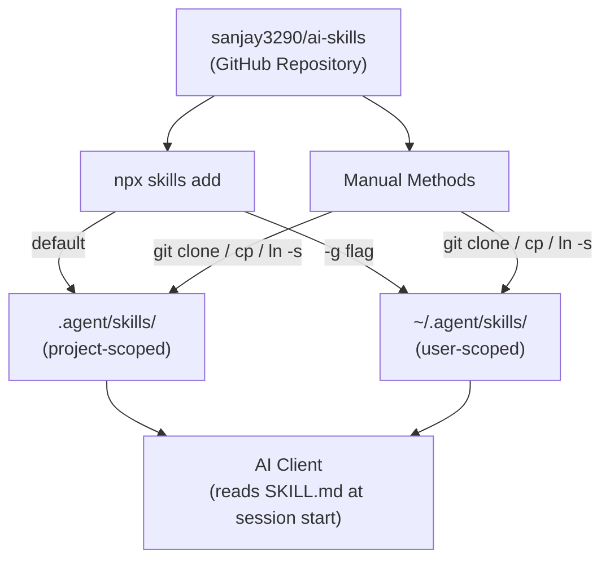
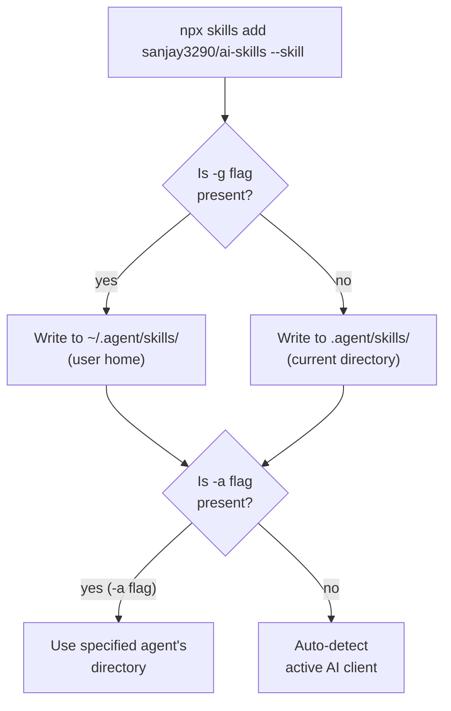
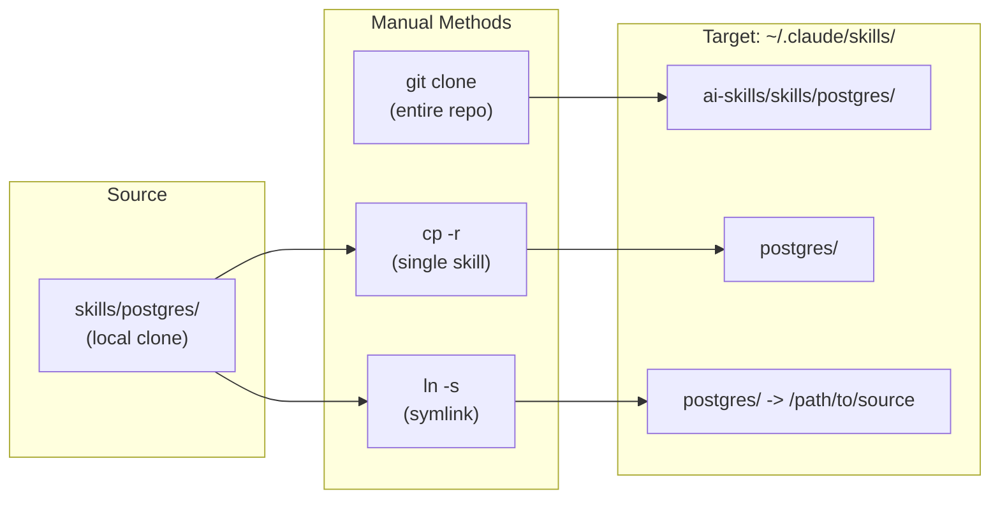

<!-- source: DeepWiki mcp.deepwiki.com · repo sanjay3290/ai-skills · page 2.1 Installation Methods · fetched 2026-10-26 -->

# Installation Methods

<details>
<summary>Relevant source files</summary>

The following files were used as context for generating this wiki page:

- [README.md](README.md)
- [skills/jules/SKILL.md](skills/jules/SKILL.md)
- [skills/manus/SKILL.md](skills/manus/SKILL.md)

</details>


This page documents all supported methods for installing skills from the `sanjay3290/ai-skills` repository into an AI agent's skill directory. It covers the `npx skills` CLI (the recommended approach), as well as manual alternatives including `git clone`, file copy, and symlink. For a list of supported AI clients and their skill directory paths, see [Supported AI Clients](#2.2). For a concrete end-to-end walkthrough, see [Quick Start Example](#2.3).

---

## Overview

Skills are installed by copying a skill's directory (containing `SKILL.md` and supporting scripts) into the skill directory that your AI client monitors at session start. The installation scope (project vs. global) determines which directory is targeted.

**Installation Method Diagram**



Sources: [README.md:60-175]()

---

## Method 1: `npx skills` CLI (Recommended)

The `npx skills` package manager resolves skill metadata from `.claude-plugin/marketplace.json`, fetches the matching skill directories from the repository, and copies them into the target agent directory. No prior installation of a global package is needed — `npx` handles execution.

### Basic Usage

```bash
# List all available skills before installing
npx skills add sanjay3290/ai-skills --list

# Install a single skill (auto-detects your agent)
npx skills add sanjay3290/ai-skills --skill postgres

# Install multiple skills at once
npx skills add sanjay3290/ai-skills --skill postgres --skill mysql --skill mssql

# Install all 18 skills
npx skills add sanjay3290/ai-skills --all
```

Sources: [README.md:64-78]()

### Targeting a Specific Agent

By default, `npx skills` auto-detects the active AI client. Use the `-a` flag to override this and target one or more specific agents.

```bash
# Install for Claude Code only
npx skills add sanjay3290/ai-skills --skill postgres -a claude-code

# Install for multiple agents at once
npx skills add sanjay3290/ai-skills --skill postgres -a claude-code -a gemini-cli -a cursor

# Install into all supported agents simultaneously
npx skills add sanjay3290/ai-skills --all -a '*'
```

**Agent Flag Reference**

| Agent | `-a` Flag | Project Directory | Global Directory |
|---|---|---|---|
| Claude Code | `claude-code` | `.claude/skills/` | `~/.claude/skills/` |
| Gemini CLI | `gemini-cli` | `.gemini/skills/` | `~/.gemini/skills/` |
| Cursor | `cursor` | `.cursor/skills/` | `~/.cursor/skills/` |
| OpenAI Codex | `codex` | `.codex/skills/` | `~/.codex/skills/` |
| Goose | `goose` | `.goose/skills/` | `~/.config/goose/skills/` |
| GitHub Copilot | `github-copilot` | `.github/skills/` | `~/.github/skills/` |
| Google Antigravity | `antigravity` | `.agent/skills/` | `~/.gemini/antigravity/skills/` |
| All agents | `'*'` | auto-detected | auto-detected |

Sources: [README.md:107-120]()

### Project vs. Global Scope

The scope determines which directory the skill is written into.

| Scope | Flag | Target Directory | Availability |
|---|---|---|---|
| Project (default) | _(none)_ | `.agent/skills/` inside the current working directory | Current repository only |
| Global | `-g` | `~/.agent/skills/` in the user's home directory | All projects on the machine |

```bash
# Global install — available in all projects
npx skills add sanjay3290/ai-skills --skill imagen -g

# Project install (default) — scoped to the current repo
npx skills add sanjay3290/ai-skills --skill imagen
```

Sources: [README.md:95-105]()

### Scope Decision Diagram



Sources: [README.md:95-120]()

### Managing Installed Skills

```bash
# List all currently installed skills
npx skills list

# Check for available updates
npx skills check

# Update all installed skills
npx skills update

# Remove a specific skill
npx skills remove postgres

# Remove all skills from one agent
npx skills remove --skill '*' -a cursor
```

Sources: [README.md:122-139]()

### Discovering Additional Skills

The `find` subcommand queries the community directory at `skills.sh`, not just this repository.

```bash
# Search by keyword
npx skills find postgres

# Browse all community skills
npx skills find
```

Sources: [README.md:141-151]()

---

## Method 2: Manual Installation

Manual methods bypass the `npx skills` package manager. They are useful for offline environments, development workflows, or when you want direct control over the file layout. In all cases, replace `~/.claude/skills/` with the appropriate directory for your AI client (see table above or [Supported AI Clients](#2.2)).

### Clone the Entire Repository

Clones all 18 skills in a single subdirectory inside the agent's skill directory.

```bash
git clone https://github.com/sanjay3290/ai-skills.git ~/.claude/skills/ai-skills
```

The AI client will discover all `SKILL.md` files recursively under `~/.claude/skills/ai-skills/skills/`.

### Copy an Individual Skill

Copies a single skill directory directly into the target skill directory.

```bash
cp -r skills/postgres ~/.claude/skills/
```

After this, the agent's skill directory will contain `~/.claude/skills/postgres/SKILL.md`.

### Symlink for Development

Creates a symbolic link so edits to the source directory are immediately reflected in the agent's skill directory. This is the recommended approach when actively developing or modifying a skill.

```bash
ln -s /path/to/ai-skills/skills/postgres ~/.claude/skills/postgres
```

Sources: [README.md:153-176]()

### Manual Method Comparison



| Method | Updates automatically | Installs all skills | Good for development |
|---|---|---|---|
| `git clone` (whole repo) | With `git pull` | Yes | No (modifies tracked files) |
| `cp -r` (single skill) | No (must re-copy) | No (one at a time) | No |
| `ln -s` (symlink) | Yes (live link) | No (one at a time) | **Yes** |

Sources: [README.md:153-176]()

---

## Post-Installation: Skill Configuration

After installing a skill via any method, most skills require additional configuration before they are functional. The type of configuration depends on the skill category:

| Category | Configuration Required |
|---|---|
| Database (postgres, mysql, mssql) | `connections.json` credential file in the skill directory |
| Google Workspace (gmail, drive, etc.) | `pip install keyring`, then run `auth.py login` for each skill |
| API-key skills (imagen, manus, outline, etc.) | Set environment variables such as `GEMINI_API_KEY`, `MANUS_API_KEY` |
| NotebookLM | Playwright browser setup and `auth_manager.py setup` |
| Jules | `npm install -g @google/jules` and `jules login` |

Detailed configuration instructions for each skill are covered in [Configuration Guide](#6) and the individual skill pages under [Skills by Category](#4) and [Google Workspace Skills](#5).

Sources: [README.md:178-275]()

---

