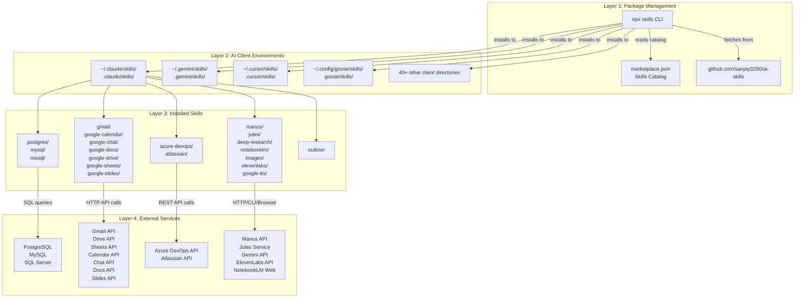
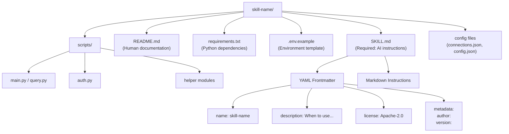
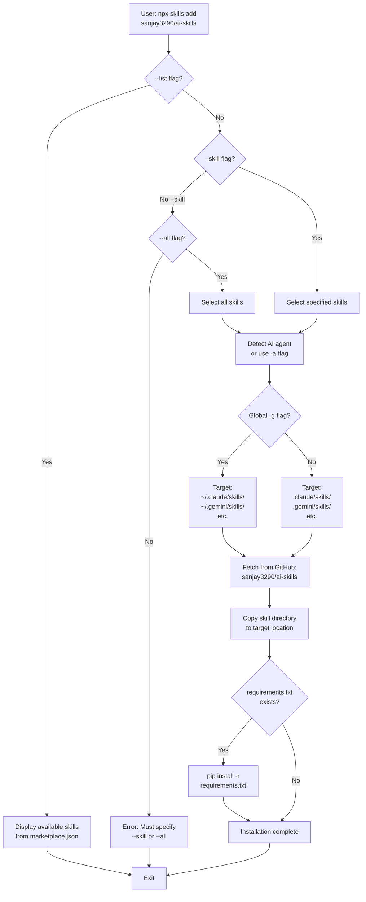
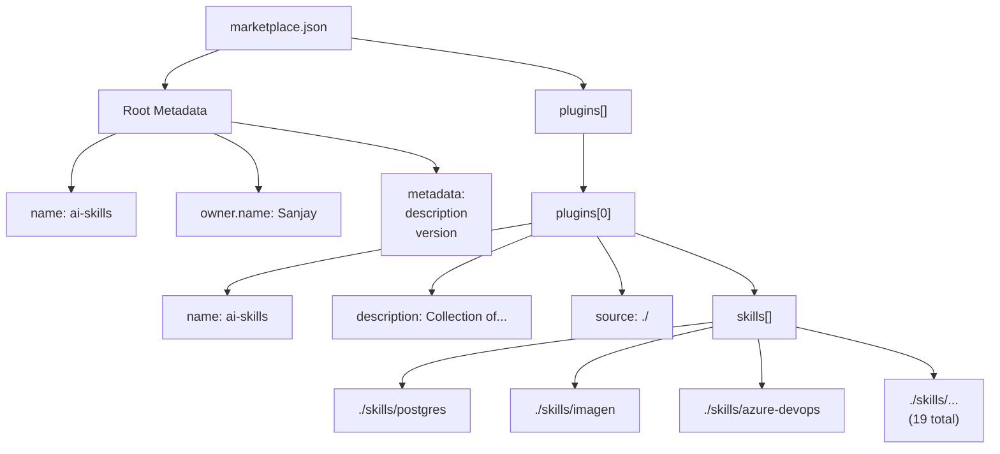
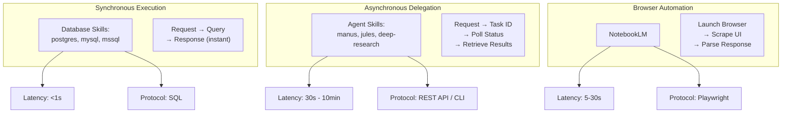
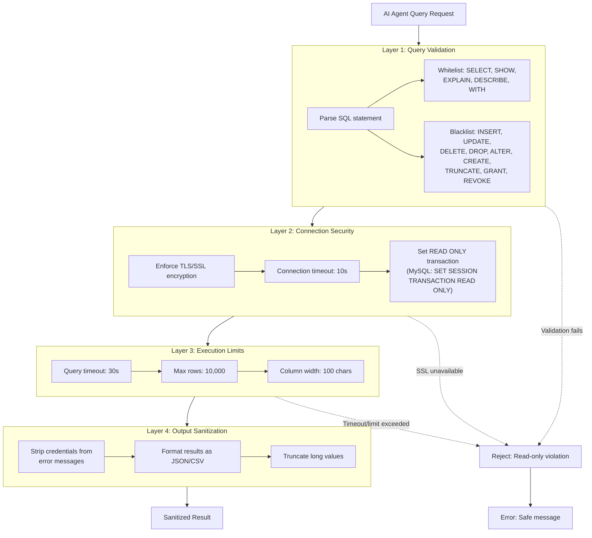

<!-- source: DeepWiki mcp.deepwiki.com · repo sanjay3290/ai-skills · page 3 Architecture · fetched 2026-10-26 -->

# Architecture

<details>
<summary>Relevant source files</summary>

The following files were used as context for generating this wiki page:

- [.claude-plugin/marketplace.json](.claude-plugin/marketplace.json)
- [README.md](README.md)
- [skills/jules/SKILL.md](skills/jules/SKILL.md)
- [skills/manus/SKILL.md](skills/manus/SKILL.md)

</details>


This document provides a deep dive into the system architecture of the ai-skills ecosystem, explaining the core design patterns, mechanisms, and structures that enable portable AI agent skills. It covers the three-layer architecture, the Agent Skills Standard format, installation workflows, authentication patterns, execution models, and safety mechanisms.

For skill-specific implementation details, see [Skills by Category](#4). For configuration instructions, see [Configuration Guide](#6). For creating new skills, see [Development Guide](#7).

---

## Three-Layer Ecosystem Architecture

The ai-skills system implements a three-layer architecture that separates package management, AI client environments, and external service integrations.



**Layer 1: Package Management**  
The `npx skills` CLI reads skill definitions from the GitHub repository and the [.claude-plugin/marketplace.json:1-39]() catalog. It handles discovery, fetching, and installation across different AI clients.

**Layer 2: AI Client Environments**  
Skills install into client-specific directories following the Agent Skills Standard. Each client has both global (user-level) and project-level directories. The table in [README.md:18-25]() documents these paths.

**Layer 3: Installed Skills**  
Skills are organized by functional category: databases, Google Workspace, DevOps, AI services, and research tools. Each skill is a self-contained directory with standardized structure.

**Layer 4: External Services**  
Skills interact with external services through various protocols: SQL connections, REST APIs, CLI tools, and browser automation.

**Sources:** [README.md:1-429](), [.claude-plugin/marketplace.json:1-39]()

---

## Agent Skills Standard Format

Every skill follows the [Agent Skills Standard](https://agentskills.io) structure, which defines a portable format recognized by 40+ AI clients.

### Skill Directory Structure



**Sources:** [README.md:365-389]()

### SKILL.md YAML Schema

The `SKILL.md` file uses YAML frontmatter to define skill metadata that AI agents parse to determine when and how to activate the skill.

| Field | Required | Description | Example |
|-------|----------|-------------|---------|
| `name` | Yes | Skill identifier (kebab-case) | `postgres`, `gmail`, `manus` |
| `description` | Yes | Activation triggers and use cases | `"Use when user says 'query database'..."` |
| `license` | No | License identifier | `Apache-2.0` |
| `metadata.author` | No | Creator identifier | `sanjay3290` |
| `metadata.version` | No | Semantic version | `"1.0"`, `"1.2.3"` |

**Activation Trigger Pattern:**  
The `description` field follows a specific pattern: explicit trigger phrases (`"use manus"`, `"delegate to jules"`) followed by semantic use cases (`"deep research"`, `"bug fixes"`). This dual approach ensures both explicit invocation and contextual activation.

Example from [skills/manus/SKILL.md:1-8]():
```yaml
---
name: manus
description: Delegate complex, long-running tasks to Manus AI agent for autonomous execution. Use when user says 'use manus', 'delegate to manus', 'send to manus', 'have manus do', 'ask manus', 'check manus sessions', or when tasks require deep web research, market analysis, product comparisons...
---
```

**Sources:** [README.md:379-388](), [skills/manus/SKILL.md:1-8](), [skills/jules/SKILL.md:1-8]()

### Markdown Instruction Format

Below the YAML frontmatter, the markdown content provides instructions for AI agents. Common sections include:

- **Setup/Configuration** - Environment variables, authentication, prerequisites
- **Commands** - Executable examples with bash/curl/python snippets
- **Workflow/Usage** - Step-by-step procedures
- **Parameters** - Command-line arguments, options, flags
- **Error Handling** - Common failure modes and resolutions
- **Best Practices** - Guidance on effective usage

**Sources:** [skills/manus/SKILL.md:10-185](), [skills/jules/SKILL.md:10-201]()

---

## Installation & Discovery Mechanism

The `npx skills` CLI implements a sophisticated discovery and installation flow that handles multiple AI clients, installation scopes, and dependency management.

### Installation Workflow



**Agent Auto-Detection:**  
The CLI scans for existing agent directories in both project (`.`) and global (`~/`) locations. Detection order follows the table in [README.md:112-121]().

**Installation Targets:**  
Each agent has two installation locations:
- **Project scope** (default): `.{agent}/skills/` in current directory
- **Global scope** (`-g` flag): `~/.{agent}/skills/` in user home directory

**Multiple Agent Installation:**  
The `-a` flag accepts multiple values or `'*'` to install across all detected agents simultaneously, as shown in [README.md:83-94]().

**Sources:** [README.md:61-150]()

---

## Marketplace & Plugin System

The marketplace.json file serves as the central catalog for skill discovery and Claude Code plugin integration.

### Marketplace Structure



**File:** [.claude-plugin/marketplace.json:1-39]()

The marketplace.json structure from [.claude-plugin/marketplace.json:1-39]() includes:

| Field | Type | Purpose |
|-------|------|---------|
| `name` | string | Repository identifier |
| `owner.name` | string | Maintainer name |
| `metadata.description` | string | Repository description |
| `metadata.version` | string | Catalog version (semantic) |
| `plugins[].name` | string | Plugin identifier |
| `plugins[].description` | string | Plugin description (all skills) |
| `plugins[].source` | string | Root directory path |
| `plugins[].skills[]` | array | Relative paths to skill directories |

**Claude Code Integration:**  
When Claude Code encounters the `.claude-plugin/` directory, it automatically recognizes the marketplace.json format and registers all listed skills as available plugins. The `skills` array enumerates all installable skill paths.

**Skill Enumeration:**  
The 19 skills listed in [.claude-plugin/marketplace.json:15-36]() correspond exactly to the subdirectories in `skills/`. This provides a single source of truth for the `npx skills add --list` command.

**Sources:** [.claude-plugin/marketplace.json:1-39]()

---

## Authentication Architectures

The ecosystem implements three distinct authentication patterns based on service requirements and security constraints.

### Pattern Comparison

| Pattern | Skills Using | Storage | Token Refresh | Setup Command |
|---------|--------------|---------|---------------|---------------|
| OAuth + Keyring | Google Workspace (7 skills) | System keyring | Cloud function | `python scripts/auth.py login` |
| API Key (env) | imagen, deep-research, google-tts, elevenlabs, outline | Environment variables | N/A | `export API_KEY=...` |
| API Key (file) | manus, elevenlabs | config.json | N/A | Manual file creation |
| PAT + Keyring | azure-devops, atlassian | System keyring | N/A | `python scripts/auth.py login --pat` |
| OAuth + MCP | atlassian, azure-devops | System keyring | MCP server | `python scripts/auth.py login --oauth` |
| Browser Session | notebooklm | Playwright profile | Manual re-auth | `python scripts/auth_manager.py setup` |

### OAuth with Keyring Architecture

```mermaid
sequenceDiagram
    participant User
    participant AuthScript["scripts/auth.py"]
    participant Browser
    participant CloudFunc["OAuth Cloud Function<br/>(Google Workspace MCP)"]
    participant Keyring["System Keyring<br/>(Keychain/Credential Locker)"]
    participant APIScript["scripts/main.py"]
    participant GoogleAPI["Google API<br/>(Gmail/Drive/Sheets/etc.)"]
    
    User->>AuthScript: python scripts/auth.py login
    AuthScript->>Browser: Open OAuth URL
    Browser->>User: Prompt for Google login
    User->>Browser: Authorize application
    Browser->>CloudFunc: Return authorization code
    CloudFunc->>AuthScript: Return access + refresh tokens
    AuthScript->>Keyring: Store tokens with service name<br/>(e.g., gmail-skill-oauth)
    
    Note over User,GoogleAPI: Later: API call execution
    
    User->>APIScript: Execute skill command
    APIScript->>Keyring: Retrieve access token<br/>by service name
    Keyring->>APIScript: Return token
    APIScript->>GoogleAPI: API call with Bearer token
    GoogleAPI-->>APIScript: Response
    
    Note over APIScript,CloudFunc: Token expired
    
    APIScript->>CloudFunc: Refresh token request
    CloudFunc->>APIScript: New access token
    APIScript->>Keyring: Update stored token
```

**Keyring Service Names:**  
Each Google Workspace skill uses a unique service identifier for token isolation:
- Gmail: `gmail-skill-oauth`
- Google Calendar: `google-calendar-skill-oauth`
- Google Chat: `google-chat-skill-oauth`
- Google Docs: `google-docs-skill-oauth`
- Google Drive: `google-drive-skill-oauth`
- Google Sheets: `google-sheets-skill-oauth`
- Google Slides: `google-slides-skill-oauth`

**Platform-Specific Storage:**
- **macOS:** Keychain Access (`/Library/Keychains/`)
- **Windows:** Credential Locker (`Control Panel > Credential Manager`)
- **Linux:** Secret Service API (GNOME Keyring, KDE Wallet)

This architecture is documented in [README.md:283-286]() and implements the same OAuth infrastructure as the official Google Workspace MCP server mentioned in [README.md:400]().

**Sources:** [README.md:268-286](), [README.md:400]()

### API Key Pattern (Environment Variables)

Simple API key authentication for services like Gemini, ElevenLabs, and Outline:

```bash
export GEMINI_API_KEY=your-api-key
export ELEVENLABS_API_KEY=your-api-key
export OUTLINE_API_KEY=your-api-key
export GOOGLE_TTS_API_KEY=your-api-key
```

Scripts read directly from environment variables without additional storage layers, as shown in [README.md:193-237]().

**Sources:** [README.md:193-237]()

### PAT with Keyring Pattern

Personal Access Tokens for Azure DevOps and Atlassian, stored in system keyring:

```bash
# Azure DevOps
python skills/azure-devops/scripts/auth.py login --org MyOrg --pat YOUR_PAT

# Atlassian
python skills/atlassian/scripts/auth.py login
```

The `auth.py` script prompts for credentials and stores them securely using the `keyring` library, as documented in [README.md:257-266]().

**Sources:** [README.md:246-266]()

### Browser Session Pattern (NotebookLM)

NotebookLM uses Playwright to maintain persistent browser sessions with authenticated Google cookies:

```bash
pip install -r skills/notebooklm/requirements.txt
python -m playwright install chromium
python skills/notebooklm/scripts/auth_manager.py setup
```

Browser profiles stored at `~/.notebooklm/profiles/` contain session cookies that persist across script executions. Profile management supports multiple accounts (default + named profiles).

**Sources:** [README.md:239-244]()

---

## Execution Patterns

Skills implement three distinct execution patterns based on task characteristics and service capabilities.

### Pattern Comparison



### Synchronous Execution (Database Skills)

Database skills execute queries synchronously with immediate response. The workflow from [README.md:292-297]():

```bash
# User request: "Query production database for active users"
# ↓
# AI agent parses SKILL.md, constructs query
# ↓
python scripts/query.py --database production --query "SELECT * FROM users WHERE active = true"
# ↓
# Returns: JSON result with rows (instant)
```

**Characteristics:**
- Latency: <1 second
- Blocking execution
- Direct SQL connection
- Result size: up to 10,000 rows (capped)
- Timeout: 30 seconds per query

**Sources:** [README.md:292-297]()

### Asynchronous Delegation (Agent Skills)

Jules, Manus, and Deep Research delegate long-running tasks to external agents, returning task IDs immediately and requiring polling.

**Manus Workflow** (from [skills/manus/SKILL.md:56-98]()):

```bash
# Step 1: Create task
curl -X POST "https://api.manus.ai/v1/tasks" \
  -H "API_KEY:$MANUS_API_KEY" \
  -d '{"prompt":"Research EV batteries","agentProfile":"manus-1.6"}'
# Returns: {"task_id":"abc123","task_url":"https://manus.im/app/abc123"}

# Step 2: Poll status (every 5-30 seconds)
while true; do
  STATUS=$(curl -s "https://api.manus.ai/v1/tasks/abc123" -H "API_KEY:$MANUS_API_KEY" | jq -r '.status')
  [ "$STATUS" = "completed" ] && break
  sleep 10
done

# Step 3: Extract results
curl -s "https://api.manus.ai/v1/tasks/abc123" -H "API_KEY:$MANUS_API_KEY" | \
  jq -r '.output[] | select(.role=="assistant") | .content[] | select(.type=="output_text") | .text'
```

**Jules Workflow** (from [skills/jules/SKILL.md:38-63]()):

```bash
# Step 1: Create session
jules new --repo owner/repo "Fix auth bug"
# Returns: Session ID

# Step 2: Monitor status
jules remote list --session

# Step 3: Pull results when complete
jules remote pull --session <id> --apply
```

**Characteristics:**
- Latency: 30 seconds to 10 minutes
- Non-blocking (returns task ID immediately)
- Polling interval: 5-30 seconds
- Status transitions: `pending` → `running` → `completed`/`failed`

**Sources:** [skills/manus/SKILL.md:56-98](), [skills/jules/SKILL.md:38-63]()

### Browser Automation (NotebookLM)

NotebookLM lacks a public API, so the skill uses Playwright to automate the web interface.

**Execution Flow:**

```bash
# Query execution with retry logic
python scripts/ask_question.py \
  --profile default \
  --notebook "My Notebook" \
  --question "Summarize key points" \
  --wait-time 30
```

**Internal Process:**
1. Launch headless Chromium with persistent profile
2. Navigate to `notebooklm.google.com`
3. Select notebook from library
4. Find `textarea.query-box-input` element
5. Type question and submit
6. Wait for response (detect placeholder disappearance)
7. Perform 3x stability checks (5s intervals)
8. Extract response text and citations
9. Capture debug artifacts (screenshots, HTML) on failure

**Characteristics:**
- Latency: 5-30 seconds
- Browser overhead: ~200MB memory
- Fragile (depends on UI stability)
- Profile-based authentication
- Automatic retry with artifact capture

**Sources:** Inferred from NotebookLM architecture diagram

---

## Safety & Security Mechanisms

Database skills implement a defense-in-depth security model with four sequential protection layers.

### Multi-Layer Safety Architecture



### Layer 1: Query Validation

**Whitelist Approach:**  
Only `SELECT`, `SHOW`, `EXPLAIN`, `DESCRIBE`, and `WITH` statements are permitted. The validation occurs before connection establishment.

**Blacklist Enforcement:**  
All write operations (`INSERT`, `UPDATE`, `DELETE`, `DROP`, `ALTER`, `CREATE`, `TRUNCATE`), permission changes (`GRANT`, `REVOKE`), and administrative commands are rejected.

**Implementation:**  
Regex pattern matching on parsed SQL statements.

### Layer 2: Connection Security

**TLS/SSL Encryption:**  
All database connections enforce encrypted transport:
- PostgreSQL: `sslmode=require`
- MySQL: `ssl_mode='REQUIRED'` or certificate-based
- SQL Server: `encrypt=True`

**Read-Only Transaction Isolation:**  
MySQL explicitly sets session read-only mode:
```python
cursor.execute("SET SESSION TRANSACTION READ ONLY")
```

PostgreSQL and SQL Server rely on user-level permissions configured in `connections.json`.

**Connection Timeout:**  
10-second timeout prevents hung connections from blocking resources.

### Layer 3: Execution Limits

**Resource Caps:**

| Limit | Value | Purpose |
|-------|-------|---------|
| Query timeout | 30 seconds | Prevent runaway queries |
| Max rows | 10,000 | Prevent memory exhaustion |
| Column width | 100 characters | Prevent display overflow |

These limits are enforced in the query execution wrapper, as documented in the database skills architecture diagrams.

### Layer 4: Output Sanitization

**Credential Stripping:**  
Error messages are parsed to remove any connection strings, passwords, or host information before display.

**Result Formatting:**  
Query results are serialized to JSON or CSV with consistent formatting and value truncation.

**Example Sanitization:**
```
# Raw error:
Connection failed: FATAL: password authentication failed for user "admin" at host "prod-db.internal"

# Sanitized output:
Connection failed: Authentication error. Check connections.json configuration.
```

### Configuration Security

**File Permissions:**  
The `connections.json` file must have `chmod 600` permissions (owner read/write only) to prevent credential exposure, as mentioned in [README.md:184]().

**Intelligent Selection:**  
The `description` field in each database configuration enables semantic matching for automatic database selection based on query context.

**Sources:** [README.md:184](), database skills security architecture diagram

---

## Skill Categories & Service Integration

Skills are organized into five functional categories based on their external service integrations.

| Category | Skills | Protocol | Authentication |
|----------|--------|----------|----------------|
| **Databases** | postgres, mysql, mssql | SQL (PostgreSQL wire, MySQL protocol, TDS) | connections.json |
| **Google Workspace** | gmail, google-calendar, google-chat, google-docs, google-drive, google-sheets, google-slides | Google APIs (REST) | OAuth + keyring |
| **DevOps** | azure-devops, atlassian | REST APIs | PAT/OAuth + keyring |
| **AI Services** | manus, jules, deep-research, imagen, elevenlabs, google-tts | REST APIs / CLI | API keys / OAuth |
| **Research** | notebooklm, outline | Browser automation / REST | Browser session / API key |

Each category shares common architectural patterns within its group while maintaining skill-specific implementations. For detailed coverage of individual skills, see [Skills by Category](#4) and its subsections.

**Sources:** [README.md:27-59](), [.claude-plugin/marketplace.json:15-36]()

---

