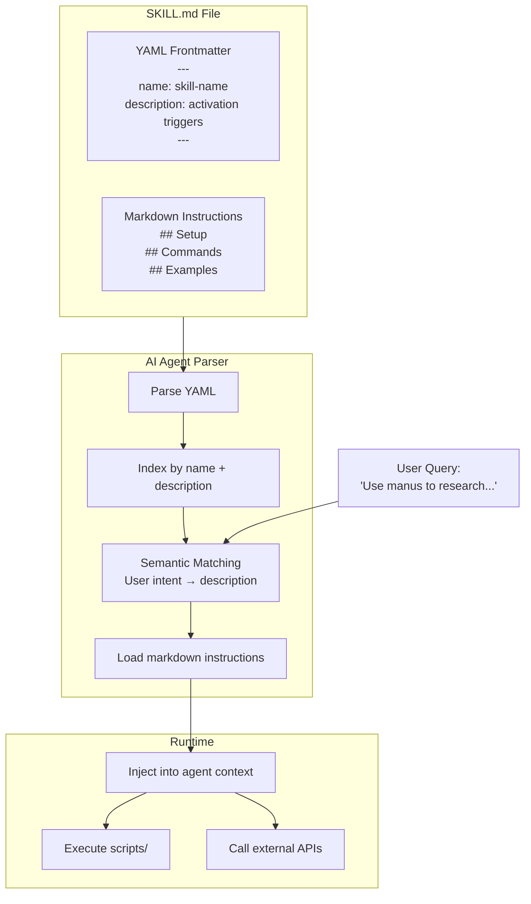
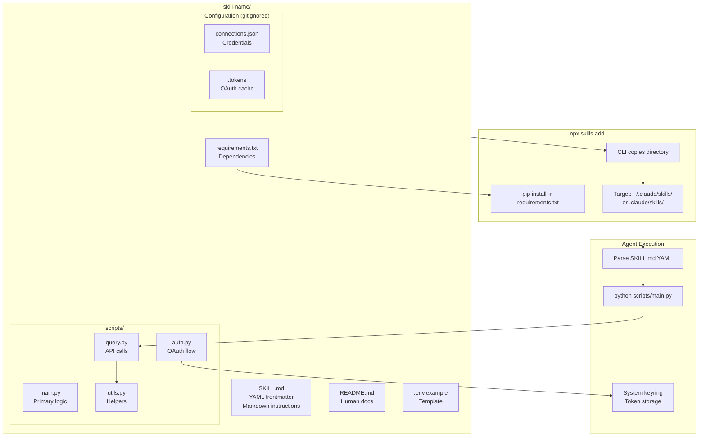
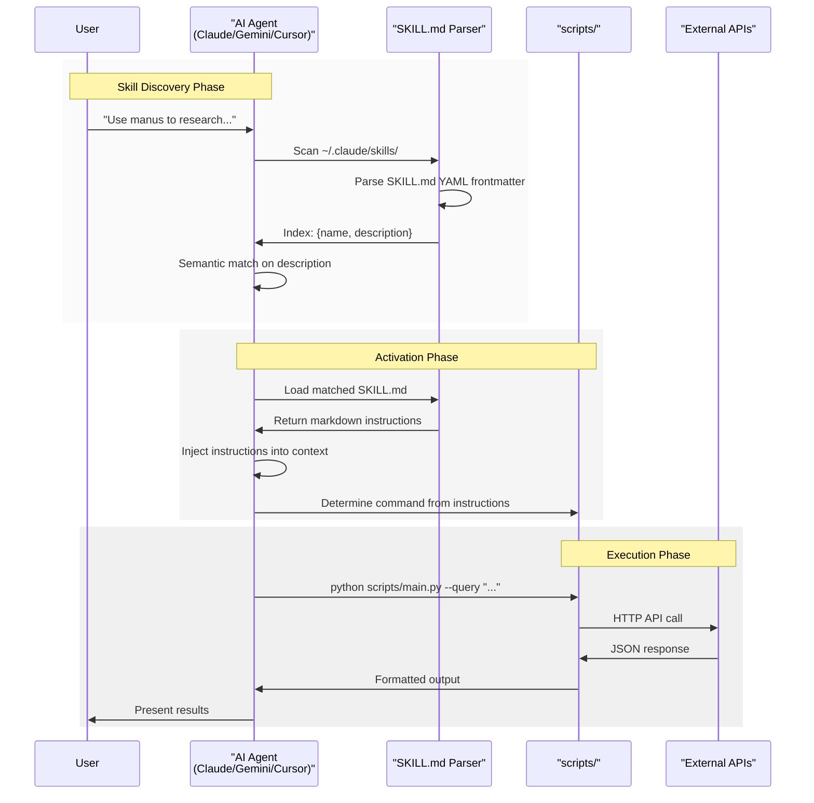
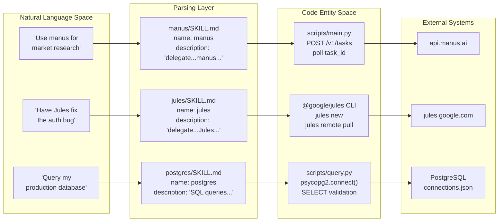

<!-- source: DeepWiki mcp.deepwiki.com · repo sanjay3290/ai-skills · page 3.1 Agent Skills Standard · fetched 2026-10-26 -->

# Agent Skills Standard

<details>
<summary>Relevant source files</summary>

The following files were used as context for generating this wiki page:

- [README.md](README.md)
- [skills/jules/SKILL.md](skills/jules/SKILL.md)
- [skills/manus/SKILL.md](skills/manus/SKILL.md)

</details>


The Agent Skills Standard defines the portable skill format that enables AI agents to discover, understand, and execute capabilities across 40+ different AI coding assistants. This standard specifies the directory structure, metadata format, and instruction conventions that make skills "write once, run anywhere."

For information about how skills are installed and distributed, see [Skill Discovery & Installation](#3.2). For security patterns used within skills, see [Execution & Safety Features](#3.5).

## Standard Overview

The Agent Skills Standard is a filesystem-based convention that consists of:

1. **SKILL.md** - Agent-facing instructions with YAML frontmatter
2. **Directory structure** - Standardized layout for scripts, configuration, and documentation
3. **Portability contract** - Guaranteed locations where agents can find skills

The standard is maintained at [agentskills.io](https://agentskills.io) and implemented by this repository. All 19+ skills in the marketplace follow this specification.

**Sources:** [README.md:5](), [README.md:367-388]()

## SKILL.md Format

The `SKILL.md` file is the core interface between skills and AI agents. It combines YAML frontmatter for metadata with markdown instructions for execution guidance.

### YAML Frontmatter Structure

```yaml
---
name: skill-name
description: "Activation criteria and use cases"
license: Apache-2.0
metadata:
  author: username
  version: "1.0"
---
```

**Required Fields:**

| Field | Type | Purpose |
|-------|------|---------|
| `name` | string | Skill identifier, must match directory name |
| `description` | string | Activation triggers and capability description |

**Optional Fields:**

| Field | Type | Purpose |
|-------|------|---------|
| `license` | string | SPDX license identifier |
| `metadata.author` | string | Skill creator |
| `metadata.version` | string | Semantic version |

The `description` field is semantically critical - it determines when the AI agent activates the skill. Effective descriptions include:
- Explicit trigger phrases: "Use when user says 'use manus', 'delegate to manus'"
- Capability keywords: "deep research", "market analysis", "SQL queries"
- Domain indicators: "GitHub repositories", "Google Workspace", "databases"

**Sources:** [README.md:379-388](), [skills/manus/SKILL.md:1-8](), [skills/jules/SKILL.md:1-8]()

### SKILL.md Structure Diagram



**Sources:** [README.md:367-388](), [skills/manus/SKILL.md:1-185](), [skills/jules/SKILL.md:1-201]()

### Markdown Instructions

The markdown content following the frontmatter provides execution instructions to the AI agent. Standard sections include:

- **Setup** - Prerequisites, environment variables, authentication
- **Commands** - Executable syntax with examples
- **Workflow** - Step-by-step processes
- **Error Handling** - Common failure modes and recovery
- **Best Practices** - Optimization guidance

Example structure from manus skill:

```markdown
## When to Use Manus
- Deep research - Market analysis, competitive landscaping
- Stock/financial analysis - Company research, technical indicators

## Environment Setup
Requires `MANUS_API_KEY` environment variable.

## Core Workflow
1. **Create task** → Returns `task_id` immediately
2. **Poll status** → Check until `status` is `completed`
3. **Return results** → Extract output text and attachments
```

**Sources:** [skills/manus/SKILL.md:10-185](), [skills/jules/SKILL.md:10-201]()

## Directory Structure Standard

Every skill must follow this canonical layout:

```
skill-name/
├── SKILL.md              # Required: Agent instructions
├── README.md             # Required: Human documentation
├── scripts/              # Optional: Executable code
│   ├── auth.py
│   ├── main.py
│   └── utils.py
├── requirements.txt      # Optional: Python dependencies
├── .env.example          # Optional: Environment template
├── config.example.json   # Optional: Configuration template
└── connections.json      # Optional: Credentials (gitignored)
```

### Required Files

**SKILL.md**
- Agent-facing interface
- YAML frontmatter + markdown instructions
- Must exist at skill root

**README.md**
- Human-readable documentation
- Setup instructions, usage examples, troubleshooting
- Must exist at skill root

### Optional Components

**scripts/** directory
- Contains executable code (Python, Shell, Node.js)
- Standard entry points: `main.py`, `auth.py`, `query.py`
- Must be executable or invocable via interpreter

**requirements.txt**
- Python dependencies in pip format
- Installed by `npx skills add` during setup
- Example: [skills/postgres/requirements.txt]()

**.env.example**
- Template for environment variables
- Shows required configuration without exposing secrets
- Example: `GEMINI_API_KEY=your-api-key-here`

**config.example.json** / **connections.json**
- Structured configuration templates
- Actual config files are gitignored
- Example: Database connection parameters

**Sources:** [README.md:367-388](), [README.md:179-191]()

## Directory Structure with Code Entities



**Sources:** [README.md:154-177](), [README.md:367-388]()

## Portability Mechanism

The Agent Skills Standard achieves portability through three guarantees:

### 1. Standardized Skill Directories

All supporting AI clients agree on skill directory conventions:

| Client | Global | Project |
|--------|--------|---------|
| Claude Code | `~/.claude/skills/` | `.claude/skills/` |
| Gemini CLI | `~/.gemini/skills/` | `.gemini/skills/` |
| Cursor | `~/.cursor/skills/` | `.cursor/skills/` |
| Goose | `~/.config/goose/skills/` | `.goose/skills/` |
| OpenAI Codex | `~/.codex/skills/` | `.codex/skills/` |

The `npx skills` CLI auto-detects the active agent and installs to the correct location.

**Sources:** [README.md:18-26](), [README.md:109-122]()

### 2. Semantic Activation via Description

AI agents index skills by the `description` field in YAML frontmatter. When a user makes a request, the agent:

1. Extracts intent from user query
2. Performs semantic matching against all skill descriptions
3. Activates matching skills by loading their SKILL.md
4. Executes instructions in agent context

Example from manus skill:

```yaml
description: Delegate complex, long-running tasks to Manus AI agent for autonomous execution. Use when user says 'use manus', 'delegate to manus', 'send to manus', 'have manus do', 'ask manus', 'check manus sessions', or when tasks require deep web research, market analysis, product comparisons...
```

This enables natural language activation:
- User: "Use manus to research the best 4K monitors"
- Agent: Matches "use manus" → loads manus skill → executes research workflow

**Sources:** [skills/manus/SKILL.md:3](), [skills/jules/SKILL.md:3]()

### 3. Self-Contained Execution

Skills must be self-contained with explicit dependency declarations:

- Python dependencies in `requirements.txt`
- Environment variables in `.env.example`
- External tools documented in README.md (e.g., `ffmpeg`, `gh cli`)

This ensures skills work identically across all agents and environments after installation.

**Sources:** [README.md:179-286]()

## Agent Consumption Workflow



**Sources:** [README.md:288-364](), [skills/manus/SKILL.md:56-92]()

## SKILL.md Parsing and Execution Bridge



**Sources:** [skills/manus/SKILL.md:1-8, 54-92](), [skills/jules/SKILL.md:1-8, 38-57](), [README.md:31-33]()

## Standard Compliance Examples

### Example 1: Minimal Skill (imagen)

```
skills/imagen/
├── SKILL.md           # YAML + markdown instructions
├── README.md          # Human docs
└── .env.example       # GEMINI_API_KEY template
```

No scripts directory - skill executes via direct API calls using `curl` from SKILL.md.

**Sources:** [README.md:34, 193-198]()

### Example 2: Script-Based Skill (postgres)

```
skills/postgres/
├── SKILL.md
├── README.md
├── scripts/
│   └── query.py       # Main execution logic
├── requirements.txt   # psycopg2-binary
└── connections.json   # Database credentials
```

Execution: `python scripts/query.py --database prod --query "SELECT..."`

**Sources:** [README.md:31, 183-191]()

### Example 3: Complex Skill (notebooklm)

```
skills/notebooklm/
├── SKILL.md
├── README.md
├── scripts/
│   ├── auth_manager.py      # OAuth + profile management
│   ├── notebook_manager.py  # Local registry
│   ├── ask_question.py      # Query interface
│   └── remote_manager.py    # Source sync
├── requirements.txt          # playwright, beautifulsoup4
├── .env.example
└── .notebooklm/             # Profile storage (created at runtime)
    └── profiles/
```

Multi-script architecture with persistent state and browser automation.

**Sources:** [README.md:39, 239-244]()

## Frontmatter Field Reference

### Standard Fields

**name** (required)
- Type: `string`
- Must match directory name
- Used for skill identification and indexing
- Example: `name: postgres`

**description** (required)
- Type: `string`
- Activation triggers and capability summary
- Should include explicit user phrases and keywords
- Example: `description: "Use when user says 'query database', 'SQL', or when needing to read PostgreSQL data"`

**license** (optional)
- Type: `string`
- SPDX identifier
- Default: Inherits from repository
- Example: `license: Apache-2.0`

**metadata** (optional)
- Type: `object`
- Arbitrary key-value pairs
- Common fields: `author`, `version`, `homepage`, `repository`

**Sources:** [skills/manus/SKILL.md:1-8](), [skills/jules/SKILL.md:1-8]()

## Installation Integration Points

The `npx skills add` CLI interacts with the Agent Skills Standard at these points:

1. **Fetch phase** - Clones GitHub repo or downloads specific skill directory
2. **Validation phase** - Verifies SKILL.md exists with valid YAML frontmatter
3. **Dependency phase** - Runs `pip install -r requirements.txt` if present
4. **Installation phase** - Copies skill directory to agent's skill path
5. **Post-install** - Optionally runs setup scripts or displays setup instructions

The standard intentionally does not specify post-install hooks to maintain simplicity.

**Sources:** [README.md:65-140]()

## Markdown Instruction Conventions

While the standard does not enforce specific markdown structure, common conventions have emerged:

### Section Hierarchy

**Top-level sections:**
- Setup / Environment Setup / Prerequisites
- Commands / Usage / API
- Workflow / Core Workflow
- Examples / Template Prompts
- Best Practices / Notes
- Error Handling / Troubleshooting

**Code blocks:**
- Use `bash` for shell commands
- Use `json` for API payloads
- Use `yaml` for configuration examples
- Include explanatory comments

### Command Documentation Pattern

```markdown
## Command Name

```bash
command --flag value
```

**Description:** What the command does

**Parameters:**
- `--flag` - Parameter description

**Example:**
```bash
command --flag example
```
```

**Sources:** [skills/manus/SKILL.md:62-116](), [skills/jules/SKILL.md:38-128]()

## Relationship to Claude Plugin System

The Agent Skills Standard is compatible with the Claude Desktop plugin system (`.claudeplugin/` directory). Skills can optionally include a `.claudeplugin/manifest.json` to integrate with Claude's MCP (Model Context Protocol) architecture.

However, the core standard remains MCP-agnostic to ensure portability across non-Claude agents.

For Claude-specific integration, see [Marketplace & Plugin System](#3.3).

**Sources:** [README.md:5]()

## Validation Checklist

A compliant skill must satisfy:

- [ ] `SKILL.md` exists at skill root
- [ ] SKILL.md contains valid YAML frontmatter with `---` delimiters
- [ ] YAML includes `name` field matching directory name
- [ ] YAML includes `description` field
- [ ] `README.md` exists with human-readable documentation
- [ ] If Python code exists, `requirements.txt` declares dependencies
- [ ] If credentials required, `.env.example` or `config.example.json` provides template
- [ ] Directory name uses lowercase with hyphens (e.g., `google-chat`, not `GoogleChat`)
- [ ] No absolute paths in scripts (use relative or environment-based paths)
- [ ] Scripts are executable or documented with invocation syntax

**Sources:** [README.md:367-388](), [README.md:390-396]()

---

