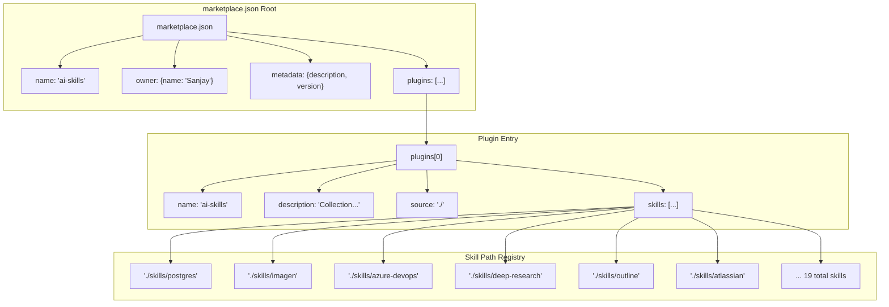
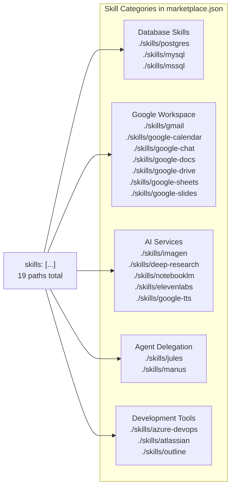
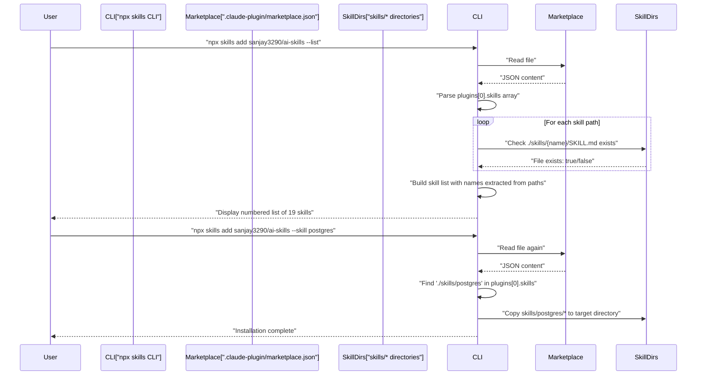
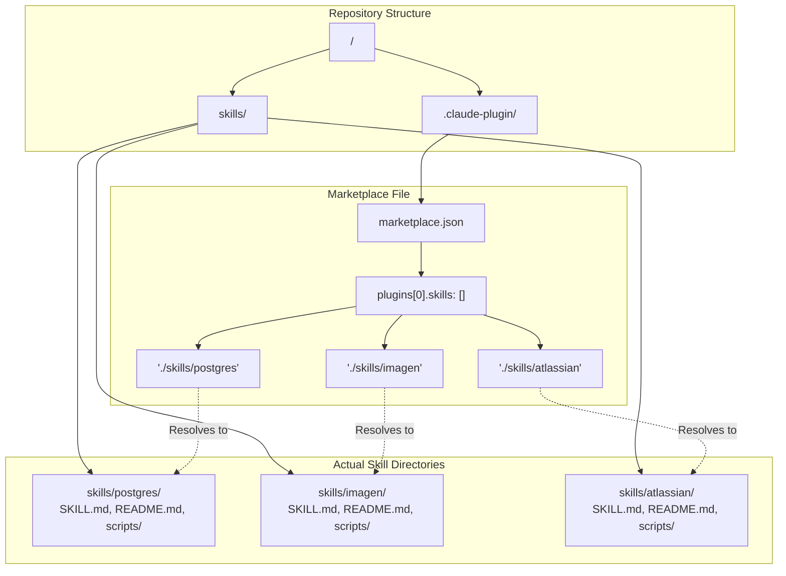

<!-- source: DeepWiki mcp.deepwiki.com · repo sanjay3290/ai-skills · page 3.3 Marketplace & Plugin System · fetched 2026-10-26 -->

# Marketplace & Plugin System

<details>
<summary>Relevant source files</summary>

The following files were used as context for generating this wiki page:

- [.claude-plugin/marketplace.json](.claude-plugin/marketplace.json)

</details>


This document describes the marketplace catalog structure defined in `marketplace.json` and its role as the centralized registry for all available skills. The marketplace serves as the discovery mechanism for the `npx skills` CLI and provides Claude-compatible plugin metadata. For information about how the CLI uses the marketplace during installation, see [Skill Discovery & Installation](#3.2). For details on individual skill structures, see [Agent Skills Standard](#3.1).

## Overview

The marketplace system consists of a single JSON file that catalogs all 19+ skills available in the repository. This file serves two primary functions:

1. **CLI Discovery Source**: The `npx skills` CLI reads this file to enumerate available skills and display them via the `--list` flag
2. **Claude Plugin Integration**: The file follows Claude's plugin manifest format, enabling the entire skill collection to be recognized as a Claude-compatible plugin package

**Sources**: [.claude-plugin/marketplace.json:1-40]()

## Marketplace File Structure



**Sources**: [.claude-plugin/marketplace.json:1-40]()

## Root-Level Metadata

The marketplace file contains three top-level metadata fields:

| Field | Type | Value | Purpose |
|-------|------|-------|---------|
| `name` | string | `"ai-skills"` | Package identifier |
| `owner.name` | string | `"Sanjay"` | Package maintainer |
| `metadata.description` | string | `"Collection of agent skills for AI coding assistants"` | Human-readable package description |
| `metadata.version` | string | `"1.1.0"` | Semantic version number for the entire skill collection |

The version field follows semantic versioning (MAJOR.MINOR.PATCH) and applies to the marketplace catalog as a whole, not to individual skills.

**Sources**: [.claude-plugin/marketplace.json:2-9]()

## Plugin Entry Structure

The `plugins` array contains a single plugin entry that encapsulates all skills:

```json
{
  "name": "ai-skills",
  "description": "Collection of agent skills: PostgreSQL, MySQL, MSSQL, Imagen, ...",
  "source": "./",
  "skills": [
    "./skills/postgres",
    "./skills/imagen",
    ...
  ]
}
```

### Plugin Fields

| Field | Description |
|-------|-------------|
| `name` | Plugin identifier matching the root `name` field |
| `description` | Comprehensive list of all included skills with their common names |
| `source` | Base path for skill resolution (repository root: `"./"`) |
| `skills` | Array of relative paths to individual skill directories |

The `description` field [.claude-plugin/marketplace.json:13]() enumerates all 19 skills by name, providing a quick reference without needing to parse the `skills` array.

**Sources**: [.claude-plugin/marketplace.json:10-38]()

## Skill Path Registry

The `skills` array contains 19 relative paths pointing to individual skill directories:



Each path follows the pattern `./skills/{skill-name}` and points to a directory containing a `SKILL.md` file and supporting scripts. The order in the array [.claude-plugin/marketplace.json:15-36]() is arbitrary and does not indicate priority or importance.

**Sources**: [.claude-plugin/marketplace.json:15-36]()

### Skill Path to Directory Mapping

| Array Entry | Resolved Path | Primary File |
|-------------|---------------|--------------|
| `"./skills/postgres"` | `skills/postgres/` | `skills/postgres/SKILL.md` |
| `"./skills/imagen"` | `skills/imagen/` | `skills/imagen/SKILL.md` |
| `"./skills/azure-devops"` | `skills/azure-devops/` | `skills/azure-devops/SKILL.md` |
| `"./skills/gmail"` | `skills/gmail/` | `skills/gmail/SKILL.md` |
| ... | ... | ... |

The CLI resolves these paths relative to the repository root when the `source` field is `"./"`.

**Sources**: [.claude-plugin/marketplace.json:15-36]()

## CLI Discovery Workflow



The CLI uses the marketplace as the authoritative source of truth for:
- **Skill Enumeration**: The `--list` flag reads `plugins[0].skills` to display available options
- **Path Resolution**: When installing a specific skill, the CLI validates the skill name exists in the array before attempting to copy files
- **Validation**: The CLI can verify the marketplace is well-formed and all referenced skill directories exist

**Sources**: [.claude-plugin/marketplace.json:1-40]()

## Claude Plugin Integration

The marketplace file follows the Claude plugin manifest specification, enabling Claude Code to recognize the repository as a plugin package. When installed via Claude's plugin system, Claude reads the `marketplace.json` to:

1. **Identify the Package**: Uses `name` and `metadata.description` for display in Claude's plugin manager
2. **Locate Skills**: Resolves skill paths using `plugins[0].source` + each entry in `plugins[0].skills`
3. **Install Skills**: Copies the resolved skill directories to `~/.claude/skills/` (or equivalent)

The single-plugin structure [.claude-plugin/marketplace.json:10-38]() means all 19 skills are bundled together as one installable unit rather than being individually selectable within Claude's UI.

**Sources**: [.claude-plugin/marketplace.json:10-38]()

## Catalog Maintenance

### Adding a New Skill

To register a new skill in the marketplace:

1. Create the skill directory structure under `skills/{new-skill-name}/`
2. Implement `SKILL.md` following the Agent Skills Standard (see [Agent Skills Standard](#3.1))
3. Add `"./skills/{new-skill-name}"` to the `plugins[0].skills` array in `marketplace.json`
4. Update the `plugins[0].description` string to include the new skill's name
5. Optionally increment `metadata.version` (typically MINOR version for new features)

**Example Addition**:
```json
{
  "plugins": [
    {
      "skills": [
        "./skills/postgres",
        "./skills/new-skill-name"  // Add here
      ]
    }
  ]
}
```

### Removing a Skill

To deprecate a skill:

1. Remove the corresponding `"./skills/{skill-name}"` entry from the `plugins[0].skills` array
2. Remove the skill name from `plugins[0].description`
3. Increment `metadata.version` (MAJOR version if breaking change, MINOR if backward-compatible)
4. Optionally keep the skill directory for historical purposes but exclude it from the catalog

**Sources**: [.claude-plugin/marketplace.json:15-36]()

## Relationship to Skills Directory



The marketplace acts as an index that maps logical skill names to physical directory locations. The separation between the marketplace file (`.claude-plugin/marketplace.json`) and the skill implementations (`skills/*/`) enables:

- **Centralized Discovery**: One file to query for all available skills
- **Decoupled Updates**: Skills can be modified without changing the marketplace (unless adding/removing skills)
- **CLI Efficiency**: The CLI doesn't need to scan the entire `skills/` directory to determine what's available

**Sources**: [.claude-plugin/marketplace.json:1-40]()

## Version Management

The `metadata.version` field [.claude-plugin/marketplace.json:8]() tracks the marketplace catalog version:

| Version Component | Increment When |
|-------------------|----------------|
| **MAJOR** (1.x.x) | Breaking changes: removing skills, changing path structure, incompatible format changes |
| **MINOR** (x.1.x) | Adding new skills, non-breaking enhancements |
| **PATCH** (x.x.1) | Documentation updates, fixing typos in descriptions |

Current version: **1.1.0** indicates the marketplace has undergone one minor revision since the initial 1.0.0 release.

**Sources**: [.claude-plugin/marketplace.json:8]()

## Limitations and Constraints

| Constraint | Impact |
|------------|--------|
| **Single Plugin Entry** | All skills must be installed as a bundle; no granular skill selection within Claude's UI |
| **Relative Paths Only** | Skills must reside within the repository; no support for external/remote skill sources |
| **No Dependency Graph** | The array structure cannot express inter-skill dependencies (e.g., Google Workspace skills sharing auth infrastructure) |
| **Manual Maintenance** | Adding/removing skills requires manual JSON edits; no automated catalog generation |
| **No Skill Metadata** | Individual skill metadata (version, author, tags) must be stored in `SKILL.md`, not the marketplace |

Despite these constraints, the simple array-based structure keeps the marketplace easy to understand and modify.

**Sources**: [.claude-plugin/marketplace.json:1-40]()

---

