<!-- source: DeepWiki mcp.deepwiki.com · repo sanjay3290/ai-skills · page 3.4 Authentication Patterns · fetched 2026-10-26 -->

# Authentication Patterns

<details>
<summary>Relevant source files</summary>

The following files were used as context for generating this wiki page:

- [skills/azure-devops/SKILL.md](skills/azure-devops/SKILL.md)
- [skills/deep-research/SKILL.md](skills/deep-research/SKILL.md)
- [skills/elevenlabs/SKILL.md](skills/elevenlabs/SKILL.md)
- [skills/gmail/SKILL.md](skills/gmail/SKILL.md)
- [skills/google-drive/SKILL.md](skills/google-drive/SKILL.md)
- [skills/google-sheets/SKILL.md](skills/google-sheets/SKILL.md)
- [skills/google-slides/SKILL.md](skills/google-slides/SKILL.md)

</details>


## Purpose and Scope

This document provides a comprehensive technical reference for the six authentication patterns implemented across the AI Skills ecosystem. Each pattern is optimized for specific security requirements, user experience constraints, and API integration scenarios. The material covers credential storage mechanisms, token management, OAuth flows, and platform-specific implementations.

For skill-specific configuration details, see [Configuration Guide](#6). For individual skill documentation, see [Skills by Category](#4).

---

## Authentication Pattern Overview

The 18 skills in the ecosystem employ six distinct authentication patterns, each selected based on API provider requirements, security constraints, and workflow characteristics.

```mermaid
graph TB
    subgraph Pattern1["Pattern 1: Environment Variables"]
        P1Skills["imagen<br/>deep-research<br/>outline<br/>manus<br/>elevenlabs"]
        P1Impl["GEMINI_API_KEY<br/>OUTLINE_API_KEY<br/>MANUS_API_KEY<br/>ELEVENLABS_API_KEY"]
        P1Skills --> P1Impl
    end
    
    subgraph Pattern2["Pattern 2: connections.json"]
        P2Skills["postgres<br/>mysql<br/>mssql"]
        P2Impl["connections.json<br/>600 permissions<br/>Multiple named connections"]
        P2Skills --> P2Impl
    end
    
    subgraph Pattern3["Pattern 3: OAuth + Keyring"]
        P3Skills["gmail<br/>google-calendar<br/>google-chat<br/>google-docs<br/>google-drive<br/>google-sheets<br/>google-slides"]
        P3Impl["auth.py login<br/>System keyring storage<br/>Auto-refresh via cloud function"]
        P3Skills --> P3Impl
    end
    
    subgraph Pattern4["Pattern 4: CLI OAuth"]
        P4Skills["jules"]
        P4Impl["npm install -g @google/jules<br/>jules login<br/>~/.jules/credentials"]
        P4Skills --> P4Impl
    end
    
    subgraph Pattern5["Pattern 5: Browser Automation"]
        P5Skills["notebooklm"]
        P5Impl["auth_manager.py setup<br/>Playwright Chrome profiles<br/>~/.config/claude/notebooklm-skill/profiles/"]
        P5Skills --> P5Impl
    end
    
    subgraph Pattern6["Pattern 6: Dual-Mode Auth"]
        P6Skills["azure-devops"]
        P6Impl["auth.py login --org<br/>OAuth device flow OR --pat<br/>System keyring storage"]
        P6Skills --> P6Impl
    end
```

**Pattern Distribution by Skill Count**

| Pattern | Skills | Use Case |
|---------|--------|----------|
| OAuth + Keyring | 7 (39%) | Enterprise services requiring high security |
| Environment Variables | 5 (28%) | Simple API integrations |
| Database Credentials | 3 (17%) | Database query operations |
| Browser Automation | 1 (6%) | Services without official APIs |
| CLI OAuth | 1 (6%) | Delegated authentication to external CLI |
| Dual-Mode | 1 (6%) | Flexible auth for CI/CD and interactive use |

Sources: [README.md:27-57](), [skills/gmail/SKILL.md:1-12](), [skills/notebooklm/SKILL.md:1-8](), [skills/azure-devops/SKILL.md:1-14]()

---

## Pattern 1: Environment Variable API Keys

The simplest pattern used by five skills that integrate with APIs supporting direct API key authentication. Credentials are stored as environment variables and read at runtime.

### Implementation Architecture

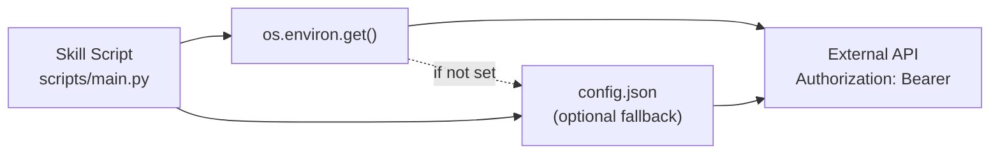

### Skills Using This Pattern

| Skill | Environment Variable | Config File Alternative |
|-------|---------------------|------------------------|
| imagen | `GEMINI_API_KEY` | N/A |
| deep-research | `GEMINI_API_KEY` | N/A |
| outline | `OUTLINE_API_KEY` | N/A |
| manus | `MANUS_API_KEY` | N/A |
| elevenlabs | `ELEVENLABS_API_KEY` | `skills/elevenlabs/config.json` |

### Code Implementation: ElevenLabs Example

The elevenlabs skill demonstrates both environment variable and config file fallback:

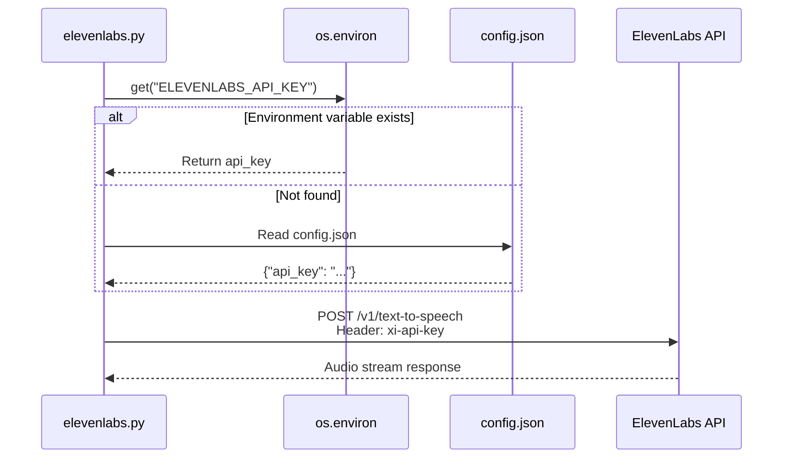

**Key characteristics:**
- No token refresh logic required
- Credentials are static strings
- Suitable for personal development environments
- Requires secure secret management in production

Sources: [skills/elevenlabs/SKILL.md:29-44](), [skills/deep-research/SKILL.md:14-27](), [skills/manus/SKILL.md:52-54]()

---

## Pattern 2: Database Credentials File

Database skills (postgres, mysql, mssql) use a `connections.json` file to store multiple named database connections with full credentials. This pattern enables quick switching between environments (dev/staging/prod) and supports read-only operations for safety.

### connections.json Structure

```json
{
  "production": {
    "host": "prod-db.example.com",
    "port": 5432,
    "user": "readonly_user",
    "password": "secure_password",
    "database": "main_db",
    "ssl": true
  },
  "staging": {
    "host": "staging-db.example.com",
    "port": 5432,
    "user": "admin",
    "password": "staging_pass",
    "database": "staging_db"
  }
}
```

### Connection Selection Flow

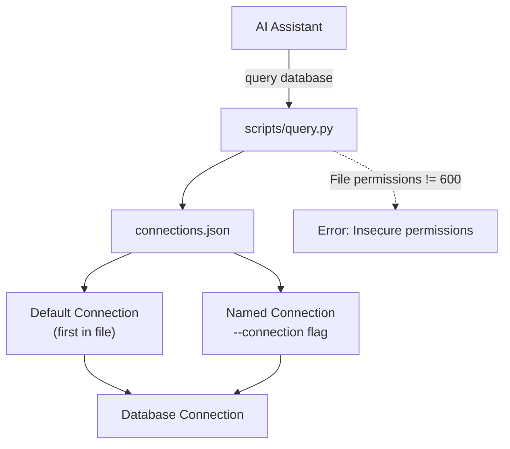

### Security Requirements

| Requirement | Implementation | Rationale |
|-------------|----------------|-----------|
| File permissions | Must be `600` (owner read/write only) | Prevent credential exposure to other users |
| Password sanitization | Credentials stripped from error messages | Prevent accidental logging |
| Read-only enforcement | Query validation, no `INSERT`/`UPDATE`/`DELETE` | Defense-in-depth safety |
| Connection timeouts | 10s login, 30s query | Prevent hung connections |
| Row limits | 10,000 row maximum | Prevent memory exhaustion |

### File Location by Skill

Each database skill expects `connections.json` in its own directory:

- PostgreSQL: `skills/postgres/connections.json`
- MySQL: `skills/mysql/connections.json`
- MSSQL: `skills/mssql/connections.json`

Sources: [README.md:181-183](), File references inferred from skill structure

---

## Pattern 3: OAuth + System Keyring

The most sophisticated authentication pattern, used by all seven Google Workspace skills. This pattern combines browser-based OAuth flow with platform-native secure storage, enabling long-term authenticated access without password re-entry.

### OAuth Flow Architecture

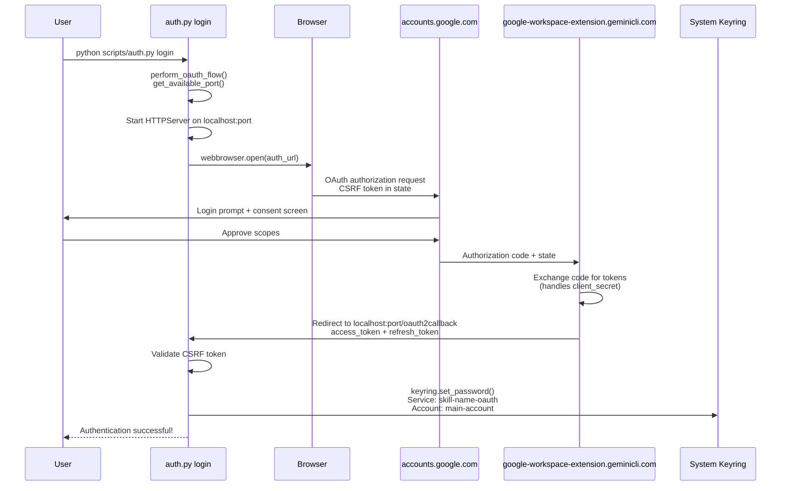

### Token Storage Implementation

Each Google skill uses a unique keyring service identifier to prevent cross-skill conflicts:

| Skill | Keyring Service Name | Scope |
|-------|---------------------|-------|
| gmail | `gmail-skill-oauth` | `gmail.modify` |
| google-calendar | `google-calendar-skill-oauth` | `calendar` |
| google-chat | `google-chat-skill-oauth` | `chat.spaces`, `chat.messages` |
| google-docs | `google-docs-skill-oauth` | `documents` |
| google-drive | `google-drive-skill-oauth` | `drive` |
| google-sheets | `google-sheets-skill-oauth` | `spreadsheets` |
| google-slides | `google-slides-skill-oauth` | `presentations` |

### Token Refresh Mechanism

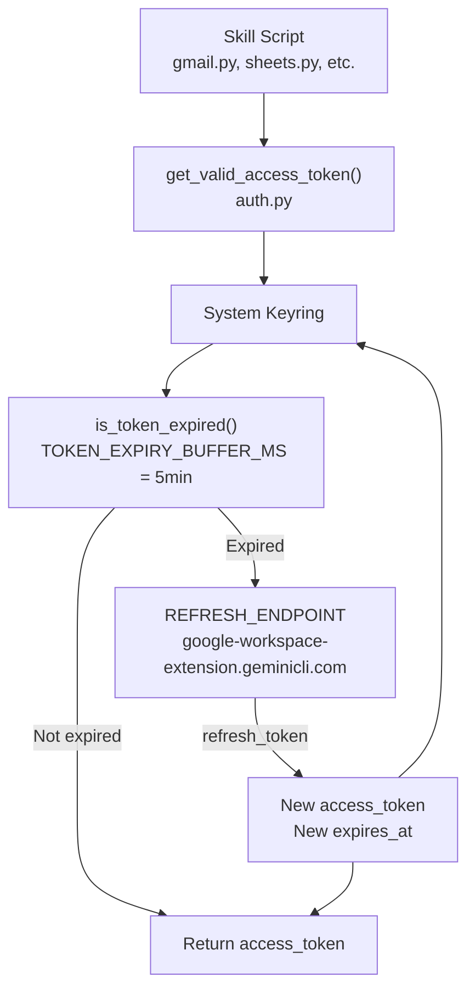

### Code Implementation: Gmail auth.py

The OAuth implementation is shared across all Google skills with minor variations. Key functions:

**Authentication Flow** [skills/gmail/scripts/auth.py:199-278]():
- `perform_oauth_flow()` - Manages browser redirect and local callback server
- `OAuthCallbackHandler` - HTTP server for receiving OAuth callback
- CSRF protection via `secrets.token_hex(32)` state parameter

**Token Management** [skills/gmail/scripts/auth.py:253-328]():
- `get_valid_access_token(interactive=True)` - Main entry point for all API operations
- `is_token_expired(token_info)` - Checks expiry with 5-minute buffer
- `refresh_access_token(refresh_token)` - Calls cloud function for refresh

**Storage Operations** [skills/gmail/scripts/auth.py:56-100]():
- `get_stored_tokens()` - Reads from `keyring.get_password()`
- `save_stored_tokens(token_info)` - Writes to `keyring.set_password()`
- `clear_stored_tokens()` - Deletes via `keyring.delete_password()`

### Platform-Specific Storage Locations

| Platform | Storage Backend | Location |
|----------|----------------|----------|
| macOS | Keychain | `/Library/Keychains/` |
| Windows | Credential Locker | `Control Panel > Credential Manager` |
| Linux | Secret Service API | GNOME Keyring, KDE Wallet, or compatible |

### OAuth Configuration Constants

[skills/gmail/scripts/auth.py:23-38]():
```
CLIENT_ID = "338689075775-o75k922vn5fdl18qergr96rp8g63e4d7.apps.googleusercontent.com"
CLOUD_FUNCTION_URL = "https://google-workspace-extension.geminicli.com"
REFRESH_ENDPOINT = f"{CLOUD_FUNCTION_URL}/refreshToken"
KEYCHAIN_SERVICE = "gmail-skill-oauth"
KEYCHAIN_ACCOUNT = "main-account"
SCOPES = ["https://www.googleapis.com/auth/gmail.modify", ...]
TOKEN_EXPIRY_BUFFER_MS = 5 * 60 * 1000  # 5 minutes
```

### Auto-Authentication in API Operations

All Google skill scripts automatically trigger authentication if tokens are missing:

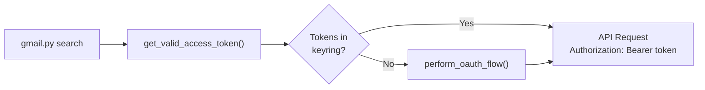

Sources: [skills/gmail/scripts/auth.py:1-367](), [skills/google-calendar/scripts/auth.py:1-400](), [skills/gmail/SKILL.md:176-184](), [skills/google-sheets/SKILL.md:135-142]()

---

## Pattern 4: CLI-Delegated OAuth

The jules skill delegates authentication to an external NPM package (`@google/jules`), which handles OAuth and stores credentials in its own format. This pattern is used when a skill wraps an existing CLI tool with established authentication.

### Authentication Delegation Architecture

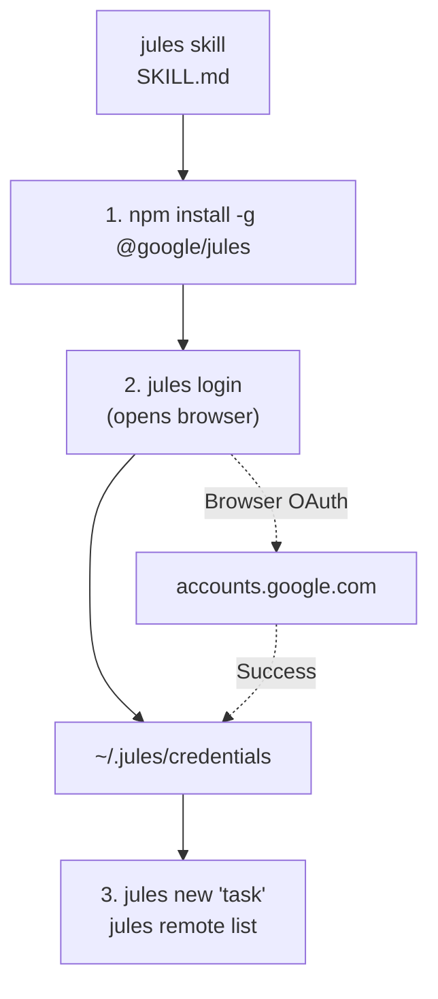

### CLI Authentication Check

The jules skill verifies authentication before executing tasks:

[skills/jules/SKILL.md:21-25]():
```bash
# Check Auth
jules remote list --repo
# If fails → tell user to run `jules login`
```

### Credential Storage

Unlike the Google skills which use system keyring, jules stores tokens in a CLI-managed file:
- **Location**: `~/.jules/credentials`
- **Format**: Proprietary to `@google/jules` package
- **Management**: Handled entirely by the jules CLI, not the skill scripts

### Skill Integration

The jules skill does not implement authentication logic itself. Instead, it:
1. Checks if `jules` CLI is installed via `which jules`
2. Tests authentication by running `jules remote list --repo`
3. Provides setup instructions if authentication fails
4. Executes jules commands assuming valid authentication

**Headless Authentication** [skills/jules/SKILL.md:23-24]():
```bash
jules login --no-launch-browser
# For servers without display
```

Sources: [skills/jules/SKILL.md:14-25](), [README.md:207-214]()

---

## Pattern 5: Browser Automation with Profile Persistence

The notebooklm skill uses Playwright browser automation because NotebookLM lacks an official API. Authentication is achieved by logging into Google in a persistent Chrome profile that maintains cookies across invocations.

### Profile-Based Authentication Flow

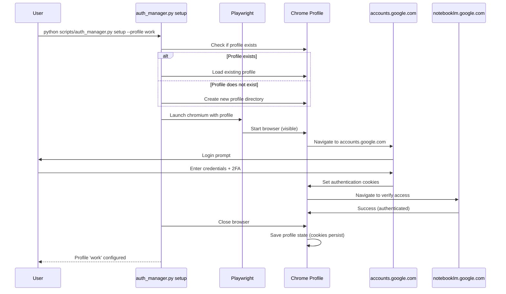

### Profile Storage Structure

[skills/notebooklm/SKILL.md:26]():
```
~/.config/claude/notebooklm-skill/profiles/
├── work/                      # Profile name
│   ├── Default/               # Chrome profile data
│   │   ├── Cookies            # Persistent cookies
│   │   ├── Local Storage/
│   │   └── Session Storage/
│   └── metadata.json          # Profile metadata
└── personal/
    └── ...
```

### Profile-Based Script Execution

All notebooklm skill operations specify a profile:

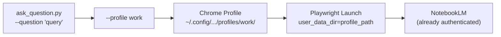

### Headless vs. Visible Mode

[skills/notebooklm/SKILL.md:25]():
- **Default**: `headless=True` for automated execution
- **Debugging**: `--show-browser` flag launches visible Chrome

### Environment Variable Override

[skills/notebooklm/SKILL.md:26]():
```bash
export NOTEBOOKLM_DATA_DIR=/custom/path
# Overrides default ~/.config/claude/notebooklm-skill/
```

### Authentication Status Check

```bash
python scripts/auth_manager.py status --profile work
# Output: Profile 'work' is configured
#         Last used: 2024-01-15 10:30:00
```

### Security Considerations

| Aspect | Implementation |
|--------|----------------|
| Profile encryption | Relies on OS-level disk encryption |
| Cookie exposure | Cookies stored in plaintext in profile directory |
| 2FA support | Manual entry during initial `setup` |
| Session persistence | Cookies remain valid until Google expires them (typically 14-30 days) |
| Multiple accounts | Separate profiles for each Google account |

Sources: [skills/notebooklm/SKILL.md:24-42](), [README.md:230-235]()

---

## Pattern 6: Dual-Mode Authentication

The azure-devops skill uniquely supports two authentication modes: OAuth device code flow (interactive) and Personal Access Token (automation-friendly). Both methods store credentials in the system keyring.

### Dual-Mode Authentication Architecture

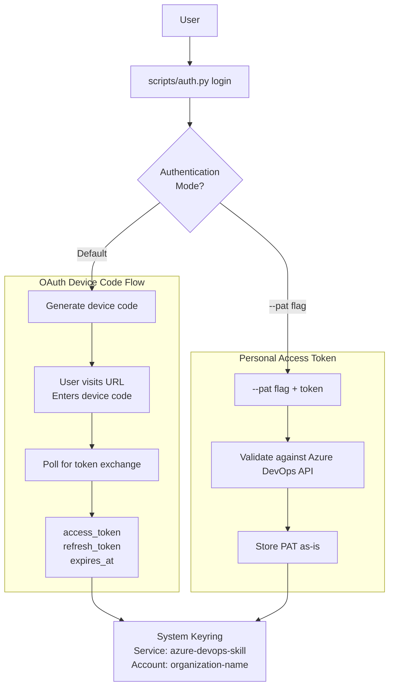

### OAuth Device Code Flow

[skills/azure-devops/SKILL.md:23-27]():
```bash
python scripts/auth.py login --org MyOrganization
# Output: Please visit: https://microsoft.com/devicelogin
#         Code: ABCD-EFGH
#         Waiting for authorization...
```

**OAuth Implementation Steps:**
1. Request device code from Azure AD
2. Display authorization URL and code to user
3. User visits URL, enters code, approves
4. Poll token endpoint until user completes authorization
5. Store `access_token`, `refresh_token`, `expires_at` in keyring

### Personal Access Token (PAT) Mode

[skills/azure-devops/SKILL.md:30-34]():
```bash
python scripts/auth.py login --org MyOrganization --pat YOUR_PAT
```

**PAT Required Scopes:**
- Work Items: Read & Write
- Code: Read & Write (repos/PRs)
- Build: Read & Execute (pipelines)
- Wiki: Read & Write
- Test Management: Read & Write
- Advanced Security: Read
- Project and Team: Read
- Identity: Read

### Keyring Storage Format

Both authentication modes store credentials in the same keyring service with organization-specific accounts:

| Field | OAuth Mode | PAT Mode |
|-------|-----------|----------|
| `access_token` | OAuth access token | PAT value |
| `refresh_token` | OAuth refresh token | None |
| `token_type` | "Bearer" | "Bearer" |
| `expires_at` | Unix timestamp (ms) | None (PATs don't expire automatically) |
| `organization` | Organization name | Organization name |

### Service Identifier

[skills/azure-devops/SKILL.md:477]():
```
Service name: azure-devops-skill
Account name: {organization-name}
```

Multiple organizations can be authenticated simultaneously, each with its own keyring entry.

### Token Refresh Logic

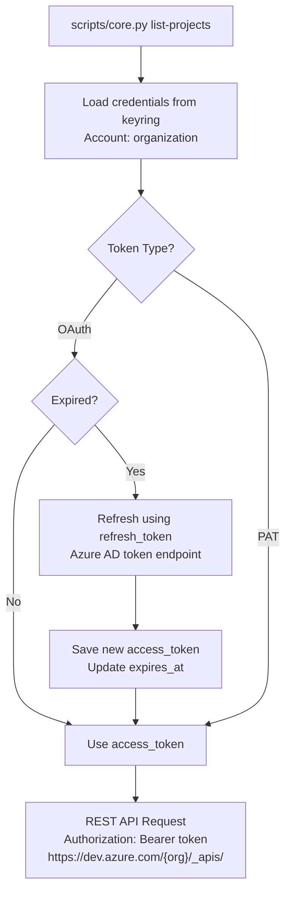

### Authentication Status Check

```bash
python scripts/auth.py status
# OAuth Mode Output:
#   Status: Authenticated (OAuth)
#   Organization: MyOrganization
#   Token expires in: 45.3 minutes
#   Storage: System keyring

# PAT Mode Output:
#   Status: Authenticated (PAT)
#   Organization: MyOrganization
#   Storage: System keyring
```

### Use Case Comparison

| Scenario | Recommended Mode | Rationale |
|----------|-----------------|-----------|
| Interactive development | OAuth | Automatic token refresh, no manual rotation |
| CI/CD pipelines | PAT | No browser interaction required |
| Shared service accounts | PAT | Centralized token management |
| Multi-organization access | OAuth | Easier to manage multiple org authorizations |
| Long-running automation | PAT | No refresh logic needed |

Sources: [skills/azure-devops/SKILL.md:19-57](), [README.md:237-246](), [skills/azure-devops/SKILL.md:472-477]()

---

## Cross-Platform Token Storage

All keyring-based authentication patterns (Google skills, Azure DevOps) rely on the Python `keyring` library for cross-platform credential storage.

### Platform Storage Backends

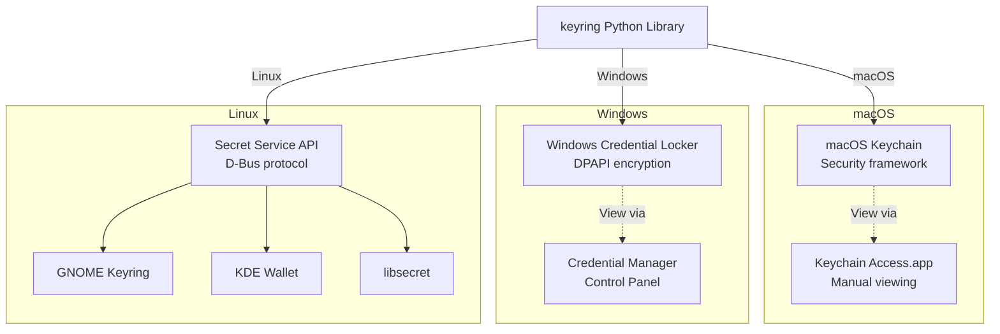

### Keyring API Usage

All Google skills and Azure DevOps use identical keyring operations:

**Store Credentials:**
```python
import keyring
import json

data = {
    "serverName": "main-account",
    "token": {
        "accessToken": "...",
        "refreshToken": "...",
        "expiresAt": 1234567890000
    }
}
keyring.set_password(
    service="gmail-skill-oauth",  # Service identifier
    username="main-account",       # Account identifier
    password=json.dumps(data)      # Serialized credentials
)
```

**Retrieve Credentials:**
```python
data_str = keyring.get_password(
    service="gmail-skill-oauth",
    username="main-account"
)
data = json.loads(data_str)
access_token = data["token"]["accessToken"]
```

**Delete Credentials:**
```python
keyring.delete_password(
    service="gmail-skill-oauth",
    username="main-account"
)
```

### Service Naming Convention

Each skill uses a unique service identifier to prevent conflicts:

| Skill | Service Identifier | Pattern |
|-------|-------------------|---------|
| gmail | `gmail-skill-oauth` | `{skill-name}-skill-oauth` |
| google-calendar | `google-calendar-skill-oauth` | `{skill-name}-skill-oauth` |
| azure-devops | `azure-devops-skill` | `{skill-name}-skill` |

### Dependency Installation

[skills/gmail/requirements.txt:1](), [skills/google-calendar/requirements.txt:1]():
```
keyring>=24.0.0
```

All keyring-based skills require `keyring` library installation:
```bash
pip install keyring
```

### Security Properties

| Property | Implementation |
|----------|----------------|
| Encryption at rest | Platform-native encryption (Keychain, DPAPI, libsecret) |
| Access control | OS-level user isolation |
| Credential rotation | Token refresh mechanisms handle rotation |
| Multi-user support | Each OS user has isolated credential storage |
| Backup integration | macOS Keychain backs up via iCloud (optional) |

### Platform-Specific Considerations

**macOS Keychain:**
- Credentials visible in Keychain Access.app
- Items named by service identifier
- Can be manually deleted or exported
- Supports TouchID/FaceID access control (not used by skills)

**Windows Credential Locker:**
- Credentials visible in Control Panel > Credential Manager
- Stored under "Generic Credentials"
- DPAPI automatically encrypts with user's login password
- Credential Manager UI allows manual deletion

**Linux Secret Service:**
- Requires active keyring daemon (gnome-keyring or kwalletd)
- Headless servers may need `keyring` configured for file-based backend
- Some distributions require explicit keyring unlocking after login

Sources: [skills/gmail/scripts/auth.py:54-118](), [skills/google-calendar/scripts/auth.py:54-118](), [README.md:263-266]()

---

## Security Considerations

Each authentication pattern implements security measures appropriate to its threat model and operational constraints.

### Pattern-Specific Security Measures

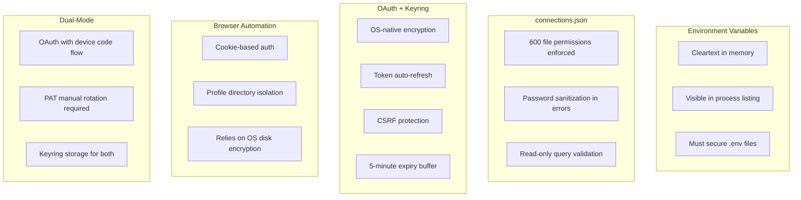

### Credential Exposure Risks

| Pattern | Exposure Vector | Mitigation |
|---------|----------------|------------|
| Environment Variables | Process environment visible to same-user processes | Use restrictive file permissions on `.env` files |
| connections.json | File readable by same-user processes | Enforced `600` permissions, password sanitization |
| OAuth + Keyring | Keyring accessible to user's processes | OS-level keyring access control |
| Browser Profiles | Cookie files accessible to same-user processes | Rely on OS disk encryption |
| CLI OAuth | `~/.jules/credentials` file | Managed by jules CLI (external) |
| PAT | Long-lived tokens without auto-rotation | Users must manually rotate PATs |

### CSRF Protection in OAuth Flows

All OAuth implementations (Google skills, Azure DevOps) use CSRF tokens:

[skills/gmail/scripts/auth.py:203]():
```python
csrf_token = secrets.token_hex(32)  # 64-character hex string
```

The token is:
1. Generated before starting OAuth flow
2. Embedded in OAuth `state` parameter
3. Validated on OAuth callback
4. Flow aborted if mismatch detected

### Token Refresh Security

OAuth-based skills implement automatic token refresh with security considerations:

**Refresh Logic** [skills/gmail/scripts/auth.py:279-287]():
```python
if is_token_expired(token_info) and token_info.refresh_token:
    print("Access token expired, refreshing...", file=sys.stderr)
    new_tokens = refresh_access_token(token_info.refresh_token)
    if new_tokens:
        token_info.access_token = new_tokens.get("access_token")
        token_info.expires_at = new_tokens.get("expiry_date")
        save_stored_tokens(token_info)
```

**Expiry Buffer** [skills/gmail/scripts/auth.py:38]():
```python
TOKEN_EXPIRY_BUFFER_MS = 5 * 60 * 1000  # 5 minutes
# Refresh before expiration to avoid API errors
```

### Database Credential Sanitization

Database skills strip passwords from error messages to prevent logging sensitive data:

**Implementation Pattern:**
```python
try:
    connection = connect(host, user, password, database)
except Exception as e:
    # Sanitize error message
    error_message = str(e).replace(password, "***")
    print(json.dumps({"error": error_message}))
```

### Best Practices by Pattern

**Environment Variables:**
- Use `.env.example` templates without actual secrets
- Add `.env` to `.gitignore`
- Rotate API keys periodically
- Use read-only or scoped API keys when available

**connections.json:**
- Enforce `600` permissions (implemented in database skills)
- Use database-level read-only users
- Separate credentials for dev/staging/prod
- Avoid storing production credentials in project directories

**OAuth + Keyring:**
- No manual credential management required
- Tokens auto-refresh before expiration
- Users can revoke access at Google/Azure account settings
- Each skill uses isolated keyring service

**Browser Automation:**
- Enable OS disk encryption (FileVault, BitLocker, LUKS)
- Use separate Chrome profiles for personal vs. work accounts
- Profiles auto-logout after extended inactivity (Google's policy)

**Personal Access Tokens:**
- Set minimal required scopes
- Configure expiration dates (Azure DevOps supports this)
- Rotate tokens before expiration
- Use separate PATs for different automation contexts

Sources: [skills/gmail/scripts/auth.py:199-328](), [README.md:181-189](), [skills/azure-devops/SKILL.md:30-45]()

---

## Authentication Flow Decision Tree

When implementing or using a skill, the authentication pattern is determined by the external service's API characteristics:

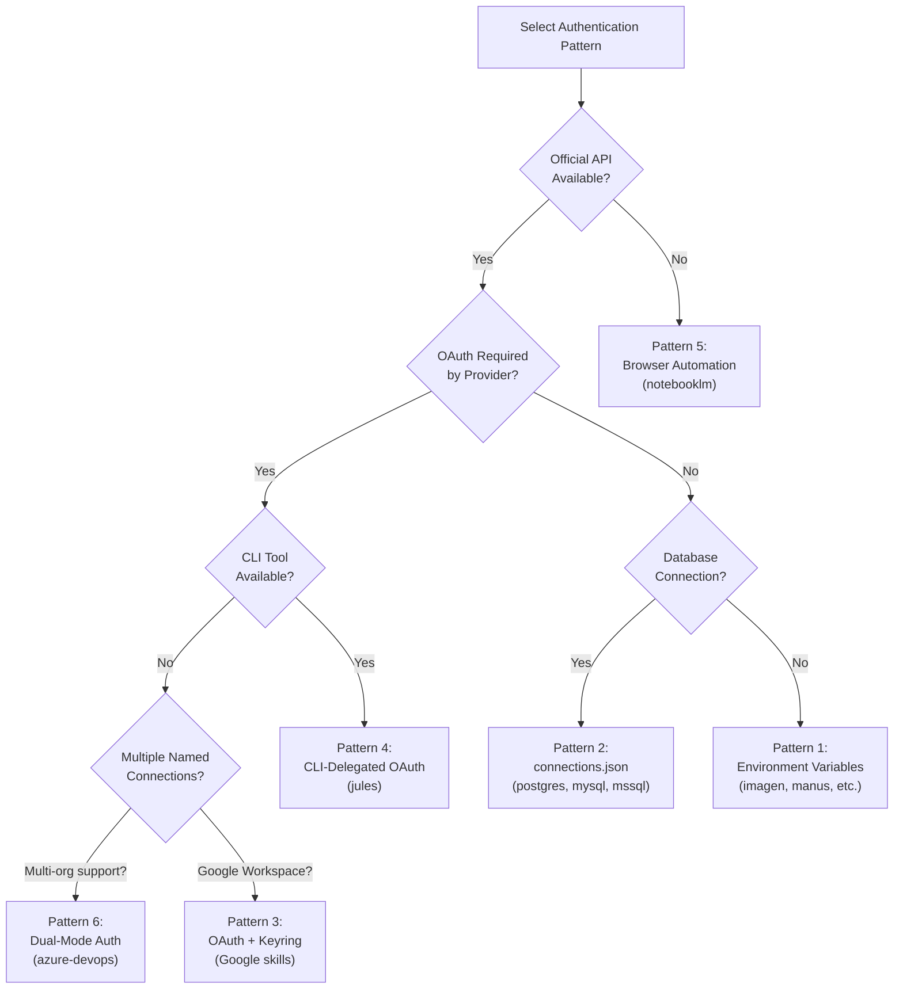

**Pattern Selection Criteria:**

1. **Browser Automation**: Last resort when no official API exists
2. **CLI-Delegated OAuth**: When wrapping existing authenticated CLIs
3. **Dual-Mode Auth**: When supporting both interactive and CI/CD workflows
4. **OAuth + Keyring**: Enterprise services requiring OAuth, especially Google
5. **connections.json**: Database connections with multiple environments
6. **Environment Variables**: Simple API key authentication

Sources: Inferred from skills overview and authentication requirements

---

