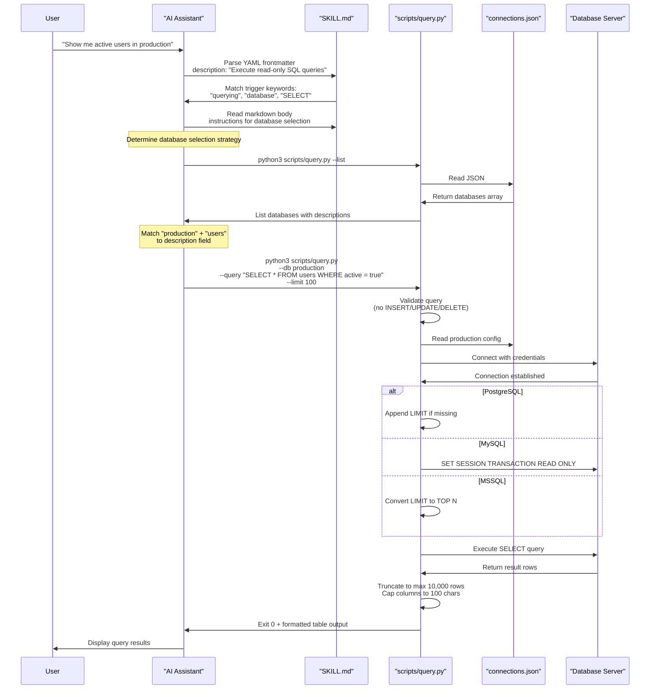
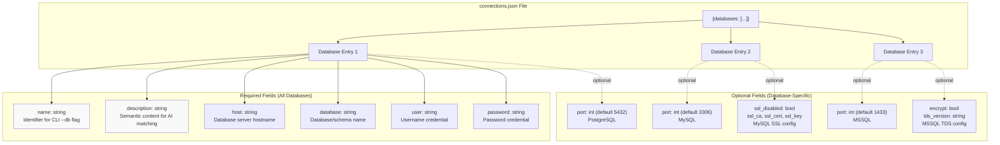
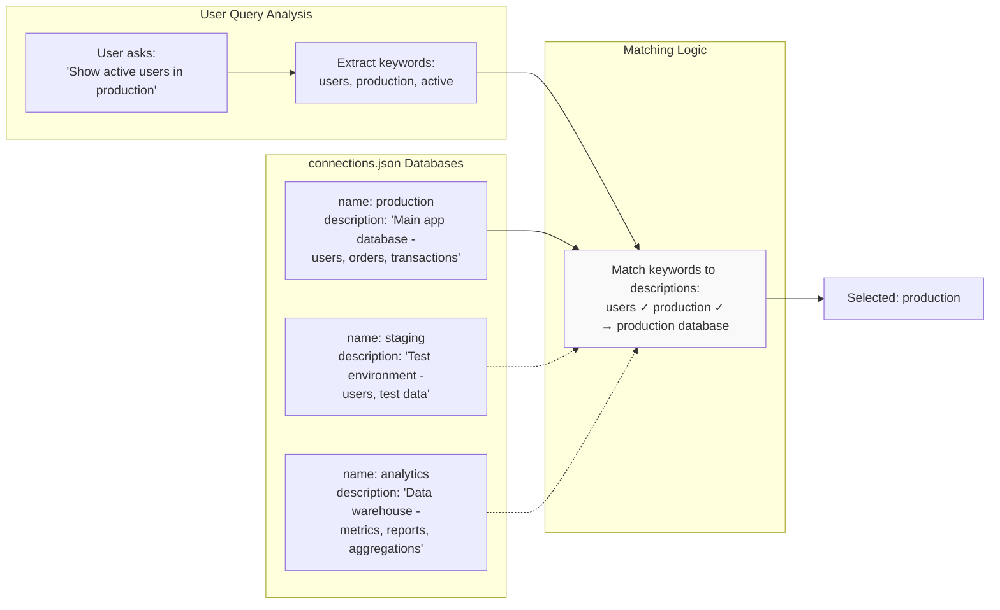
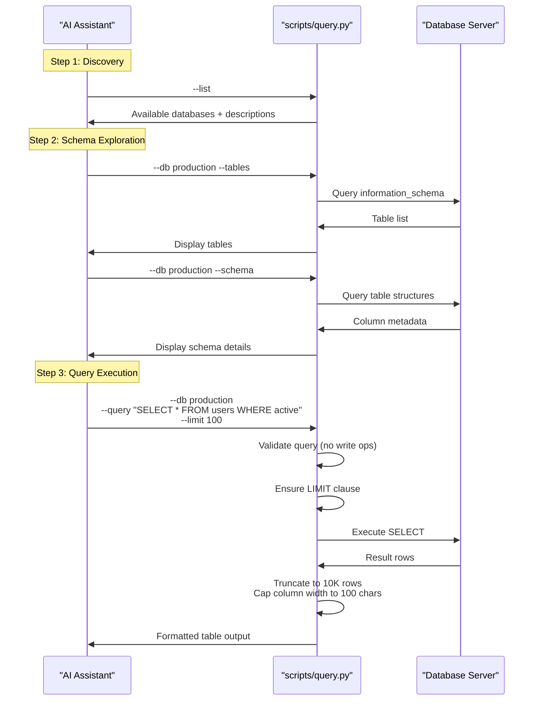

<!-- source: DeepWiki mcp.deepwiki.com · repo sanjay3290/ai-skills · page 4.2 Database Skills · fetched 2026-10-26 -->

# Database Skills

<details>
<summary>Relevant source files</summary>

The following files were used as context for generating this wiki page:

- [skills/mssql/SKILL.md](skills/mssql/SKILL.md)
- [skills/mysql/SKILL.md](skills/mysql/SKILL.md)

</details>


This page provides an overview of the three database skills (PostgreSQL, MySQL, and Microsoft SQL Server) and their shared read-only query pattern with `connections.json` configuration. For detailed documentation on each specific database system, see [PostgreSQL](#4.2.1), [MySQL](#4.2.2), and [Microsoft SQL Server](#4.2.3). For Google Workspace integrations, see [Google Workspace Skills](#5).

## Overview

The database skills provide safe, read-only query execution against configured relational database instances. All three skills follow a common architectural pattern with identical configuration formats and safety features, differing only in their database driver implementations and SQL dialect specifics.

**Common characteristics:**
- Read-only enforcement through query validation and session configuration
- Multiple named database connections via `connections.json`
- Database auto-selection based on semantic description matching
- Uniform command-line interface across all three skills
- Shared safety features: timeouts, row limits, credential sanitization

| Skill | Driver | Default Port | Primary Safety Mechanism |
|-------|--------|--------------|--------------------------|
| `postgres` | `psycopg2-binary` | 5432 | `readonly=True` session mode |
| `mysql` | `mysql-connector-python` | 3306 | `SET SESSION TRANSACTION READ ONLY` |
| `mssql` | `pymssql` | 1433 | Query validation + `TOP N` conversion |

Sources: [skills/postgres/SKILL.md:1-7](), [skills/mysql/SKILL.md:1-7](), [skills/mssql/SKILL.md:1-7]()

## Skill Invocation Flow



**Diagram: Database Skill Execution Flow from User Query to Result Retrieval**

Sources: [skills/postgres/SKILL.md:60-85](), [skills/mysql/SKILL.md:60-86](), [skills/mssql/SKILL.md:60-88]()

## Configuration Architecture

### connections.json Structure

All three database skills use an identical `connections.json` format with database-specific fields. The file can be located in:
1. Skill directory (e.g., `~/.claude/skills/postgres/connections.json`)
2. Centralized location (e.g., `~/.config/claude/postgres-connections.json`)



**Diagram: connections.json Schema with Database-Specific Extensions**

Sources: [skills/postgres/SKILL.md:20-38](), [skills/mysql/SKILL.md:20-60](), [skills/mssql/SKILL.md:20-59]()

### Configuration Fields Reference

| Field | PostgreSQL | MySQL | MSSQL | Description |
|-------|------------|-------|-------|-------------|
| `name` | ✓ Required | ✓ Required | ✓ Required | Case-insensitive identifier for `--db` flag |
| `description` | ✓ Required | ✓ Required | ✓ Required | Semantic description for AI-based database selection |
| `host` | ✓ Required | ✓ Required | ✓ Required | Database server hostname or IP |
| `port` | Optional (5432) | Optional (3306) | Optional (1433) | TCP port number |
| `database` | ✓ Required | ✓ Required | ✓ Required | Target database/schema name |
| `user` | ✓ Required | ✓ Required | ✓ Required | Authentication username |
| `password` | ✓ Required | ✓ Required | ✓ Required | Authentication password |
| `sslmode` | ✓ Optional | ❌ | ❌ | SSL mode: `disable`, `allow`, `prefer`, `require`, `verify-ca`, `verify-full` (PostgreSQL only) |
| `ssl_disabled` | ❌ | ✓ Optional | ❌ | Disable SSL/TLS (MySQL only) |
| `ssl_ca` | ❌ | ✓ Optional | ❌ | CA certificate path (MySQL only) |
| `ssl_cert` | ❌ | ✓ Optional | ❌ | Client certificate path (MySQL only) |
| `ssl_key` | ❌ | ✓ Optional | ❌ | Client private key path (MySQL only) |
| `encrypt` | ❌ | ❌ | ✓ Optional | Enable TLS encryption (MSSQL only) |
| `tds_version` | ❌ | ❌ | ✓ Optional | TDS protocol version: 7.0–7.4 (MSSQL only) |

**File permissions:** Must be set to `600` (owner read/write only) since credentials are stored in plaintext.

Sources: [skills/postgres/SKILL.md:39-57](), [skills/mysql/SKILL.md:45-60](), [skills/mssql/SKILL.md:46-59]()

## Database Selection Strategy

The `description` field in `connections.json` enables AI assistants to automatically select the appropriate database based on user intent. This semantic matching eliminates the need for explicit database specification in most queries.



**Diagram: Semantic Database Selection via Description Field Matching**

### Common Description Patterns

| User Intent Keywords | Recommended Description Content |
|---------------------|--------------------------------|
| users, accounts, customers | users, accounts, customers, authentication |
| orders, sales, transactions | orders, transactions, sales, payments |
| analytics, metrics, reports | analytics, metrics, reports, dashboards, aggregations |
| logs, events, audit | logs, events, audit, monitoring |
| staging, test | test environment, staging, QA |
| production, prod, live | production, main app database, live data |

**Fallback behavior:** If AI cannot determine database from context, it executes `python3 scripts/query.py --list` and prompts user for selection.

Sources: [skills/postgres/SKILL.md:82-91](), [skills/mysql/SKILL.md:88-99](), [skills/mssql/SKILL.md:89-100]()

## Command-Line Interface

All three database skills expose identical CLI commands through `scripts/query.py`:

```bash
# List configured databases with descriptions
python3 scripts/query.py --list

# Execute query against named database
python3 scripts/query.py --db production --query "SELECT * FROM users LIMIT 10"

# List all tables in database
python3 scripts/query.py --db production --tables

# Show full schema (tables, columns, types)
python3 scripts/query.py --db production --schema

# Limit result rows (auto-converts to database-specific syntax)
python3 scripts/query.py --db production --query "SELECT * FROM orders" --limit 100
```

**Exit codes:**
- `0`: Success
- `1`: Error (config missing, authentication failed, invalid query, database error)

Sources: [skills/postgres/SKILL.md:60-85](), [skills/mysql/SKILL.md:62-86](), [skills/mssql/SKILL.md:62-88]()

## Safety Features

```mermaid
graph TB
    subgraph "Defense-in-Depth Layers"
        direction TB
        
        layer1["Layer 1: Query Validation<br/>scripts/query.py parse logic"]
        layer2["Layer 2: Session-Level Protection<br/>Database-specific mechanisms"]
        layer3["Layer 3: Resource Limits<br/>Timeouts and row caps"]
        layer4["Layer 4: Output Sanitization<br/>Credential removal from errors"]
        
        layer1 --> layer2 --> layer3 --> layer4
    end
    
    subgraph "Layer 1: Query Validation"
        allowed["Allowed Operations:<br/>SELECT, SHOW, DESCRIBE,<br/>EXPLAIN, WITH, SP_HELP"]
        blocked["Blocked Operations:<br/>INSERT, UPDATE, DELETE,<br/>DROP, CREATE, ALTER, TRUNCATE,<br/>GRANT, REVOKE"]
        single["Single Statement Enforcement:<br/>Reject semicolon-separated queries"]
    end
    
    subgraph "Layer 2: Database-Specific"
        pg["PostgreSQL:<br/>readonly=True session mode"]
        my["MySQL:<br/>SET SESSION TRANSACTION READ ONLY"]
        ms["MSSQL:<br/>Query validation only<br/>db_datareader role recommended"]
    end
</thinking>
    
    subgraph "Layer 3: Resource Limits"
        timeout_query["Query Timeout: 30 seconds"]
        timeout_login["Login Timeout: 10 seconds"]
        row_limit["Max Rows: 10,000 per query"]
        col_width["Column Width: 100 chars max"]
    end
    
    subgraph "Layer 4: Sanitization"
        no_pwd["Remove passwords from error messages"]
        no_conn["Sanitize connection strings"]
    end
    
    layer1 -.-> allowed & blocked & single
    layer2 -.-> pg & my & ms
    layer3 -.-> timeout_query & timeout_login & row_limit & col_width
    layer4 -.-> no_pwd & no_conn
    
    style pg fill:#f9f9f9
    style my fill:#f9f9f9
```

**Diagram: Defense-in-Depth Security Architecture Across Database Skills**

### Safety Feature Comparison

| Feature | PostgreSQL | MySQL | MSSQL | Implementation |
|---------|------------|-------|-------|----------------|
| Query validation | ✓ | ✓ | ✓ | Allowlist check: `SELECT`, `SHOW`, `EXPLAIN`, `WITH` |
| Single statement | ✓ | ✓ | ✓ | Reject semicolon-separated queries |
| Session read-only | ✓ `readonly=True` | ✓ `SET SESSION TRANSACTION READ ONLY` | ❌ | Driver/server-level read-only mode |
| LIMIT enforcement | ✓ `LIMIT N` | ✓ `LIMIT N` | ✓ `TOP N` | Auto-append or convert syntax |
| Query timeout | ✓ 30s | ✓ 30s | ✓ 30s | Database driver timeout parameter |
| Login timeout | — | — | ✓ 10s | `pymssql` connection timeout |
| Row limit | ✓ 10,000 | ✓ 10,000 | ✓ 10,000 | Python result set truncation |
| Column truncation | ✓ 100 chars | ✓ 100 chars | ✓ 100 chars | String slicing in output formatter |
| Credential sanitization | ✓ | ✓ | ✓ | Exception handler removes passwords |
| TLS/SSL support | ✓ `sslmode` | ✓ `ssl_ca`/`ssl_cert`/`ssl_key` | ✓ `encrypt` | Driver-level encryption |

**Note:** PostgreSQL and MySQL both enforce read-only access at the session/transaction level through the database driver or server. MSSQL relies on query validation alone for client-side enforcement; the `db_datareader` role is recommended as additional server-side protection.

Sources: [skills/postgres/SKILL.md:93-106](), [skills/mysql/SKILL.md:101-111](), [skills/mssql/SKILL.md:103-113]()

## Database-Specific Differences

### SQL Syntax Variations

| Feature | PostgreSQL | MySQL | MSSQL |
|---------|------------|-------|-------|
| Result limiting | `LIMIT N` at end | `LIMIT N` at end | `TOP N` after SELECT |
| Schema inspection | `\d`, `\dt`, `SHOW TABLES` | `SHOW TABLES`, `DESCRIBE` | `SP_HELP`, `SP_COLUMNS` |
| String concatenation | `\|\|` operator | `CONCAT()` function | `+` operator |
| Boolean literals | `TRUE`, `FALSE` | `TRUE`, `FALSE`, `1`, `0` | `1`, `0` (no boolean type) |
| Date functions | `NOW()`, `CURRENT_TIMESTAMP` | `NOW()`, `CURRENT_TIMESTAMP` | `GETDATE()`, `CURRENT_TIMESTAMP` |

**Automatic syntax handling:** The `--limit` flag automatically converts to the correct syntax for each database:
- PostgreSQL/MySQL: Appends `LIMIT N` if missing
- MSSQL: Inserts `TOP N` after `SELECT` keyword

Sources: [skills/postgres/SKILL.md:75-78](), [skills/mysql/SKILL.md:83-86](), [skills/mssql/SKILL.md:83-87]()

### Driver Dependencies

```bash
# PostgreSQL
pip install psycopg2-binary

# MySQL
pip install mysql-connector-python

# Microsoft SQL Server
pip install pymssql
```

Each skill includes a `requirements.txt` file specifying the exact driver version. Install only the drivers for databases you need to query.

Sources: [skills/postgres/SKILL.md:14-16](), [skills/mysql/SKILL.md:14-17](), [skills/mssql/SKILL.md:14-17]()

## Typical Usage Workflow



**Diagram: Standard Three-Step Workflow for Database Exploration and Querying**

1. **Discovery** (`--list`): Show available databases to identify correct target
2. **Schema exploration** (`--tables`, `--schema`): Understand data structure before querying
3. **Query execution** (`--query`, `--limit`): Run SELECT queries with automatic safety enforcement

Sources: [skills/postgres/SKILL.md:117-123](), [skills/mysql/SKILL.md:128-134](), [skills/mssql/SKILL.md:130-136]()

## Troubleshooting Reference

| Error Symptom | PostgreSQL | MySQL | MSSQL | Solution |
|---------------|------------|-------|-------|----------|
| Config not found | ✓ | ✓ | ✓ | Create `connections.json` in skill directory |
| Authentication failed | ✓ | ✓ | ✓ | Verify username/password in config |
| Connection timeout | ✓ | ✓ | ✓ | Check host/port, verify firewall/VPN |
| SSL/TLS error | ❌ | ✓ | ✓ | MySQL: Try `ssl_disabled: true`<br/>MSSQL: Set `encrypt: true` for Azure SQL |
| TDS version error | ❌ | ❌ | ✓ | Try `tds_version: "7.3"` or `"7.4"` |
| Permission warning | ✓ | ✓ | ✓ | Run `chmod 600 connections.json` |
| Query timeout | ✓ | ✓ | ✓ | Optimize query or increase timeout in code |
| max_execution_time | ❌ | ✓ | ❌ | Upgrade to MySQL 5.7.8+ or MariaDB 10.1.1+ |

**Permission warning:** All skills check `connections.json` file permissions and warn if not set to `600`, since credentials are stored in plaintext.

Sources: [skills/postgres/SKILL.md:108-116](), [skills/mysql/SKILL.md:113-122](), [skills/mssql/SKILL.md:115-124]()

## Related Pages

- **4.2.1 PostgreSQL** — `connections.json` fields, `sslmode` options, `psycopg2` `readonly=True` session detail
- **4.2.2 MySQL** — `ssl_ca`/`ssl_cert`/`ssl_key` SSL config, `SET SESSION TRANSACTION READ ONLY` implementation detail
- **4.2.3 Microsoft SQL Server** — `encrypt`/`tds_version` fields, `TOP N` auto-conversion, `pymssql` dependency
- **3.5 Execution & Safety Features** — Full safety mechanism documentation across all skills
- **6.3 Database Connections** — `connections.json` format reference and file permission setup

## Skill Trigger Descriptions

Each database skill uses an identical YAML frontmatter structure in `SKILL.md` with carefully crafted `description` fields to maximize AI assistant matching accuracy:

**PostgreSQL:** [skills/postgres/SKILL.md:1-7]()
```yaml
description: "Execute read-only SQL queries against multiple PostgreSQL databases. Use when: (1) querying PostgreSQL/Postgres databases, (2) exploring database schemas/tables, (3) running SELECT queries for data analysis, (4) checking database contents. Supports multiple database connections with descriptions for intelligent auto-selection. Blocks all write operations (INSERT, UPDATE, DELETE, DROP, etc.) for safety."
```

**MySQL:** [skills/mysql/SKILL.md:1-7]()
```yaml
description: "Execute read-only SQL queries against multiple MySQL databases. Use when: (1) querying MySQL databases, (2) exploring database schemas/tables, (3) running SELECT queries for data analysis, (4) checking database contents. Supports multiple database connections with descriptions for intelligent auto-selection. Blocks all write operations (INSERT, UPDATE, DELETE, DROP, etc.) for safety."
```

**MSSQL:** [skills/mssql/SKILL.md:1-7]()
```yaml
description: "Execute read-only SQL queries against multiple Microsoft SQL Server databases. Use when: (1) querying MSSQL/SQL Server databases, (2) exploring database schemas/tables, (3) running SELECT queries for data analysis, (4) checking database contents. Supports multiple database connections with descriptions for intelligent auto-selection. Blocks all write operations (INSERT, UPDATE, DELETE, DROP, etc.) for safety."
```

These descriptions explicitly list trigger scenarios to help AI assistants determine when to invoke each skill. The parallel structure across all three ensures consistent behavior regardless of which database system is being queried.

Sources: [skills/postgres/SKILL.md:3-3](), [skills/mysql/SKILL.md:3-3](), [skills/mssql/SKILL.md:3-3]()

---

