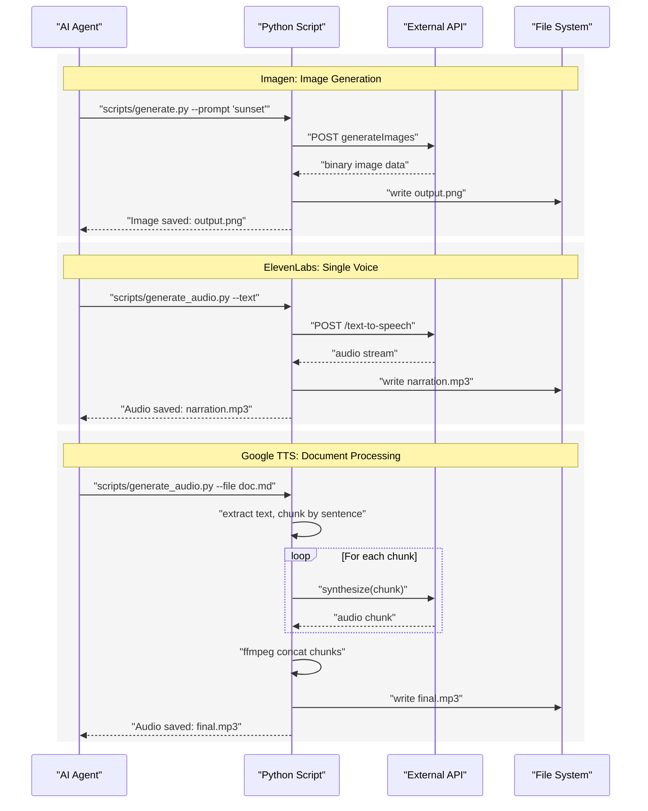
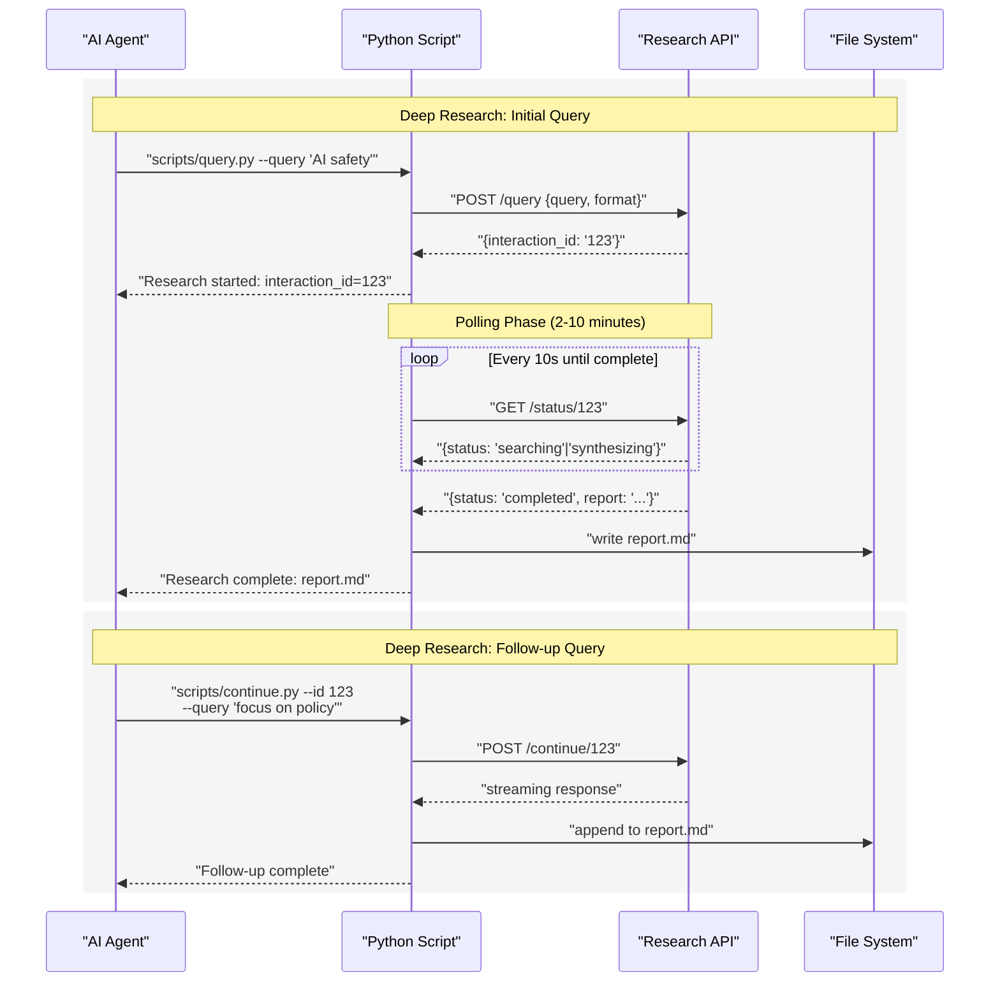
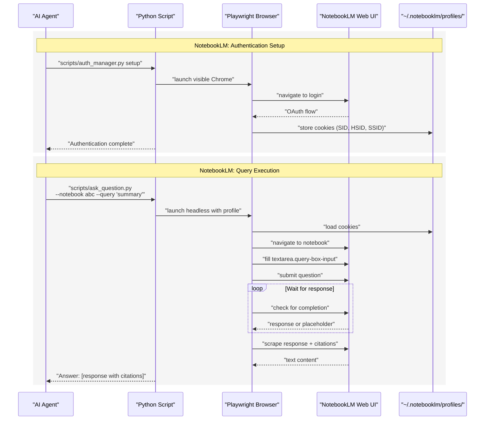
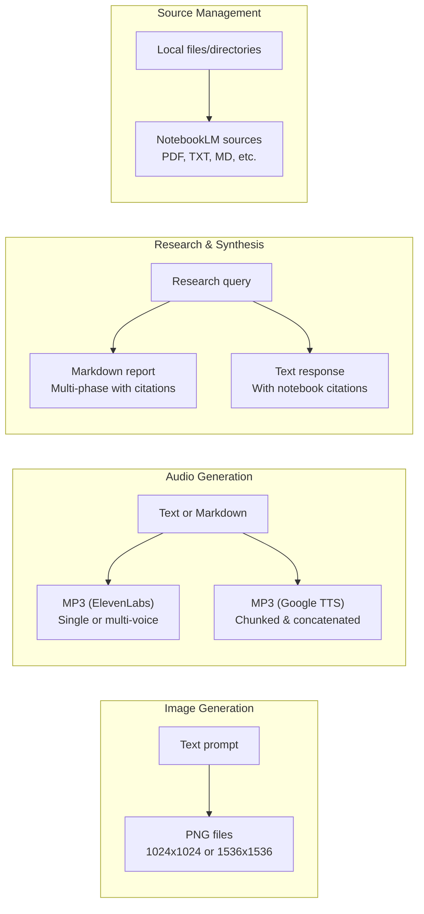

<!-- source: DeepWiki mcp.deepwiki.com · repo sanjay3290/ai-skills · page 4.3 AI & ML Services · fetched 2026-10-26 -->

# AI & ML Services

<details>
<summary>Relevant source files</summary>

The following files were used as context for generating this wiki page:

- [.claude-plugin/marketplace.json](.claude-plugin/marketplace.json)

</details>


This page provides an overview of skills that integrate with AI and machine learning services for content generation, research, and synthesis. These skills enable AI agents to delegate specialized tasks to external AI/ML services, including image generation, text-to-speech, autonomous research, and notebook-based querying.

For skills that delegate long-running coding and research tasks to autonomous agents, see [Agent Delegation](#4.4).

## Purpose and Scope

The AI & ML Services category encompasses five skills that leverage external AI/ML APIs and services:

1. **Imagen** - Text-to-image generation via Google's Gemini Imagen API
2. **Deep Research** - Multi-phase autonomous research using Gemini's research agent
3. **NotebookLM** - Browser-automated queries against Google NotebookLM notebooks
4. **ElevenLabs** - Text-to-speech generation with single-voice and podcast modes
5. **Google Text-to-Speech** - Document-to-audio conversion using Google Cloud TTS

These skills differ from the Agent Delegation category ([#4.4](#4.4)) in that they focus on content generation and synthesis rather than task execution. They also differ from Google Workspace skills ([#5](#5)) in that they target AI/ML services rather than productivity applications.

## Skills Overview

| Skill | API/Service | Primary Use Case | Execution Model | Authentication |
|-------|-------------|------------------|-----------------|----------------|
| **Imagen** | Gemini Imagen API | Generate images from text descriptions | Synchronous | API Key (`GEMINI_API_KEY`) |
| **Deep Research** | Gemini Deep Research | Multi-phase research with citations | Asynchronous (2-10 min) | API Key (`GEMINI_API_KEY`) |
| **NotebookLM** | notebooklm.google.com | Query notebooks, sync sources | Synchronous (browser) | OAuth (Google Workspace) |
| **ElevenLabs** | ElevenLabs TTS API | Generate narration and podcasts | Synchronous | API Key (`ELEVENLABS_API_KEY`) |
| **Google TTS** | Google Cloud TTS | Convert documents to audio | Synchronous | API Key (`GEMINI_API_KEY`) |

**Sources:** [.claude-plugin/marketplace.json:1-39]()

## Architecture Overview

The following diagram maps each skill to its implementation scripts and external service dependencies:

```mermaid
graph TB
    subgraph "imagen skill"
        ImgSkill["skills/imagen/SKILL.md"]
        ImgScript["scripts/generate.py"]
        ImgSkill -->|"executes"| ImgScript
    end
    
    subgraph "deep-research skill"
        DRSkill["skills/deep-research/SKILL.md"]
        DRQuery["scripts/query.py"]
        DRContinue["scripts/continue.py"]
        DRSkill -->|"executes"| DRQuery
        DRSkill -->|"executes"| DRContinue
    end
    
    subgraph "notebooklm skill"
        NBSkill["skills/notebooklm/SKILL.md"]
        AuthMgr["scripts/auth_manager.py"]
        NotebookMgr["scripts/notebook_manager.py"]
        AskQuestion["scripts/ask_question.py"]
        RemoteMgr["scripts/remote_manager.py"]
        NBSkill -->|"executes"| AuthMgr
        NBSkill -->|"executes"| NotebookMgr
        NBSkill -->|"executes"| AskQuestion
        NBSkill -->|"executes"| RemoteMgr
    end
    
    subgraph "elevenlabs skill"
        ELSkill["skills/elevenlabs/SKILL.md"]
        ELGenerate["scripts/generate_audio.py"]
        ELPodcast["scripts/generate_podcast.py"]
        ELSkill -->|"executes"| ELGenerate
        ELSkill -->|"executes"| ELPodcast
    end
    
    subgraph "google-tts skill"
        GTTSSkill["skills/google-tts/SKILL.md"]
        GTTSGenerate["scripts/generate_audio.py"]
        GTTSSkill -->|"executes"| GTTSGenerate
    end
    
    subgraph "External Services"
        ImagenAPI["Gemini Imagen API<br/>generateImages"]
        DRAPI["Deep Research API<br/>/query, /status, /continue"]
        NotebookLMWeb["notebooklm.google.com<br/>Chat Interface"]
        ElevenLabsAPI["ElevenLabs API<br/>/text-to-speech"]
        GoogleTTSAPI["Google Cloud TTS<br/>synthesize"]
    end
    
    subgraph "Storage & State"
        ImgOutput["Output: *.png"]
        DROutput["Output: report.md"]
        NBProfiles["~/.notebooklm/<br/>profiles/"]
        ELOutput["Output: *.mp3"]
        GTTSOutput["Output: *.mp3"]
    end
    
    ImgScript -->|"POST request"| ImagenAPI
    ImagenAPI -->|"binary image"| ImgOutput
    
    DRQuery -->|"POST /query"| DRAPI
    DRContinue -->|"POST /continue"| DRAPI
    DRAPI -->|"polling status"| DROutput
    
    AuthMgr -->|"Playwright"| NotebookLMWeb
    AskQuestion -->|"Playwright"| NotebookLMWeb
    RemoteMgr -->|"Playwright"| NotebookLMWeb
    NotebookLMWeb -->|"cookies/sessions"| NBProfiles
    
    ELGenerate -->|"POST request"| ElevenLabsAPI
    ELPodcast -->|"POST request"| ElevenLabsAPI
    ElevenLabsAPI -->|"audio stream"| ELOutput
    
    GTTSGenerate -->|"synthesize call"| GoogleTTSAPI
    GoogleTTSAPI -->|"audio chunks"| GTTSOutput
```



**Sources:** [.claude-plugin/marketplace.json:15-36]()

## Execution Patterns

AI & ML services follow two distinct execution patterns based on their processing requirements:

### Synchronous Generation Pattern



### Asynchronous Research Pattern



### Browser Automation Pattern



**Sources:** [.claude-plugin/marketplace.json:15-36]()

## Authentication & Configuration

Each skill requires different authentication methods and configuration files:

| Skill | Auth Method | Config File | Environment Variables | Secure Storage |
|-------|-------------|-------------|----------------------|----------------|
| **Imagen** | API Key | None | `GEMINI_API_KEY` | Environment only |
| **Deep Research** | API Key | None | `GEMINI_API_KEY` | Environment only |
| **NotebookLM** | OAuth | `~/.notebooklm/profiles/` | None | System Keyring (cookies) |
| **ElevenLabs** | API Key | `config.json` | `ELEVENLABS_API_KEY` | config.json fallback |
| **Google TTS** | API Key | None | `GEMINI_API_KEY` | Environment only |

### API Key Pattern

Three skills (Imagen, Deep Research, Google TTS) share the same Gemini API key:

```
GEMINI_API_KEY=your_key_here
```

ElevenLabs uses its own dedicated API key:

```
ELEVENLABS_API_KEY=your_key_here
```

Configuration details are covered in [Environment Variables](#6.1) and [API Keys & Secrets](#6.4).

### OAuth Pattern

NotebookLM uniquely uses browser-based OAuth with persistent cookie storage. The authentication state includes critical cookies: `SID`, `HSID`, `SSID`, `APISID`, `SAPISID`, `__Secure-1PSID`, and `__Secure-3PSID`. These are stored in platform-specific secure storage locations:

- **macOS**: Keychain via `security` command
- **Windows**: Credential Locker
- **Linux**: Secret Service (GNOME Keyring/KDE Wallet)

Multiple profiles are supported via the `--profile` flag, enabling separate authentication contexts for different Google accounts.

**Sources:** [.claude-plugin/marketplace.json:15-36]()

## Output Formats

The skills produce different output formats based on their use cases:



**Sources:** [.claude-plugin/marketplace.json:15-36]()

## Common Patterns

### Error Handling

All skills implement consistent error handling patterns:

1. **Validation** - Check required parameters before API calls
2. **Retries** - NotebookLM implements automatic retry with exponential backoff
3. **Artifact Capture** - NotebookLM captures screenshots and HTML on failures
4. **Credential Stripping** - API keys and tokens are sanitized from error messages

### Rate Limiting

Skills respect API rate limits through different strategies:

- **Imagen, Deep Research, Google TTS**: Rely on SDK-level retry logic
- **ElevenLabs**: Implements quota error detection with actionable messages
- **NotebookLM**: Uses timing delays and stability checks to avoid overwhelming the web interface

### Progress Reporting

Skills with long-running operations provide progress updates:

- **Deep Research**: Reports multi-phase status (planning, searching, reading, synthesizing)
- **Google TTS**: Reports chunk processing progress (e.g., "Processing chunk 3/15")
- **NotebookLM**: Reports batch processing progress in multi-notebook queries

**Sources:** [.claude-plugin/marketplace.json:15-36]()

## Skill-Specific Features

### Multi-Modal Capabilities

| Feature | Skills | Description |
|---------|--------|-------------|
| **Text → Image** | Imagen | Generate images with size control and aspect ratio options |
| **Text → Audio** | ElevenLabs, Google TTS | Single-voice narration with voice selection |
| **Text → Podcast** | ElevenLabs | Two-host conversational format with distinct voices |
| **Document → Audio** | Google TTS | Extract text from MD/DOCX/PDF, chunk, and synthesize |

### Advanced Research Features

| Feature | Skills | Description |
|---------|--------|-------------|
| **Multi-Phase Research** | Deep Research | Planning → Searching → Reading → Synthesizing workflow |
| **Citations** | Deep Research, NotebookLM | Source attribution in responses |
| **Follow-up Queries** | Deep Research | Context-aware continuation with `--continue` flag |
| **Multi-Notebook Queries** | NotebookLM | Parallel querying with comparative analysis |
| **Batch Processing** | NotebookLM | Process multiple questions sequentially |

### Source Management

NotebookLM uniquely supports source file management:

- **Upload**: Add files/directories to notebooks with filtering by extension, size, and patterns
- **Sync**: Hash-based deduplication to skip unchanged files
- **Remote Operations**: Manage sources without local notebook references

**Sources:** [.claude-plugin/marketplace.json:15-36]()

## Comparison with Related Categories

### AI & ML Services vs Agent Delegation

While both categories involve AI agents, they serve different purposes:

| Aspect | AI & ML Services (4.3) | Agent Delegation (4.4) |
|--------|------------------------|------------------------|
| **Primary Function** | Content generation, synthesis | Task execution, automation |
| **Skills** | Imagen, Deep Research, NotebookLM, ElevenLabs, Google TTS | Jules, Manus |
| **Typical Duration** | Seconds to 10 minutes | Minutes to hours |
| **Output Type** | Files (images, audio, reports) | Code changes, PRs, research reports |
| **Interaction Model** | Request → Response | Session management with polling |

For details on Jules and Manus, see [Agent Delegation](#4.4).

### AI & ML Services vs Google Workspace

Both categories integrate with Google services, but target different domains:

| Aspect | AI & ML Services (4.3) | Google Workspace (5) |
|--------|------------------------|---------------------|
| **Service Type** | AI/ML APIs and platforms | Productivity applications |
| **Google Skills** | Deep Research, NotebookLM, Google TTS | Gmail, Calendar, Chat, Docs, Drive, Sheets, Slides |
| **Account Requirement** | Personal or Workspace | Workspace-only for most skills |
| **Primary Use Cases** | Content generation, research | Communication, collaboration, document management |

For details on Google Workspace skills, see [Google Workspace Skills](#5).

**Sources:** [.claude-plugin/marketplace.json:15-36]()

## Next Steps

For detailed documentation on individual skills, see the following pages:

- [Imagen (Image Generation)](#4.3.1) - Text-to-image generation with Gemini Imagen
- [Deep Research](#4.3.2) - Multi-phase autonomous research with Gemini
- [NotebookLM](#4.3.3) - Browser-automated queries and source management
- [ElevenLabs (Text-to-Speech)](#4.3.4) - Professional narration and podcast generation
- [Google Text-to-Speech](#4.3.5) - Document-to-audio conversion with chunking

For configuration instructions, see:
- [Environment Variables](#6.1) - Setting up API keys
- [OAuth & Keyring Setup](#6.2) - Configuring NotebookLM authentication
- [API Keys & Secrets](#6.4) - Best practices for credential management

---

